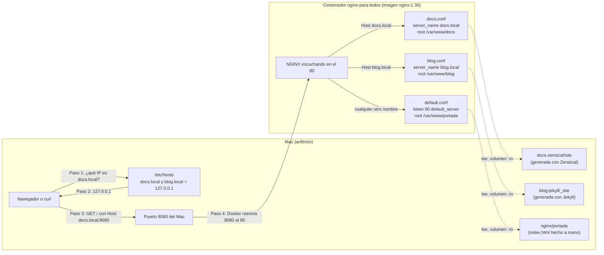
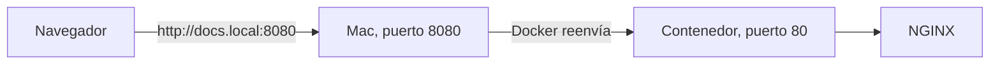
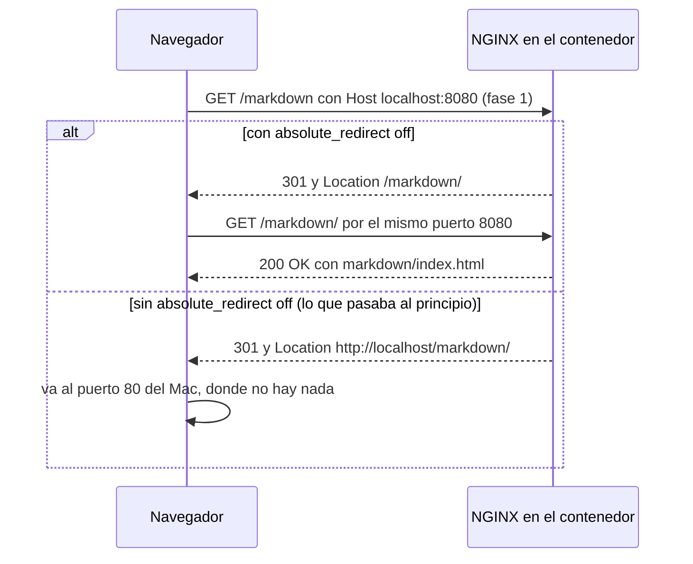
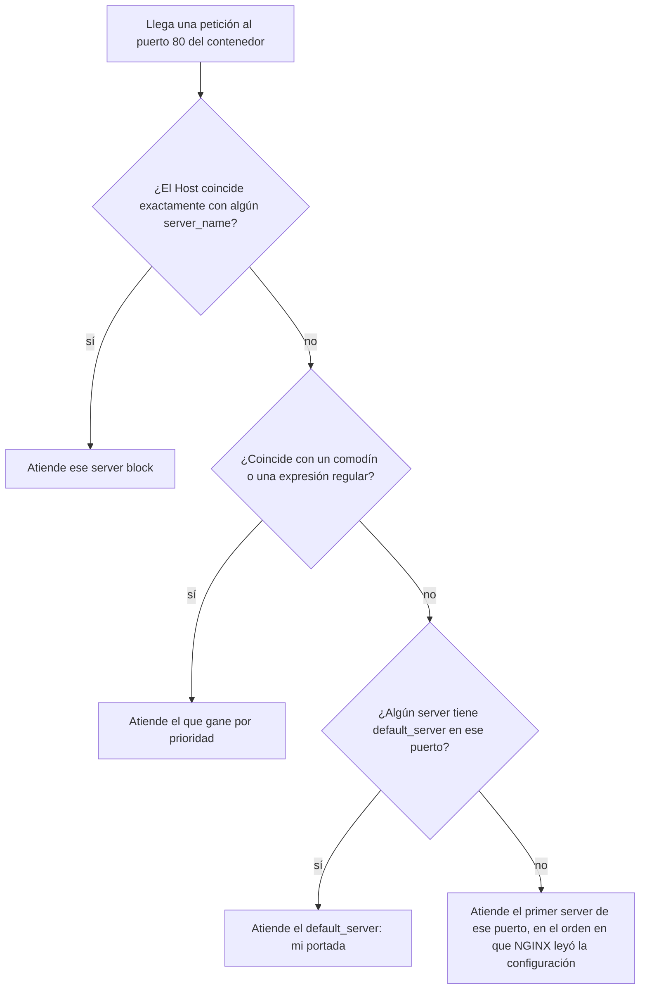
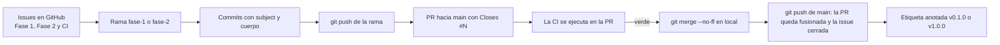

# Práctica NGINX: entenderla y defenderla

Guía para entender de verdad la práctica "NGINX para todos y todos para NGINX" y poder explicarla y defenderla delante del profesor. La primera vez conviene leerla en orden. Después, para repasar, basta con la chuleta, la demostración y el banco de preguntas.

- Repositorio de la práctica: https://github.com/diegoalegil/nginx-para-todos (en local está en la carpeta `nginx-para-todos/` de este mismo directorio).
- Apuntes relacionados: [01-repo-gitanddocs.md](01-repo-gitanddocs.md), [02-git-github.md](02-git-github.md), [03-uv-zensical.md](03-uv-zensical.md) y [asignatura.md](../../general/asignatura.md).

## Índice

- [1. El proyecto en 5 líneas](#1-el-proyecto-en-5-líneas)
- [2. Las piezas explicadas desde cero](#2-las-piezas-explicadas-desde-cero)
  - [2.1 Conceptos básicos antes de empezar](#21-conceptos-básicos-antes-de-empezar)
  - [2.2 Docker y Docker Compose](#22-docker-y-docker-compose)
  - [2.3 Zensical y uv: la documentación](#23-zensical-y-uv-la-documentación)
  - [2.4 Jekyll: el blog](#24-jekyll-el-blog)
  - [2.5 NGINX línea a línea](#25-nginx-línea-a-línea)
  - [2.6 Virtual hosts, cabecera Host y archivo hosts](#26-virtual-hosts-cabecera-host-y-archivo-hosts)
- [3. Cómo elige NGINX el server block](#3-cómo-elige-nginx-el-server-block)
- [4. El flujo de git](#4-el-flujo-de-git)
- [5. La CI con GitHub Actions](#5-la-ci-con-github-actions)
- [6. Problemas que tuve y cómo los resolví](#6-problemas-que-tuve-y-cómo-los-resolví)
- [7. Chuleta de comandos](#7-chuleta-de-comandos)
- [8. Demostración en 5 minutos](#8-demostración-en-5-minutos)
- [9. Banco de preguntas](#9-banco-de-preguntas)
- [10. Qué temario del examen repasas con la práctica](#10-qué-temario-del-examen-repasas-con-la-práctica)

## 1. El proyecto en 5 líneas

1. Un único servidor web NGINX, metido en un contenedor de Docker, sirve dos webs estáticas a través del puerto 8080 del Mac.
2. Fase 1: la documentación del repo de clase `monium/gitanddocs`, convertida de Markdown a HTML con Zensical.
3. Fase 2: un blog personal sobre el Barça ("Mi temporada culé"), hecho con Jekyll y generado dentro de un contenedor de Ruby.
4. NGINX decide qué web enseñar mirando el nombre que llega en la cabecera `Host` (`docs.local` o `blog.local`). Si el nombre no es ninguno de los dos, enseña una portada con enlaces.
5. Todo está versionado con git (issues, ramas, PR, etiquetas), documentado en el README y comprobado automáticamente con GitHub Actions.

### La práctica como un restaurante

Antes del diagrama, una analogía que ayuda a ubicar cada pieza:

| Pieza | En el restaurante |
|---|---|
| Las webs (HTML, CSS, imágenes) | Los platos ya cocinados |
| Zensical y Jekyll | Las cocinas que preparan los platos a partir de recetas escritas en Markdown |
| NGINX | El camarero: recibe los pedidos y entrega el plato correcto |
| Docker | Una caja cerrada donde vive el camarero con todo lo que necesita |
| Puerto 8080 | La puerta por la que entran los pedidos |
| Cabecera `Host` | El nombre del restaurante escrito en el pedido. Hay dos restaurantes que comparten puerta y camarero, y el camarero lee ese nombre para saber de qué cocina sacar el plato |
| `/etc/hosts` | La agenda del Mac que dice en qué dirección está cada restaurante |

### Arquitectura completa



Cómo se lee: el navegador pregunta al Mac qué IP tiene `docs.local` y el archivo `/etc/hosts` contesta que es el propio Mac (`127.0.0.1`). El navegador llama a ese Mac por el puerto 8080. Docker pasa la llamada al puerto 80 del contenedor, donde escucha NGINX. NGINX mira la cabecera `Host` y elige uno de sus tres bloques `server`. Cada bloque lee los archivos de una carpeta del Mac que está compartida con el contenedor en modo solo lectura.

Fuentes: [README de la práctica](https://github.com/diegoalegil/nginx-para-todos), [Servidor web nginx (curso)](https://dpl-f1facc.gitlab.io/ut02/teoria/servidor-web-nginx/).

## 2. Las piezas explicadas desde cero

### 2.1 Conceptos básicos antes de empezar

**Servidor web.** Programa que se queda esperando peticiones y contesta con archivos. NGINX es un servidor web. Apache es otro.

**Web estática.** Una web formada solo por archivos ya hechos (HTML, CSS, JavaScript, imágenes). El servidor no ejecuta nada, solo entrega los archivos tal cual. Las dos webs de la práctica son estáticas: no hay base de datos ni código que se ejecute en el servidor. Por eso basta con NGINX y no hace falta un **servidor de aplicaciones** (el programa que ejecuta el código de una web dinámica, como Gunicorn para Python o PHP-FPM para PHP).

**HTTP.** El idioma con el que hablan el navegador y el servidor. Funciona por turnos: el navegador hace una **petición** y el servidor da una **respuesta**.

- La petición lleva un **método** (`GET` para pedir una página, `HEAD` para pedir solo las cabeceras), una **ruta** (`/markdown/`) y unas **cabeceras**.
- La respuesta lleva un **código de estado**, sus cabeceras y, normalmente, un **cuerpo** (el HTML).

**Cabecera.** Una línea `Nombre: valor` que acompaña a la petición o a la respuesta. Las tres que más salen en la práctica:

| Cabecera | Va en | Para qué |
|---|---|---|
| `Host` | Petición | Dice a qué nombre de web va dirigida (`Host: docs.local:8080`) |
| `Location` | Respuesta | En una redirección, dice adónde tiene que ir el navegador |
| `Content-Type` | Respuesta | Dice qué tipo de contenido es (`text/html`) |

**Códigos de estado que salen en la práctica:**

| Código | Significado | Dónde lo ves |
|---|---|---|
| 200 OK | Todo bien, aquí tienes el archivo | `curl -I http://docs.local:8080/` |
| 301 Moved Permanently | Está en otra dirección, ve a la de `Location` | Pedir `/markdown` sin barra final |
| 403 Forbidden | Existe, pero no te lo enseño | Pedir una carpeta sin `index.html` |
| 404 Not Found | No existe | `/esto-no-existe` |

**IP, localhost y loopback.** Una IP es la dirección de una máquina en la red. `127.0.0.1` (IPv4) y `::1` (IPv6) son direcciones especiales que siempre significan "esta misma máquina" (se llama *loopback*). `localhost` es el nombre de esas direcciones.

**Puerto.** Una máquina tiene muchas "puertas" numeradas para que varios programas puedan recibir conexiones a la vez. HTTP usa por defecto la 80. Si una URL `http://` no lleva puerto, el navegador usa el 80.

**Partes de una URL**, con `http://docs.local:8080/markdown/` como ejemplo:

| Parte | Valor | Qué es |
|---|---|---|
| Esquema (protocolo) | `http` | El idioma (HTTP sin cifrar) |
| Nombre | `docs.local` | A qué máquina y a qué web. Viaja en la cabecera `Host` |
| Puerto | `8080` | Por qué puerta entrar |
| Ruta | `/markdown/` | Qué recurso se pide dentro de esa web |

Así se ve, resumida, una petición real y su respuesta (con `curl -v` se ve entera):

```text
GET /markdown/ HTTP/1.1
Host: docs.local:8080
User-Agent: curl/8.7.1

HTTP/1.1 200 OK
Server: nginx/1.30.6
Content-Type: text/html
```

**Cuidado con la palabra "host", que sale tres veces con significados distintos:**

- **Anfitrión** (*host* en inglés): la máquina real donde corre Docker. Aquí, el Mac.
- **Cabecera `Host`**: el nombre de la web que va dentro de cada petición HTTP.
- **Archivo `/etc/hosts`**: la "agenda" del sistema que traduce nombres a IP sin preguntar a ningún DNS.

Fuentes: [HTTP y HTTPS (curso)](https://dpl-f1facc.gitlab.io/ut02/teoria/http-https/), [Cabecera Host (MDN)](https://developer.mozilla.org/en-US/docs/Web/HTTP/Reference/Headers/Host), [Código 301 (MDN)](https://developer.mozilla.org/en-US/docs/Web/HTTP/Reference/Status/301).

### 2.2 Docker y Docker Compose

**Qué problema resuelve.** Si instalas NGINX en tu ordenador, depende de tu sistema, de tu versión y de lo que ya tengas instalado. Docker mete el programa en una caja con todo lo que necesita, y esa caja funciona igual en mi Mac, en el ordenador del profesor y en GitHub Actions.

**Imagen y contenedor.** La forma más fácil de recordarlo es pensar en Java:

- **Imagen** = la **clase**. Es una plantilla de solo lectura. `nginx:1.30` trae un Linux mínimo (Debian), NGINX ya instalado y una configuración por defecto.
- **Contenedor** = el **objeto**. Es una imagen en marcha, con sus procesos, su red y su propia capa de archivos encima. De una imagen se pueden crear muchos contenedores.

**Docker Desktop en el Mac.** Los contenedores comparten el núcleo (*kernel*, la parte central del sistema operativo) de la máquina donde corren, y los de este proyecto necesitan un núcleo Linux. macOS no lo tiene. En el Mac, Docker Desktop arranca por debajo una pequeña máquina virtual Linux y los contenedores viven dentro de ella. Por eso hay que abrir Docker Desktop antes de usar `docker`.

**Docker Compose.** En vez de escribir comandos `docker run` larguísimos, describo los contenedores en un archivo, `compose.yaml`, y los manejo con `docker compose ...`. El archivo está en **YAML**, un formato de texto para configuración que se escribe con líneas `clave: valor` y en el que las sangrías (los espacios del principio) indican qué va dentro de qué. Cada contenedor descrito ahí se llama **servicio**. Mi proyecto tiene dos: `nginx` (el servidor, que se queda encendido) y `jekyll` (una herramienta que se usa y se apaga).

El `compose.yaml` completo:

```yaml
services:
  nginx:
    image: nginx:1.30
    container_name: nginx-para-todos
    ports:
      - "8080:80"
    volumes:
      # mi configuración sustituye a la que trae la imagen
      - ./nginx/conf.d:/etc/nginx/conf.d:ro
      # la web que genera zensical
      - ./docs-zensical/site:/var/www/docs:ro
      # el blog que genera jekyll
      - ./blog-jekyll/_site:/var/www/blog:ro
      # la portada del servidor por defecto
      - ./nginx/portada:/var/www/portada:ro

  # solo para crear y generar el blog, no se queda encendido
  jekyll:
    image: ruby:3.4
    working_dir: /srv/jekyll
    volumes:
      - ./blog-jekyll:/srv/jekyll
      # las gemas se guardan aquí para no descargarlas cada vez
      - gemas:/usr/local/bundle
    environment:
      JEKYLL_ENV: production
    command: sh -c "bundle install && bundle exec jekyll build"
    profiles: ["herramientas"]

volumes:
  gemas:
```

Línea a línea:

| Línea | Qué hace | Por qué la puse |
|---|---|---|
| `services:` | Empieza la lista de servicios (contenedores) | Es obligatoria en Compose |
| `nginx:` | Nombre del servicio | Es el nombre que uso en `docker compose exec nginx ...` |
| `image: nginx:1.30` | Imagen oficial de NGINX, rama estable 1.30 | Imagen oficial y versión fijada para que no cambie de rama sola (ver la pregunta sobre `latest` en el banco) |
| `container_name: nginx-para-todos` | Nombre fijo del contenedor | Sin esto se llamaría `nginx-para-todos-nginx-1` |
| `ports: "8080:80"` | Une el puerto 8080 del Mac con el 80 del contenedor | El formato es `puerto_del_Mac:puerto_del_contenedor` |
| `./nginx/conf.d:/etc/nginx/conf.d:ro` | Comparte mi carpeta de configuración con el contenedor | Tapa la carpeta `conf.d` de la imagen, así que su `default.conf` (la página "Welcome to nginx!") deja de existir y solo cuentan mis tres archivos |
| `./docs-zensical/site:/var/www/docs:ro` | Comparte la web de Zensical | `docs.conf` la sirve con `root /var/www/docs` |
| `./blog-jekyll/_site:/var/www/blog:ro` | Comparte el blog generado | `blog.conf` lo sirve con `root /var/www/blog` |
| `./nginx/portada:/var/www/portada:ro` | Comparte la portada | `default.conf` la sirve |
| `image: ruby:3.4` | Imagen oficial de Ruby | Jekyll está hecho en Ruby y así no instalo Ruby en el Mac |
| `working_dir: /srv/jekyll` | Carpeta donde se ejecutan los comandos dentro del contenedor | Es donde está montado el blog |
| `./blog-jekyll:/srv/jekyll` | Comparte la carpeta del blog, sin `:ro` | Aquí Jekyll sí tiene que escribir (crea `_site/`) |
| `gemas:/usr/local/bundle` | Volumen con nombre donde se guardan las gemas | `/usr/local/bundle` es la carpeta de gemas de la imagen `ruby` (su `GEM_HOME`) |
| `JEKYLL_ENV: production` | Variable de entorno | Jekyll genera el blog en modo producción, el modo de la versión final |
| `command:` | Comando por defecto al lanzar el servicio | Instala las gemas y genera el blog |
| `profiles: ["herramientas"]` | Mete el servicio en un perfil | `docker compose up` no lo arranca. Solo funciona cuando lo llamo por su nombre |
| `volumes: gemas:` | Declara el volumen con nombre | Docker lo crea la primera vez (se llamará `nginx-para-todos_gemas`) |

**Puertos, `8080:80`.** Dentro del contenedor NGINX escucha en el 80, el puerto normal de HTTP. Fuera, en el Mac, publico el 8080. Docker hace de puente: lo que llega al 8080 del Mac lo entrega en el 80 del contenedor.



**Volúmenes.** Un volumen es una forma de que el contenedor use archivos que no están dentro de la imagen. Hay dos tipos y uso los dos:

- **Montaje de carpeta** (*bind mount*): una carpeta del Mac aparece dentro del contenedor, como una ventana. Si cambio un archivo en el Mac, el contenedor lo ve al momento. Son los que empiezan por `./`.
- **Volumen con nombre**: un espacio que guarda y gestiona Docker, fuera de mi proyecto. Es `gemas`.

**Qué significa `:ro`.** *Read only*, solo lectura. NGINX solo necesita leer la configuración y las webs, así que no le dejo escribir. Es el principio de **mínimo privilegio**: si alguien atacara NGINX, no podría modificar mi web ni mi configuración, y el contenedor tampoco puede estropear por error mis archivos del Mac.

**Por qué no instalé NGINX (ni Ruby) en el Mac:**

1. Es norma del curso: el software de servidor va dentro de contenedores, nunca en el anfitrión.
2. Es reproducible: la misma versión en mi Mac, en el del profesor y en la CI.
3. No ensucia el Mac. Al terminar, `docker compose down` lo quita todo.
4. Para Jekyll, además, el Ruby que trae el Mac es el del sistema y es antiguo (2.6). Con `ruby:3.4` tengo uno moderno sin tocar nada.

uv y Zensical sí están en el Mac porque no son servidores: solo generan archivos, igual que en el repo de clase gitanddocs.

**Comandos de Compose que usé:**

| Comando | Qué hace |
|---|---|
| `docker compose up -d` | Crea y arranca los servicios (menos los que tienen perfil) en segundo plano (`-d`, *detached*). Si cambié `compose.yaml`, recrea el contenedor |
| `docker compose ps` | Lista los contenedores del proyecto, su estado y sus puertos |
| `docker compose exec nginx <comando>` | Ejecuta un comando dentro del contenedor `nginx` que ya está en marcha |
| `docker compose run --rm jekyll` | Crea un contenedor temporal del servicio `jekyll`, ejecuta su `command` y lo borra al terminar (`--rm`) |
| `docker compose run --rm jekyll sh -c "..."` | Igual, pero ejecuta mi comando en vez del `command` del archivo |
| `docker compose logs nginx` | Enseña lo que el contenedor escribe por su **salida estándar** (lo que un programa escribiría en la terminal si lo lanzaras a mano) |
| `docker compose down` | Para y borra los contenedores y la red del proyecto. El volumen `gemas` se queda (solo se borra con `-v`) |

Fuentes: [Prepara tu entorno Docker (curso)](https://dpl-f1facc.gitlab.io/ut01/practicas/guiada-03-prepara-entorno-docker/), [Entorno de trabajo (curso)](https://dpl-f1facc.gitlab.io/introduccion/entorno/), [Compose: servicios](https://docs.docker.com/reference/compose-file/services/), [Compose: perfiles](https://docs.docker.com/compose/how-tos/profiles/), [Bind mounts](https://docs.docker.com/engine/storage/bind-mounts/), [Volúmenes](https://docs.docker.com/engine/storage/volumes/), [docker compose run](https://docs.docker.com/reference/cli/docker/compose/run/).

### 2.3 Zensical y uv: la documentación

**Zensical** es un generador de webs estáticas: lee archivos **Markdown** (`.md`, texto normal con marcas sencillas, como `#` para un título o `**` para la negrita) de la carpeta `docs/` y fabrica una web completa en HTML, con menú, buscador y modo oscuro, dentro de la carpeta `site/`. La configuración está en `zensical.toml`. **TOML** es otro formato de texto para configuración, parecido a YAML, pero con líneas `clave = valor` y secciones entre corchetes (`[project]`). Lo básico de Zensical ya está en [03-uv-zensical.md](03-uv-zensical.md).

**uv** es el gestor de Python que instala Python y las librerías del proyecto en un entorno virtual propio (`.venv/`), separado del resto del sistema. Lee tres archivos:

| Archivo | Qué guarda |
|---|---|
| `pyproject.toml` | Qué necesita el proyecto: Python 3.14 o superior y Zensical en el grupo de desarrollo `dev` |
| `uv.lock` | Las versiones exactas de todo lo instalado (Zensical 0.0.65, Jinja2, Markdown...) |
| `.python-version` | La versión de Python del proyecto (3.14) |

**Cómo copié la documentación.** Con `git archive` exporté los archivos de gitanddocs en el commit `3e7a2df`, sin su carpeta `.git`, y borré su `.github` (más detalle en [el flujo de git](#4-el-flujo-de-git)).

**Los dos comandos que generan la web** (siempre dentro de `docs-zensical/`):

```bash
uv sync --locked
uv run zensical build
```

- `uv sync --locked` busca un Python 3.14 (si no lo encuentra, lo descarga; en mi Mac usó el que ya había instalado con Homebrew), crea `.venv/` e instala exactamente lo que dice `uv.lock`. Con `--locked`, si `uv.lock` no cuadra con `pyproject.toml`, uv falla en vez de actualizarlo por su cuenta. Así me aseguro de que en mi Mac y en la CI se usan las mismas versiones. Por defecto `uv sync` también instala el grupo `dev`, que es donde está Zensical.
- `uv run zensical build` ejecuta Zensical dentro de ese entorno y genera `site/`. uv busca el proyecto (`pyproject.toml`) en la carpeta actual y en las de arriba, nunca en las de dentro. Por eso hay que estar en `docs-zensical/` (ver el problema `Failed to spawn`).

Lo que sale en `site/`:

```text
site/
├── 404.html            página de error con el diseño de la web
├── assets/             CSS, JavaScript e imágenes
├── index.html          portada de la documentación
├── markdown/index.html cada página es una carpeta con su index.html
├── get-site/  gitea/  tema-visual/  trabajando-con-git/
├── search.json         índice del buscador
└── sitemap.xml         lista de páginas para los buscadores
```

Fíjate en que cada página es **una carpeta con un `index.html` dentro**. Por eso la dirección de una página es `/markdown/`, con barra final. Esto es importante para entender el [problema de la redirección](#6-problemas-que-tuve-y-cómo-los-resolví).

**El `site_url`.** Es la dirección pública donde va a vivir la web. Zensical la usa para el enlace canónico de cada página (una etiqueta en el `<head>` que dice "esta es la dirección oficial de esta página") y para `sitemap.xml`. Venía con `https://www.example.com/`. La cambié dos veces:

| Fase | `site_url` | Por qué |
|---|---|---|
| Fase 1 | `http://localhost:8080/` | La documentación era la única web y se veía en localhost |
| Fase 2 | `http://docs.local:8080/` | La documentación pasa a tener su propio nombre |

Se comprueba buscando el enlace canónico en la web generada. En la fase 1 salía esto:

```text
$ grep -o 'rel="canonical"[^>]*' docs-zensical/site/index.html
rel="canonical" href="http://localhost:8080/"
```

Y con la web generada en la fase 2, que es la que está ahora en la carpeta:

```text
$ grep -o 'rel="canonical"[^>]*' docs-zensical/site/index.html
rel="canonical" href="http://docs.local:8080/"
```

El `sitemap.xml` también usa esa dirección en cada `<loc>` (`http://docs.local:8080/markdown/`, etc.). Si cambio el `site_url` hay que volver a generar la web, porque se escribe dentro del HTML al generarla.

**Por qué `site/` no se sube a git.** Es el resultado de generar, como los `.class` de Java: se vuelve a crear con un comando y cambiaría en cada build, ensuciando el historial. Está en el `.gitignore`.

Fuentes: [Documentación y herramientas colaborativas (curso)](https://dpl-f1facc.gitlab.io/ut01/teoria/documentacion/), [Zensical: configuración básica](https://zensical.org/docs/setup/basics/), [uv: referencia de comandos](https://docs.astral.sh/uv/reference/cli/).

### 2.4 Jekyll: el blog

**Jekyll** es otro generador de webs estáticas, más antiguo y orientado a blogs. Está hecho en **Ruby**. En Ruby, las librerías se llaman **gemas**. **Bundler** es la herramienta que instala las gemas que pide el proyecto:

| Archivo | Qué guarda |
|---|---|
| `Gemfile` | Qué gemas necesita el blog: `jekyll ~> 4.4.1`, el tema `minima ~> 2.5` y el plugin `jekyll-feed` |
| `Gemfile.lock` | Las versiones exactas instaladas (equivale a `uv.lock`) |

**Cómo lo creé.** Todo dentro del contenedor `ruby:3.4`:

```bash
mkdir blog-jekyll
docker compose run --rm jekyll sh -c "gem install jekyll -v 4.4.1 && jekyll new . --force"
docker compose run --rm jekyll
```

- `gem install jekyll -v 4.4.1` instala Jekyll en el contenedor (en el volumen `gemas`).
- `jekyll new . --force` crea un blog de ejemplo en la carpeta actual (`.` significa "aquí", que dentro del contenedor es `/srv/jekyll`, o sea, mi `blog-jekyll/`). `--force` obliga a crearlo aunque la carpeta ya exista y tenga archivos (los machacaría). Jekyll solo se queja si la carpeta **no está vacía**; la mía estaba recién creada y vacía, así que no era imprescindible, pero no hace daño. Por defecto usa el tema **minima**.
- `docker compose run --rm jekyll` ejecuta el `command` del servicio: `bundle install` (instala las gemas del `Gemfile.lock`) y `bundle exec jekyll build` (genera el blog en `_site/` usando exactamente esas versiones).

**`_config.yml`**, la configuración del blog:

```yaml
title: Mi temporada culé
description: >-
  Blog personal donde cuento cómo estoy viviendo la temporada 2026-2027 del Barça.
lang: es
baseurl: ""
url: "http://blog.local:8080"
github_username: diegoalegil

minima:
  date_format: "%d/%m/%Y"

theme: minima
plugins:
  - jekyll-feed
```

| Clave | Qué hace |
|---|---|
| `title` y `description` | Título y descripción del blog. Salen en la cabecera y en la etiqueta `<title>` |
| `lang: es` | Idioma de las páginas |
| `baseurl: ""` | El blog está en la raíz del dominio, no en una subcarpeta |
| `url` | Dirección pública del blog. Jekyll la usa en el feed y en las etiquetas para buscadores |
| `minima: date_format` | Formato de fecha del tema: 18/10/2026 |
| `theme: minima` | Tema visual |
| `plugins: jekyll-feed` | Genera `feed.xml`, para seguir el blog con un lector RSS |

Si cambio algo en `_config.yml` hay que volver a generar el blog.

**Las entradas.** Van en `_posts/` y el nombre del archivo **tiene que** empezar por la fecha: `AAAA-MM-DD-titulo.markdown`. Si no, Jekyll no las trata como entradas. Cada una empieza con un **front matter**, un bloque YAML entre dos líneas `---` que le dice a Jekyll cómo procesar el archivo:

```yaml
---
layout: post
title: "10 de 10 y una semana enorme"
date: 2026-10-18 19:45:00 +0100
categories: futbol
---
```

| Campo | Qué hace |
|---|---|
| `layout: post` | Plantilla del tema que se usa para pintarla |
| `title` | Título de la entrada |
| `date` | Fecha y hora de publicación. Manda sobre la fecha del nombre del archivo |
| `categories` | Categoría. Con la forma de URL por defecto de Jekyll aparece en la dirección: `/futbol/2026/10/18/diez-de-diez.html` |

**Fechas futuras.** Por defecto Jekyll **no publica entradas con fecha futura** (opción `future`, desactivada por defecto). Me pasó de verdad: lo cuento en [problemas](#6-problemas-que-tuve-y-cómo-los-resolví).

**Otros cambios:** borré la entrada de ejemplo con `git rm`, traduje "Sobre mí" (`about.markdown`, ahora en `/sobre-mi/`), el título de la lista (`list_title: Entradas` en `index.markdown`) y la página 404.

Lo que sale en `_site/`: `index.html`, `404.html`, `feed.xml`, `assets/` (CSS del tema), `sobre-mi/index.html` y `futbol/2026/10/18/` con las dos entradas. Igual que `site/`, no se sube a git.

Fuentes: [Jekyll: entradas](https://jekyllrb.com/docs/posts/), [Jekyll: front matter](https://jekyllrb.com/docs/front-matter/), [Jekyll: opciones de configuración](https://jekyllrb.com/docs/configuration/options/), [Jekyll: permalinks](https://jekyllrb.com/docs/permalinks/).

### 2.5 NGINX línea a línea

**Ideas básicas de NGINX** (de la guía oficial para principiantes):

- Tiene un **proceso maestro** (*master*) que lee la configuración y controla a varios **procesos de trabajo** (*workers*), que son los que atienden las peticiones.
- Todo se configura con **directivas** en archivos de texto. Una directiva simple es `nombre valor;` y termina en punto y coma. Una directiva de bloque lleva llaves `{ }`. Los bloques que contienen otras directivas se llaman **contextos**: `http`, `server`, `location`.
- Un bloque `server` es una web (un **server block**, lo que en Apache se llama *virtual host*).
- Un bloque `location` decide qué hacer según la ruta pedida. Si varias `location` de prefijo coinciden, gana la de prefijo más largo (las de expresión regular, con `~`, tienen reglas propias, pero en mi práctica no hay ninguna: solo uso `location /`).

**El `nginx.conf` de la imagen.** No está en mi proyecto: lo trae la imagen en `/etc/nginx/nginx.conf`. Resumido, tiene esto:

```nginx
user  nginx;                 # usuario con el que trabajan los workers
worker_processes  auto;      # un worker por núcleo disponible
error_log  /var/log/nginx/error.log notice;   # log de errores general

events {
    worker_connections  1024;  # conexiones a la vez por cada worker
}

http {
    include       /etc/nginx/mime.types;          # tabla extensión -> Content-Type
    access_log  /var/log/nginx/access.log  main;  # log de peticiones general
    include /etc/nginx/conf.d/*.conf;             # aquí entran mis tres archivos
}
```

(Le he quitado algunas líneas que no importan para la práctica, como `pid`, `log_format`, `sendfile` o `keepalive_timeout`.)

La línea clave es `include /etc/nginx/conf.d/*.conf;`: carga todos los `.conf` de `conf.d/`, que es justo la carpeta que yo monto. Por eso con mis tres archivos basta. Se puede ver entero con `docker compose exec nginx cat /etc/nginx/nginx.conf`.

La imagen oficial sigue la forma de organizar de nginx.org: los sitios en `conf.d/*.conf` y el usuario `nginx`. En las prácticas guiadas del curso se usa el paquete de Ubuntu, que organiza con `sites-available/` y `sites-enabled/` y usa el usuario `www-data`. La propia web del curso explica las dos formas.

#### docs.conf

```nginx
# Documentación de gitanddocs generada con Zensical
server {
    listen 80;
    server_name docs.local;

    root /var/www/docs;
    index index.html;
    absolute_redirect off;

    access_log /var/log/nginx/docs.access.log;
    error_log /var/log/nginx/docs.error.log;

    location / {
        try_files $uri $uri/ =404;
    }

    error_page 404 /404.html;
}
```

| Línea | Qué hace | Por qué |
|---|---|---|
| `server { ... }` | Define una web | Una por cada web que sirvo |
| `listen 80;` | Escucha en el puerto 80 del contenedor (en todas sus direcciones IPv4) | Es el puerto de dentro al que Docker lleva lo que entra por el 8080 del Mac (`8080:80`) |
| `server_name docs.local;` | Nombre de esta web | NGINX lo compara con la cabecera `Host` para elegir server block |
| `root /var/www/docs;` | Carpeta raíz de la web | Es donde está montada `docs-zensical/site`. La ruta del archivo es `root` + ruta pedida: `/markdown/index.html` se busca en `/var/www/docs/markdown/index.html` |
| `index index.html;` | Archivo que se entrega cuando se pide una carpeta | Es el valor por defecto, pero lo dejo escrito para que se vea |
| `absolute_redirect off;` | Hace que las redirecciones de NGINX sean relativas (`Location: /markdown/`) | Sin esto, las redirecciones perdían el puerto 8080 (ver problemas) |
| `access_log ...docs.access.log;` | Archivo donde se apunta cada petición a esta web | Logs separados por web. Sin formato indicado, usa el formato estándar `combined` |
| `error_log ...docs.error.log;` | Archivo donde se apuntan los errores de esta web | Igual, separado por web |
| `location / { ... }` | Bloque para todas las rutas (todas empiezan por `/`) | Es el único que necesito |
| `try_files $uri $uri/ =404;` | Prueba la ruta como archivo, luego como carpeta, y si no hay nada responde 404 | Deja claro el orden de búsqueda |
| `error_page 404 /404.html;` | Si la respuesta es 404, enseña `/404.html` | Es la página de error de Zensical, con el diseño de la web. El código sigue siendo 404 |

**`try_files` con ejemplos.** `$uri` es una **variable** de NGINX que guarda la ruta pedida, sin la parte de los parámetros (lo que va detrás de `?`). Si pido `/markdown/?q=hola`, `$uri` vale `/markdown/`. Para buscar el archivo, NGINX le pone delante el `root`.

| Petición | Qué encuentra | Resultado |
|---|---|---|
| `/search.json` | `$uri` es un archivo | 200 con el archivo |
| `/markdown/` | `$uri/` es una carpeta con `index.html` | 200 con `markdown/index.html` |
| `/markdown` (sin barra) | No es archivo, pero sí carpeta | NGINX responde 301 a `/markdown/` para que la ruta acabe en barra |
| `/assets/` | Es carpeta, pero no tiene `index.html` | 403, porque el listado de carpetas (`autoindex`) está desactivado por defecto |
| `/esto-no-existe` | Nada | 404, y `error_page` enseña `404.html` |

Siendo honesto: para una web estática, NGINX haría casi lo mismo sin `try_files`, porque servir archivos y carpetas es lo que hace por defecto. Lo pongo porque deja el comportamiento por escrito y el 404 explícito, que es el patrón habitual en la documentación.

**La redirección de `/markdown` paso a paso:**



¿Por qué se perdía el puerto? Cuando la redirección es absoluta (la opción por defecto, `absolute_redirect on`), NGINX escribe la dirección completa: el esquema, el nombre que llegó en `Host` **sin su puerto**, y el puerto **por el que entró la conexión**. Dentro del contenedor la conexión entra por el 80, que es el de por defecto de HTTP, así que no lo escribe. NGINX no sabe que fuera, en el Mac, el puerto es el 8080: esa traducción la hace Docker. Con `absolute_redirect off` la `Location` es solo `/markdown/` (una dirección **relativa**) y el navegador la completa con la dirección que ya estaba usando, puerto incluido.

#### blog.conf

Es igual que `docs.conf` cambiando tres cosas: `server_name blog.local;`, `root /var/www/blog;` y los logs `blog.access.log` y `blog.error.log`. El `error_page 404 /404.html;` enseña el `404.html` que genera Jekyll.

#### default.conf

```nginx
# Servidor por defecto: responde cuando el nombre no es docs.local ni blog.local
server {
    listen 80 default_server;
    server_name _;

    root /var/www/portada;
    index index.html;

    location / {
        try_files $uri $uri/ =404;
    }
}
```

| Línea | Qué hace |
|---|---|
| `listen 80 default_server;` | Lo marca como servidor por defecto del puerto 80: atiende todo lo que no coincide con ningún `server_name` |
| `server_name _;` | Un nombre inválido que nunca coincidirá con un `Host` real. Es una costumbre, no un comodín. Lo que lo hace "por defecto" es `default_server` |
| `root /var/www/portada;` | La portada con enlaces a las dos webs |

No tiene `error_page` porque la portada no tiene página 404 propia: un 404 ahí enseña la página de error de NGINX. Tampoco tiene logs propios, así que hereda el `access_log` y el `error_log` generales de `nginx.conf`. Tampoco lleva `absolute_redirect off`: la portada es un solo `index.html` sin subcarpetas, así que no hay redirecciones de carpeta que puedan perder el puerto.

**`root` frente a `alias`.** Las dos dicen dónde están los archivos, pero calculan la ruta de forma distinta:

```nginx
# Opción A, con root
location /img/ {
    root /var/www;              # /img/a.png se busca en /var/www/img/a.png
}

# Opción B, con alias
location /img/ {
    alias /var/www/fotos/;      # /img/a.png se busca en /var/www/fotos/a.png
}
```

Son dos alternativas para comparar: en un mismo `server` no pueden ir las dos, porque `nginx -t` daría error de `location` duplicada.

- `root` **añade** la ruta completa pedida al final de la carpeta.
- `alias` **sustituye** la parte de la `location` por la carpeta indicada.

Uso `root` porque las rutas de mis webs coinciden con sus carpetas. La documentación oficial recomienda `root` cuando el `alias` acabaría igual que la `location`.

**Logs: archivos frente a `docker compose logs`.** En la imagen oficial, `/var/log/nginx/access.log` es un enlace a la salida estándar del contenedor y `error.log` a su salida de errores (su `Dockerfile` los crea con `ln -sf /dev/stdout` y `ln -sf /dev/stderr`). `docker compose logs` enseña esas dos salidas. Como `docs.conf` y `blog.conf` tienen logs propios en archivos, sus peticiones **no** salen en `docker compose logs`, solo en sus archivos. Las de la portada sí salen, porque usa el log general. Esos archivos están dentro del contenedor y desaparecen con `docker compose down`.

```text
$ docker compose exec nginx tail -n 3 /var/log/nginx/blog.access.log
192.168.65.1 - - [18/Oct/2026:20:51:16 +0000] "HEAD / HTTP/1.1" 200 0 "-" "curl/8.7.1"
192.168.65.1 - - [18/Oct/2026:20:51:23 +0000] "GET / HTTP/1.1" 200 4149 "-" "curl/8.7.1"
```

Cada línea dice: IP del cliente, fecha, petición, código, bytes enviados, de dónde venía y qué programa la hizo. El `HEAD` tiene 0 bytes porque `curl -I` solo pide cabeceras. La IP `192.168.65.1` es la de la red interna de Docker Desktop, por donde llegan al contenedor las peticiones del Mac.

**Comprobar y recargar.** El ciclo de trabajo es: editar, comprobar, recargar y probar.

| Comando | Qué hace |
|---|---|
| `nginx -t` | Comprueba la sintaxis de toda la configuración. Dice `syntax is ok` o el archivo y la línea del error |
| `nginx -s reload` | Pide al proceso maestro que relea la configuración sin cortar el servicio. Si la nueva tiene errores, sigue con la anterior |
| `nginx -T` | Comprueba y además imprime toda la configuración cargada. Sirve para ver en qué orden están los server blocks |

Con Docker se ejecutan dentro del contenedor: `docker compose exec nginx nginx -t`. El primer `nginx` es el servicio y el segundo, el programa.

Fuentes: [Servidor web nginx (curso)](https://dpl-f1facc.gitlab.io/ut02/teoria/servidor-web-nginx/), [Guía para principiantes de NGINX](https://nginx.org/en/docs/beginners_guide.html), [Módulo core de NGINX: root, alias, try_files, error_page, absolute_redirect, listen](https://nginx.org/en/docs/http/ngx_http_core_module.html), [Módulo index](https://nginx.org/en/docs/http/ngx_http_index_module.html), [Módulo de logs](https://nginx.org/en/docs/http/ngx_http_log_module.html), [Imagen oficial de nginx en Docker Hub](https://hub.docker.com/_/nginx).

### 2.6 Virtual hosts, cabecera Host y archivo hosts

**Virtual host** (en NGINX, *server block*): tener varias webs en un mismo servidor. Hay tres formas de distinguirlas:

| Tipo | Cómo distingue la web | ¿Lo uso? |
|---|---|---|
| Por nombre | Misma IP y mismo puerto. Mira la cabecera `Host` | Sí |
| Por puerto | Cada web en un puerto (`listen 8081`, `listen 8082`...) | No |
| Por IP | Cada web en una IP distinta | No |

Uso **por nombre** porque es lo más habitual en la vida real (todas las webs en el 80 o el 443) y porque es lo que pide la fase 2: cada web accesible por su propia dirección.

**La cabecera `Host`.** El navegador la manda siempre, con el nombre (y el puerto, si no es el de por defecto) que escribiste en la barra. Si escribo `http://docs.local:8080/`, manda `Host: docs.local:8080`. NGINX compara solo el nombre, sin el puerto, con los `server_name`. Con `curl -H` puedo escribirla a mano y probar cualquier web sin tocar `/etc/hosts`:

```text
$ curl -s -H "Host: docs.local" http://127.0.0.1:8080/ | grep -o "<title>[^<]*</title>" | head -1
<title>Get started - Documentation</title>

$ curl -s -H "Host: blog.local" http://127.0.0.1:8080/ | grep -o "<title>[^<]*</title>" | head -1
<title>Mi temporada culé | Blog personal donde cuento cómo estoy viviendo la temporada 2026-2027 del Barça.</title>

$ curl -s -H "Host: otro.local" http://127.0.0.1:8080/ | grep -o "<title>[^<]*</title>" | head -1
<title>NGINX para todos</title>
```

Misma IP, mismo puerto, tres webs distintas. Es la prueba más clara de que los virtual hosts funcionan.

**El archivo `/etc/hosts`.** `docs.local` y `blog.local` no existen en ningún DNS (el servicio que traduce nombres de Internet a IP). Para que el navegador los encuentre, los apunto a mi propio Mac en `/etc/hosts`, que el sistema consulta antes que el DNS:

```text
$ sudo sh -c 'printf "127.0.0.1 docs.local blog.local\n::1 docs.local blog.local\n" >> /etc/hosts'

$ tail -2 /etc/hosts
127.0.0.1 docs.local blog.local
::1 docs.local blog.local
```

- `sudo` porque `/etc/hosts` es un archivo del sistema y solo lo puede cambiar el administrador.
- `>>` **añade** al final. Con un solo `>` se borraría todo el archivo.
- La línea `::1` es la misma en IPv6. macOS trata los nombres `.local` con Bonjour (*multicast DNS*, para encontrar aparatos de la red local) y, si solo pongo la línea IPv4, la web puede tardar unos segundos en abrir mientras busca la IPv6. Con las dos responde al momento.
- Uso `.local` porque es como lo dibujó el profesor en clase (`app1.local`, `app2.local`) y como lo hace la web del curso en sus ejemplos (`www.alumno.local`, `app.alumno.local`). Pega: `.local` está reservado para Bonjour (RFC 6762), y por eso hace falta la línea `::1`. Para desarrollo también se usan `.test` o `.localhost`, que no tienen ese problema.

`/etc/hosts` solo vale para **mi** Mac. En el ordenador del profesor o en la CI hay que añadir la línea o usar `curl -H "Host: ..."`.

Fuentes: [Server blocks (curso)](https://dpl-f1facc.gitlab.io/ut03/teoria/virtual-hosts/), [Cómo procesa NGINX una petición](https://nginx.org/en/docs/http/request_processing.html), [Nombres de servidor en NGINX](https://nginx.org/en/docs/http/server_names.html), [RFC 6762, multicast DNS](https://www.rfc-editor.org/rfc/rfc6762).

## 3. Cómo elige NGINX el server block

Este es el corazón de la fase 2. NGINX decide en dos pasos y, si no encuentra nada, tiene un plan B:

1. **Dirección y puerto.** Se queda con los `server` cuyo `listen` coincide con la IP y el puerto por los que entró la conexión. Ojo: es el puerto **de la conexión** dentro del contenedor (el 80), no el `8080` que va escrito en la cabecera `Host`. En mi caso, los tres escuchan en el 80, así que pasan los tres.
2. **Nombre.** Compara la cabecera `Host`, sin el puerto, con los `server_name` de esos bloques, en este orden de prioridad (se para en la primera coincidencia):
   1. el nombre **exacto** (`docs.local`);
   2. el comodín más largo que **empieza** por asterisco (`*.local`);
   3. el comodín más largo que **acaba** en asterisco (`docs.*`);
   4. la primera **expresión regular** que coincida, en el orden en que aparece en la configuración.
3. **Plan B: si no coincide ninguno** (o la petición no trae `Host`), atiende el **servidor por defecto de ese puerto**:
   - el que tenga `default_server` en su `listen`;
   - si ninguno lo tiene, **el primer `server` definido para esa dirección y puerto**.

Un detalle sobre "no trae `Host`": en HTTP/1.1 la cabecera `Host` es obligatoria, así que si falta, NGINX no sirve ninguna web: responde `400 Bad Request`. Una petición sin `Host` solo es válida en el viejo HTTP/1.0, y esa sí va al servidor por defecto. Los navegadores y `curl` siempre la mandan.



Ojo: el servidor por defecto es una propiedad del **puerto** (de la pareja dirección y puerto del `listen`), no del nombre. Solo puede haber uno por pareja: si pongo `default_server` en dos bloques del mismo puerto, `nginx -t` falla con un mensaje del tipo `[emerg] a duplicate default server for 0.0.0.0:80 in ...` (y dice el archivo y la línea).

**Casos reales de mi práctica:**

| Lo que escribo | `Host` que llega | Quién responde | Por qué |
|---|---|---|---|
| `http://docs.local:8080/` | `docs.local:8080` | `docs.conf` | Nombre exacto |
| `http://blog.local:8080/` | `blog.local:8080` | `blog.conf` | Nombre exacto |
| `http://localhost:8080/` | `localhost:8080` | `default.conf` | No coincide con nada: servidor por defecto |
| `http://127.0.0.1:8080/` | `127.0.0.1:8080` | `default.conf` | Igual |
| `curl -H "Host: otro.local" http://127.0.0.1:8080/` | `otro.local` | `default.conf` | Igual |

**La pregunta trampa: ¿y si quito `default_server`?** Entonces el servidor por defecto pasa a ser el primer `server` que NGINX lee para el puerto 80. El `include conf.d/*.conf` carga los archivos en **orden alfabético**: `blog.conf`, `default.conf`, `docs.conf`. Así que `http://localhost:8080` enseñaría **el blog**, no la portada. El `server_name _` no lo evitaría, porque no tiene nada de especial. El orden real se puede ver con `docker compose exec nginx nginx -T`. Por eso la web del curso recomienda numerar los archivos de los sitios (`001-...`, `002-...`): el orden importa cuando no hay `default_server`.

**En la fase 1** solo había `docs.conf`, con `server_name localhost`. Como era el único bloque del puerto 80, además era el servidor por defecto: respondía a cualquier nombre.

Fuentes: [Cómo procesa NGINX una petición](https://nginx.org/en/docs/http/request_processing.html), [Nombres de servidor en NGINX](https://nginx.org/en/docs/http/server_names.html), [Directiva listen y default_server](https://nginx.org/en/docs/http/ngx_http_core_module.html#listen), [Server blocks (curso)](https://dpl-f1facc.gitlab.io/ut03/teoria/virtual-hosts/).

## 4. El flujo de git

Las bases de git (commit, rama, push, PR, issue) están en [02-git-github.md](02-git-github.md). Aquí va lo específico de esta práctica y el porqué de cada decisión.



### Identidad con `--local`

```bash
git init -b main
git config --local user.name "Diego Alejandro Gil González"
git config --local user.email "diegogildam@gmail.com"
```

- `git init -b main` crea el repositorio con la rama principal llamada `main`.
- `--local` guarda la identidad en `.git/config` del propio repositorio. Tiene prioridad sobre la global (`~/.gitconfig`).
- **Por qué importa:** el profesor descomprime el ZIP y ejecuta `git config user.name` dentro del repo. Como `.git/config` viaja en el ZIP, le sale mi nombre aunque su configuración global sea la suya. Sin la configuración local, le saldría **su** nombre. Además, la web del curso exige que `user.name` sea el nombre y apellidos del aula virtual y `user.email` el correo de esa cuenta, y el enunciado de la práctica avisa de que si no coinciden, la práctica vale 0.
- Ojo: la identidad se guarda **dentro de cada commit** en el momento de hacerlo. Por eso hay que configurarla **antes** del primer commit; cambiarla después no arregla los commits ya hechos.

La comprobación que pone la web del curso, y que demuestra que todo el historial tiene una sola identidad:

```text
$ git log --format='%an <%ae>' | sort -u
Diego Alejandro Gil González <diegogildam@gmail.com>
```

(`%an` es el nombre del autor, `%ae` su correo, `sort -u` ordena y quita repetidos.)

### Commits con subject y cuerpo

La convención del curso: un commit por cambio, con un **subject** (la primera línea, el título del commit) corto en imperativo y un **cuerpo** (los párrafos de debajo) que explique qué, cómo y por qué. Con dos `-m`, git los guarda como dos párrafos separados: el primero es el subject y el segundo, el cuerpo.

```bash
git commit -m "Arreglo la redirección que perdía el puerto 8080" \
  -m "Al pedir una carpeta sin la barra final, NGINX redirigía a http://localhost/markdown/ sin el puerto, porque dentro del contenedor escucha en el 80. Con absolute_redirect off la redirección es relativa y el navegador se queda en el 8080."
```

Ese commit es real (`c9d5a1b`), con ese subject y ese cuerpo. El curso dice expresamente que valora que los errores cometidos y resueltos queden en el historial, y aquí hay dos: este y `709f545` (la entrada con fecha futura).

**Cuidado con un detalle que el profesor puede señalar.** La web del curso pide el subject "en imperativo" y pone ejemplos como `Instalar nginx y verificar el servicio`. Mis subjects están en **primera persona del presente** (`Arreglo...`, `Añado...`, `Configuro...`), no en imperativo. Si te lo preguntan, no lo niegues: cada subject es corto, describe una sola acción y empieza por el verbo, y el cuerpo explica el porqué, que es lo que busca la convención. En clase se pidieron mensajes naturales, como los escribe una persona, y por eso elegí la primera persona y la mantuve igual en todo el historial. Lo que **no** se puede hacer es cambiarlo ahora reescribiendo commits: el historial tiene que ser el real.

### Ramas, issues y PR

El historial real:

```text
*   1f456da (HEAD -> main, tag: v1.0.0, origin/main) Junto la fase 2 en main
|\
| * 27437ab (origin/fase-2, fase-2) Termino el README de la fase 2
| * f1046ea Añado el blog a la CI
| * 6d18ce7 Sirvo la documentación y el blog por su nombre
| * 709f545 Apunto el fallo de la entrada con fecha futura
| * 8ab36e3 Escribo las primeras entradas del blog
| * 634647d Creo el blog con Jekyll
|/
*   bd0a827 (tag: v0.1.0) Junto la fase 1 en main
|\
| * ed0f051 (origin/fase-1, fase-1) Documento la fase 1 en el README
| * 19ff647 Añado la CI con GitHub Actions
| * c9d5a1b Arreglo la redirección que perdía el puerto 8080
| * 12eed38 Configuro NGINX para servir la documentación
| * ffdfd13 Cambio el site_url de la documentación
| * e44902e Copio la documentación de gitanddocs
|/
* 501e160 Añado el README y el .gitignore
```

- **Issues** (fichas de trabajo en GitHub, una por tarea pendiente): #1 "Fase 1: servir la documentación de gitanddocs con NGINX", #2 "Fase 2: añadir un blog con Jekyll en el mismo NGINX" y #3 "CI para comprobar el proyecto". Las tres están cerradas.
- **Ramas** (líneas de trabajo separadas): `fase-1` y `fase-2`, que salen de `main` (una rama se crea y se activa con `git switch -c fase-1`). Así `main` solo recibe trabajo terminado y probado.
- **PR** (*pull request*, petición para unir una rama a `main`): #4 para la fase 1 y #5 para la fase 2. La descripción de la #4 termina en `Closes #1` y `Closes #3`, y la de la #5 en `Closes #2`. En cada PR se ejecuta la CI y se ve si pasa. Las dos aparecen en GitHub como fusionadas (*merged*).

### Merge con `--no-ff` y en local

```bash
git switch main
git merge --no-ff fase-1 -m "Junto la fase 1 en main" -m "La documentación de gitanddocs ya se sirve con NGINX y la CI pasa. Cierra la PR #4. Closes #1, closes #3."
git push
```

- **Fast-forward**: si `main` no ha avanzado desde que creé la rama, un merge normal solo "adelanta" el puntero de `main` hasta el último commit de la rama. No crea commit de unión y en el historial no se nota que hubo una rama.
- **`--no-ff`** (*no fast-forward*) obliga a crear un **commit de unión** (*merge commit*). En el grafo se ve la "burbuja" de cada fase, como arriba. Es lo que pide el curso para que el historial cuente el trabajo por ramas.
- **Por qué en local y no con el botón de GitHub**: el commit de unión que crea la web de GitHub no lo hace mi git, sino GitHub. Como autor pone los datos de mi cuenta de GitHub (y si tengo el correo en privado, uno del tipo `...@users.noreply.github.com`), y como *committer* (quien graba el commit) pone a GitHub. Esa identidad no tiene por qué ser la del aula virtual y podría aparecer una segunda en `git log --format='%an <%ae>' | sort -u`. Haciendo el merge en local, el commit lleva mi identidad `--local` y el mensaje que yo escribo. Después hago `git push` y GitHub ve que los commits de la PR ya están en `main` y la marca como fusionada él solo.
- **`Closes #1`** en el mensaje del merge (y también en la descripción de la PR): cuando ese cambio llega a la rama principal, GitHub cierra la issue automáticamente. Valen también `Fixes` y `Resolves` (y sus variantes, como `Fixed` o `Resolved`), en mayúsculas o minúsculas.

### Etiquetas anotadas

```bash
git tag -a v0.1.0 -m "Fase 1: documentación de gitanddocs servida con NGINX"
git tag -a v1.0.0 -m "Práctica completa: documentación y blog servidos con NGINX"
git push --follow-tags
```

- Una **etiqueta** marca un commit concreto como una versión.
- **Anotada** (`-a`): es un objeto propio con autor, fecha y mensaje. `git cat-file -t v1.0.0` responde `tag`. Se ve con `git tag -n` o `git show v1.0.0`.
- **Ligera** (sin `-a`): solo un nombre que apunta a un commit, sin autor ni mensaje.
- **Versionado semántico** `MAYOR.MENOR.PARCHE`: `v0.1.0` es una versión todavía incompleta (solo la fase 1) y `v1.0.0` es la práctica completa.
- `git push --follow-tags` sube los commits y las etiquetas anotadas. También vale `git push origin v1.0.0`.

### Copiar gitanddocs con `git archive`

```bash
git clone https://github.com/monium/gitanddocs.git /tmp/gitanddocs
git -C /tmp/gitanddocs log -1 --format='%h %cd'
mkdir docs-zensical
git -C /tmp/gitanddocs archive HEAD | tar -x -C docs-zensical
rm -r docs-zensical/.github
```

- Clono el repo **fuera** de mi proyecto, en `/tmp`.
- `git -C <carpeta>` ejecuta git como si estuviera en esa carpeta.
- `log -1 --format='%h %cd'` me da el commit que copio (`3e7a2df`), para documentar de qué versión es la copia.
- `git archive HEAD` empaqueta los archivos de ese commit **sin la carpeta `.git`** (`HEAD` es el commit en el que está el repo, aquí el último de su rama principal). Solo mete los archivos versionados, no los que git ignora. Saca un paquete **tar** (un formato que junta muchos archivos en uno, como un ZIP sin comprimir) y la tubería `|` se lo pasa a `tar -x -C docs-zensical`, que lo desempaqueta en esa carpeta.
- **Por qué no copiar la carpeta o clonar dentro**: me traería el historial de gitanddocs, con commits de muchas personas. Además, una carpeta `.git` dentro de mi repo haría que git la tratara como un repositorio incrustado y no guardara sus archivos.
- Borro `.github` porque son las plantillas y el workflow de gitanddocs, no de mi proyecto (y GitHub solo lee los workflows de la carpeta `.github` de la raíz del repo).

### El ZIP con `.git`

La entrega es un ZIP del proyecto **con la carpeta `.git`**. Sin ella la práctica no se valora, porque el historial es la prueba del trabajo: commits, autoría, ramas y etiquetas. Mi ZIP (`nginx-para-todos.zip`, 331 entradas) lleva también las webs ya generadas (`site/` y `_site/`), que no están en git pero sí en la carpeta, para que el profesor pueda arrancar directamente. No lleva `.venv/`, `.DS_Store` ni cachés.

Una forma de hacerlo y comprobarlo:

```bash
cd ..
zip -r nginx-para-todos.zip nginx-para-todos -x "*/.venv/*" "*.DS_Store" "*/.cache/*" "*/.jekyll-cache/*"
unzip -l nginx-para-todos.zip | grep "\.git/HEAD"
```

Fuentes: [Git y control de versiones (curso)](https://dpl-f1facc.gitlab.io/ut01/teoria/git/), [Registro de entregas (curso)](https://dpl-f1facc.gitlab.io/evaluacion/entregables/), [git config](https://git-scm.com/docs/git-config), [git commit](https://git-scm.com/docs/git-commit), [git merge](https://git-scm.com/docs/git-merge), [git tag](https://git-scm.com/docs/git-tag), [git archive](https://git-scm.com/docs/git-archive), [Enlazar una PR con una issue (GitHub)](https://docs.github.com/en/issues/tracking-your-work-with-issues/using-issues/linking-a-pull-request-to-an-issue).

## 5. La CI con GitHub Actions

**CI** (*integración continua*): cada vez que subo un cambio, una máquina comprueba automáticamente que todo sigue funcionando. En GitHub se hace con **GitHub Actions**, describiendo los pasos en un archivo YAML dentro de `.github/workflows/`.

Vocabulario mínimo:

- **Workflow**: el archivo YAML entero, una receta automática.
- **Evento** (`on:`): lo que dispara el workflow, por ejemplo un push o una PR.
- **Job** (trabajo): un grupo de pasos que se ejecutan en la misma máquina.
- **Step** (paso): cada cosa que se hace. Puede ser un comando (`run:`) o una **acción** (`uses:`), que es un paso ya programado por otros que se reutiliza, como `actions/checkout`. Lo que va detrás de `@` es la versión de la acción.
- **Runner**: la máquina virtual de GitHub donde se ejecuta el job. Se crea limpia para cada ejecución y se tira al acabar.

`.github/workflows/ci.yml` (versión final, de la fase 2):

```yaml
name: CI

on:
  push:
    branches: [main]
  pull_request:

jobs:
  comprobar:
    runs-on: ubuntu-24.04
    steps:
      - name: Descargar el repositorio
        uses: actions/checkout@v7

      - name: Instalar uv
        uses: astral-sh/setup-uv@v10.3.0

      - name: Generar la documentación con Zensical
        working-directory: docs-zensical
        run: |
          uv sync --locked
          uv run zensical build

      - name: Generar el blog con Jekyll
        run: docker compose run --rm jekyll

      - name: Comprobar la configuración de NGINX
        run: docker compose run --rm nginx nginx -t

      - name: Arrancar NGINX y probar las dos webs
        run: |
          docker compose up -d
          sleep 2
          curl -fsS -H "Host: docs.local" http://localhost:8080/ | grep "<title>Get started - Documentation</title>"
          curl -fsS -H "Host: blog.local" http://localhost:8080/ | grep "<title>Mi temporada culé"
          curl -fsS http://localhost:8080/ | grep "<title>NGINX para todos</title>"
          curl -sI -H "Host: docs.local" http://localhost:8080/markdown | grep -i "^location: /markdown/"
          docker compose down
```

| Parte | Qué hace |
|---|---|
| `name: CI` | Nombre del workflow que se ve en GitHub |
| `on: push: branches: [main]` | Se ejecuta en cada push a `main` |
| `on: pull_request:` | Y en cada PR: al abrirla y cada vez que subo commits nuevos a su rama |
| `jobs: comprobar:` | Un trabajo llamado `comprobar` |
| `runs-on: ubuntu-24.04` | Corre en una máquina virtual Linux limpia de GitHub (un *runner*), que ya trae Docker y Compose |
| `uses: actions/checkout@v7` | Acción ya hecha que descarga mi repositorio en el runner |
| `uses: astral-sh/setup-uv@v10.3.0` | Acción que instala uv |
| `working-directory: docs-zensical` | Ejecuta los comandos de ese paso dentro de esa carpeta (si no, sale el error `Failed to spawn`) |
| `uv sync --locked` y `zensical build` | Genera la documentación con las mismas versiones que en mi Mac |
| `docker compose run --rm jekyll` | Genera el blog con el mismo contenedor de Ruby que uso yo |
| `docker compose run --rm nginx nginx -t` | Crea un contenedor temporal de NGINX con mis volúmenes y comprueba la configuración. Si hay un error de sintaxis, la CI falla aquí |
| `docker compose up -d` y `sleep 2` | Arranca NGINX y espera 2 segundos a que esté listo |
| Los tres `curl ... \| grep "<title>..."` | Piden cada web con su `Host` y buscan su título. Prueban los tres server blocks |
| `curl -sI ... /markdown \| grep -i "^location: /markdown/"` | Comprueba que la redirección es relativa, es decir, que no vuelve el fallo del puerto |
| `docker compose down` | Lo apaga todo |

Detalles de `curl` y `grep`:

- `-f`: si el código HTTP es 400 o más, `curl` termina con error.
- `-s`: modo silencioso, sin barra de progreso. `-S`: aun así enseña los errores.
- `-I`: pide solo las cabeceras (`HEAD`).
- `-H "Host: docs.local"`: pone la cabecera a mano. En el runner no existe mi `/etc/hosts`, así que `docs.local` no resolvería: le pido a `localhost:8080` y le digo a NGINX qué web quiero.
- `|` (tubería): pasa lo que escribe el comando de la izquierda como entrada al de la derecha.
- `grep` termina con error si no encuentra el texto.
- Los `run:` se ejecutan con `bash -e`: en cuanto un comando termina con error, el paso se para, el trabajo sale **en rojo** y la PR enseña una cruz. En una tubería lo que cuenta es cómo termina el **último** comando, el `grep`. Si `curl -f` falla, no le pasa nada a `grep`, `grep` no encuentra el título y termina con error, así que el paso falla igualmente.

**Evolución.** En la fase 1 la CI solo generaba la documentación, hacía `nginx -t` y probaba `localhost:8080` y la redirección. En la fase 2 la amplié con el blog y las tres pruebas con `Host`.

**Por qué es útil:**

1. Comprueba cada PR antes de unirla a `main`. Si rompo la configuración, me entero antes de fusionar.
2. Lo prueba en una máquina limpia, no solo en "mi Mac, donde funciona".
3. Prueba lo importante: la sintaxis de NGINX, que cada web responde por su nombre y que el fallo del puerto no vuelve.
4. Deja una evidencia visible: el check verde en cada PR (`gh pr checks`).

**¿Es CI o CD?** Solo **CI**: verifica, pero no despliega en ningún servidor ni deja nada preparado para desplegar. La web del curso distingue tres niveles:

| Nivel | Qué hace | ¿Mi workflow? |
|---|---|---|
| Integración continua | Comprueba cada cambio automáticamente | Sí |
| Entrega continua | Además deja el resultado listo para publicar; publicar es un botón que pulsa una persona | No |
| Despliegue continuo | Publica solo, sin botón, todo lo que pasa las pruebas | No. Es lo que hace el workflow de gitanddocs: en cada push a `main` publica la web en GitHub Pages |

Fuentes: [CI/CD (curso)](https://dpl-f1facc.gitlab.io/ut01/teoria/ci-cd/), [GitHub Actions con CI/CD (curso)](https://dpl-f1facc.gitlab.io/ut01/practicas/guiada-25-github-actions-cicd/), [Sintaxis de workflows (GitHub)](https://docs.github.com/en/actions/writing-workflows/workflow-syntax-for-github-actions), [Manual de curl](https://curl.se/docs/manpage.html).

## 6. Problemas que tuve y cómo los resolví

Saber contar los problemas suma: demuestra que la práctica la hice yo y que entiendo lo que pasó.

**1. La redirección perdía el puerto 8080.**
- Síntoma: `http://localhost:8080/markdown` (sin barra) llevaba a `http://localhost/markdown/`, que no carga.
- Causa: NGINX escribía la redirección completa con el puerto por el que le llegó la conexión, que dentro del contenedor es el 80 y, como es el de por defecto, no aparece. No sabe que fuera es el 8080.
- Solución: `absolute_redirect off;`, que hace la redirección relativa (`Location: /markdown/`). Commit `c9d5a1b`. La CI lo comprueba en cada PR.

**2. Una entrada no salía en el blog.**
- Síntoma: al generar el blog, Jekyll avisó `Skipping: _posts/2026-10-18-diez-de-diez.markdown has a future date` y solo creó una entrada.
- Causa: en el front matter ponía `date: 2026-10-18 19:45:00 +0100` y generé el blog a las 19:44:45. Jekyll no publica entradas con fecha futura.
- Solución: volver a generarlo pasadas las 19:45. Otra opción habría sido `jekyll build --future` o `future: true` en `_config.yml`, pero no tiene sentido publicar algo "del futuro". Commit `709f545`.

**3. `no such service: jekyll`.**
- Síntoma: el primer `docker compose run --rm jekyll` falló.
- Causa: todavía no había guardado el servicio `jekyll` en `compose.yaml`. Compose solo conoce los servicios del archivo.
- Solución: guardar el archivo y repetir el comando.

**4. `Failed to spawn: zensical`.**
- Síntoma: `uv run zensical build` fallaba.
- Causa: lo ejecuté desde la raíz del proyecto. uv busca el proyecto (`pyproject.toml`) en la carpeta actual y en las de arriba, pero no entra en las subcarpetas. Desde la raíz no encontraba el proyecto, así que no había entorno con Zensical y no pudo lanzar ("spawn") el programa `zensical`.
- Solución: `cd docs-zensical` antes. En la CI se resuelve con `working-directory: docs-zensical`.

**5. Avisos `anchor does not exist` al generar la documentación.**
- Causa: un *anchor* (ancla) es un enlace a un apartado concreto de una página, el que va detrás de `#`. 4 enlaces del índice de `docs/index.md` apuntan a apartados que no existen. Vienen así del repo original.
- Decisión: no los toco porque la documentación es de gitanddocs, no mía, y la web se genera bien. Son avisos, no errores.

**6. Avisos `Deprecation Warning` al generar el blog.**
- Causa: el tema minima escribe sus estilos en **Sass**, un lenguaje que Jekyll traduce a CSS normal al generar el blog. La versión del tema (minima 2.5.2) usa `@import` y funciones como `lighten()`, que las versiones nuevas de Sass marcan como obsoletas (*deprecated*: siguen funcionando, pero desaparecerán en el futuro).
- Decisión: son avisos del tema, no errores. El blog se genera bien.

**7. El sitemap apuntaba a example.com.**
- Causa: el `site_url` de `zensical.toml` venía con `https://www.example.com/`.
- Solución: cambiarlo por la dirección real (`localhost:8080` en la fase 1 y `docs.local:8080` en la fase 2) y comprobarlo con `grep` en el enlace canónico. Commit `ffdfd13` para la fase 1; el cambio a `docs.local` va en `6d18ce7`, junto con los server blocks por nombre.

Fuentes: [README de la práctica, apartado de problemas](https://github.com/diegoalegil/nginx-para-todos#problemas-encontrados-y-solución), [absolute_redirect](https://nginx.org/en/docs/http/ngx_http_core_module.html#absolute_redirect), [Jekyll: opciones de configuración](https://jekyllrb.com/docs/configuration/options/).

## 7. Chuleta de comandos

**Instalación (en el Mac):**

```bash
brew install --cask docker-desktop    # instala Docker Desktop
brew install uv                        # instala uv
open -a Docker                         # abre Docker Desktop (arranca su máquina virtual)
docker run --rm hello-world            # comprueba que Docker funciona
uv --version                           # comprueba la versión de uv
```

**Repositorio e identidad:**

```bash
git init -b main                                          # crea el repo con la rama main
git config --local user.name "Diego Alejandro Gil González"  # nombre solo para este repo
git config --local user.email "diegogildam@gmail.com"        # correo solo para este repo
git config --local --list                                 # enseña la configuración local
git log --format='%an <%ae>' | sort -u                    # lista las identidades del historial
```

**Copiar gitanddocs:**

```bash
git clone https://github.com/monium/gitanddocs.git /tmp/gitanddocs   # clona fuera del proyecto
git -C /tmp/gitanddocs log -1 --format='%h %cd'                      # commit que voy a copiar
git -C /tmp/gitanddocs archive HEAD | tar -x -C docs-zensical        # copia los archivos sin .git
rm -r docs-zensical/.github                                          # quita lo que no es mío
```

**Documentación con Zensical (dentro de `docs-zensical/`):**

```bash
uv sync --locked                                     # instala Python y Zensical según uv.lock
uv run zensical build                                # genera la web en site/
grep -o 'rel="canonical"[^>]*' site/index.html       # comprueba el site_url
```

**Blog con Jekyll:**

```bash
docker compose run --rm jekyll sh -c "gem install jekyll -v 4.4.1 && jekyll new . --force"  # crea el blog
docker compose run --rm jekyll                       # instala gemas y genera el blog en _site/
```

**Nombres en `/etc/hosts`:**

```bash
sudo sh -c 'printf "127.0.0.1 docs.local blog.local\n::1 docs.local blog.local\n" >> /etc/hosts'  # añade los nombres
tail -2 /etc/hosts                                   # comprueba las dos últimas líneas
```

**Docker Compose y NGINX:**

```bash
docker compose up -d                                 # arranca NGINX en segundo plano
docker compose ps                                    # estado y puertos del contenedor
docker compose exec nginx nginx -t                   # comprueba la configuración
docker compose exec nginx nginx -s reload            # recarga la configuración sin cortar
docker compose exec nginx nginx -T                   # enseña toda la configuración cargada
docker compose exec nginx ls /var/log/nginx          # lista los logs
docker compose exec nginx tail -n 3 /var/log/nginx/docs.access.log   # últimas peticiones a la documentación
docker compose logs nginx                            # salida estándar del contenedor
docker compose run --rm nginx nginx -t               # comprueba la configuración en un contenedor temporal
docker compose down                                  # para y borra contenedor y red
```

**Pruebas con curl:**

```bash
curl -I http://docs.local:8080/                      # solo cabeceras: debe dar 200
curl -I http://docs.local:8080/markdown              # 301 con Location: /markdown/
curl -I http://docs.local:8080/esto-no-existe        # 404 con la página de Zensical
curl -s -H "Host: blog.local" http://127.0.0.1:8080/ | grep -o "<title>[^<]*</title>" | head -1  # título de la web que responde
```

**Flujo de git:**

```bash
git switch -c fase-2                                 # crea la rama y se cambia a ella
git add nginx/conf.d/blog.conf                       # prepara un archivo para el commit
git commit -m "Subject en imperativo" -m "Cuerpo: qué, cómo y por qué"   # commit en dos partes
git push -u origin fase-2                            # sube la rama y la enlaza con la remota
gh issue create --title "Fase 2: añadir un blog con Jekyll en el mismo NGINX" --body "..."   # abre una issue desde la terminal (también se puede desde la web)
gh pr create --base main --title "Fase 2: blog con Jekyll en el mismo NGINX" --body "... Closes #2"   # abre la PR
gh pr checks 5                                       # estado de la CI de la PR
git switch main                                      # vuelve a main
git merge --no-ff fase-2 -m "Junto la fase 2 en main" -m "... Closes #2."   # une con commit de unión
git push                                             # sube main: la PR queda fusionada
git tag -a v1.0.0 -m "Práctica completa: documentación y blog servidos con NGINX"   # etiqueta anotada
git push --follow-tags                               # sube commits y etiquetas anotadas
git log --graph --oneline --all                      # dibuja el historial con las ramas
git tag -n                                           # lista las etiquetas con su mensaje
git cat-file -t v1.0.0                               # tipo de objeto: "tag" si es anotada
```

Fuentes: [Comandos (curso)](https://dpl-f1facc.gitlab.io/recursos/comandos/), [README de la práctica](https://github.com/diegoalegil/nginx-para-todos).

## 8. Demostración en 5 minutos

Guion para enseñar al profesor que todo funciona. Se hace desde la carpeta `nginx-para-todos/`.

**Antes de empezar:** abre Docker Desktop (`open -a Docker`) y espera a que arranque. Si `docker` dice `Cannot connect to the Docker daemon`, es que todavía no ha terminado de arrancar.

**Paso 1. Arrancar (30 segundos).**

```bash
docker compose up -d
docker compose ps
```

Debe salir el contenedor `nginx-para-todos` en marcha con el puerto publicado:

```text
NAME               IMAGE        COMMAND                  SERVICE   CREATED         STATUS         PORTS
nginx-para-todos   nginx:1.30   "/docker-entrypoint.…"   nginx     6 seconds ago   Up 5 seconds   0.0.0.0:8080->80/tcp, [::]:8080->80/tcp
```

Qué contar: "NGINX va en un contenedor. El 8080 del Mac lleva al 80 del contenedor".

**Paso 2. Cada web por su nombre (1 minuto).**

```bash
curl -I http://docs.local:8080/
curl -I http://blog.local:8080/
```

Las dos deben responder `HTTP/1.1 200 OK`, con `Server: nginx/1.30.6` y `Content-Type: text/html`. El último número de la versión puede ser otro si Docker descarga una imagen `nginx:1.30` más nueva (ver la pregunta 7). Después ábrelas en el navegador junto con `http://localhost:8080` (la portada).

**Paso 3. La prueba de los virtual hosts (1 minuto).** Misma IP y mismo puerto, solo cambia `Host`:

```bash
curl -s -H "Host: docs.local" http://127.0.0.1:8080/ | grep -o "<title>[^<]*</title>" | head -1
curl -s -H "Host: blog.local" http://127.0.0.1:8080/ | grep -o "<title>[^<]*</title>" | head -1
curl -s -H "Host: otro.local" http://127.0.0.1:8080/ | grep -o "<title>[^<]*</title>" | head -1
```

Debe salir, en este orden: `Get started - Documentation`, `Mi temporada culé | ...` y `NGINX para todos`. Qué contar: "NGINX elige el server block comparando `Host` con `server_name`. Con un nombre desconocido responde el `default_server`".

**Paso 4. Redirección y error (1 minuto).**

```bash
curl -I http://docs.local:8080/markdown
curl -I http://docs.local:8080/esto-no-existe
```

- La primera: `HTTP/1.1 301 Moved Permanently` y `Location: /markdown/`. Qué contar: "es relativa gracias a `absolute_redirect off`, así no se pierde el 8080".
- La segunda: `HTTP/1.1 404 Not Found` con un `Content-Length` grande (unos 17 000 bytes), porque es la página 404 de Zensical y no la de NGINX (unos 150).

**Paso 5. Configuración y logs (1 minuto).**

```bash
docker compose exec nginx nginx -t
docker compose exec nginx nginx -s reload
docker compose exec nginx tail -n 3 /var/log/nginx/docs.access.log
```

Debe salir:

```text
nginx: the configuration file /etc/nginx/nginx.conf syntax is ok
nginx: configuration file /etc/nginx/nginx.conf test is successful
```

Después una línea `[notice] ... signal process started` (la recarga) y las tres últimas peticiones a la documentación: el `GET /` del paso 3 (código 200) y los dos `HEAD` del paso 4 (`/markdown` con 301 y `/esto-no-existe` con 404). Las peticiones del paso 3 al blog y a `otro.local` no salen aquí, porque van a otros logs. Qué contar: "siempre `-t` antes de recargar; si la configuración tuviera un error, el reload no se aplicaría y NGINX seguiría con la anterior".

**Paso 6. Git (30 segundos).**

```bash
git log --format='%an <%ae>' | sort -u
git log --graph --oneline --all
git tag -n
```

Una sola identidad, las dos burbujas de `--no-ff` y las etiquetas `v0.1.0` y `v1.0.0` con su mensaje.

**Paso 7. Apagar.**

```bash
docker compose down
```

Y después cerrar Docker Desktop desde el icono de la ballena de la barra de menús.

**Si algo falla delante del profesor:**

| Síntoma | Causa probable | Qué hacer |
|---|---|---|
| `Cannot connect to the Docker daemon` | Docker Desktop no está abierto | `open -a Docker` y esperar |
| `Could not resolve host: docs.local` | Falta la línea en `/etc/hosts` | Usar `curl -H "Host: docs.local" http://127.0.0.1:8080/` o añadir la línea |
| `port is already allocated` al hacer `up` | Otro programa usa el 8080 | `lsof -i :8080` para ver cuál, o cambiar a otro puerto en `compose.yaml` |
| `403 Forbidden` al pedir `/` de una web y 404 en sus páginas | Falta `site/` o `_site/`. Docker crea la carpeta vacía para poder montarla, NGINX no encuentra `index.html` y no lista carpetas | Generarlas: `uv sync --locked && uv run zensical build` en `docs-zensical/` y `docker compose run --rm jekyll` |
| He cambiado un `.conf` y no se nota | NGINX solo lee la configuración al arrancar o al recargar | `docker compose exec nginx nginx -t` y después `nginx -s reload` |
| `nginx -t` da `[emerg] ... in /etc/nginx/conf.d/...:N` | Error de sintaxis (suele ser un `;` olvidado) | Corregir esa línea del archivo y repetir `nginx -t` |

Fuentes: [Prácticas y entregas, guía común (curso)](https://dpl-f1facc.gitlab.io/evaluacion/practicas/), [README de la práctica, apartado Comprobación](https://github.com/diegoalegil/nginx-para-todos#comprobación).

## 9. Banco de preguntas

Las respuestas están escritas como las dirías tú delante del profesor. Primero intenta responder sin mirar.

### Docker y Compose

**1. ¿Qué diferencia hay entre una imagen y un contenedor?**

<details><summary>Respuesta</summary>

La imagen es una plantilla de solo lectura: `nginx:1.30` trae un Linux mínimo con NGINX instalado. El contenedor es esa imagen en marcha, con sus procesos y su red. Es como clase y objeto: de una imagen puedo crear varios contenedores. Mi contenedor se llama `nginx-para-todos` y sale de la imagen `nginx:1.30`.

</details>

**2. ¿Por qué `8080:80` y no `80:80`? ¿Qué número es de quién?**

<details><summary>Respuesta</summary>

El formato es `puerto_del_Mac:puerto_del_contenedor`. Dentro, NGINX escucha en el 80, el puerto normal de HTTP. Fuera publico el 8080 porque es el puerto alternativo típico para desarrollo, evita chocar con otro programa que use el 80 y en algunos sistemas abrir puertos por debajo de 1024 necesita permisos de administrador. La web del curso también propone publicar en otro puerto si el 80 está ocupado. Con `80:80` funcionaría igual, entraría sin escribir el puerto y no habría tenido el problema de la redirección.

</details>

**3. ¿Por qué los volúmenes de NGINX llevan `:ro`?**

<details><summary>Respuesta</summary>

`:ro` es solo lectura. NGINX solo necesita leer la configuración y las webs, así que no le doy permiso para escribir: es el principio de mínimo privilegio. Si alguien atacara NGINX no podría cambiar mi web ni mi configuración, y el contenedor tampoco puede estropear mis archivos del Mac por error. El volumen del blog en el servicio `jekyll` no lleva `:ro` porque Jekyll sí tiene que escribir `_site/`.

</details>

**4. ¿Por qué no instalaste NGINX en el Mac? ¿Y por qué uv sí?**

<details><summary>Respuesta</summary>

Porque en el curso el software de servidor va siempre en contenedores, nunca en el anfitrión. Además así es reproducible (la misma versión en mi Mac, en el del profesor y en la CI) y no ensucia el Mac: con `docker compose down` desaparece. uv y Zensical no son servidores, solo generan archivos HTML, y el propio README de gitanddocs enseña a instalar uv en el equipo y usarlo ahí. Además, uv mete Zensical en un entorno aislado (`.venv/`) dentro de la carpeta del proyecto, así que tampoco ensucia el sistema. Ruby sí lo evité: el del Mac es antiguo (2.6) y uso el contenedor `ruby:3.4`.

</details>

**5. ¿Para qué sirve `profiles: ["herramientas"]`?**

<details><summary>Respuesta</summary>

El servicio `jekyll` es una herramienta: genera el blog y termina. No tiene que arrancar con `docker compose up`. Al meterlo en un perfil, `up` lo ignora. Cuando lo llamo por su nombre, con `docker compose run --rm jekyll`, Compose lo arranca igualmente.

</details>

**6. ¿Qué es el volumen `gemas` y por qué no es una carpeta del proyecto?**

<details><summary>Respuesta</summary>

Es un volumen con nombre que guarda Docker, montado en `/usr/local/bundle`, que es donde la imagen `ruby` instala las gemas. Como el contenedor de Jekyll se borra al terminar (`--rm`), sin ese volumen cada vez se descargarían otra vez las 39 gemas. No lo meto en el proyecto para no llenar el repositorio de librerías que no son mías. Se borra con `docker compose down -v` o con `docker volume rm nginx-para-todos_gemas`.

</details>

**7. ¿`nginx:1.30` es una versión exacta? ¿Por qué no `latest`?**

<details><summary>Respuesta</summary>

Fija la rama 1.30, que es la estable (en NGINX las ramas pares son estables y las impares son la línea principal, *mainline*, con las novedades). Dentro de la rama pueden llegar parches como 1.30.6 o 1.30.7, que solo corrigen fallos. Si quisiera fijarla del todo pondría `nginx:1.30.6`. `latest` sigue la rama *mainline* y cambia sola: hoy funciona y mañana podría comportarse distinto.

</details>

**8. Si cambio el HTML de la web, ¿tengo que reiniciar NGINX? ¿Y si cambio `docs.conf`? ¿Y `compose.yaml`?**

<details><summary>Respuesta</summary>

- Contenido de la web: nada. NGINX lee los archivos del disco en cada petición. Basta con volver a generar la web.
- `docs.conf`: `nginx -t` y `nginx -s reload`. El archivo nuevo ya está dentro gracias al volumen, pero NGINX solo lee la configuración al arrancar o al recargar.
- `compose.yaml`: `docker compose up -d`, que recrea el contenedor con los volúmenes o puertos nuevos. Lo hice en la fase 2 al añadir las carpetas del blog y la portada.

</details>

**9. ¿Dónde está `nginx.conf` si no está en tu proyecto?**

<details><summary>Respuesta</summary>

Lo trae la imagen en `/etc/nginx/nginx.conf`. Dentro del bloque `http` tiene `include /etc/nginx/conf.d/*.conf;`, así que carga los `.conf` de la carpeta que yo monto. Yo solo sustituyo `conf.d`. Lo puedo ver con `docker compose exec nginx cat /etc/nginx/nginx.conf` o con `nginx -T`.

</details>

**10. ¿Por qué las peticiones al blog no salen en `docker compose logs`?**

<details><summary>Respuesta</summary>

En la imagen oficial, `access.log` y `error.log` son enlaces a la salida estándar del contenedor, que es lo que enseña `docker compose logs`. El blog y la documentación tienen sus propios archivos de log, así que sus peticiones van a `blog.access.log` y `docs.access.log`. La portada no tiene logs propios y usa los generales, por eso sus peticiones sí salen. Los leo con `docker compose exec nginx tail ...`.

</details>

**11. ¿Qué IP es `192.168.65.1`, la que sale en los logs?**

<details><summary>Respuesta</summary>

Es la IP de la red interna de Docker Desktop. Mis peticiones salen del Mac, pasan por la máquina virtual de Docker y llegan al contenedor desde esa IP. Por eso NGINX no ve `127.0.0.1`.

</details>

**12. ¿Alguien de tu red podría ver tus webs?**

<details><summary>Respuesta</summary>

Sí, si el cortafuegos del Mac lo permite. `docker compose ps` enseña `0.0.0.0:8080->80/tcp`: el puerto está abierto en todas las interfaces de red, no solo en localhost. Otra persona entraría con `http://IP-de-mi-Mac:8080` y vería la portada, porque su `Host` sería mi IP. Para que solo funcione desde mi Mac pondría `"127.0.0.1:8080:80"` en `ports`.

</details>

**13. Si reinicias el Mac, ¿NGINX vuelve a arrancar solo?**

<details><summary>Respuesta</summary>

No. No puse política de reinicio (`restart:`) y la de por defecto es `no`, no reiniciar nunca. Tengo que abrir Docker Desktop y hacer `docker compose up -d`. Si quisiera que arrancara solo, haría dos cosas: añadir `restart: unless-stopped` al servicio y activar en Docker Desktop la opción de abrirse al iniciar sesión, porque sin Docker en marcha no arranca ningún contenedor.

</details>

### NGINX

**14. ¿Qué pasa si quito `default_server`?**

<details><summary>Respuesta</summary>

El servidor por defecto pasaría a ser el primer `server` que NGINX lee para el puerto 80. El `include conf.d/*.conf` carga los archivos en orden alfabético: `blog.conf`, `default.conf`, `docs.conf`. Así que `http://localhost:8080` enseñaría el blog en vez de la portada. `server_name _` no lo evitaría porque no tiene nada de especial. Lo comprobaría con `nginx -T` y con `curl -H "Host: otro.local"`.

</details>

**15. ¿Y si pongo `default_server` en dos server blocks?**

<details><summary>Respuesta</summary>

`nginx -t` falla con `[emerg] a duplicate default server for 0.0.0.0:80` y el archivo y la línea del segundo, y esa configuración no se aplica. Solo puede haber un `default_server` por cada dirección y puerto. (`listen 80` sin IP equivale a `0.0.0.0:80`: todas las direcciones IPv4 del contenedor.)

</details>

**16. ¿Qué significa `server_name _`? ¿Es un comodín?**

<details><summary>Respuesta</summary>

No es un comodín. Es un nombre inválido que nunca coincidirá con un `Host` real. Se pone por costumbre en el servidor por defecto. Lo que lo convierte en servidor por defecto es `default_server` en el `listen`. Un comodín de verdad sería `*.local`.

</details>

**17. ¿Qué pasa si pido `/markdown` sin barra? ¿Y si quito `absolute_redirect off`?**

<details><summary>Respuesta</summary>

`/markdown` es una carpeta, porque Zensical crea `markdown/index.html`. NGINX ve que no es un archivo pero sí una carpeta y responde `301` con `Location: /markdown/`. El navegador repite la petición con la barra y recibe `200` con el `index.html`. Gracias a `absolute_redirect off` la `Location` es relativa y se mantiene el 8080. Sin esa línea, la `Location` sería `http://docs.local/markdown/`, sin puerto, porque dentro del contenedor NGINX escucha en el 80. El navegador iría al puerto 80 del Mac, donde no hay nada, y daría error de conexión.

</details>

**18. ¿Había otra forma de arreglar lo del puerto?**

<details><summary>Respuesta</summary>

Sí. Publicar `80:80`, para que el puerto de dentro y el de fuera sean el mismo. O hacer que NGINX escuche en el 8080 dentro y publicar `8080:8080`: entonces escribiría el 8080 en la redirección. Elegí `absolute_redirect off` porque es una línea y funciona sea cual sea el puerto publicado fuera.

</details>

**19. ¿Qué diferencia hay entre `root` y `alias`?**

<details><summary>Respuesta</summary>

`root` añade la ruta completa pedida al final de la carpeta: con `location /img/ { root /var/www; }`, `/img/a.png` se busca en `/var/www/img/a.png`. `alias` sustituye la parte de la `location`: con `location /img/ { alias /var/www/fotos/; }`, `/img/a.png` se busca en `/var/www/fotos/a.png`. Uso `root` porque las rutas de mis webs coinciden con sus carpetas, y la documentación oficial recomienda `root` en ese caso.

</details>

**20. Explícame `try_files $uri $uri/ =404`.**

<details><summary>Respuesta</summary>

Prueba en orden: primero la ruta pedida como archivo (`$uri`), después como carpeta (`$uri/`, y entonces entrega su `index.html`), y si no existe nada responde 404. Ese 404 lo recoge `error_page` y enseña mi página de error. Para una web estática NGINX haría casi lo mismo sin `try_files`, pero así el comportamiento queda escrito.

</details>

**21. ¿Qué pasa si pido una carpeta que no tiene `index.html`, por ejemplo `/assets/`?**

<details><summary>Respuesta</summary>

NGINX responde `403 Forbidden`. La carpeta existe, pero no tiene `index.html`, y el listado de carpetas (`autoindex`) está desactivado por defecto, así que no enseña su contenido. Es lo que queremos: nadie puede ver la lista de archivos de mis carpetas.

</details>

**22. ¿Para qué sirve `error_page 404 /404.html`? ¿Qué código recibe el navegador?**

<details><summary>Respuesta</summary>

Cuando la respuesta va a ser 404, NGINX hace una redirección interna (dentro del servidor, el navegador no se entera) a `/404.html` y la entrega. El código sigue siendo `404`, no `200`. Así se ve la página de error con el diseño de la web. Lo comprobé por el tamaño: la de Zensical pesa 17614 bytes y la de NGINX unos 150. La portada no lo tiene porque no tiene `404.html`.

</details>

**23. ¿Por qué pones `index index.html` si ya es el valor por defecto?**

<details><summary>Respuesta</summary>

Es verdad que es el valor por defecto. Lo dejo escrito para que se vea qué archivo se entrega al pedir una carpeta sin tener que saberse los valores por defecto, y para que el sitio siga igual aunque alguien cambie ese valor en la configuración general.

</details>

**24. ¿Qué hacen `nginx -t` y `nginx -s reload`? ¿Qué pasa si recargo con un error?**

<details><summary>Respuesta</summary>

`nginx -t` comprueba la sintaxis de toda la configuración y, si hay un error, dice el archivo y la línea. `nginx -s reload` pide al proceso maestro que relea la configuración: arranca workers nuevos con ella y los viejos terminan lo que estaban haciendo, sin cortar el servicio. Si la configuración nueva tiene un error, el maestro no la aplica y sigue con la anterior. Aun así, siempre hago `-t` antes, para enterarme del error y no pensar que ya está aplicado.

</details>

**25. El navegador manda `Host: docs.local:8080`. ¿Por qué coincide con `server_name docs.local`?**

<details><summary>Respuesta</summary>

Porque NGINX quita el puerto de la cabecera `Host` y compara solo el nombre. El `8080` de la cabecera no lo usa para nada al elegir. El puerto que cuenta es el de la conexión: la petición entra por el 80 del contenedor (Docker la trae desde el 8080 del Mac), y con él NGINX se queda con los bloques que tienen `listen 80`, que son los tres.

</details>

**26. ¿Por qué cada web tiene su propio log?**

<details><summary>Respuesta</summary>

Para saber qué pasa en cada web por separado: si falla el blog, miro solo `blog.error.log`. Además me sirve de prueba: al pedir el blog, la petición aparece solo en `blog.access.log`, lo que demuestra que la atendió el server block correcto.

</details>

**27. La cabecera `Server` dice `nginx/1.30.6`. ¿Es un problema?**

<details><summary>Respuesta</summary>

Da una pista a un atacante, que podría buscar fallos conocidos de esa versión. En producción pondría `server_tokens off;`, que quita la versión (sigue diciendo `nginx`, pero sin número). En una práctica local no lo veía necesario, pero sé cómo se hace.

</details>

**28. ¿Por qué no usaste `sites-available` y `sites-enabled` como en las guiadas?**

<details><summary>Respuesta</summary>

Porque uso la imagen oficial de NGINX, que sigue la organización de nginx.org: los sitios van en `conf.d/*.conf` y el usuario es `nginx`. `sites-available` y `sites-enabled` son del paquete de Debian y Ubuntu, el del contenedor `dpl-lab`. Con `conf.d` montado no necesito enlaces simbólicos: para activar un sitio pongo su `.conf` en la carpeta y para desactivarlo lo quito o le cambio la extensión, porque solo se cargan los `*.conf`.

</details>

### Nombres y red

**29. ¿Qué pasa si no pongo la línea en `/etc/hosts`?**

<details><summary>Respuesta</summary>

El Mac no sabe qué IP es `docs.local`. El navegador da error de que no encuentra el servidor y `curl` dice `Could not resolve host`. NGINX ni se entera, porque la petición no llega a salir. Pero `http://localhost:8080` sigue funcionando (la portada) y `curl -H "Host: docs.local" http://127.0.0.1:8080/` también, porque ahí no hay que traducir ningún nombre.

</details>

**30. ¿Por qué pones `127.0.0.1` y también `::1`?**

<details><summary>Respuesta</summary>

Son la dirección de "esta misma máquina" en IPv4 y en IPv6. macOS trata los nombres `.local` con Bonjour (multicast DNS) y, si solo pongo la línea IPv4, la web puede tardar unos segundos en abrir mientras busca la IPv6 en la red local. Con las dos responde al momento.

</details>

**31. ¿Qué es un virtual host? ¿Cuál usas, por nombre o por puerto?**

<details><summary>Respuesta</summary>

Es tener varias webs en un mismo servidor. En NGINX se llaman server blocks. Pueden distinguirse por nombre, por puerto o por IP. Uso por nombre: las tres comparten IP y puerto, y NGINX las distingue por la cabecera `Host`. Por puerto sería poner cada web en un `listen` distinto.

</details>

**32. ¿Qué enseña `http://localhost:8080` y por qué? ¿Y en la fase 1?**

<details><summary>Respuesta</summary>

En la fase 2 enseña la portada: llega `Host: localhost:8080`, no coincide ni con `docs.local` ni con `blog.local` y responde el `default_server`. En la fase 1 enseñaba la documentación, porque `docs.conf` tenía `server_name localhost` y además era el único server block, así que también era el de por defecto.

</details>

### Zensical y Jekyll

**33. ¿Qué hace `uv sync --locked` y qué pasaría sin `--locked`?**

<details><summary>Respuesta</summary>

Crea el entorno `.venv` con Python 3.14 (lo descarga si no lo hay) e instala Zensical y sus dependencias con las versiones exactas de `uv.lock`. Con `--locked`, si `uv.lock` no cuadra con `pyproject.toml`, uv falla en vez de actualizar el archivo por su cuenta. Así tengo garantizadas las mismas versiones en mi Mac y en la CI. Sin `--locked`, si alguien cambiara `pyproject.toml` y no el lock, uv volvería a calcular las versiones, reescribiría `uv.lock` y podría instalar otras distintas sin que nadie se diera cuenta.

</details>

**34. ¿Para qué cambiaste el `site_url`?**

<details><summary>Respuesta</summary>

Es la dirección pública de la documentación. Zensical la usa en el enlace canónico de cada página y en `sitemap.xml`. Venía con `https://www.example.com/`, así que el sitemap apuntaba a una web que no es la mía. La cambié a `http://localhost:8080/` en la fase 1 y a `http://docs.local:8080/` en la fase 2, y lo comprobé con `grep` en `site/index.html`.

</details>

**35. ¿Por qué generas Jekyll en un contenedor?**

<details><summary>Respuesta</summary>

Jekyll necesita Ruby y el Ruby del Mac es el del sistema, antiguo (2.6), y no conviene tocarlo. Con la imagen `ruby:3.4` tengo un Ruby moderno sin instalar nada en el Mac, y la CI usa exactamente el mismo servicio, así que el blog se genera igual en los dos sitios.

</details>

**36. ¿Por qué no salía una de las entradas del blog?**

<details><summary>Respuesta</summary>

Su front matter decía `date: 2026-10-18 19:45:00 +0100` y generé el blog a las 19:44:45. Jekyll no publica entradas con fecha futura y avisó con `Skipping ... has a future date`. Lo volví a generar pasadas las 19:45 y salieron las dos. Se podría forzar con `--future`, pero no tiene sentido. Lo dejé documentado en el README y en un commit porque el profesor valora los errores resueltos.

</details>

**37. ¿Qué es el front matter?**

<details><summary>Respuesta</summary>

Es un bloque YAML entre dos líneas `---` al principio del archivo. Le dice a Jekyll cómo procesarlo: `layout` (qué plantilla usar), `title`, `date` y `categories`. La categoría `futbol` aparece en la URL de las entradas: `/futbol/2026/10/18/diez-de-diez.html`.

</details>

**38. ¿Por qué no subes `site/` ni `_site/` al repositorio? Entonces, ¿cómo ve el profesor las webs?**

<details><summary>Respuesta</summary>

Son el resultado de generar, como los `.class` de Java: se crean otra vez con un comando y cambiarían en cada build, ensuciando el historial. Por eso están en el `.gitignore`. El ZIP lleva la carpeta entera, con las webs ya generadas, así que basta con `docker compose up -d`. Si no estuvieran, el README tiene una "Puesta en marcha rápida" que las genera, y la CI también las genera desde cero en cada ejecución.

</details>

**39. En `pyproject.toml` sale como autor "Test Verif". ¿Quién es?**

<details><summary>Respuesta</summary>

Viene tal cual del repo original gitanddocs, en el commit `3e7a2df` que copié. Es un dato del paquete de Python, no tiene nada que ver con la autoría de git: los commits son todos míos, como enseña `git log --format='%an <%ae>' | sort -u`. No lo cambié porque la documentación no es mía.

</details>

### Git y entrega

**40. ¿Por qué configuraste la identidad con `--local`?**

<details><summary>Respuesta</summary>

Porque así se guarda en `.git/config` del repo, que viaja en el ZIP. Cuando el profesor ejecuta `git config user.name` dentro del repo, le sale mi nombre aunque su configuración global sea otra, porque la local tiene prioridad. Sin configuración local le saldría su propio nombre. Además, la configuré antes del primer commit, así que todos los commits llevan esa identidad, como demuestra `git log --format='%an <%ae>' | sort -u`. Y el enunciado avisa de que si nombre y correo no son los del aula virtual, la práctica vale 0.

</details>

**41. ¿Qué hace `git merge --no-ff` y qué habría pasado sin `--no-ff`?**

<details><summary>Respuesta</summary>

Crea siempre un commit de unión. Como `main` no había avanzado desde que creé `fase-1`, sin `--no-ff` git habría hecho un *fast-forward*: solo movería `main` hasta el último commit de la rama, sin commit de unión, y en el historial no se vería que hubo una rama. Con `--no-ff` se ve la "burbuja" de cada fase en `git log --graph`.

</details>

**42. ¿Por qué no fusionaste las PR con el botón de GitHub?**

<details><summary>Respuesta</summary>

Porque ese commit de unión lo crea GitHub, no mi git: como autor usa los datos de mi cuenta de GitHub (con correo privado, uno `@users.noreply.github.com`) y como *committer* pone a GitHub. No tienen por qué coincidir con los del aula virtual y podría aparecer una segunda identidad en el historial. Hice el merge en local con `--no-ff`, con mi identidad y mi mensaje, y luego `git push`. GitHub vio que los commits de la PR ya estaban en `main` y la marcó como fusionada.

</details>

**43. ¿Qué hace `Closes #2`?**

<details><summary>Respuesta</summary>

Es una palabra clave de GitHub. Si está en la descripción de una PR o en el mensaje de un commit, cuando ese cambio llega a la rama principal GitHub cierra la issue #2 automáticamente. También valen `Fixes` y `Resolves`. Lo puse en las PR y en los commits de unión.

</details>

**44. ¿Tus etiquetas son anotadas o ligeras? ¿Qué diferencia hay?**

<details><summary>Respuesta</summary>

Anotadas, con `git tag -a`. Una anotada es un objeto propio con autor, fecha y mensaje (`git cat-file -t v1.0.0` responde `tag`). Una ligera solo es un nombre que apunta a un commit. Uso versionado semántico: `v0.1.0` al terminar la fase 1 (versión todavía incompleta) y `v1.0.0` con la práctica completa.

</details>

**45. ¿Por qué copiaste gitanddocs con `git archive` y no clonándolo dentro o copiando la carpeta?**

<details><summary>Respuesta</summary>

Porque así copio solo los archivos de un commit concreto, sin la carpeta `.git`. Si me trajera su historial, en mi repo aparecerían commits de muchas otras personas. Además, una carpeta `.git` dentro de mi repo haría que git la tratara como un repositorio incrustado y no guardara sus archivos. Anoté el commit copiado (`3e7a2df`) en el README y en el mensaje del commit.

</details>

**46. ¿Qué pasa si entregas el ZIP sin `.git`?**

<details><summary>Respuesta</summary>

Que la práctica no se valora. El historial es la prueba del trabajo: commits uno a uno, autoría, ramas y etiquetas. Antes de entregar compruebo que el ZIP lo lleva, por ejemplo con `unzip -l nginx-para-todos.zip | grep "\.git/HEAD"`.

</details>

### CI

**47. ¿Qué hace tu CI y cuándo se ejecuta?**

<details><summary>Respuesta</summary>

Se ejecuta en cada PR y en cada push a `main`. En una máquina Linux limpia de GitHub genera la documentación con uv y Zensical, genera el blog con el contenedor de Jekyll, comprueba la configuración con `nginx -t`, arranca NGINX y prueba con `curl` que responden la documentación, el blog y la portada según la cabecera `Host`, y que la redirección de `/markdown` es relativa.

</details>

**48. ¿Por qué en la CI usas `-H "Host: ..."` en vez de `http://docs.local:8080`?**

<details><summary>Respuesta</summary>

Porque la máquina de GitHub no tiene mi `/etc/hosts` y allí `docs.local` no existe. Llamo a `localhost:8080` y pongo la cabecera `Host` a mano, que es justo lo que NGINX mira para elegir la web. Así no tengo que tocar el `/etc/hosts` del runner.

</details>

**49. Tu workflow, ¿es CI o CD?**

<details><summary>Respuesta</summary>

Solo CI, integración continua: comprueba automáticamente cada cambio, pero no despliega en ningún servidor. Sería entrega continua si además dejara el resultado listo para publicar con un botón, y despliegue continuo si al fusionar en `main` la web se publicara sola, sin que nadie pulse nada, como hace el workflow de gitanddocs con GitHub Pages.

</details>

**50. ¿Qué pasa si uno de los `curl` de la CI falla?**

<details><summary>Respuesta</summary>

`curl -f` termina con error si el código HTTP es 400 o más, y `grep` termina con error si no encuentra el título. Como cada `curl` va en una tubería con `grep`, lo que decide es el `grep`: si `curl` falla no le pasa nada, `grep` no encuentra el título y termina con error. GitHub ejecuta los `run:` con `bash -e`, así que el primer comando con error para el paso, el trabajo sale en rojo y la PR enseña una cruz. No fusionaría la PR hasta arreglarlo.

</details>

### Más preguntas trampa

**51. La convención del curso pide el subject en imperativo. ¿Tus commits la cumplen?**

<details><summary>Respuesta</summary>

No del todo, y lo reconozco: mis subjects están en primera persona del presente (`Arreglo la redirección que perdía el puerto 8080`), no en imperativo (`Instalar nginx y verificar el servicio`, como pone la web del curso). Sí cumplen el resto: un cambio por commit, subject corto que empieza por el verbo y dice qué hace, y cuerpo que explica cómo y por qué. Elegí la primera persona porque en clase se pidieron mensajes naturales y la mantuve igual en todo el historial. No lo cambié reescribiendo commits porque el historial tiene que ser el real.

</details>

**52. ¿Por qué usaste nombres `.local`? ¿No dan problemas?**

<details><summary>Respuesta</summary>

Los usé porque así lo dibujó el profesor en clase y así los usa la web del curso (`www.alumno.local`). El problema es que `.local` está reservado para Bonjour (multicast DNS, RFC 6762) y macOS intenta buscar esos nombres en la red local. Por eso puse también la línea `::1` en `/etc/hosts`: sin ella la página podía tardar unos segundos en abrir. Para desarrollo también valen `.test` o `.localhost`, que no tienen ese problema.

</details>

**53. ¿Y si llega una petición sin cabecera `Host`?**

<details><summary>Respuesta</summary>

En HTTP/1.1 la cabecera `Host` es obligatoria, así que NGINX responde `400 Bad Request`. Solo en HTTP/1.0, donde no es obligatoria, la petición iría al servidor por defecto del puerto, que en mi caso es la portada. Los navegadores y `curl` siempre la mandan, por eso en la práctica no pasa.

</details>

**54. ¿Qué pasa si arrancas NGINX sin haber generado las webs?**

<details><summary>Respuesta</summary>

El contenedor arranca igual: Docker crea las carpetas `site/` y `_site/` vacías para poder montarlas. Pero al pedir `/` de la documentación o del blog, NGINX no encuentra `index.html` y, como no lista carpetas, responde `403 Forbidden`; cualquier otra página da 404. La portada sí funciona, porque su `index.html` está en git. Se arregla generando las webs (`uv sync --locked && uv run zensical build` en `docs-zensical/` y `docker compose run --rm jekyll`). Por eso el README tiene una "Puesta en marcha rápida" que las genera antes de `docker compose up -d`.

</details>

**55. Si te pido una tercera web, `fotos.local`, ¿qué tocarías?**

<details><summary>Respuesta</summary>

1. Crear `nginx/conf.d/fotos.conf` con `listen 80;`, `server_name fotos.local;`, `root /var/www/fotos;`, `index`, `try_files` y sus logs.
2. Añadir en `compose.yaml` el volumen `./fotos:/var/www/fotos:ro`.
3. Añadir `fotos.local` a las líneas de `/etc/hosts` (IPv4 e IPv6).
4. Comprobar la configuración con `docker compose run --rm nginx nginx -t`, que usa ya los volúmenes nuevos (igual que en la CI).
5. `docker compose up -d` para recrear el contenedor con el volumen nuevo. Un `nginx -s reload` no basta, porque los volúmenes se montan al crear el contenedor.
6. Probar con `curl -H "Host: fotos.local" http://127.0.0.1:8080/` y, si quiero, añadir esa prueba a la CI.

No tocaría `default.conf`: la nueva web no necesita ser la de por defecto.

</details>

**56. ¿Qué diferencia hay entre una redirección 301 y una 302?**

<details><summary>Respuesta</summary>

`301 Moved Permanently` dice que el cambio es **permanente**: el navegador y los buscadores pueden recordarlo e ir directamente a la nueva dirección la próxima vez. `302 Found` es **temporal**: la próxima vez hay que volver a preguntar por la dirección original. NGINX usa 301 para añadir la barra final a una carpeta (`/markdown` a `/markdown/`), porque esa dirección siempre va a ser una carpeta.

</details>

Fuentes: [Server blocks, autoevaluación (curso)](https://dpl-f1facc.gitlab.io/ut03/teoria/virtual-hosts/), [Servidor web nginx, autoevaluación (curso)](https://dpl-f1facc.gitlab.io/ut02/teoria/servidor-web-nginx/), [Git y control de versiones, convención de commits (curso)](https://dpl-f1facc.gitlab.io/ut01/teoria/git/), [Cómo procesa NGINX una petición](https://nginx.org/en/docs/http/request_processing.html), [Módulo core de NGINX](https://nginx.org/en/docs/http/ngx_http_core_module.html), [Código 302 (MDN)](https://developer.mozilla.org/en-US/docs/Web/HTTP/Reference/Status/302), [Bind mounts (Docker)](https://docs.docker.com/engine/storage/bind-mounts/).

## 10. Qué temario del examen repasas con la práctica

El examen P1 es sobre UT1 (RA6) y UT2 (RA1). La práctica toca mucho temario, pero no todo:

| Lo que hiciste | Tema del examen | RA |
|---|---|---|
| Commits con subject y cuerpo, ramas, `--no-ff`, etiquetas | Control de versiones, convención de commits, ramas y flujos | RA6 |
| Issues, PR con `Closes #N`, revisión con la CI | Flujo colaborativo | RA6 |
| README paso a paso, Markdown, Mermaid, Zensical, Jekyll | Documentación y generadores | RA6 |
| `ci.yml` con GitHub Actions | CI/CD y GitHub Actions | RA6 |
| Peticiones con `curl`, códigos 200, 301, 403, 404, cabeceras `Host` y `Location` | HTTP | RA1 |
| NGINX: master y workers, `nginx.conf`, `root`, `index`, logs, `nginx -t`, reload | Servidor web nginx | RA1 |
| Webs estáticas generadas (`index.html`, `assets/`, `sitemap.xml`, `feed.xml`) | Estructura de una aplicación web | RA1 |
| NGINX y Ruby en contenedores con Compose | Nube y contenedores | RA1 |

Ojo con una cosa: la propia página de nginx del curso dice que los **server blocks** (y con ellos `default_server` y `server_name`), las `location`, `alias` y las redirecciones se estudian a fondo en la **UT3**, que entra en el P2, no en el P1. Para defender la práctica los necesitas igual (son el corazón de la fase 2), pero en el P1 lo que se pregunta de nginx es lo de la UT2: qué es, cómo procesa una petición estática, el maestro y los workers, el layout de Debian/Ubuntu, `root`, Apache frente a nginx, proxy inverso, caché y balanceo.

**Lo que entra en el P1 y la práctica no toca** (hay que estudiarlo aparte):

- Arquitecturas web y modelo por capas (presentación, lógica, datos).
- Versiones de HTTP (1.1, 2, 3 con QUIC) y HTTPS con TLS.
- Servidores de aplicaciones: Gunicorn (Python) y PHP-FPM, y NGINX como proxy inverso delante de ellos.
- Comparación Apache frente a NGINX, caché y balanceo de carga.
- Nube: modelos de servicio (IaaS, PaaS, SaaS), regiones y zonas, servicios básicos de AWS e infraestructura como código con Terraform.
- Instalación de nginx con el paquete de Ubuntu (`sites-available/`, `sites-enabled/`, usuario `www-data`), que es lo que usan las prácticas guiadas, distinto de la imagen oficial que usé yo.
- Git más allá de la práctica: estados de un fichero, `restore`, `stash`, `rebase`, resolver conflictos, fork y upstream, estrategias de ramas (Git Flow, GitHub Flow, trunk-based).
- CI/CD más allá de la práctica: fases de un pipeline, entornos, artefactos y secretos.

Todo eso está explicado desde cero en [05-ut1-git-documentacion-cicd.md](05-ut1-git-documentacion-cicd.md) (UT1) y [06-ut2-arquitecturas-servidores-web.md](06-ut2-arquitecturas-servidores-web.md) (UT2), y el plan para repasarlo, con el mapa de criterios y un simulacro, en [07-plan-de-repaso-p1.md](07-plan-de-repaso-p1.md).

Cada página de teoría del curso termina con una lista de autoevaluación: es la mejor forma de comprobar si lo sabes explicar, no solo reconocer.

Fuentes: [Preparación de los exámenes (curso)](https://dpl-f1facc.gitlab.io/evaluacion/preparacion-examen/), [Git](https://dpl-f1facc.gitlab.io/ut01/teoria/git/), [Documentación](https://dpl-f1facc.gitlab.io/ut01/teoria/documentacion/), [CI/CD](https://dpl-f1facc.gitlab.io/ut01/teoria/ci-cd/), [Arquitecturas web](https://dpl-f1facc.gitlab.io/ut02/teoria/arquitecturas-web/), [HTTP y HTTPS](https://dpl-f1facc.gitlab.io/ut02/teoria/http-https/), [Estructura de una aplicación web](https://dpl-f1facc.gitlab.io/ut02/teoria/estructura-app-web/), [Servidor web nginx](https://dpl-f1facc.gitlab.io/ut02/teoria/servidor-web-nginx/), [Server blocks (UT3)](https://dpl-f1facc.gitlab.io/ut03/teoria/virtual-hosts/), [Administración avanzada de nginx (UT3)](https://dpl-f1facc.gitlab.io/ut03/teoria/administracion-nginx/), [Gunicorn](https://dpl-f1facc.gitlab.io/ut02/teoria/gunicorn/), [PHP-FPM](https://dpl-f1facc.gitlab.io/ut02/teoria/php-fpm/), [Cloud](https://dpl-f1facc.gitlab.io/ut02/teoria/cloud/).
