# UT1: Git, documentación y CI/CD (RA6)

Guía de estudio de la UT1 para el examen P1 (primer trimestre). La UT1 se evalúa con el RA6. La UT2 (RA1) entra en el mismo examen y se estudia aparte.

Está escrita para empezar desde cero: cada palabra técnica se explica la primera vez que aparece. Lo que ya tengo en otros apuntes no lo repito, lo enlazo:

- [01-repo-gitanddocs.md](01-repo-gitanddocs.md): el repositorio de clase monium/gitanddocs.
- [02-git-github.md](02-git-github.md): fork, upstream, issues y PR tal y como los usamos en gitanddocs.
- [03-uv-zensical.md](03-uv-zensical.md): uv, Zensical y el workflow que publica la web en GitHub Pages.
- [asignatura.md](../../general/asignatura.md): cómo se trabaja en clase.

## Índice

- [Cómo usar esta guía](#cómo-usar-esta-guía)
- [1. El RA6 y sus criterios de evaluación](#1-el-ra6-y-sus-criterios-de-evaluación)
- [2. Git desde cero](#2-git-desde-cero)
  - [2.1 Qué es Git y para qué sirve](#21-qué-es-git-y-para-qué-sirve)
  - [2.2 Las tres zonas: working tree, staging y repositorio](#22-las-tres-zonas-working-tree-staging-y-repositorio)
  - [2.3 Estados de un fichero](#23-estados-de-un-fichero)
  - [2.4 El commit y la convención del profesor](#24-el-commit-y-la-convención-del-profesor)
  - [2.5 Identidad: user.name y user.email](#25-identidad-username-y-useremail)
  - [2.6 Mirar qué pasa: status, log, diff y show](#26-mirar-qué-pasa-status-log-diff-y-show)
  - [2.7 Deshacer cosas](#27-deshacer-cosas)
  - [2.8 Ramas y HEAD](#28-ramas-y-head)
  - [2.9 Fusionar ramas: fast-forward y no-ff](#29-fusionar-ramas-fast-forward-y-no-ff)
  - [2.10 Conflictos y cómo se resuelven](#210-conflictos-y-cómo-se-resuelven)
  - [2.11 Rebase y por qué no se reescribe la historia compartida](#211-rebase-y-por-qué-no-se-reescribe-la-historia-compartida)
  - [2.12 Remotos: origin, upstream, clone, fetch, pull y push](#212-remotos-origin-upstream-clone-fetch-pull-y-push)
  - [2.13 Etiquetas y versiones](#213-etiquetas-y-versiones)
  - [2.14 El fichero .gitignore](#214-el-fichero-gitignore)
  - [2.15 git archive](#215-git-archive)
  - [2.16 stash y otros comandos útiles](#216-stash-y-otros-comandos-útiles)
- [3. Ramas y flujos de trabajo](#3-ramas-y-flujos-de-trabajo)
- [4. Flujo colaborativo: fork, issue, PR y revisión](#4-flujo-colaborativo-fork-issue-pr-y-revisión)
- [5. Seguridad y accesibilidad del código](#5-seguridad-y-accesibilidad-del-código)
- [6. Documentación](#6-documentación)
- [7. CI/CD y GitHub Actions](#7-cicd-y-github-actions)
- [8. Docker en la UT1: prepara tu entorno](#8-docker-en-la-ut1-prepara-tu-entorno)
- [9. Cómo se entrega una práctica en este módulo](#9-cómo-se-entrega-una-práctica-en-este-módulo)
- [10. Mi práctica nginx-para-todos vista desde la UT1](#10-mi-práctica-nginx-para-todos-vista-desde-la-ut1)
- [11. Chuleta de comandos](#11-chuleta-de-comandos)
- [12. Errores típicos](#12-errores-típicos)
- [13. Preguntas de repaso tipo examen](#13-preguntas-de-repaso-tipo-examen)
- [Fuentes](#fuentes)

## Cómo usar esta guía

1. Lee un apartado entero sin agobiarte por los comandos. Primero la idea, luego el comando.
2. Vuelve a leerlo y prueba los comandos en una carpeta de pruebas (por ejemplo `~/dpl/pruebas-git`). Git se aprende tocando: crear, romper y arreglar.
3. Contesta las preguntas de autoevaluación que el profesor pone al final de cada página de teoría y las del apartado 13 de esta guía.
4. Si fallas algo, vuelve al apartado y repite la práctica guiada que lo trabaja.

La UT1 entera cabe en este dibujo. Cada caja es un apartado de la guía:

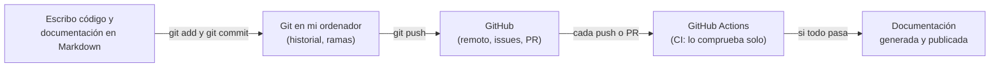

- Git y sus comandos: apartado 2.
- Ramas, issues y pull requests: apartados 3 y 4.
- Que no se filtre nada (contraseñas, claves): apartado 5.
- README, Markdown y generadores de webs: apartado 6.
- GitHub Actions y CI/CD: apartado 7.

Sobre el examen:

- El P1 es una **prueba objetiva** sobre UT1 y UT2 (RA6 y RA1). "Prueba objetiva" quiere decir que las respuestas se corrigen con criterios cerrados (test, verdadero o falso, completar, qué hace un comando...), no por opinión.
- El formato exacto (tipo de preguntas, cuántas y cuánto vale cada una) lo publica el profesor en el aula virtual antes del examen.
- Los tres exámenes del curso hacen media y valen el 50 % de la nota. El otro 50 % es la media de las prácticas obligatorias. Para aprobar el módulo hace falta un 5 de nota final.
- El examen se construye sobre los RA y sus criterios, no sobre temas sueltos. Por eso el apartado 1 es el mapa de todo lo demás.

Fuente: https://dpl-f1facc.gitlab.io/evaluacion/preparacion-examen/ y https://dpl-f1facc.gitlab.io/introduccion/evaluacion/

## 1. El RA6 y sus criterios de evaluación

Vocabulario básico:

- **RA (resultado de aprendizaje)**: lo que el currículo oficial (el Real Decreto 686/2023, publicado en el BOE) dice que tienes que saber hacer al terminar. El módulo DPL tiene seis, del RA1 al RA6.
- **CE (criterio de evaluación)**: cada una de las cosas concretas con las que se comprueba un RA. Se nombran con letras: RA6-a, RA6-b...
- **UT (unidad de trabajo)**: cada tema del curso. La UT1 es la que trabaja el RA6.

El RA6, dicho con palabras sencillas: **saber documentar una aplicación web eligiendo bien las herramientas para generar documentación, para controlar versiones y para la integración continua**. En tres palabras: documentación, Git y CI.

| CE | Qué significa en sencillo | Dónde lo he trabajado | Qué me pueden preguntar |
|---|---|---|---|
| a | Conocer varias herramientas que generan documentación | Zensical, MkDocs, Jekyll | Nombra generadores de sitios estáticos y di qué hacen. Diferencia entre generar documentación y validarla (markdownlint) |
| b | Usar el generador de una plataforma para documentar un proyecto | `zensical build` de gitanddocs, `mkdocs build --strict` en la guiada 02 | Qué fichero configura el generador, qué carpeta produce, qué hace `--strict` |
| c | Usar distintos formatos de documentación | Markdown, HTML, YAML, TOML, Mermaid, texto plano | Ventajas de Markdown frente a un procesador de textos. Para qué sirve cada formato |
| d | Usar herramientas colaborativas para escribir y mantener la documentación | Issues, pull requests, revisiones, GitHub Projects, wikis | Diferencia entre issue y PR. Qué hace `Closes #N`. Pasos del flujo con fork |
| e | Instalar, configurar y usar un sistema de control de versiones | Instalación (`git --version`), `git init`, `git config`, commits, ramas, merge, remotos | Qué hace un comando. Las tres zonas de Git. Fast-forward frente a `--no-ff`. Conflictos |
| f | Que la información y el código guardados en el control de versiones estén accesibles y seguros | Remoto como copia, SSH, tokens, `.gitignore`, secretos fuera del repo | Por qué SSH. Qué es un token (PAT). Qué no se versiona. Qué haces si subes una contraseña |
| g | Documentar cómo se instaló, configuró y usó el control de versiones | README con los pasos, `comprobaciones.txt`, historial de commits | Qué apartados lleva el README. Por qué el historial también es documentación |
| h | Usar herramientas de integración continua del código | GitHub Actions (`ci.yml`) | Diferencia entre CI, entrega continua y despliegue continuo. Partes de un workflow. Dónde se guarda |

Prácticas de la UT1:

| Práctica | Qué se hace | Tipo | RA y CE |
|---|---|---|---|
| Guiada 01: repositorio dpl-despliegue | Repo con historial, ramas, fusión y convención de commits | Obligatoria | RA6-e, f, g |
| Guiada 02: flujo colaborativo | Fork, issue, rama, PR, revisión, conflicto, etiqueta y release | Obligatoria | RA6-a, b, c, d, h |
| Guiada 03: prepara tu entorno (Docker) | Contenedores dpl-lab y dpl-cliente en una red | Obligatoria | RA1-e, f, i (ojo: es de la UT1 pero cuenta para el RA1) |
| Guiada 24: ramas y flujos | Merges, conflictos y estrategias de ramas | Ampliación, no cuenta en la media | RA6-e |
| Guiada 25: CI/CD con GitHub Actions | Workflow que prueba y publica una imagen Docker | Ampliación, no cuenta en la media | RA6-g, h |

Los RA y CE de cada práctica son los del registro de entregas. En su propia página, la guiada 01 añade RA6-c y la guiada 02 dice que toca los ocho criterios (a-h).

El currículo también fija los **contenidos** de este bloque. Conviene saber dónde está cada uno en esta guía:

| Contenido oficial | Dónde está |
|---|---|
| Herramientas colaborativas para generar documentación | Apartados 4 y 6 |
| Creación y uso de plantillas | Plantillas de issue y PR (apartado 4) y la plantilla de README (apartado 6) |
| Instalar, configurar y usar un sistema de control de versiones | Apartado 2 (la instalación, al final del 2.1) |
| Operaciones avanzadas | Rebase, etiquetas, stash, etc. (apartados 2.11 a 2.16) |
| Seguridad de los sistemas de control de versiones | Apartado 5 |
| Integración continua y vigilar la calidad del código de forma continua | Apartado 7 (la CI comprueba cada cambio) y su subapartado "Vigilar la calidad de forma continua" (métricas) |

Fuente: https://dpl-f1facc.gitlab.io/introduccion/modulo/, https://dpl-f1facc.gitlab.io/ut01/ y https://dpl-f1facc.gitlab.io/evaluacion/entregables/

## 2. Git desde cero

### 2.1 Qué es Git y para qué sirve

Un **sistema de control de versiones** (en inglés VCS, Version Control System) es un programa que va guardando los cambios que haces en los ficheros de una carpeta. Para qué sirve:

- Si algo se rompe, recuperas una versión que funcionaba.
- Queda apuntado cada cambio: qué se tocó, quién lo hizo y en qué fecha.
- Un equipo entero puede trabajar sobre los mismos ficheros sin machacarse el trabajo.
- El historial sirve de documentación: cuenta los fallos que hubo y cómo se arreglaron.

> Analogía: es como las partidas guardadas de un videojuego. Cada vez que guardas, puedes volver a ese punto si luego algo sale mal. Y además queda escrito qué hiciste en cada partida.

**Git** es el sistema de control de versiones más usado. Lo creó Linus Torvalds en 2005. Es **distribuido**: cada copia del proyecto tiene el historial completo, así que casi todo (commits, ramas, mirar el historial) se hace sin conexión. La red solo hace falta para sincronizar con otra copia.

| Modelo centralizado | Modelo distribuido |
|---|---|
| Un único servidor guarda el historial | Cada copia guarda el historial completo |
| Sin conexión apenas puedes trabajar | Sin conexión puedes hacer casi todo |
| Más sencillo y más antiguo | Más flexible y más moderno |
| Ejemplo: Subversion (svn) | Ejemplo: Git |

El ecosistema tiene tres capas, y conviene no mezclarlas:

| Capa | Qué es | Ejemplos |
|---|---|---|
| Sistema | El propio programa de control de versiones | Git, Subversion, Mercurial, CVS |
| Cliente | Programa para usarlo (Git ya trae el de terminal) | Terminal, GitHub Desktop, GitKraken, VS Code |
| Servicio | Web que aloja repositorios y añade colaboración | GitHub, GitLab, Bitbucket, Gitea |

Dos palabras que se confunden:

- **Repositorio** (o repo): los ficheros versionados y su historial. Nada más.
- **Proyecto**: el repositorio más todo lo que añade la plataforma (issues, permisos, wiki, CI...). GitHub convierte un repositorio en un proyecto.

Pregunta clásica: Git y GitHub no son lo mismo. Git es el programa que guarda versiones en tu ordenador. GitHub es una web que guarda copias de repositorios Git y añade herramientas para trabajar en equipo.

**Instalarlo y comprobarlo.** El CE RA6-e empieza por "instalar". En el curso Git se usa en el **anfitrión** (tu ordenador): la guiada 01 lo da por instalado y pide una versión orientativa 2.40 o superior. La guiada 03 lo instala también dentro de `dpl-lab`, junto a `curl` y `nano`.

```bash
xcode-select --install                    # macOS: las herramientas de línea de comandos de Xcode traen Git
brew install git                          # macOS con Homebrew: otra forma de tener una versión reciente
apt-get update && apt-get install -y git  # Ubuntu o Debian (dentro de dpl-lab eres root y no hace falta sudo)
git --version                             # comprueba que está instalado y qué versión es
```

En Windows se usa el instalador **Git for Windows** de git-scm.com, que trae además la terminal Git Bash.

Instalar no basta. Antes del primer commit hay que configurar la identidad (apartado 2.5) y, para trabajar con GitHub, la autenticación (apartado 5). Todo eso es lo que pide el CE RA6-g: dejar escrito en el README cómo se instaló (`git --version` con su salida), cómo se configuró (`git config`) y cómo se usó (commits, ramas, remoto).

Fuente: https://dpl-f1facc.gitlab.io/ut01/teoria/git/#1-que-es-un-sistema-de-control-de-versiones, https://dpl-f1facc.gitlab.io/ut01/practicas/guiada-01-git/, https://dpl-f1facc.gitlab.io/introduccion/entorno/ y https://git-scm.com/book/es/v2/Inicio---Sobre-el-Control-de-Versiones-Instalación-de-Git

### 2.2 Las tres zonas: working tree, staging y repositorio

Cuando haces `git init` en una carpeta, Git crea dentro una carpeta oculta `.git`. Ahí guarda todo el historial. **Si borras `.git`, la carpeta deja de ser un repositorio y pierdes el historial** (por eso las entregas sin `.git` valen 0).

Git trabaja con tres zonas:

| Zona | Otros nombres | Qué es |
|---|---|---|
| Working tree | Directorio de trabajo, working directory | Los ficheros tal y como los ves y editas en tu carpeta |
| Staging | Index, área de preparación | Los cambios que has elegido para el próximo commit |
| Repositorio | Historial, HEAD | Los commits ya guardados dentro de `.git` |

En la web del profesor la tercera zona se llama directamente **HEAD** ("el último commit", lo ya fijado). Por eso la pregunta típica es "¿qué diferencia hay entre working directory, index y HEAD?": tus ficheros, lo preparado y lo ya guardado.

> Analogía: el carrito de la compra. Vas por la tienda (working tree), metes en el carrito lo que te quieres llevar (`git add`, staging) y al pagar (`git commit`) solo te cobran lo que hay en el carrito. Lo que dejaste en la estantería no entra.

A estas tres zonas se suma el **repositorio remoto**: una copia del repo en un servidor (GitHub, GitLab, Gitea) que sirve de copia de seguridad y para colaborar. Lo vemos en el apartado 2.12.

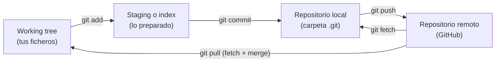

La flecha de `git pull` va hasta tus ficheros porque hace dos cosas: descarga los commits nuevos a tu repositorio local (`fetch`) y además los fusiona en tu rama (`merge`), así que tus ficheros cambian. `git fetch` solo hace la primera parte.

La regla mental: **editas, preparas (`add`) y fijas (`commit`)**.

```bash
git init                 # convierte la carpeta actual en un repositorio
git status               # en qué zona está cada cambio
git add README.md        # pasa el cambio del README al staging
git commit -m "Añadir README inicial" -m "Explica qué es el proyecto y sus apartados."
```

Un mismo fichero puede tener una parte en el staging y otra sin preparar. Pasa si haces `git add`, sigues editando y no vuelves a hacer `add`. En `git status -s` sale como `MM`:

```text
$ git status -s
MM f.txt
?? nuevo.txt
```

La primera columna es el staging y la segunda el working tree. `M` es modificado y `??` es un fichero sin seguimiento. Si haces commit en ese momento, solo entra la parte preparada.

Fuente: https://dpl-f1facc.gitlab.io/ut01/teoria/git/#3-como-funciona-el-modelo-de-tres-estados

### 2.3 Estados de un fichero

| Estado | En español | Qué significa |
|---|---|---|
| untracked | Sin seguimiento | Está en la carpeta, pero Git no lo versiona todavía |
| ignored | Ignorado | Lo excluye un patrón del `.gitignore`. Git ni lo ofrece para añadir |
| tracked | Con seguimiento | Git ya lo conoce: estaba en el último commit o lo acabas de añadir con `git add`. Los tres estados de abajo son casos de fichero con seguimiento |
| modified | Modificado | Está versionado y tiene cambios sin preparar |
| staged | Preparado | El cambio está en el staging y entrará en el próximo commit |
| committed | Confirmado | El cambio ya está guardado en el historial |

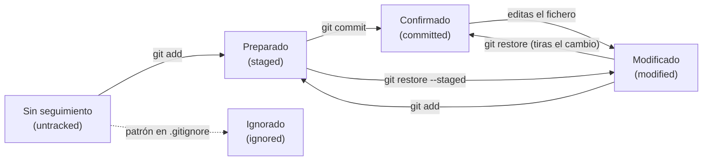

Cómo leerlo: un fichero nuevo empieza sin seguimiento. Con `git add` pasa a preparado y con `git commit` queda confirmado. Si lo vuelves a editar, pasa a modificado y el ciclo se repite. Si un patrón del `.gitignore` lo cubre, Git lo ignora.

Fuente: https://dpl-f1facc.gitlab.io/ut01/teoria/git/#los-estados-de-un-fichero

### 2.4 El commit y la convención del profesor

Un **commit** es una foto del staging guardada en el historial. Cada commit lleva:

- un **hash**: su identificador único. Es una cadena de 40 caracteres hexadecimales (números del 0 al 9 y letras de la a a la f) que Git calcula a partir del contenido. `git log --oneline` enseña solo los primeros caracteres (por ejemplo `501e160`), y con eso basta para nombrar el commit en los comandos;
- el **autor** (nombre y correo) y la **fecha**;
- un **mensaje** que explica el cambio;
- un enlace a su commit **padre** (el anterior). Así se forma la cadena del historial.

**Convención de commits del módulo (obligatoria):**

1. **Subject** (cabecera): una línea corta que resume el cambio, con el verbo en imperativo, es decir, como una orden. Ejemplo de la web del profesor: `Instalar nginx y verificar el servicio`. En sus ejemplos aparecen las dos formas habituales: infinitivo (`Instalar...`) y la de "tú" (`Añade server block HTTPS`).
2. **Cuerpo**: un texto más largo, separado por una línea en blanco, que explica qué se hizo, cómo y por qué (comandos, resultados).

Se escriben las dos partes en un solo comando con dos `-m`. Git convierte cada `-m` en un párrafo distinto:

```bash
git commit -m "Configurar NGINX para servir la documentación" \
           -m "Creo nginx/conf.d/docs.conf con root /var/www/docs. Lo compruebo con curl -I http://localhost:8080/ y responde 200."
```

Lo que el profesor quiere ver en el historial:

- **Un commit por cambio lógico** (por paso de la práctica). Nada de diez cosas en un commit.
- Mensajes que digan algo. `final`, `upd`, `cambios` o `entrega final` no acreditan el trabajo.
- Los errores que cometiste y arreglaste, también en el historial. Se valoran **positivamente**.
- Revisar qué entra antes de confirmar: mejor `git add fichero` que `git add .` a ciegas, porque así no se cuela una contraseña.
- En clase insistió en que los mensajes sean naturales, como los escribe una persona (puso ejemplos del estilo "arreglé el fallo X que encontré en el paso anterior"), y en que el historial refleje el trabajo real hecho en varias sesiones.

En mi práctica de NGINX los subjects están en primera persona (`Añado el README y el .gitignore`, `Configuro NGINX para servir la documentación`). Si me lo preguntan, lo importante se cumple: subject corto que dice una acción, cuerpo con qué, cómo y por qué, y un commit por paso; y además encaja con lo que pidió en clase de que suenen naturales. En el examen, si preguntan por la convención, la respuesta es la de la web: **subject corto en imperativo y cuerpo largo (qué, cómo y por qué) con dos `-m`**.

Existe un estándar llamado **Conventional Commits** que pone un tipo delante (`feat:`, `fix:`, `docs:`...). En este módulo es **opcional**.

Atajo: `git commit -am "subject"` prepara y confirma de golpe los ficheros que ya estaban versionados. **No incluye ficheros nuevos** (untracked).

Fuente: https://dpl-f1facc.gitlab.io/ut01/teoria/git/#convencion-de-commits-del-modulo-obligatoria

### 2.5 Identidad: user.name y user.email

Cada commit guarda quién es su autor. Git saca esos datos de dos ajustes:

- `user.name`: en este módulo, **nombre y apellidos tal y como salen en el aula virtual**.
- `user.email`: **el correo de la cuenta del aula virtual**.

Si no coinciden, la entrega puntúa 0. Se pueden poner a dos niveles:

| Nivel | Comando | Dónde se guarda | A qué afecta |
|---|---|---|---|
| Global | `git config --global user.name "..."` | `~/.gitconfig` (tu carpeta personal) | Todos los repos de tu ordenador |
| Local | `git config --local user.name "..."` (dentro de la carpeta del repo) | `.git/config` del repo | Solo ese repo. **Manda sobre la global** |

Existe un tercer nivel, `--system`, para todos los usuarios del ordenador, pero casi no se usa. El orden de prioridad es: local gana a global y global gana a system.

```bash
git config --local user.name "Diego Alejandro Gil González"
git config --local user.email "diegogildam@gmail.com"
git config --local --list                   # ver la configuración local
git config --show-origin user.name          # de qué fichero sale el valor que se usa
git log --format='%an <%ae>' | sort -u      # autores reales de todos los commits
```

En la última línea, `%an` es el nombre del autor, `%ae` su correo y `sort -u` quita repetidos. En una entrega correcta tiene que salir **una sola línea con tus datos**.

Si el último commit salió con la identidad mal y **todavía no lo has subido**: corriges la configuración y haces `git commit --amend --reset-author`. Eso rehace el commit con el autor nuevo.

Fuente: https://dpl-f1facc.gitlab.io/ut01/teoria/git/#configuracion-obligatoria-de-identidad-username-y-useremail

### 2.6 Mirar qué pasa: status, log, diff y show

| Comando | Para qué sirve |
|---|---|
| `git status` | En qué rama estás y en qué zona está cada cambio |
| `git status -s` | Lo mismo en formato corto |
| `git log` | Historial completo (autor, fecha, mensaje) |
| `git log --oneline` | Un commit por línea: hash corto y subject |
| `git log --oneline --graph --all` | Dibuja el árbol de ramas, incluidas las remotas |
| `git shortlog` | Commits agrupados por autor (sirve para comprobar quién hizo cada cosa) |
| `git shortlog -sn` | Solo el número de commits por autor |
| `git diff` | Diferencias entre working tree y staging (lo que aún no has preparado) |
| `git diff --stat` | Qué ficheros cambian y cuántas líneas, sin el detalle |
| `git diff --staged` | Diferencias entre staging y el último commit (lo que va a entrar en el commit) |
| `git diff main..otra-rama` | Diferencias entre dos ramas |
| `git diff HEAD~1 HEAD` | Qué cambió el último commit respecto al anterior |
| `git show <hash>` | Qué hizo un commit concreto |

Buena costumbre: antes de cada commit, `git status` y `git diff`. Así no se cuela nada raro (por ejemplo una contraseña).

Fuente: https://dpl-f1facc.gitlab.io/ut01/teoria/git/#8-historia-git-log-y-git-diff

### 2.7 Deshacer cosas

| Situación | Comando | Qué hace | ¿Cambia la historia? |
|---|---|---|---|
| He editado un fichero y quiero tirar los cambios | `git restore fichero` | Lo deja como está en el staging (si no hiciste `add`, como en el último commit) | No |
| Hice `git add` y quiero sacarlo del staging | `git restore --staged fichero` | Lo saca del staging; los cambios siguen en el fichero | No |
| Quiero que Git deje de seguir un fichero sin borrarlo del disco | `git rm --cached fichero` | Lo quita del repo en el próximo commit | No |
| Me equivoqué en el último commit (mensaje o fichero olvidado) | `git commit --amend` | Sustituye el último commit por uno nuevo, con otro hash | Sí |
| Quiero anular un commit ya publicado | `git revert <hash>` | Crea un commit nuevo que deshace aquel | No |
| Quiero volver la rama a un commit anterior y tirar todo lo posterior | `git reset --hard <hash>` | Mueve la rama y descarta cambios | Sí (peligroso) |
| Estoy en mitad de un merge con conflicto y me he perdido | `git merge --abort` | Cancela la fusión y deja todo como antes | No |
| He terminado un merge y me arrepiento (todavía no lo he subido) | `git reset --hard ORIG_HEAD` | Vuelve la rama a como estaba antes del merge (`ORIG_HEAD` es una referencia que Git guarda antes de operaciones como el merge) | Sí (por eso, solo si no lo has subido) |

Cuidado: lo que tiras con `git restore` **no se puede recuperar**, porque nunca llegó a ser un commit.

Fuente: https://dpl-f1facc.gitlab.io/ut01/teoria/git/#deshacer-cambios-git-restore y https://dpl-f1facc.gitlab.io/ut01/teoria/git/#otros-comandos-de-interes

### 2.8 Ramas y HEAD

Una **rama** es una línea de trabajo independiente. Sirve para probar o hacer un cambio sin tocar lo que ya funciona. La rama principal se llama `main` (antes se llamaba `master`; según la versión y la configuración, `git init` todavía puede crearla como `master`, y con `git init -b main` te aseguras).

> Analogía: una rama es un borrador. Copias el trabajo bueno, pruebas cosas en el borrador y, si salen bien, las pasas a limpio (merge). Si salen mal, tiras el borrador y el original sigue intacto.

Por dentro, una rama es solo **una etiqueta móvil que apunta a un commit**. A estas etiquetas que señalan a un commit se les llama **punteros**. Cuando haces un commit en esa rama, la etiqueta avanza al commit nuevo. Por eso crear una rama es instantáneo: no se copia ningún fichero, solo se crea una etiqueta nueva.

**HEAD** es otro puntero: indica **dónde estás tú ahora**. Normalmente apunta a la rama actual (y la rama a su último commit). Por eso:

- `HEAD` es "el último commit de la rama en la que estoy";
- `HEAD~1` es el commit anterior a ese, `HEAD~2` el de antes, etc.

```bash
git branch                 # lista las ramas locales (la actual lleva *)
git branch -a              # también las remotas
git branch docs            # crea la rama docs (pero no te cambia a ella)
git switch docs            # te cambia a docs (antiguo: git checkout docs)
git switch -c fase-1       # crea fase-1 y te cambia a ella (antiguo: git checkout -b)
git switch -               # vuelve a la rama anterior
git branch -d docs         # borra docs si ya está fusionada
git branch -D docs         # la borra aunque no esté fusionada (pierdes sus commits)
```

**HEAD desacoplada (detached HEAD)**: pasa si haces `git checkout <hash>` (o `git switch --detach <hash>`) para ver un commit antiguo. HEAD apunta a un commit, no a una rama. Puedes mirar, pero si haces commits ahí no pertenecen a ninguna rama y, al irte, ninguna rama los señala (solo se podrían rescatar con `git reflog`). Para volver: `git switch -`. Para conservar lo hecho: `git switch -c nombre-rama`.

```text
$ git checkout HEAD~1
$ git status
HEAD desacoplada en 8946fc2
```

Fuente: https://dpl-f1facc.gitlab.io/ut01/teoria/git/#6-ramas y https://dpl-f1facc.gitlab.io/ut01/teoria/git/#volver-a-una-version-git-checkout-y-head-desacoplado

### 2.9 Fusionar ramas: fast-forward y no-ff

**Merge (fusión)**: traer los cambios de una rama a la rama en la que estás. Siempre te pones primero en la rama que **recibe** los cambios:

```bash
git switch main
git merge docs-extra       # trae docs-extra a main
```

Hay dos casos.

**Caso 1: main no se ha movido desde que nació la rama.** Git puede hacer un **fast-forward** (avance rápido): no crea ningún commit nuevo, solo mueve la etiqueta `main` hacia delante. Con `--no-ff` (no fast-forward) le obligas a crear un **commit de fusión** aunque no haga falta.

```text
Antes de fusionar:

A---B                  main
     \
      C---D            docs-extra

Con git merge docs-extra (fast-forward):

A---B---C---D          main y docs-extra apuntan al mismo commit

Con git merge --no-ff docs-extra:

A---B-----------M      main   (M es el commit de fusión)
     \         /
      C-------D        docs-extra
```

Salida real de cada uno:

```text
$ git merge rama1
Actualizando cd9d5c1..25eadf7
Fast-forward
 f.txt | 1 +
 1 file changed, 1 insertion(+)

$ git merge --no-ff rama2 -m "Fusiona rama2"
Merge made by the 'ort' strategy.
 f.txt | 1 +
 1 file changed, 1 insertion(+)

$ git log --oneline --graph
*   8946fc2 Fusiona rama2
|\
| * e3b65fc Cambio en rama2
|/
* 25eadf7 Cambio en rama1
* cd9d5c1 Inicial
```

Fíjate: el commit de `rama1` aparece en línea recta, como si nunca hubiera existido una rama. El de `rama2` se ve como un desvío que vuelve.

Dos detalles de la salida:

- `Merge made by the 'ort' strategy` sale en inglés aunque Git esté en español. `ort` es el nombre del algoritmo que usa Git por defecto para fusionar. No hay que hacer nada con él.
- Un **commit de fusión** es especial porque tiene **dos padres**: el último commit de `main` y el último de la rama. Los commits normales tienen uno.

**Caso 2: main también ha avanzado.** Las dos ramas han divergido (cada una tiene commits que la otra no tiene). No se puede hacer fast-forward y Git crea **siempre** un commit de fusión, con o sin `--no-ff`.

```text
A---B---E              main   (main avanzó con E)
     \
      C---D            rama

git merge rama:

A---B---E---M          main
     \     /
      C---D            rama
```

**Por qué en el curso se usa `--no-ff`**: el commit de fusión deja constancia en el grafo de que existió una rama. El profesor puede ver el trabajo por ramas en `git log --oneline --graph`.

Fuente: https://dpl-f1facc.gitlab.io/ut01/teoria/git/#fusionar-ramas-fast-forward-y-no-ff y https://dpl-f1facc.gitlab.io/ut01/practicas/guiada-24-git-branching/

### 2.10 Conflictos y cómo se resuelven

Un **conflicto** aparece cuando dos ramas han cambiado **la misma zona** de un fichero: las mismas líneas o líneas pegadas una a la otra (también si una rama borró un fichero que la otra modificó). Git no sabe con cuál quedarse y te lo pregunta. Si las ramas tocaron partes separadas del fichero, Git fusiona solo y no hay conflicto.

Salida real:

```text
$ git merge r3
Auto-fusionando f.txt
CONFLICTO (contenido): Conflicto de fusión en f.txt
Fusión automática falló; arregle los conflictos y luego realice un commit con el resultado.

$ git status
En la rama main
Tienes rutas no fusionadas.
  (arregla los conflictos y ejecuta "git commit"
  (usa "git merge --abort" para abortar la fusion)

Rutas no fusionadas:
  (usa "git add <archivo>..." para marcar una resolución)
	modificados por ambos:  f.txt
```

El fichero queda con unas **marcas**:

```text
<<<<<<< HEAD
color: purple;
=======
color: darkgreen;
>>>>>>> cool-colors
```

- Entre `<<<<<<< HEAD` y `=======`: lo que hay en **tu rama actual** (la que recibe).
- Entre `=======` y `>>>>>>> cool-colors`: lo que **viene de la otra rama**.

Pasos para resolverlo:

1. `git status` para ver qué ficheros tienen conflicto.
2. Abres el fichero y dejas el contenido final: una versión, la otra o una mezcla. **Borras las tres líneas de marcas**.
3. `git add fichero` para marcarlo como resuelto.
4. `git commit` para cerrar la fusión (con su mensaje).
5. Si te lías: `git merge --abort` y vuelves a como estabas antes del merge.

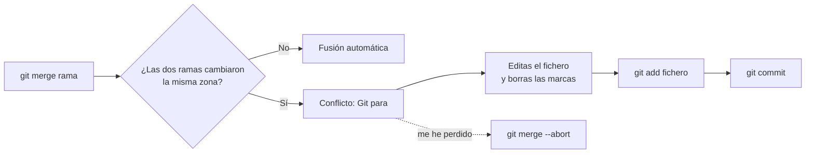

Ojo al resolver: es fácil borrar el trabajo de otra persona sin darte cuenta (en gitanddocs ya pasó, lo cuento en [02-git-github.md](02-git-github.md)).

Fuente: https://dpl-f1facc.gitlab.io/ut01/teoria/git/#resolver-un-conflicto-de-merge-paso-a-paso

### 2.11 Rebase y por qué no se reescribe la historia compartida

`git rebase` es otra forma de integrar cambios. En vez de unir dos ramas con un commit de fusión, **coge tus commits y los vuelve a aplicar encima de otra rama**, como si hubieras empezado a trabajar más tarde.

```text
Antes:

A---B---E              main
     \
      C---D            mi-rama

git switch mi-rama
git rebase main

Después:

A---B---E              main
         \
          C'--D'       mi-rama
```

`C'` y `D'` tienen el mismo contenido que `C` y `D`, pero son **commits nuevos con otro hash**. El historial queda en línea recta, sin commit de fusión.

| | merge | rebase |
|---|---|---|
| Qué hace | Une dos historias con un commit de fusión | Reaplica tus commits encima de otra rama |
| Historial | Se ve que hubo ramas | Lineal, sin ramas visibles |
| ¿Cambia hashes? | No | Sí |
| Riesgo | Bajo | Alto si los commits ya estaban publicados |

**La regla de oro**: no hagas rebase de commits que ya existen fuera de tu repositorio (que ya subiste y otras personas pueden haber descargado). Si cambias sus hashes, tu historia y la de tus compañeros dejan de encajar, tendrías que forzar la subida (`git push --force`) y les rompes el trabajo.

Lo mismo vale para todo lo que **reescribe historia**: `git commit --amend`, `git rebase` y `git reset --hard`. En local y antes de subir, no pasa nada. Ya publicado, no.

En este módulo se usa **merge**, que es más sencillo y seguro. El rebase basta con reconocerlo y saber explicarlo. Además, la entrega lleva la carpeta `.git`, y dentro de ella Git guarda un registro de por dónde ha pasado HEAD (el **reflog**, en `.git/logs/`), así que reescribir la historia deja rastro.

Fuente: https://dpl-f1facc.gitlab.io/ut01/teoria/git/#merge-vs-rebase-vision-general y https://git-scm.com/book/en/v2/Git-Branching-Rebasing

### 2.12 Remotos: origin, upstream, clone, fetch, pull y push

Un **remoto** es un nombre que apunta a la dirección (URL) de otra copia del repositorio, normalmente en GitHub, GitLab o Gitea.

- **origin**: nombre que se da por convención al remoto principal. Si clonas, Git lo crea solo apuntando a lo que clonaste.
- **upstream**: esta palabra tiene **dos significados** y conviene no liarse:
  1. En el flujo con fork, es el nombre que se le da al remoto del **repositorio original** (el del profesor), mientras que `origin` es tu fork.
  2. La **rama upstream** de una rama local es la rama remota con la que está vinculada (por ejemplo, `main` sigue a `origin/main`). Es lo que configura `git push -u`.

**Ramas de seguimiento remoto**: `origin/main` es la foto que tu repo tiene de la rama `main` del remoto. No se actualiza sola: se actualiza al hacer `fetch` o `pull`.

| Comando | Qué hace |
|---|---|
| `git clone URL` | Descarga un repo completo (con historial) y crea el remoto `origin` |
| `git remote -v` | Lista los remotos y sus URL |
| `git remote add origin URL` | Añade un remoto |
| `git remote set-url origin URL` | Cambia la URL de un remoto |
| `git fetch origin` | Descarga los commits nuevos del remoto **sin tocar tus ramas** |
| `git pull origin main` | `fetch` + `merge`: descarga y fusiona en tu rama actual |
| `git push origin main` | Sube tus commits de `main` al remoto |
| `git push -u origin fase-2` | Sube una rama nueva y la vincula (solo la primera vez) |
| `git branch -vv` | Muestra a qué rama remota sigue cada rama local |

> Analogía: `fetch` es recoger las cartas del buzón y dejarlas en la mesa sin abrirlas. `pull` es recogerlas y además meterlas en tu archivador. `push` es mandar tus cartas.

La primera vez que subes una rama, `git push` a secas falla porque la rama no tiene upstream:

```text
$ git push
fatal: La rama actual nueva no tiene una rama upstream.
Para empujar la rama actual y configurar el remoto como upstream, usa

    git push --set-upstream origin nueva
```

Se arregla con `git push -u origin nueva` (`-u` es la forma corta de `--set-upstream`). A partir de ahí, `git push` y `git pull` sin más ya saben adónde ir.

`git status` te dice cómo vas respecto al remoto: "Tu rama está actualizada con 'origin/main'", "adelantada" (tienes commits sin subir), "detrás" (el remoto tiene commits que tú no) o "han divergido" (los dos tienen commits que el otro no tiene). Ojo: compara con la foto `origin/main` que tienes en local. Si hace tiempo que no haces `git fetch`, esa foto está vieja y el mensaje puede engañar.

Se pueden tener **varios remotos** (por ejemplo `origin` en GitHub y `backup` en GitLab). Buena práctica: escribir siempre `git push <remoto> <rama>` para no mandar cambios al sitio equivocado.

Fuente: https://dpl-f1facc.gitlab.io/ut01/teoria/git/#4-repositorio-local-y-remoto y https://dpl-f1facc.gitlab.io/ut01/teoria/git/#clone-fetch-pull-y-push-trabajar-con-remotos

### 2.13 Etiquetas y versiones

Una **etiqueta (tag)** es un nombre fijo que se pone a un commit para marcar una versión (por ejemplo, la entrega). A diferencia de una rama, **no se mueve**.

| Tipo | Comando | Qué guarda |
|---|---|---|
| Ligera | `git tag v1.0.0` | Solo el nombre que apunta al commit |
| Anotada | `git tag -a v1.0.0 -m "Mensaje"` | Nombre, autor, fecha y mensaje. **Es la que se usa en el curso** |

```bash
git tag                          # lista las etiquetas
git show v1.0.0                  # datos de la etiqueta y su commit
git push origin v1.0.0           # sube una etiqueta concreta
git push --follow-tags           # sube los commits y las etiquetas anotadas que les correspondan
```

`git push` normal **no sube las etiquetas**. Hay que subirlas aparte o con `--follow-tags`.

**Versionado semántico** (SemVer): el número tiene la forma `MAYOR.MENOR.PARCHE`.

| Parte | Cuándo se sube | Ejemplo |
|---|---|---|
| MAYOR | Cambios incompatibles con lo anterior | 1.4.2 pasa a 2.0.0 |
| MENOR | Funcionalidad nueva compatible | 1.4.2 pasa a 1.5.0 |
| PARCHE | Arreglos de fallos compatibles | 1.4.2 pasa a 1.4.3 |

Al subir una parte, las de su derecha vuelven a 0: de `1.4.2` a `1.5.0` (no `1.5.2`) y de `1.4.2` a `2.0.0`.

Las versiones `0.x.y` indican que el proyecto aún está en desarrollo y puede cambiar cualquier cosa. La `1.0.0` es la primera versión estable.

En el curso las etiquetas se escriben sin `v` (`0.1.0`, `1.0.0`). Ponerle una `v` delante (`v1.0.0`, como en mi práctica) también es muy habitual; el número sigue siendo el mismo.

Una **release** (lanzamiento) es una página de GitHub o GitLab asociada a una etiqueta, con notas de qué cambia y ficheros descargables. Se crea desde la web (Releases) o con `gh release create 0.1.0 --title "0.1.0" --notes "..."`. `gh` es **GitHub CLI**, la herramienta oficial de GitHub para la terminal (se vuelve a ver en el apartado 4). Toda release va unida a una etiqueta: lo normal es crear y subir antes la etiqueta, y si no existe, GitHub la crea al publicar la release.

Fuente: https://dpl-f1facc.gitlab.io/ut01/teoria/git/#tag-etiquetar-versiones y https://semver.org/lang/es/

### 2.14 El fichero .gitignore

`.gitignore` es un fichero de texto en la raíz del repo con patrones de lo que **no** se debe versionar: contraseñas, claves, ficheros generados, entornos virtuales, basura del sistema.

```text
# Ejemplo de .gitignore
.env
*.log
.DS_Store
.venv/
site/
_site/
```

| Patrón | Qué ignora |
|---|---|
| `*.log` | Cualquier fichero `.log` en cualquier carpeta |
| `cache/` | Cualquier carpeta llamada `cache` |
| `/env` | Solo `env` en la raíz (la barra del principio la ancla a la raíz) |
| `**/output/*.obj` | Los `.obj` dentro de cualquier carpeta `output` |
| `!cache/importante.txt` | La exclamación vuelve a incluir algo que estaba ignorado |

Trampa con la exclamación: **no funciona si la carpeta que lo contiene está ignorada entera**. Con `cache/` más `!cache/importante.txt`, el fichero sigue ignorado, porque Git ni siquiera entra en la carpeta. Para que funcione hay que ignorar el contenido y no la carpeta:

```text
cache/*
!cache/importante.txt
```

Tres cosas que se preguntan mucho:

1. **`.gitignore` no afecta a lo que ya está versionado.** Si un fichero ya está en un commit, añadirlo al `.gitignore` no hace nada. Hay que dejar de seguirlo con `git rm --cached fichero` y hacer commit.
2. **Git no versiona carpetas vacías.** Si una carpeta no tiene ningún fichero, `git add` no hace nada con ella. El truco habitual es meter dentro un fichero vacío, por ejemplo `.gitkeep`.
3. Para no partir de cero hay generadores de `.gitignore` por tecnología. El profesor cita el de Toptal: pones las tecnologías en la URL (por ejemplo `https://www.toptal.com/developers/gitignore/api/python,visualstudiocode`) y lo descargas con `curl -o .gitignore URL`. Después hay que revisarlo y adaptarlo antes del primer commit.

Lo normal es un `.gitignore` en la raíz, pero también puede haber otros en subcarpetas, que solo afectan a esa carpeta.

Fuente: https://dpl-f1facc.gitlab.io/ut01/teoria/git/#gitignore-que-no-versionar y https://git-scm.com/docs/gitignore

### 2.15 git archive

`git archive` crea un fichero comprimido (`.tar` o `.zip`) con **los ficheros de un commit, pero sin la carpeta `.git`**. Solo incluye lo que está versionado en ese commit: nada de ficheros sin seguimiento ni ignorados.

```bash
git archive --format=zip -o copia.zip HEAD        # ZIP con los ficheros del último commit
git archive HEAD | tar -x -C otra-carpeta         # extrae esos ficheros en otra carpeta (que ya tiene que existir)
```

En la segunda línea, la barra `|` (tubería) pasa la salida de `git archive` directamente a `tar`, que la descomprime en la carpeta indicada con `-C`.

Para qué lo usé: en la práctica de NGINX copié la documentación de gitanddocs con `git archive HEAD | tar -x -C docs-zensical`. Así me traje los ficheros pero **no su historial**, que tenía commits de otras personas, y apunté el hash del commit copiado (`3e7a2df`) en el README.

Cuidado: **`git archive` no sirve para hacer el ZIP de entrega**, porque deja fuera `.git` y la entrega sin `.git` vale 0. El ZIP de entrega se hace comprimiendo la carpeta entera.

Fuente: https://git-scm.com/docs/git-archive

### 2.16 stash y otros comandos útiles

`git stash` guarda en una pila los cambios que no has confirmado y deja la carpeta limpia. Sirve para cambiar de rama a mitad de algo sin hacer un commit a medias.

```bash
git stash          # guarda los cambios de ficheros versionados
git stash -u       # incluye también los ficheros sin seguimiento
git stash list     # lo que hay guardado: stash@{0}, stash@{1}...
git stash pop      # recupera lo último y lo quita de la pila
git stash apply    # recupera lo último pero lo deja en la pila
```

| Comando | Para qué sirve |
|---|---|
| `git blame fichero` | Quién cambió cada línea y en qué commit |
| `git cherry-pick <hash>` | Copia un commit concreto de otra rama a la actual |
| `git clean -fd` | Borra ficheros y carpetas sin seguimiento (lo versionado no lo toca, y lo ignorado tampoco salvo que añadas `-x`). No se puede deshacer |
| `git gc` | Optimiza y compacta el repositorio local |
| `git reflog` | Lista por dónde ha pasado HEAD. Sirve para rescatar commits "perdidos" |
| `git rev-parse --show-toplevel` | Dice cuál es la carpeta raíz del repo en el que estás |

Fuente: https://dpl-f1facc.gitlab.io/ut01/teoria/git/#stash-guardar-trabajo-en-curso

## 3. Ramas y flujos de trabajo

Hacer una rama cuesta un comando. Lo difícil es ponerse de acuerdo en el equipo: para qué se abre cada rama, qué nombre lleva, cuándo vuelve a `main` y cuándo se borra. Ese conjunto de reglas se llama **estrategia de ramificación** (branching strategy) o flujo de trabajo. Todas comparten estas ideas:

- En `main` solo hay cosas que funcionan. En cualquier momento se podría coger `main` y ponerlo en producción (**desplegar**: instalarlo donde lo usan los usuarios de verdad).
- Las ramas de trabajo son de usar y tirar: se abren para un cambio concreto y, cuando ese cambio entra en `main`, se borran.
- Una rama pequeña y que dura poco da menos conflictos y se revisa antes.
- La integración continua (apartado 7) prueba sola cada rama y cada PR.

Nombres de rama habituales: `feature/login`, `fix/redireccion-puerto`, `docs/instalacion`, o por fases como en mi práctica (`fase-1`, `fase-2`).

**Trunk-based development** (desarrollo sobre el tronco; el tronco es `main`): cada persona mete sus cambios en `main` muy a menudo, como mínimo una vez al día. Si usa ramas, duran unas horas o un día como mucho (en equipos pequeños, a veces ni eso: se hace commit directamente en `main`). Una funcionalidad sin terminar puede estar ya en `main` pero apagada con un **feature flag** (un interruptor en la configuración que la enciende o la apaga).

**Feature branches** (ramas por funcionalidad): cada tarea va en su rama, que nace de `main` y vuelve a `main`, normalmente mediante un pull request con revisión.

**GitHub Flow**: la versión sencilla de feature branches. Solo `main` y ramas cortas que entran por PR, y se despliega a menudo desde `main`. Es lo que hacemos en gitanddocs.

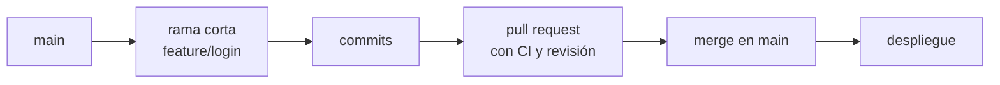

**Git Flow**: más estructurado, pensado para publicar versiones con fecha.

- `main`: solo versiones publicadas, cada una con su etiqueta.
- `develop`: donde se van juntando las funcionalidades terminadas.
- `feature/*`: nacen de `develop` y vuelven a `develop`.
- `release/*`: preparan una versión; van a `main` y a `develop`.
- `hotfix/*`: arreglos urgentes de producción; nacen de `main` y vuelven a `main` y a `develop`.

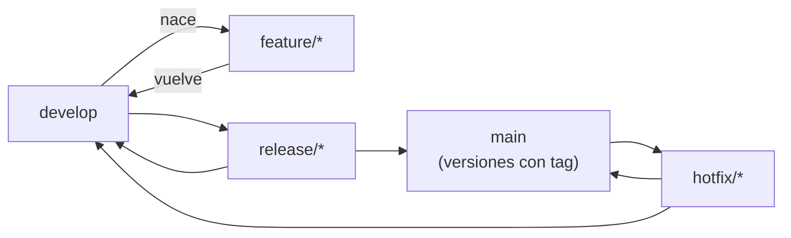

| Estrategia | Ramas principales | Cuándo encaja | Ventaja | Inconveniente |
|---|---|---|---|---|
| Trunk-based | Solo `main` | Equipos con CI fiable y despliegue continuo | Pocos conflictos, respuesta rápida | Exige pruebas automáticas y disciplina |
| Feature branches / GitHub Flow | `main` + ramas cortas | Revisión por PR y despliegue frecuente | Aísla el trabajo y permite revisarlo | Ramas largas acaban en conflictos caros |
| Git Flow | `main` + `develop` + feature, release, hotfix | Versiones con fecha y varias versiones mantenidas | Orden y ramas con propósito claro | Pesado si despliegas a diario |

**Qué se usa en el curso**: feature branches con fusión `--no-ff`. Una rama por tarea, revisión (real o simulada con un PR) y fusión a `main`. Es lo más fácil de comprobar en un historial.

**Cómo se fusiona un PR en GitHub** (tres opciones del botón de merge):

| Opción | Qué hace | Cómo queda el historial |
|---|---|---|
| Merge commit (`gh pr merge --merge`) | Crea un commit de fusión | Se ven la rama y todos sus commits |
| Squash and merge (`--squash`) | Aplasta todos los commits del PR en uno | Lineal, un commit por PR |
| Rebase and merge (`--rebase`) | Reaplica los commits sobre `main` sin commit de fusión | Lineal, sin rama visible |

En las prácticas se usa **merge commit**, para que se vea que hubo una rama.

Fuente: https://dpl-f1facc.gitlab.io/ut01/teoria/git/#7-estrategias-de-ramificacion-y-flujos-de-trabajo y https://dpl-f1facc.gitlab.io/ut01/teoria/git/#estrategias-de-fusion-de-un-pull-request

## 4. Flujo colaborativo: fork, issue, PR y revisión

Vocabulario:

- **Issue**: una ficha de trabajo del proyecto (un fallo, una tarea, una mejora, una duda). Tiene número (`#1`, `#2`...) y se puede comentar, etiquetar (labels) y asignar.
- **Fork**: una copia de un repositorio ajeno en tu cuenta. Se usa cuando **no tienes permiso para escribir** en el original.
- **Pull request (PR)**: una petición para que los cambios de una rama se fusionen en otra (normalmente en `main`). En GitLab se llama **merge request (MR)**. Ojo: el PR **no es un comando de Git**, es una herramienta de la plataforma.
- **Revisión (review)**: otra persona lee el PR y lo comenta, lo aprueba (approve) o pide cambios (request changes).
- **Maintainer**: quien mantiene el repositorio y decide qué se fusiona.

**Diferencia clave**: una issue describe **qué hay que hacer**. Un PR propone **cómo se ha hecho** (trae código) y se revisa antes de fusionarlo.

Hay dos formas de colaborar:

1. **Mismo repositorio** (tienes permiso de escritura): rama, commits, PR, revisión y merge.
2. **Con fork** (no tienes permiso): copias el repo a tu cuenta, trabajas en tu copia y mandas el PR al original.

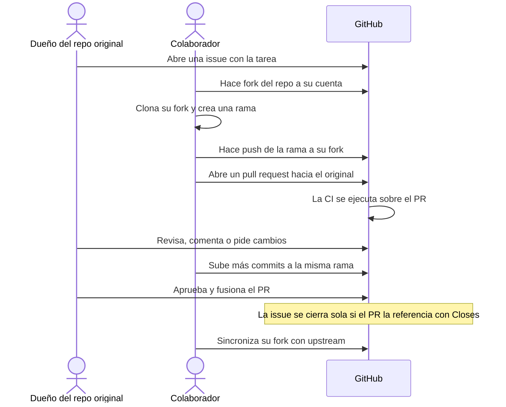

Pasos con comandos (los de gitanddocs los tengo en [02-git-github.md](02-git-github.md)):

```bash
gh repo fork USUARIO/git-work --clone             # fork y clon en un paso (o botón Fork en la web y luego git clone)
cd git-work
git remote -v                                      # origin = tu fork; gh suele dejar creado ya upstream = el original
git remote add upstream git@github.com:USUARIO/git-work.git   # solo si upstream no aparece (si ya existe, da error)
git switch -c custom-text                          # nunca se trabaja directamente en main
git add index.html
git commit -m "Personalizar la portada" -m "Cambio el título y el eslogan de la startup."
git push -u origin custom-text                     # la rama va a TU fork
gh pr create --base main --head MIUSUARIO:custom-text --title "..." --body "Relacionado con #1"
```

Mientras el PR está abierto, **cada commit nuevo que subes a esa rama aparece solo en el PR**. No hace falta abrir otro. Si al crear el PR marcas **Allow edits by maintainers**, quien mantiene el original también puede subir commits a tu rama durante la revisión.

En la guiada 02, quien la hace en solitario no puede hacer fork de su propio repositorio (GitHub no lo permite). Por eso se simula con un segundo repositorio, el **repositorio espejo**, y el PR se abre desde una rama subida al repositorio principal. En el README se explica esa equivalencia.

Sincronizar el fork con el original (para no quedarte atrás):

```bash
git switch main
git fetch upstream
git merge upstream/main
git push origin main
```

Lo mismo con `gh` en un solo comando: `gh repo sync TU_USUARIO/git-work --source USUARIO/git-work --branch main`. Regla práctica: a `upstream` no se hace push; solo se lee de él.

**Cerrar issues automáticamente**: si escribes `Closes #2` (también valen `Fixes`, `Resolves` y sus variantes `close`, `closed`, `fix`, `fixed`, `resolve`, `resolved`):

- en la **descripción de un PR**: la issue se cierra cuando el PR se fusiona en la **rama por defecto** (normalmente `main`);
- en el **mensaje de un commit**: la issue se cierra cuando ese commit **llega a la rama por defecto**.

Si el PR va a otra rama que no es la de por defecto, la palabra clave no hace nada. Y el commit en tu rama, sin llegar a `main`, tampoco cierra nada.

Herramientas colaborativas que hay que saber nombrar (RA6-d):

| Herramienta | Para qué sirve | Ejemplo |
|---|---|---|
| Issues | Apuntar y discutir tareas o fallos | "Desplegar site en un contenedor con NGINX" |
| Pull request / merge request | Proponer cambios y revisarlos antes de fusionar | PR #7 de gitanddocs, con cambios pedidos |
| Revisiones | Comentar, aprobar o pedir cambios | `gh pr review 1 --approve` |
| Wiki | Documentación viva del proyecto dentro de la plataforma | Manual de uso, glosario |
| GitHub Projects | Tablero Kanban: columnas como "por hacer", "en curso" y "terminado" por las que se mueven las tareas | El tablero "DPL" de clase |
| Releases | Publicar versiones con notas | La release `0.1.0` de la guiada 02 |
| Plantillas de issue y PR | Que todos rellenen lo mismo | `.github/ISSUE_TEMPLATE/` de gitanddocs |

**Plantillas** (el currículo las nombra aparte: "creación y utilización de plantillas"). Una plantilla es un texto ya preparado que GitHub pone en el formulario cuando alguien crea una issue o un PR, para que todos rellenen los mismos apartados y no se olvide nada. Se guardan dentro del propio repositorio:

| Fichero | Para qué sirve |
|---|---|
| `.github/ISSUE_TEMPLATE/*.md` | Una plantilla por tipo de issue (fallo, mejora, pregunta...). Si hay varias, al pulsar **New issue** GitHub enseña un selector para elegir |
| `.github/ISSUE_TEMPLATE/config.yml` | Configura ese selector |
| `.github/pull_request_template.md` | Texto con el que empieza la descripción de cada PR: qué cambia, `Closes #N`, cómo se ha probado y una checklist |

Como viven en el repo, las plantillas también se versionan y se cambian con un PR, igual que el código. Ejemplo real: gitanddocs tiene cinco plantillas de issue y una de PR (las describo en [01-repo-gitanddocs.md](01-repo-gitanddocs.md)). La otra plantilla que usas en el curso es el esqueleto del README del apartado 6, que repites en cada entrega.

Comandos de `gh` (GitHub CLI, la herramienta oficial de GitHub para la terminal) que conviene reconocer:

| Comando | Qué hace |
|---|---|
| `gh issue create --title "..." --body "..."` | Crea una issue |
| `gh pr create --base main --head usuario:rama` | Abre un PR |
| `gh pr checkout 1` | Trae a tu ordenador la rama del PR 1 para probarlo |
| `gh pr review 1 --approve` | Aprueba el PR 1 |
| `gh pr review 1 --request-changes --body "..."` | Pide cambios |
| `gh pr merge 1 --merge --delete-branch` | Fusiona con commit de fusión y borra la rama |
| `gh repo sync TU_USUARIO/repo --source ORIGINAL/repo` | Pone al día tu fork de GitHub con el original (sin argumentos, `gh repo sync` actualiza tu copia local) |
| `gh release create v1.0.0` | Crea una release |

Regla de revisión del curso: **el autor no fusiona su propio PR sin una revisión antes**.

Fuente: https://dpl-f1facc.gitlab.io/ut01/teoria/git/#10-flujo-colaborativo-en-github, https://dpl-f1facc.gitlab.io/ut01/teoria/documentacion/#flujo-open-source-completo-fork-y-upstream, https://docs.github.com/en/issues/tracking-your-work-with-issues/using-issues/linking-a-pull-request-to-an-issue, https://docs.github.com/en/communities/using-templates-to-encourage-useful-issues-and-pull-requests/configuring-issue-templates-for-your-repository y https://docs.github.com/en/communities/using-templates-to-encourage-useful-issues-and-pull-requests/creating-a-pull-request-template-for-your-repository

## 5. Seguridad y accesibilidad del código

Esto es el RA6-f: que el código guardado esté **accesible** (disponible para quien lo necesita, con copia de seguridad) y **seguro** (que no se filtre nada ni entre quien no debe).

**Accesibilidad:**

- El repositorio remoto es una copia de seguridad: si se rompe tu ordenador, el historial sigue en GitHub. Se puede tener más de un remoto.
- Control de acceso: repositorio público o privado, quién es colaborador y con qué permisos (leer, escribir, administrar).
- Además, GitHub permite proteger ramas, por ejemplo exigiendo un PR con revisión o que la CI pase antes de fusionar en `main`.

**Autenticación** (demostrarle a GitHub que eres tú). Un repositorio remoto tiene dos tipos de dirección y cada una se autentica de una forma:

- **SSH** (Secure Shell): protocolo para conectarse cifrado a otra máquina. Dirección del tipo `git@github.com:usuario/repo.git`.
- **HTTPS**: el mismo protocolo cifrado que usa el navegador. Dirección del tipo `https://github.com/usuario/repo.git`.

| Vía | Credencial | Cómo funciona |
|---|---|---|
| SSH (la recomendada en el módulo) | Par de claves: privada y pública | La privada se queda en tu ordenador; la pública se sube a GitHub. No viaja ninguna contraseña |
| HTTPS | Token personal (PAT) | GitHub ya no acepta la contraseña de la cuenta para Git; se usa un token en su lugar. Con `gh auth login` la herramienta `gh` lo gestiona por ti |

Por qué el módulo prefiere SSH, en cuatro ideas:

1. Más seguro: no se manda ni usuario ni contraseña por la red.
2. Más cómodo: configurada una vez, no te pide credenciales en cada `push` o `pull`.
3. La clave privada nunca sale de tu ordenador, así que solo tú autorizas conexiones.
4. Con HTTPS es más fácil que un token acabe filtrado (pegado en un log, en una captura o en un comando copiado).

```bash
ssh-keygen -t ed25519 -C "alumno@dpl.local"   # crea el par de claves (ed25519 es el tipo de clave)
eval "$(ssh-agent -s)"                        # arranca el agente SSH, que guarda la clave en memoria
ssh-add ~/.ssh/id_ed25519                     # le da la clave privada al agente
cat ~/.ssh/id_ed25519.pub                     # esta (la .pub) es la que se pega en GitHub
ssh -T git@github.com                         # comprueba que GitHub te reconoce
```

- **Clave de cuenta** (Settings > SSH and GPG keys): sirve para todos tus repos.
- **Deploy key** (Settings > Deploy keys de un repo): sirve solo para ese repo. Por defecto solo lee; para poder hacer push hay que marcar "Allow write access".
- **Personal Access Token (PAT)**: una contraseña especial que generas en GitHub (Settings > Developer settings > Personal access tokens), con permisos limitados (los **scopes**, en la web del curso los mínimos son `repo`, `workflow` y `read:org`) y que puedes revocar. Solo se ve una vez al crearlo. Se trata como una contraseña: no se comparte ni se guarda en el repo.

**No subir secretos:**

- Nunca se versionan contraseñas, claves privadas, tokens ni ficheros `.env`. Se excluyen con `.gitignore`.
- En la documentación se usan valores de ejemplo: usuario `alumno`, contraseña `CAMBIAR_ESTO`.
- Antes de entregar, buscar con algo como `grep -RniE "password|passwd|secret|PRIVATE KEY" .`
- **Si se te escapa un secreto**: cámbialo (rótalo) inmediatamente. Borrarlo en un commit nuevo **no basta**, porque sigue en los commits anteriores del historial. Para quitarlo también del historial hay que reescribirlo con herramientas como `git filter-repo`, con todos los problemas de reescribir historia compartida (apartado 2.11). Por eso lo primero siempre es cambiar la contraseña: una vez publicada, hay que darla por comprometida.
- Para buscar si un fichero sensible llegó a algún commit: `git log --all -- .env`.
- En la CI, los secretos van en los **secrets** del repositorio, nunca en el YAML (apartado 7).

Fuente: https://dpl-f1facc.gitlab.io/ut01/teoria/git/#11-seguridad-y-buenas-practicas y https://docs.github.com/en/authentication/keeping-your-account-and-data-secure/managing-your-personal-access-tokens

## 6. Documentación

### Por qué documentar

Piensa en un servidor que montó un compañero que ya no está en la empresa. Si no dejó nada escrito, nadie sabe cómo instalarlo de nuevo, qué ficheros se tocaron, cómo saber si funciona ni qué hacer cuando falla. Arreglarlo cuesta mucho más que haberlo apuntado. Por eso en este módulo documentar forma parte del despliegue, y se hace **mientras** se trabaja, no al final si sobra tiempo.

Y se **versiona con Git** junto al código, no se guarda suelta: así cada cambio de la documentación tiene autor y fecha, se revisa en un PR como el código y siempre cuadra con la versión del programa que describe.

### El README según el profesor

El **README.md** es la primera página del repositorio: lo que se ve al abrirlo en GitHub. Estructura que pide el módulo:

````markdown
# Nombre del proyecto

Qué es y para qué sirve, en una o dos líneas.

## Índice

- [Instalación](#instalación)
- [Configuración](#configuración)
- [Comprobación](#comprobación)
- [Problemas encontrados y solución](#problemas-encontrados-y-solución)
- [Repositorio remoto](#repositorio-remoto)

## Instalación
Comandos exactos para ponerlo en marcha.

## Configuración
Ficheros que se tocan y por qué.

## Comprobación
Comandos que demuestran que funciona y su salida real.

## Problemas encontrados y solución
Fallos reales y cómo se arreglaron.

## Repositorio remoto
https://github.com/usuario/proyecto
````

Normas del módulo para el README:

- **Un solo `#`** (el título del proyecto) y cada apartado con `##`.
- **Índice al principio** con enlaces internos que funcionen en GitHub.
- Los apartados coinciden con los **criterios de la rúbrica** de la práctica: así el profesor encuentra cada cosa y tú compruebas que no te falta nada.
- Comandos reales y copiables, dentro de bloques de código con lenguaje.
- La comprobación, mejor con un comando que dé una salida verificable (`curl`, `git log`, `docker compose ps`...).
- Contar los fallos que tuviste suma: demuestra que entiendes lo que haces.
- Sin credenciales reales (en los ejemplos, usuario `alumno` y contraseña `CAMBIAR_ESTO`).
- Con el enlace al repositorio remoto y la relación con los RA y CE.
- Corto y ordenado: si hace falta mucho detalle, va en una carpeta `docs/`, no en el README.
- **No es un copia y pega de los apuntes**: es la historia ordenada de lo que hiciste tú.

### Ficheros mínimos de un repositorio

| Fichero | Para qué sirve |
|---|---|
| `README.md` | Primera página: qué es, cómo se instala, se configura y se comprueba |
| `LICENSE` | La licencia: qué puede hacer otra persona con tu código (por ejemplo MIT) |
| `.gitignore` | Qué no se versiona (apartado 2.14) |
| `CHANGELOG.md` (recomendable) | Lista de cambios agrupados por versión, con el formato de Keep a Changelog |

Un ejemplo de `CHANGELOG.md` muy corto:

```markdown
# Changelog

## [Unreleased]

## [1.0.0] - 2026-10-18

### Added

- Blog con Jekyll servido por NGINX.
```

### Markdown

**Markdown** es un formato de texto plano con unas marcas muy simples para dar formato. Se lee bien en crudo y las plataformas lo convierten en HTML.

| Escribes | Resultado |
|---|---|
| `# Título`, `## Subtítulo` | Encabezados de nivel 1 y 2 |
| `**negrita**`, `*cursiva*` | **negrita**, *cursiva* |
| `` `código` `` | Código en línea |
| `- elemento` y `1. elemento` | Listas |
| `[texto](ruta.md)` | Enlace. Con una ruta **relativa** (`otra.md`, `docs/instalacion.md`) funciona tanto en GitHub como en la copia local del repo |
| Tres comillas invertidas con el lenguaje (` ```bash `) | Bloque de código con colores |
| `\| a \| b \|` con una fila `\|---\|---\|` | Tabla |
| Bloque ` ```mermaid ` | Diagrama (flujos, secuencias...) |

**Mermaid** es un lenguaje para dibujar diagramas escribiendo texto: pones las cajas y las flechas con palabras y la plataforma lo convierte en dibujo. Todos los diagramas de esta guía están hechos así. Encaja con lo que pide el curso en las entregas (diagramas Mermaid y salidas de comandos en texto, sin capturas): todo es texto, así que se versiona con Git y el `diff` enseña qué cambió.

Ventajas frente a un procesador de textos (Word): se versiona bien con Git (el `diff` muestra exactamente qué línea cambió), sirve en cualquier plataforma, se lee sin programas especiales y se puede convertir a HTML o PDF. Los generadores añaden extras como avisos (admonitions), pestañas y diagramas Mermaid.

### Generadores de documentación

Hay dos formas de publicar documentación escrita en Markdown:

1. **En la propia plataforma**: GitHub y GitLab muestran el Markdown ya formateado (README, wiki) sin instalar nada.
2. **Con un generador de sitios estáticos**: un programa que convierte una carpeta de ficheros Markdown en una web estática (HTML, CSS y JavaScript ya hechos) que se puede servir con NGINX o con cualquier hosting estático.

**Web estática**: las páginas ya están hechas de antemano y el servidor solo las entrega; no ejecuta código por cada visita.

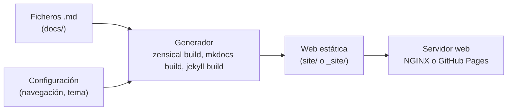

| Generador | Se instala como | Configuración | Fuentes | Sale en | Comandos |
|---|---|---|---|---|---|
| Zensical (con él está hecha la web del curso) | Paquete de Python (con pip o uv) | `zensical.toml` | `docs/` | `site/` | `zensical build`, `zensical serve` |
| MkDocs (y su tema Material) | Paquete de Python (con pip) | `mkdocs.yml` | `docs/` | `site/` | `mkdocs build`, `mkdocs serve` |
| Jekyll (el que usé para el blog) | Gema de Ruby (con gem o bundle) | `_config.yml` | Raíz del proyecto, entradas en `_posts/` | `_site/` | `jekyll build`, `jekyll serve` |

- `build` genera la web en la carpeta de salida. `serve` levanta un servidor local para verla mientras escribes.
- `mkdocs build --strict` convierte los avisos (warnings) en errores, así que el comando **falla** en vez de terminar bien. Por ejemplo, falla con un enlace a una página que no existe o con una entrada de `nav` que apunta a un fichero que no está. Por eso se usa en la CI de la guiada 02: si la documentación tiene fallos, la CI se pone en rojo.
- Matiz: la web del curso dice que también falla si hay una página fuera de la navegación. En MkDocs 1.6 eso, por defecto, es solo un mensaje informativo (`INFO`) y no lo hace fallar, salvo que se cambie la opción `validation` de `mkdocs.yml`. En el examen, quédate con la idea del profesor: `--strict` sirve para que los fallos de la documentación paren el build.
- La carpeta generada (`site/`, `_site/`) **no se versiona**: se vuelve a crear con `build`. Va en el `.gitignore`.
- Relación con Git: en el repositorio se guardan las **fuentes** (los `.md` y el fichero de configuración), no la web generada. La web se genera cuando hace falta, en tu ordenador o en la CI.
- GitHub Pages trae Jekyll integrado, y también puede publicar lo que genere un workflow (así se publica gitanddocs con Zensical).
- Otros generadores de sitios estáticos que nombra el curso en la UT2, al hablar de JAMstack (webs que se generan antes y se sirven ya hechas, sin ejecutar código en el servidor por cada visita): Hugo, Astro, Eleventy y Next.js.
- **markdownlint** no es un generador: es un **validador** que revisa que el Markdown esté bien escrito.

Los detalles de Zensical (comandos, `nav`, tema) los tengo en [03-uv-zensical.md](03-uv-zensical.md).

El CE RA6-b habla de "generadores específicos de las plataformas". En el curso ese papel lo hacen MkDocs y Zensical. Aunque no salen en la web del curso, hay otro tipo de generador que conviene saber nombrar: los que sacan la documentación de los comentarios del propio código. Ejemplos clásicos: **Javadoc** (Java), **Sphinx** (Python, con su extensión autodoc lee los docstrings), **JSDoc** (JavaScript) y **Doxygen** (C, C++ y otros).

### Formatos de documentación (RA6-c)

| Formato | Para qué lo hemos usado |
|---|---|
| Markdown (`.md`) | README, páginas de la documentación, entradas del blog |
| HTML | La web que generan Zensical y Jekyll, la portada de NGINX |
| YAML (`.yml`, `.yaml`) | Workflows de GitHub Actions, `compose.yaml`, `mkdocs.yml`, `_config.yml` de Jekyll |
| TOML (`.toml`) | `zensical.toml`, `pyproject.toml` |
| Mermaid | Diagramas dentro del Markdown |
| Texto plano (`.txt`) | `comprobaciones.txt` con las salidas reales |
| PDF | Formato de salida posible a partir de Markdown |

Dos formatos que salen mucho y conviene saber reconocer:

- **YAML**: formato de texto para configuración. Usa `clave: valor` y la **sangría** (los espacios del principio de línea) marca qué va dentro de qué. Un espacio de más o de menos puede romperlo o cambiar lo que significa, y no admite tabuladores para sangrar.
- **TOML**: otro formato de configuración. Usa `clave = valor` y agrupa con secciones entre corchetes, como `[project]`.

Fuente: https://dpl-f1facc.gitlab.io/ut01/teoria/documentacion/, https://dpl-f1facc.gitlab.io/ut01/teoria/git/#estructura-minima-de-un-repositorio y https://www.mkdocs.org/user-guide/configuration/#validation

## 7. CI/CD y GitHub Actions

### Las tres ideas: CI, entrega continua y despliegue continuo

- **Integración continua (CI, Continuous Integration)**: nadie tiene que acordarse de probar. Cada cambio que llega al repositorio dispara solo unas comprobaciones (construir el proyecto, pasar las pruebas, revisar el formato). Así un fallo se ve el mismo día que se mete, cuando todavía es fácil saber qué lo causó.
- **Entrega continua (Continuous Delivery)**: la CI y un paso más. Si el cambio supera todo, se prepara el paquete final y se deja **preparado para producción**. Subirlo de verdad lo decide **una persona** (pulsa un botón o aprueba).
- **Despliegue continuo (Continuous Deployment)**: se quita ese botón. Cada cambio que supera las comprobaciones **llega solo a producción**, sin que nadie lo apruebe. Solo es buena idea si las pruebas son muy buenas.

> Analogía: la CI es un corrector automático que revisa cada entrega. La entrega continua es dejar el paquete preparado en el almacén, esperando a que alguien pulse "enviar". El despliegue continuo es que el paquete sale solo en cuanto está listo.

Truco para no liarse: "entrega" y "despliegue" se abrevian las dos como CD. La diferencia es **si hay aprobación humana antes de producción**.

| Nivel | Qué se automatiza | Qué decide una persona |
|---|---|---|
| Integración continua | Construir y probar cada cambio | Todo lo demás |
| Entrega continua | Todo hasta dejar el artefacto listo | Cuándo desplegar |
| Despliegue continuo | Todo, incluida la subida a producción | Nada |

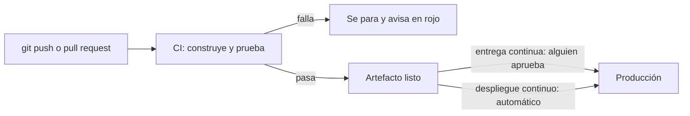

### Pipeline, entornos y artefactos

Un **pipeline** (tubería) es la lista ordenada de pasos automáticos por los que pasa cada cambio, desde el `push` hasta producción. Funciona como una cadena de montaje: si un paso sale mal, se para ahí, los siguientes ya no se hacen y el cambio queda marcado en rojo.

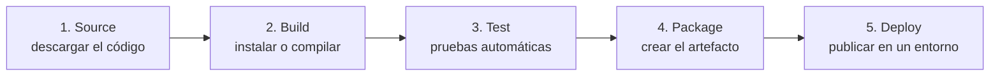

Cada fase con un ejemplo real de comando o acción:

| Fase | Qué hace | Ejemplo |
|---|---|---|
| Source | Descarga el código del commit que se va a probar | `actions/checkout` |
| Build | Instala dependencias o compila | `pip install -r requirements.txt`, `uv sync --locked` |
| Test | Pasa las pruebas automáticas | `pytest`, `nginx -t`, `curl` en mi práctica |
| Package | Fabrica el artefacto | Construir una imagen Docker |
| Deploy | Lo publica en un entorno | `docker push` a un registro |

Se ponen primero las comprobaciones rápidas y baratas y después las lentas: así los fallos tontos se ven antes (**fallo rápido**).

Un **entorno** es cada uno de los sitios por los que pasa el programa antes de llegar a los usuarios, y cada uno tiene su propia copia del sistema:

| Entorno | Para qué | Quién lo usa |
|---|---|---|
| Local | Desarrollar y probar en tu ordenador | El desarrollador |
| Integración | Donde corre el pipeline con sus pruebas | La propia CI |
| Staging (preproducción) | Probar el despliegue con datos parecidos a los reales | El equipo |
| Producción | El sistema que usan los usuarios de verdad | Los clientes |

Ojo con la palabra **staging**: aquí es un entorno (la preproducción) y no tiene nada que ver con el staging de Git del apartado 2.2 (la zona de `git add`). Se llaman igual pero son cosas distintas.

Cuanto más se parezcan los entornos entre sí, menos sorpresas. Docker ayuda justo a eso: el mismo contenedor funciona igual en todos.

Un **artefacto** es el "paquete" que sale del pipeline y que es lo que de verdad se instala: una imagen Docker, un `.war` de Java, un ZIP, un ejecutable. Lleva un número de versión o el hash del commit del que salió. Se guarda en un **registro** (un almacén de artefactos, como Docker Hub o GitHub Container Registry). Ventajas:

- Lo que se probó es exactamente lo que se instala: no se vuelve a construir por el camino.
- Se sabe qué versión hay en cada entorno y de qué commit viene.
- Volver atrás es tan fácil como instalar el artefacto anterior.

**Ramas y CI**: en GitHub Flow, los PR solo se prueban. El artefacto se construye y se publica únicamente cuando el cambio entra en `main`. Así no se fabrican paquetes de ramas que a lo mejor nunca se fusionan.

### Herramientas de CI/CD

| Herramienta | Cómo funciona | Fichero de configuración |
|---|---|---|
| GitHub Actions | Servicio en la nube de GitHub, integrado con los PR | `.github/workflows/*.yml` |
| GitLab CI/CD | Integrado en GitLab | `.gitlab-ci.yml` |
| Jenkins | Servidor propio que instalas tú, ampliable con plugins | `Jenkinsfile` |

Lo que tienen en común: el pipeline se escribe en **un fichero de texto que vive dentro del propio repositorio**. Ese fichero dice qué lo pone en marcha y qué pasos hace. Al estar en el repo, tiene historial como cualquier fichero y cambiarlo pasa por un PR con revisión.

### Vocabulario de GitHub Actions

| Término | Qué es |
|---|---|
| Workflow | Un proceso automático definido en un fichero YAML dentro de `.github/workflows/` |
| Evento (trigger) | Lo que dispara el workflow. Se pone en `on:` (`push`, `pull_request`, `workflow_dispatch` para lanzarlo a mano, `schedule` para lanzarlo por horario) |
| Job (trabajo) | Un conjunto de pasos que se ejecutan en la misma máquina. **Por defecto, los jobs van en paralelo**; con `needs:` uno espera a otro |
| Step (paso) | Cada paso de un job. Se ejecutan **en orden**, uno detrás de otro |
| Runner | La máquina (normalmente virtual y de GitHub) que ejecuta un job. Se elige con `runs-on:`, por ejemplo `ubuntu-latest` |
| Action (acción) | Un bloque reutilizable que hace una tarea común, hecho por GitHub o por otros. Se usa con `uses:` |
| `uses:` | Ejecuta una acción ya hecha, por ejemplo `actions/checkout@v4` (la `@v4` es la versión) |
| `run:` | Ejecuta comandos de terminal escritos por ti |
| `with:` | Parámetros que se le pasan a una acción |
| `if:` | Condición para que un job o un paso se ejecute |
| `secrets.NOMBRE` | Secretos guardados en la configuración del repo, que no se escriben en el YAML |

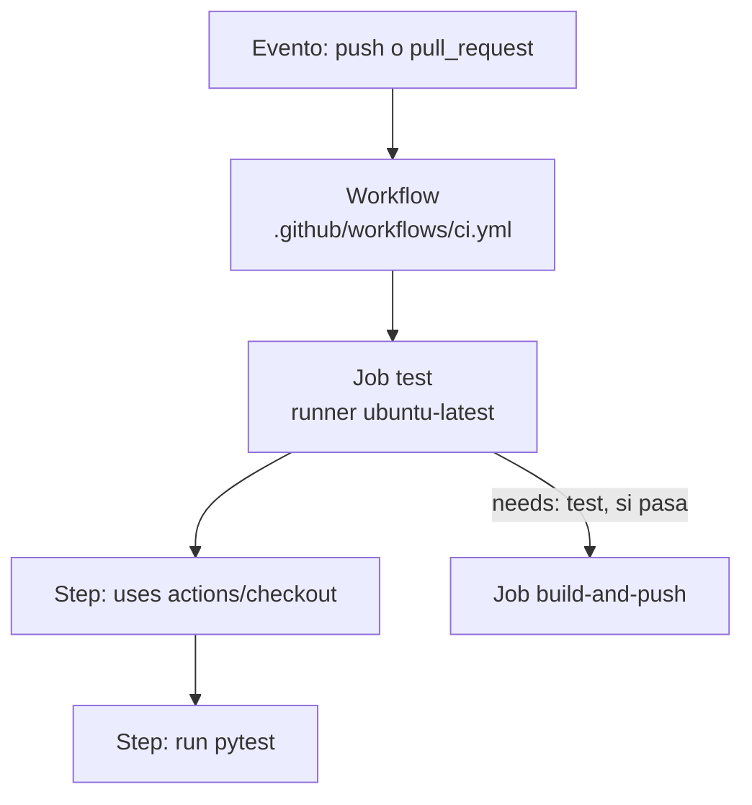

Un paso **falla** cuando su comando termina con un código de error (cualquier código distinto de 0). Entonces el job se para y se marca en rojo.

### Ejemplo comentado: el workflow de mi práctica

Este es el `.github/workflows/ci.yml` de nginx-para-todos. El contenido es el real; los comentarios con `#` los he añadido aquí para explicarlo (en el fichero de la práctica no están):

```yaml
name: CI                                   # nombre que se ve en la pestaña Actions

on:                                        # eventos que lo disparan
  push:
    branches: [main]                       # cada push a main
  pull_request:                            # y cada pull request

jobs:
  comprobar:                               # un solo job, llamado "comprobar"
    runs-on: ubuntu-24.04                  # runner: máquina Ubuntu de GitHub
    steps:
      - name: Descargar el repositorio
        uses: actions/checkout@v7          # acción que copia el repo en el runner

      - name: Instalar uv
        uses: astral-sh/setup-uv@v10.3.0   # acción que instala uv

      - name: Generar la documentación con Zensical
        working-directory: docs-zensical   # carpeta donde se ejecuta el paso
        run: |                             # | permite varias líneas de comandos
          uv sync --locked
          uv run zensical build

      - name: Generar el blog con Jekyll
        run: docker compose run --rm jekyll

      - name: Comprobar la configuración de NGINX
        run: docker compose run --rm nginx nginx -t

      - name: Arrancar NGINX y probar las dos webs
        run: |
          docker compose up -d
          sleep 2
          curl -fsS -H "Host: docs.local" http://localhost:8080/ | grep "<title>Get started - Documentation</title>"
          curl -fsS -H "Host: blog.local" http://localhost:8080/ | grep "<title>Mi temporada culé"
          curl -fsS http://localhost:8080/ | grep "<title>NGINX para todos</title>"
          curl -sI -H "Host: docs.local" http://localhost:8080/markdown | grep -i "^location: /markdown/"
          docker compose down
```

Cómo explicarlo:

- **Cuándo se ejecuta**: en cada PR (para comprobar el cambio antes de fusionarlo) y en cada push a `main` (para confirmar que `main` sigue bien).
- **Qué comprueba**: que la documentación y el blog se generan, que la configuración de NGINX es válida (`nginx -t`) y que NGINX responde con la web correcta según el nombre de la cabecera `Host`.
- `runs-on: ubuntu-24.04` fija la versión de Ubuntu del runner. `ubuntu-latest` también vale, pero cambia sola cuando GitHub publica una versión nueva.
- `--locked` hace que `uv` instale exactamente las versiones de `uv.lock` y falle si no cuadran.
- `docker compose run --rm jekyll` arranca un contenedor del servicio `jekyll` solo para generar el blog y lo borra al acabar (`--rm`). `docker compose run --rm nginx nginx -t` hace lo mismo pero ejecutando `nginx -t`, que revisa la sintaxis de la configuración.
- `sleep 2` espera dos segundos para dar tiempo a que NGINX arranque antes de probarlo.
- **curl** es un programa de terminal que hace peticiones HTTP, como un navegador pero sin ventana. `curl -fsS`: `-f` hace que curl dé error si la respuesta HTTP es un error (400 o más), `-s` quita la barra de progreso y `-S` sigue enseñando los errores. `-H "Host: docs.local"` cambia la cabecera `Host` para pedir una web u otra al mismo NGINX.
- `grep` busca un texto en la respuesta. Si no lo encuentra, devuelve error, el paso falla y la CI sale en rojo. Es una prueba automática muy sencilla.
- La última prueba usa `curl -sI`: `-I` pide solo las cabeceras. Comprueba que al pedir `/markdown` sin barra final NGINX redirige a `/markdown/` con una ruta relativa, es decir, sin perder el puerto 8080 (el fallo que arreglé con `absolute_redirect off`).
- En un runner Ubuntu, cada `run:` se ejecuta con `bash -e`: en cuanto un comando falla, el paso se para ahí.
- Es **integración continua** (comprueba), no despliegue continuo: no publica nada en producción.

### Lo que añade el ejemplo del profesor

El workflow de la guiada 25 (y de la teoría de CI/CD) tiene dos jobs: `test`, que pasa las pruebas de una aplicación Python, y `build-and-push`, que construye una imagen Docker y la publica en **GHCR** (GitHub Container Registry, el registro de imágenes de GitHub, en `ghcr.io`). Resumido, con mis comentarios:

```yaml
on:
  push:
    branches: [main]
  pull_request:
  workflow_dispatch:                              # también se puede lanzar a mano

jobs:
  test:
    runs-on: ubuntu-latest
    steps:
      - uses: actions/checkout@v4
      - uses: actions/setup-python@v5             # instala Python en el runner
        with:
          python-version: "3.12"
      - run: pip install -r requirements.txt
      - run: pytest -q

  build-and-push:
    needs: test                                   # solo empieza si test ha pasado
    if: github.ref == 'refs/heads/main' && github.event_name == 'push'   # solo en push a main
    runs-on: ubuntu-latest
    permissions:                                  # permisos mínimos para el token automático
      contents: read
      packages: write
    steps:
      - uses: actions/checkout@v4                 # cada job empieza en una máquina limpia
      - uses: docker/login-action@v3              # inicia sesión en el registro
        with:
          registry: ghcr.io
          username: ${{ github.actor }}
          password: ${{ secrets.GITHUB_TOKEN }}   # secreto que crea GitHub en cada ejecución
      - uses: docker/build-push-action@v6         # construye la imagen y la sube
        with:
          context: .
          push: true
          tags: ghcr.io/${{ github.repository }}:${{ github.sha }}
```

- `${{ ... }}` es la forma de meter un valor en el YAML. `github.ref`, `github.event_name`, `github.sha`, `github.actor` y `github.repository` son datos que GitHub rellena en cada ejecución: la rama, el evento, el hash del commit, quién lo lanzó y el nombre del repositorio.
- En un PR solo se ejecuta `test`. En un push a `main`, `test` y luego `build-and-push`. Eso es pasar de CI a **entrega continua**: queda una imagen Docker publicada (el artefacto), lista para desplegar.
- Cada job corre en un runner distinto y limpio, por eso `build-and-push` vuelve a hacer `checkout`.
- La imagen se etiqueta con el hash del commit (`github.sha`), y así se sabe de qué commit viene.

Buenas prácticas:

- **Nunca** contraseñas ni tokens en el YAML. Van en los secrets del repo y se usan con `${{ secrets.NOMBRE }}`. GitHub no los enseña en los logs, pero aun así no se imprimen con `echo`.
- Permisos mínimos con `permissions:`.
- Fijar la versión de cada acción (`@v4`) para que no cambie sin avisar.
- El workflow es código: se revisa con PR como todo lo demás.

### Vigilar la calidad de forma continua

El currículo incluye un contenido que la web del curso no desarrolla en un apartado propio: "monitorización continua de las métricas de calidad de la aplicación". La idea es sencilla: la CI no solo dice "pasa o no pasa", también **mide** cosas del código en cada push o PR, y esas medidas se pueden seguir en el tiempo.

- **Métrica**: un número que se puede medir y comparar (cuántas pruebas pasan, cuántos avisos hay...).
- **Monitorización continua**: medirlo en cada cambio, de forma automática, y no una vez al final.

| Métrica | Qué dice | Ejemplo de herramienta |
|---|---|---|
| Pruebas que pasan y que fallan | Si el código sigue haciendo lo que debe | `pytest` |
| Cobertura de pruebas | Qué porcentaje del código ejecutan las pruebas | coverage.py (con `pytest-cov`) |
| Avisos del *linter* (un programa que revisa el código sin ejecutarlo y avisa de errores de estilo o fallos probables) | Código o Markdown mal escrito o sospechoso | `ruff` o `flake8` para Python, markdownlint para Markdown |
| Build de la documentación | Que la web se genera sin enlaces rotos | `mkdocs build --strict` (apartado 6) |
| Estado y duración del pipeline | Si la CI falla a menudo o se vuelve lenta | Pestaña Actions de GitHub, `gh run list` |

Dónde se ven: en el check verde o rojo de cada PR y en el historial de ejecuciones de la pestaña Actions. Con la protección de ramas (apartado 5) se puede exigir que esas comprobaciones pasen antes de fusionar en `main`. La web del curso lo conecta con el "fallo rápido": el *lint* va al principio del pipeline porque es lo más barato. Para guardar y dibujar estas métricas a lo largo del tiempo existen plataformas específicas, como SonarQube.

En mi práctica, la CI mide lo básico: que las dos webs se generan, que `nginx -t` pasa y que cada web responde con su título. No mide cobertura porque no hay código propio que probar.

Fuente: https://dpl-f1facc.gitlab.io/ut01/teoria/ci-cd/, https://dpl-f1facc.gitlab.io/ut01/practicas/guiada-25-github-actions-cicd/, https://dpl-f1facc.gitlab.io/introduccion/modulo/#2-contenidos-basicos-oficiales, https://docs.github.com/en/actions/get-started/understand-github-actions y https://docs.github.com/en/repositories/configuring-branches-and-merges-in-your-repository/managing-protected-branches/about-protected-branches

## 8. Docker en la UT1: prepara tu entorno

En la UT1 Docker solo aparece para dejar listo el entorno de trabajo de todo el curso (guiada 03). Esa práctica cuenta para el **RA1** (e, f, i), no para el RA6. Docker a fondo se ve en la UT4.

Vocabulario mínimo:

- **Docker**: programa que ejecuta aplicaciones dentro de **contenedores**, aisladas del resto del ordenador.
- **Imagen**: la plantilla de la que se crean contenedores (por ejemplo `ubuntu:24.04`, `nginx:1.30`). Lo que va detrás de los dos puntos es la **etiqueta** (versión). Las oficiales se descargan de Docker Hub.
- **Contenedor**: una imagen en marcha. De una imagen puedes sacar muchos contenedores.
- **Anfitrión (host)**: tu ordenador, donde corre Docker.

> Analogía: la imagen es la receta y el contenedor es el plato cocinado. Con una receta puedes cocinar todos los platos que quieras, y si uno se quema, lo tiras y haces otro.

El curso no usa máquinas virtuales: cada alumno tiene un contenedor **dpl-lab** que hace de "su servidor" y un **dpl-cliente** para probar desde "otra máquina". **Nunca se instala software de servidor en el anfitrión**, todo va dentro de los contenedores.

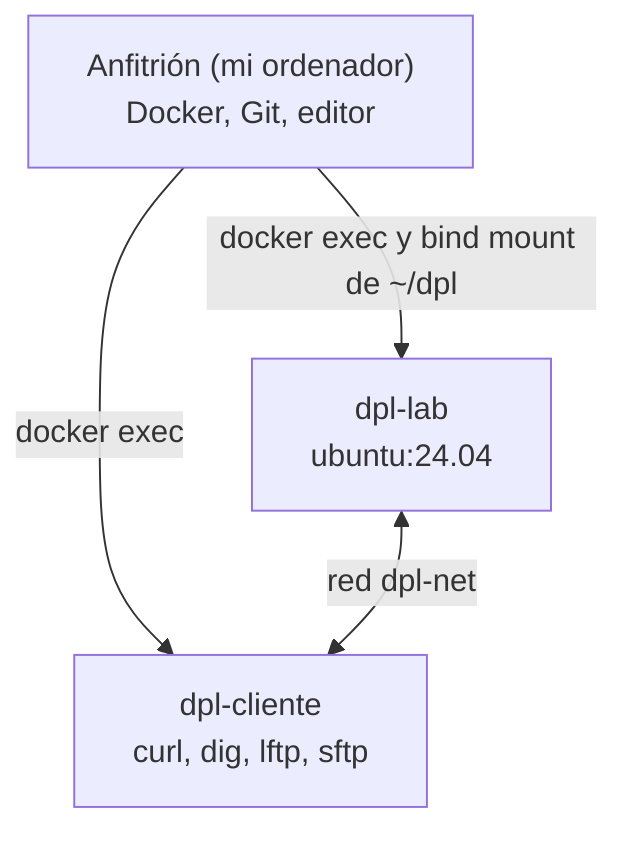

Los pasos de la práctica, en orden:

```bash
# 1. Carpeta del microproyecto con su Git, y comprobar Docker
mkdir -p ~/dpl/ut01-guiada-03 && cd ~/dpl/ut01-guiada-03 && git init
docker --version            # Docker está instalado
docker info                 # el servicio de Docker (el daemon) está en marcha

# 2. Contenedor de laboratorio
mkdir -p ~/dpl
docker run -dit --name dpl-lab \
  -v ~/dpl:/home/alumno/dpl \
  -p 80:80 -p 8080:8080 -p 8000:8000 \
  ubuntu:24.04

# 3. Usuario de trabajo dentro de dpl-lab (se escribe dentro de la terminal del contenedor)
docker exec -it dpl-lab bash
useradd -m -s /bin/bash alumno            # crea el usuario alumno con su carpeta personal
mkdir -p /home/alumno/dpl
chown -R alumno:alumno /home/alumno/dpl   # la carpeta pasa a ser de alumno
exit

# 4. Herramientas base dentro del laboratorio, nunca en el anfitrión
docker exec dpl-lab bash -c "apt-get update && apt-get install -y curl git nano"

# 5. Contenedor cliente con herramientas de red
docker run -dit --name dpl-cliente ubuntu:24.04
docker exec dpl-cliente bash -c "apt-get update && apt-get install -y curl dnsutils lftp openssh-client python3-pip"

# 6. Red propia con los dos contenedores, y sacar la IP de dpl-lab
docker network create dpl-net
docker network connect dpl-net dpl-lab
docker network connect dpl-net dpl-cliente
docker inspect -f '{{range .NetworkSettings.Networks}}{{.IPAddress}}{{end}}' dpl-lab

# 7. Probar desde el cliente que llega al laboratorio (que el 80 no responda aún es normal)
docker exec dpl-cliente bash -c "curl -s http://IP_DPL_LAB:80/ || echo 'sin servicio en el 80 (normal aún)'"

# 8. Comprobar y documentar
docker ps                   # dpl-lab y dpl-cliente en estado Up
```

Después se escribe el README con los comandos y sus salidas reales y se hace un commit por paso, como en cualquier entrega.

- `docker exec` ejecuta un comando dentro de un contenedor que ya está en marcha. Con `-it bash` te abre una terminal dentro; con `bash -c "..."` lanza un comando y vuelve.
- `apt-get` es el instalador de programas de Ubuntu. `apt-get update` descarga la lista de paquetes y hay que hacerlo antes de instalar (si no, sale `Unable to locate package`).

| Opción de `docker run` | Qué hace |
|---|---|
| `-d` | Lo arranca en segundo plano (no se queda ocupando la terminal) |
| `-i` | Mantiene abierta la entrada del contenedor |
| `-t` | Le asigna una terminal. Con `-i` y `-t` el Ubuntu se queda vivo esperando |
| `--name dpl-lab` | Le pone un nombre para usarlo luego |
| `-v ~/dpl:/home/alumno/dpl` | **Bind mount**: la carpeta `~/dpl` del anfitrión aparece dentro del contenedor. Lo que guardas en una lo ves en la otra |
| `-p 8080:8080` | Publica un puerto: `PUERTO_ANFITRIÓN:PUERTO_CONTENEDOR`. Lo que llega a ese puerto de tu ordenador se pasa al contenedor |

Otros comandos útiles: `docker ps -a` (también los parados), `docker rm -f dpl-lab` (borra el contenedor, por ejemplo si el nombre ya está en uso), `docker inspect dpl-lab` (todos sus datos, incluida la IP).

En una **red de Docker creada por ti**, los contenedores se ven entre sí. En la guiada 03 se comprueba por IP (la que da `docker inspect`); Docker también permite encontrarlos por su nombre en este tipo de red, y eso se usa en la UT4.

Si la carpeta `~/dpl` sale vacía dentro del contenedor, el bind mount apuntaba a otra ruta: se borra el contenedor y se crea otra vez con el `-v` bien escrito. Lo que hay en `~/dpl` no se pierde, porque vive en el anfitrión.

Y aunque esta práctica también se documenta como microproyecto con su propio Git, README y commits, su nota es de RA1.

En mi práctica de NGINX usé **Docker Compose**: un fichero `compose.yaml` que describe los contenedores (servicios), sus imágenes, puertos (`"8080:80"`) y volúmenes (con `:ro`, solo lectura) para levantarlos todos con `docker compose up -d` y pararlos con `docker compose down`. Compose ya aparece en la UT2 (la calculadora dockerizada) y se estudia a fondo en la UT4.

Fuente: https://dpl-f1facc.gitlab.io/ut01/practicas/guiada-03-prepara-entorno-docker/, https://dpl-f1facc.gitlab.io/introduccion/entorno/, https://docs.docker.com/reference/cli/docker/container/run/ y https://docs.docker.com/engine/network/drivers/bridge/

## 9. Cómo se entrega una práctica en este módulo

La UT1 también fija cómo se entrega **todo** el curso. Es fácil que caiga alguna pregunta y, sobre todo, es lo que da o quita puntos en cada práctica.

**Microproyecto**: cada práctica vive en su propia carpeta con su **propio repositorio Git** (`git init` en esa carpeta) y no depende de ninguna entrega anterior. Por qué: cada entrega se corrige sola, su historial solo cuenta esa práctica y la autoría se comprueba fácil.

Formato común de toda entrega:

1. `README.md` con el paso a paso: qué se hizo, cómo (comandos exactos), resultado de cada paso, problemas y solución, enlace al repositorio remoto y RA/CE.
2. **Un commit por cambio**, con subject corto en imperativo y cuerpo (qué, cómo y por qué).
3. **Autoría** con nombre y apellidos y correo del aula virtual. Se comprueba con `git log --format='%an <%ae>' | sort -u`.
4. **Evidencias en Markdown**: salidas reales de comandos en bloques de código y diagramas Mermaid. Sin capturas de pantalla.
5. **ZIP con la carpeta `.git` incluida**. Sin `.git`, la práctica no se valora.
6. Entrega en el campus virtual, en fecha.

Errores que restan puntos: entregar sin `.git`, mensajes pobres o varios cambios en un commit, autoría incorrecta, README sin comandos o sin enlace remoto, nombre o estructura de carpetas distinta a la que pide la práctica, capturas en vez de salidas, credenciales reales, configuración sin probar y entregar tarde (una práctica no entregada en fecha y forma vale 0).

Fuente: https://dpl-f1facc.gitlab.io/evaluacion/entregables/#2-formato-comun-de-toda-entrega y https://dpl-f1facc.gitlab.io/evaluacion/entregables/#4-errores-frecuentes-que-restan-puntos

## 10. Mi práctica nginx-para-todos vista desde la UT1

La práctica "NGINX para todos y todos para NGINX" evalúa RA1 y también RA6 (a, b, c, d, h). Esta tabla sirve para explicar y defender la parte de la UT1. Su README está en `nginx-para-todos/README.md` y el remoto en https://github.com/diegoalegil/nginx-para-todos.

| Qué hice | Concepto de la UT1 | Cómo lo defiendo en una frase |
|---|---|---|
| `git init -b main` en una carpeta propia | Microproyecto | Cada entrega tiene su propio repo y no depende de otras |
| `git config --local user.name` y `user.email` | Identidad (2.5) | Con `--local` la identidad va dentro de `.git/config` del ZIP y manda sobre la global |
| Copiar gitanddocs con `git archive` | `git archive` (2.15) | Me traigo los ficheros sin el historial de otros autores y apunto el hash `3e7a2df` |
| `.gitignore` con `.DS_Store`, `.venv/`, `site/`, `_site/` | `.gitignore` (2.14) | Lo generado se vuelve a crear con `build` y no se versiona |
| Ramas `fase-1` y `fase-2` | Feature branches (3) | Cada fase se hace aislada y entra en `main` cuando funciona |
| Issues #1, #2 y #3 y PR #4 y #5 | Flujo colaborativo (4) | Cada tarea tiene su issue y cada fase su PR, donde corre la CI |
| Merge en local con `--no-ff` y push | Fusión (2.9) | El grafo enseña cada rama y todos los commits tienen mi identidad |
| `Closes #1, closes #3` y `Closes #2` en el cuerpo de los dos commits de fusión | Cierre automático (4) | Al llegar cada commit de fusión a `main` (la rama por defecto), GitHub cierra esas issues solas |
| Etiquetas `v0.1.0` y `v1.0.0` | Versionado semántico (2.13) | 0.1.0 al acabar la fase 1 (aún en desarrollo) y 1.0.0 con la práctica completa |
| `.github/workflows/ci.yml` | CI (7) | En cada PR y push a `main` genera las webs, valida NGINX y lo prueba con curl |
| README con índice, Instalación, Configuración, Comprobación, Problemas, Repositorio remoto y Relación curricular | Documentación (6) | Sigue la estructura del profesor y cuenta lo que hice con salidas reales |
| Zensical para la documentación y Jekyll para el blog | Generadores (6) | Dos generadores de sitios estáticos distintos: uno se instala como paquete de Python (con uv) y el otro es de Ruby (en un contenedor `ruby:3.4`) |
| Commits como "Arreglo la redirección que perdía el puerto 8080" | Errores en el historial (2.4) | El fallo y su arreglo quedan registrados, y eso se valora |

El historial real:

```text
$ git log --graph --oneline --all
*   1f456da Junto la fase 2 en main
|\
| * 27437ab Termino el README de la fase 2
| * f1046ea Añado el blog a la CI
| * 6d18ce7 Sirvo la documentación y el blog por su nombre
| * 709f545 Apunto el fallo de la entrada con fecha futura
| * 8ab36e3 Escribo las primeras entradas del blog
| * 634647d Creo el blog con Jekyll
|/
*   bd0a827 Junto la fase 1 en main
|\
| * ed0f051 Documento la fase 1 en el README
| * 19ff647 Añado la CI con GitHub Actions
| * c9d5a1b Arreglo la redirección que perdía el puerto 8080
| * 12eed38 Configuro NGINX para servir la documentación
| * ffdfd13 Cambio el site_url de la documentación
| * e44902e Copio la documentación de gitanddocs
|/
* 501e160 Añado el README y el .gitignore
```

Cómo leerlo: cada `*` es un commit. Las líneas `|\` y `|/` marcan dónde sale y dónde vuelve cada rama. Los commits `Junto la fase...` son los commits de fusión que crea `--no-ff`.

Preguntas que me pueden hacer sobre ella:

- **¿Por qué no fusionaste los PR con el botón de GitHub?** Porque el commit de fusión lo habría creado GitHub con los datos de mi cuenta, que no tienen por qué coincidir con los del aula virtual. Fusionando en local con `--no-ff` y haciendo push, todo el historial tiene mi identidad, se ve cada rama y GitHub marca el PR como fusionado igualmente.
- **¿Por qué no clonaste gitanddocs directamente dentro del proyecto?** Porque me habría traído su `.git` con commits de muchas otras personas (en su `git shortlog -sn` salen 14 nombres de autor), y en la entrega solo puede salir mi autoría.
- **El módulo recomienda SSH y tu remoto es `https://...`. ¿Por qué?** La web del curso acepta las dos vías. Con HTTPS la credencial es un token (por ejemplo, el que gestiona `gh auth login`), y la regla es la misma: el token nunca se guarda dentro del repositorio.
- **¿Por qué `--local` y no `--global` para tu identidad?** Lo que se corrige es el autor que queda grabado en cada commit. Con `--local` me aseguro de que en este repositorio siempre se usan mis datos del aula virtual, aunque el ordenador tenga otra identidad global. Lo compruebo con `git log --format='%an <%ae>' | sort -u`, que da una sola línea.
- **¿Por qué `site/` y `_site/` no están en el repo?** Porque son resultado del `build`; se regeneran siempre igual a partir de los `.md`. Versionarlos duplica contenido y llena el historial de cambios que nadie ha escrito a mano.
- **¿Qué pasa si la CI falla en un PR?** Sale en rojo en el PR y no lo fusiono hasta arreglarlo: es justo para lo que sirve.

Fuente: `nginx-para-todos/README.md` (apartados Instalación, CI, Repositorio remoto y Relación curricular), su historial de Git y su remoto https://github.com/diegoalegil/nginx-para-todos. Sobre el cierre de issues desde commits: https://docs.github.com/en/issues/tracking-your-work-with-issues/using-issues/linking-a-pull-request-to-an-issue

## 11. Chuleta de comandos

**Configuración e inicio**

| Comando | Qué hace |
|---|---|
| `git init -b main` | Crea el repositorio con la rama `main` |
| `git config --local user.name "Nombre Apellidos"` | Identidad solo para este repo |
| `git config --global user.email "correo"` | Identidad para todos los repos |
| `git config --show-origin user.name` | De dónde sale el valor que se usa |
| `git clone URL` | Copia un repo remoto con todo su historial |

**Día a día**

| Comando | Qué hace |
|---|---|
| `git status` / `git status -s` | Estado de cada fichero |
| `git add fichero` / `git add .` | Pasa cambios al staging (con `.` todo: mira antes qué entra) |
| `git commit -m "subject" -m "cuerpo"` | Commit con la convención del módulo |
| `git commit -am "subject"` | Prepara y confirma lo ya versionado (no los nuevos) |
| `git diff` / `git diff --staged` | Cambios sin preparar / cambios preparados |
| `git log --oneline --graph --all` | Historial con el árbol de ramas |
| `git log --format='%an <%ae>' \| sort -u` | Autores de todos los commits |
| `git show <hash>` | Qué hizo un commit |

**Ramas**

| Comando | Qué hace |
|---|---|
| `git branch` / `git branch -a` | Lista ramas locales / también remotas |
| `git switch -c rama` | Crea la rama y se cambia a ella |
| `git switch rama` / `git switch -` | Cambia de rama / vuelve a la anterior |
| `git merge rama` | Fusiona `rama` en la actual (fast-forward si se puede) |
| `git merge --no-ff rama -m "mensaje"` | Fusiona siempre con commit de fusión |
| `git merge --abort` | Cancela una fusión con conflicto |
| `git branch -d rama` / `-D` | Borra la rama fusionada / a la fuerza |
| `git rebase main` | Reaplica los commits de la rama actual encima de `main` (reescribe) |

**Remotos**

| Comando | Qué hace |
|---|---|
| `git remote -v` | Lista los remotos |
| `git remote add upstream URL` | Añade el remoto del repo original |
| `git fetch upstream` | Descarga sin fusionar |
| `git pull` | Descarga y fusiona (`fetch` + `merge`) |
| `git push -u origin rama` | Sube una rama nueva y la vincula |
| `git push --follow-tags` | Sube commits y etiquetas anotadas |
| `git branch -vv` | A qué rama remota sigue cada una |

**Deshacer y guardar**

| Comando | Qué hace |
|---|---|
| `git restore fichero` | Tira los cambios sin preparar |
| `git restore --staged fichero` | Saca del staging |
| `git rm --cached fichero` | Deja de versionar sin borrar del disco |
| `git commit --amend` | Rehace el último commit (no si ya está subido) |
| `git revert <hash>` | Deshace un commit con otro commit nuevo |
| `git stash -u` / `git stash pop` | Guarda el trabajo a medias / lo recupera |
| `git tag -a v1.0.0 -m "mensaje"` | Etiqueta anotada |
| `git archive --format=zip -o copia.zip HEAD` | ZIP de los ficheros sin `.git` |

**GitHub, documentación, CI y Docker**

| Comando | Qué hace |
|---|---|
| `gh pr create` / `gh pr merge` | Abre / fusiona un PR |
| `gh issue create` | Crea una issue |
| `gh run list` | Ejecuciones recientes de GitHub Actions |
| `ssh-keygen -t ed25519` | Crea el par de claves SSH |
| `ssh -T git@github.com` | Comprueba la clave SSH con GitHub |
| `zensical build` / `mkdocs build --strict` | Genera la web de la documentación |
| `docker run -dit --name n -v orig:dest -p 8080:80 imagen` | Crea un contenedor con nombre, carpeta y puerto |
| `docker exec -it dpl-lab bash` | Terminal dentro del contenedor |
| `docker ps` / `docker ps -a` | Contenedores en marcha / todos |

Fuente: https://dpl-f1facc.gitlab.io/recursos/comandos/

## 12. Errores típicos

| Lo que ves | Por qué pasa | Cómo se arregla |
|---|---|---|
| `fatal: La rama actual X no tiene una rama upstream` | La rama local no está vinculada a una remota | `git push -u origin X` |
| `! [rejected] main -> main (fetch first)` | El remoto tiene commits que tú no tienes | `git pull` (o `fetch` + `merge`), resolver si hay conflicto y volver a hacer push |
| `fatal: Necesita especificar cómo reconciliar las ramas divergentes` | `git pull` con ramas divergentes y sin decir si quieres merge o rebase | `git pull --no-rebase` (fusionar) o `git config pull.rebase false` una vez |
| `CONFLICTO (contenido): Conflicto de fusión en f.txt` | Las dos ramas cambiaron las mismas líneas | Editar, borrar marcas, `git add`, `git commit` (o `git merge --abort`) |
| `Permission denied (publickey)` | No hay clave SSH registrada en GitHub | Crear la clave, subir la `.pub` y probar `ssh -T git@github.com` |
| Autoría distinta a la del aula virtual | Identidad global antigua o sin config local | `git config --local ...` y, si el commit no está subido, `git commit --amend --reset-author` |
| `nothing to commit` al añadir una carpeta | Git no versiona carpetas vacías | Meter al menos un fichero dentro |
| Un fichero sigue apareciendo aunque está en `.gitignore` | Ya estaba versionado | `git rm --cached fichero` y commit |
| `HEAD desacoplada en ...` | Hiciste checkout de un commit, no de una rama | `git switch -` para volver o `git switch -c rama` para conservar |
| He subido una contraseña | `git add .` sin mirar | Cambiar la contraseña ya, quitarla, añadirla al `.gitignore`. Sigue en el historial |
| El workflow no aparece en Actions | El YAML no está en `.github/workflows/` o el evento no coincide | Revisar la ruta y el `on:` |
| La CI sale en rojo | Un paso devolvió error | Abrir el log del job, reproducir el comando en local y corregir |
| La issue no se cierra sola | No hay `Closes #N` o no ha llegado a la rama por defecto | Ponerlo en el PR o el commit que llega a `main`, o cerrarla a mano |
| `Conflict. The container name "/dpl-lab" is already in use` | Ya existe un contenedor con ese nombre | `docker rm -f dpl-lab` y volver a crearlo |
| `port is already allocated` | El puerto del anfitrión está ocupado | Usar otro puerto (`-p 8081:80`) y documentarlo |
| ZIP de entrega sin `.git` | Se comprimió solo el contenido o se usó `git archive` | Comprimir la carpeta entera con `.git` |
| `error: remoto upstream ya existe.` | `gh repo fork --clone` ya lo había creado, o lo añadiste dos veces | Comprobar con `git remote -v`; si la URL está mal, `git remote set-url upstream URL` |
| `Unable to locate package` dentro del contenedor | La lista de paquetes de apt está sin descargar | `apt-get update` antes del `apt-get install` |
| `mkdocs build --strict` falla en la CI | Hay un enlace roto o una entrada de `nav` que apunta a un fichero que no existe | Mirar el log del job, corregir el enlace o el `nav` y volver a subir |

Fuente: tablas "Si algo falla" de https://dpl-f1facc.gitlab.io/ut01/practicas/guiada-01-git/, https://dpl-f1facc.gitlab.io/ut01/practicas/guiada-02-colaboracion-git/ y https://dpl-f1facc.gitlab.io/ut01/practicas/guiada-03-prepara-entorno-docker/, más mensajes reales de Git probados en un repositorio de pruebas.

## 13. Preguntas de repaso tipo examen

**1. (Test)** Has editado `README.md` y has hecho `git add README.md`, pero todavía no has hecho commit. ¿Dónde está el cambio?

a) Solo en el working tree. b) En el staging (index). c) En el historial (HEAD). d) En el repositorio remoto.

<details>
<summary>Respuesta</summary>

**b)** `git add` mueve el cambio al staging. Entrará en el historial cuando hagas `git commit`, y en el remoto cuando hagas `git push`.

</details>

**2. (Verdadero o falso)** "`git commit` guarda los cambios en GitHub."

<details>
<summary>Respuesta</summary>

**Falso.** `git commit` guarda el cambio en el repositorio local (la carpeta `.git`). Para que llegue a GitHub hay que hacer `git push`.

</details>

**3. (Qué hace este comando)**

```bash
git commit -m "Instalar nginx y verificar el servicio" -m "Ejecuté apt-get install nginx en dpl-lab y curl -I http://localhost/ respondió 200 OK."
```

<details>
<summary>Respuesta</summary>

Crea un commit con lo que hay en el staging. El primer `-m` es el **subject** (línea corta en imperativo) y el segundo el **cuerpo** (qué, cómo y por qué). Git pone cada `-m` como un párrafo separado. Es la convención de commits obligatoria del módulo.

</details>

**4. (Test)** ¿Qué diferencia hay entre `git fetch` y `git pull`?

a) Ninguna. b) `fetch` sube cambios y `pull` los baja. c) `fetch` descarga los cambios del remoto sin fusionarlos; `pull` los descarga y además los fusiona en tu rama. d) `pull` solo funciona con forks.

<details>
<summary>Respuesta</summary>

**c)** `git pull` es `git fetch` seguido de `git merge`. Con `fetch` puedes mirar lo que ha llegado (por ejemplo con `git log main..origin/main`) antes de fusionar.

</details>

**5. (Qué hace este comando)** Estás en `main` y ejecutas:

```bash
git merge --no-ff docs-extra -m "Fusiona docs-extra en main"
```

<details>
<summary>Respuesta</summary>

Trae a `main` los commits de la rama `docs-extra` y **crea siempre un commit de fusión** con ese mensaje, aunque se pudiera hacer fast-forward. Así en `git log --graph` se ve que existió la rama. Es lo que pide el curso.

</details>

**6. (Verdadero o falso)** "Un merge fast-forward crea un commit de fusión."

<details>
<summary>Respuesta</summary>

**Falso.** En un fast-forward la rama destino no había avanzado, así que Git solo mueve su puntero hasta el último commit de la otra rama. No se crea ningún commit nuevo y en el grafo no se nota que hubo una rama.

</details>

**7. (Test)** En un conflicto, Git deja esto en el fichero. ¿Qué es `color: purple;`?

```text
<<<<<<< HEAD
color: purple;
=======
color: darkgreen;
>>>>>>> cool-colors
```

a) Lo que viene de la rama `cool-colors`. b) Lo que hay en la rama en la que estás (la que recibe la fusión). c) La versión del remoto. d) La versión del commit inicial.

<details>
<summary>Respuesta</summary>

**b)** El bloque entre `<<<<<<< HEAD` y `=======` es tu rama actual. Lo de abajo, hasta `>>>>>>> cool-colors`, es lo que viene de `cool-colors`. Se resuelve dejando el contenido final, borrando las marcas, `git add` y `git commit`.

</details>

**8. (Verdadero o falso)** "Si añado `config.php` al `.gitignore`, Git deja de seguirlo aunque ya estuviera en commits anteriores."

<details>
<summary>Respuesta</summary>

**Falso.** `.gitignore` solo afecta a ficheros sin seguimiento. Si ya estaba versionado, hay que hacer `git rm --cached config.php` y un commit. Además, si contenía una contraseña, sigue en los commits antiguos y hay que cambiarla.

</details>

**9. (Qué hace este comando)** Dentro de un repositorio:

```bash
git config --local user.name "María García López"
```

<details>
<summary>Respuesta</summary>

Pone el nombre del autor de los commits **solo para ese repositorio**, guardado en su `.git/config`. La configuración local tiene prioridad sobre la global (`~/.gitconfig`). En el módulo tiene que ser el nombre y apellidos del aula virtual.

</details>

**10. (Qué hace este comando)**

```bash
git push -u origin fase-2
```

<details>
<summary>Respuesta</summary>

Sube la rama `fase-2` al remoto `origin` y, con `-u` (`--set-upstream`), la vincula con `origin/fase-2`. Desde entonces `git push` y `git pull` en esa rama ya no necesitan más datos. Sin `-u`, el primer `git push` a secas da el error de "no tiene una rama upstream".

</details>

**11. (Test)** Trabajas con un fork. ¿A qué apunta normalmente el remoto `upstream`?

a) A tu fork. b) Al repositorio original del que hiciste el fork. c) A la rama `main` local. d) A GitHub Pages.

<details>
<summary>Respuesta</summary>

**b)** `origin` es tu fork (donde subes tus ramas) y `upstream` el repositorio original, del que traes los cambios con `git fetch upstream` y `git merge upstream/main`. A `upstream` normalmente no se hace push.

</details>

**12. (Verdadero o falso)** "Si escribo `Closes #2` en un commit de mi rama `fase-2`, la issue #2 se cierra en cuanto hago push de esa rama."

<details>
<summary>Respuesta</summary>

**Falso.** La issue se cierra cuando el commit (o el PR con esa palabra clave en la descripción) **llega a la rama por defecto** del repositorio, normalmente `main`. Mientras esté solo en `fase-2`, no se cierra.

</details>

**13. (Verdadero o falso)** "Es buena idea hacer `git rebase` sobre una rama que ya he subido y que usan mis compañeros, porque deja el historial más limpio."

<details>
<summary>Respuesta</summary>

**Falso.** El rebase crea commits nuevos con otros hashes. Si esos commits ya estaban publicados, tu historia deja de coincidir con la de tus compañeros, tendrías que forzar el push y les romperías el trabajo. La regla: no reescribir historia compartida. En el curso se usa merge.

</details>

**14. (Test)** Un workflow de GitHub Actions necesita la contraseña de una base de datos. ¿Qué es lo correcto?

a) Escribirla en el YAML del workflow. b) Guardarla en un `.env` y subirlo al repo. c) Guardarla como secreto del repositorio y usarla con `${{ secrets.DB_PASSWORD }}`. d) Ponerla en el README para que no se olvide.

<details>
<summary>Respuesta</summary>

**c)** Los secretos se guardan en la configuración del repo y se inyectan al ejecutar; no quedan en el código ni en el historial y GitHub los oculta en los logs. Las otras tres opciones dejan la contraseña versionada o a la vista.

</details>

**15. (Test)** Tu aplicación está en la versión `1.4.2` y solo has corregido un fallo sin cambiar nada más. Según el versionado semántico, la nueva versión es:

a) `2.0.0` b) `1.5.0` c) `1.4.3` d) `1.4.2-final`

<details>
<summary>Respuesta</summary>

**c)** Un arreglo compatible sube el PARCHE. Una funcionalidad nueva compatible subiría el MENOR (`1.5.0`) y un cambio incompatible el MAYOR (`2.0.0`).

</details>

**16. (Test)** ¿Cuál de estas listas tiene los apartados que pide el profesor en el README de una práctica?

a) Introducción, Desarrollo y Conclusión. b) Índice, Instalación, Configuración, Comprobación, Problemas encontrados y solución, y enlace al repositorio remoto. c) Solo el título y una captura de pantalla. d) Una copia de los apuntes de la unidad.

<details>
<summary>Respuesta</summary>

**b)** Con un solo `#` (el título), índice con enlaces, los apartados de la rúbrica, comandos reales copiables, salidas reales (no capturas) y el enlace al remoto. No es un copia y pega de los apuntes.

</details>

**17. (Qué hace este comando)** En un proyecto con `mkdocs.yml` y una carpeta `docs/`:

```bash
mkdocs build --strict
```

<details>
<summary>Respuesta</summary>

Convierte los Markdown de `docs/` en una web estática dentro de `site/`, siguiendo la configuración de `mkdocs.yml`. Con `--strict`, los avisos (warnings, como un enlace a una página que no existe) se tratan como errores y el comando falla. Por eso se usa en la CI: si la documentación tiene fallos, la CI sale en rojo. (La web del curso pone también como ejemplo las páginas fuera de la navegación; en MkDocs 1.6 eso por defecto es solo informativo, ver apartado 6.)

</details>

**18. (Test)** Cada cambio que pasa las pruebas se queda listo para producción, pero una persona decide cuándo se publica. Esto es:

a) Integración continua. b) Entrega continua. c) Despliegue continuo. d) Control de versiones.

<details>
<summary>Respuesta</summary>

**b)** En la entrega continua todo está automatizado hasta dejar el artefacto listo, y el paso a producción lo aprueba una persona. En el despliegue continuo no hay aprobación: se publica solo. La integración continua solo construye y prueba cada cambio.

</details>

**19. (Qué hace este fragmento)**

```yaml
on:
  push:
    branches: [main]
  pull_request:

jobs:
  test:
    runs-on: ubuntu-latest
    steps:
      - uses: actions/checkout@v4
      - run: pytest -q
  publicar:
    needs: test
    runs-on: ubuntu-latest
    steps:
      - run: echo "Publicando"
```

<details>
<summary>Respuesta</summary>

El workflow se dispara en cada push a `main` y en cada pull request. Tiene dos jobs que corren en máquinas Ubuntu de GitHub (runners). `test` descarga el repositorio con la acción `actions/checkout` (`uses`) y ejecuta las pruebas con `pytest` (`run`). `publicar` tiene `needs: test`, así que espera a que `test` termine bien; si `test` falla, `publicar` no se ejecuta. Sin `needs`, los dos jobs irían en paralelo.

</details>

**20. (Qué hace este comando)**

```bash
docker run -dit --name dpl-lab -v ~/dpl:/home/alumno/dpl -p 8080:80 ubuntu:24.04
```

<details>
<summary>Respuesta</summary>

Crea y arranca en segundo plano (`-d`) un contenedor a partir de la imagen `ubuntu:24.04`, con terminal y entrada abiertas (`-it`) para que se quede vivo. Lo llama `dpl-lab`, monta la carpeta `~/dpl` del anfitrión en `/home/alumno/dpl` dentro del contenedor (bind mount) y publica el puerto 80 del contenedor en el 8080 del anfitrión (`PUERTO_ANFITRIÓN:PUERTO_CONTENEDOR`).

</details>

## Fuentes

Web del curso (profesor):

- RA, CE y contenidos: https://dpl-f1facc.gitlab.io/introduccion/modulo/
- Portada de la UT1: https://dpl-f1facc.gitlab.io/ut01/
- Git y control de versiones: https://dpl-f1facc.gitlab.io/ut01/teoria/git/
- Documentación y herramientas colaborativas: https://dpl-f1facc.gitlab.io/ut01/teoria/documentacion/
- Integración y despliegue continuos: https://dpl-f1facc.gitlab.io/ut01/teoria/ci-cd/
- Guiada 01: https://dpl-f1facc.gitlab.io/ut01/practicas/guiada-01-git/
- Guiada 02: https://dpl-f1facc.gitlab.io/ut01/practicas/guiada-02-colaboracion-git/
- Guiada 03: https://dpl-f1facc.gitlab.io/ut01/practicas/guiada-03-prepara-entorno-docker/
- Guiada 24: https://dpl-f1facc.gitlab.io/ut01/practicas/guiada-24-git-branching/
- Guiada 25: https://dpl-f1facc.gitlab.io/ut01/practicas/guiada-25-github-actions-cicd/
- Referencia de comandos: https://dpl-f1facc.gitlab.io/recursos/comandos/
- Glosario: https://dpl-f1facc.gitlab.io/recursos/glosario/
- Registro de entregas: https://dpl-f1facc.gitlab.io/evaluacion/entregables/
- Preparación de los exámenes: https://dpl-f1facc.gitlab.io/evaluacion/preparacion-examen/

Documentación oficial:

- Libro Pro Git en español: https://git-scm.com/book/es/v2
- git archive: https://git-scm.com/docs/git-archive
- gitignore: https://git-scm.com/docs/gitignore
- Versionado semántico: https://semver.org/lang/es/
- Conventional Commits: https://www.conventionalcommits.org/es/v1.0.0/
- Cerrar issues desde un PR o un commit: https://docs.github.com/en/issues/tracking-your-work-with-issues/using-issues/linking-a-pull-request-to-an-issue
- Conceptos de GitHub Actions: https://docs.github.com/en/actions/get-started/understand-github-actions
- Sintaxis de workflows: https://docs.github.com/en/actions/reference/workflows-and-actions/workflow-syntax
- docker run: https://docs.docker.com/reference/cli/docker/container/run/
- Redes bridge de Docker: https://docs.docker.com/engine/network/drivers/bridge/
- MkDocs: https://www.mkdocs.org/
- Jekyll: https://jekyllrb.com/docs/
- Zensical: https://zensical.org/
