# UT2: Arquitecturas web y servidores web (RA1)

Guía de estudio de la UT2 para el examen P1 del primer trimestre. El P1 mide dos resultados de aprendizaje: el RA6 (UT1: Git, documentación y CI/CD) y el RA1 (esta unidad). Aquí está todo el RA1 explicado desde cero, con ejemplos del laboratorio del curso y de mi práctica de NGINX.

Cómo usar esta guía:

1. Lee cada apartado entero, con sus ejemplos. No te saltes el vocabulario del apartado 0.
2. Al final de cada apartado está el enlace a la página del profesor. Ábrela y responde su lista de autoevaluación.
3. Haz las preguntas del apartado 10 sin mirar la respuesta. Si fallas una, vuelve a su apartado.

Relación con mis otros apuntes:

- [01-repo-gitanddocs.md](01-repo-gitanddocs.md): el repo de clase, que se publica como web estática en GitHub Pages.
- [03-uv-zensical.md](03-uv-zensical.md): Zensical genera la web estática (la carpeta `site/`) que luego sirve NGINX.
- [04-practica-nginx.md](04-practica-nginx.md): mi práctica "NGINX para todos y todos para NGINX". Aquí no la repito, solo indico qué parte de la teoría usa (apartado 5.15).
- [05-ut1-git-documentacion-cicd.md](05-ut1-git-documentacion-cicd.md): la otra mitad del P1 (RA6).
- [07-plan-de-repaso-p1.md](07-plan-de-repaso-p1.md): todas las preguntas de autoevaluación del profesor (apartados 4.6 a 4.13 para esta unidad) y un simulacro.

Aviso: en algunos puntos la web del curso y la documentación oficial no dicen lo mismo (por ejemplo, qué hace `nginx -s stop`). Los marco con **"Ojo, la web del curso..."** para que sepas las dos versiones y puedas justificar tu respuesta en el examen.

## Índice

- [0. Vocabulario mínimo para no perderse](#0-vocabulario-mínimo-para-no-perderse)
- [1. El RA1 y sus criterios de evaluación](#1-el-ra1-y-sus-criterios-de-evaluación)
- [2. Arquitecturas web](#2-arquitecturas-web)
  - [2.2 El modelo cliente-servidor](#22-el-modelo-cliente-servidor)
  - [2.3 Las capas de red (OSI simplificado)](#23-las-capas-de-red-osi-simplificado)
  - [2.4 Las capas de una aplicación web](#24-las-capas-de-una-aplicación-web)
  - [2.5 Dos capas frente a tres capas](#25-dos-capas-frente-a-tres-capas)
  - [2.6 Servidor web frente a servidor de aplicaciones](#26-servidor-web-frente-a-servidor-de-aplicaciones)
  - [2.9 Alternativas de implantación](#29-alternativas-de-implantación)
  - [2.11 Requisitos para implantar un servidor web](#211-requisitos-para-implantar-un-servidor-web)
- [3. HTTP y HTTPS desde cero](#3-http-y-https-desde-cero)
  - [3.3 La petición](#33-la-petición)
  - [3.4 La respuesta](#34-la-respuesta)
  - [3.5 Métodos](#35-métodos)
  - [3.6 Cabeceras importantes](#36-cabeceras-importantes)
  - [3.8 Códigos de estado](#38-códigos-de-estado)
  - [3.9 Versiones de HTTP](#39-versiones-de-http)
  - [3.10 HTTPS y TLS](#310-https-y-tls)
  - [3.12 curl: el cliente HTTP de la terminal](#312-curl-el-cliente-http-de-la-terminal)
- [4. Estructura de una aplicación web](#4-estructura-de-una-aplicación-web)
- [5. El servidor web nginx](#5-el-servidor-web-nginx)
  - [5.2 Proceso master y procesos worker](#52-proceso-master-y-procesos-worker)
  - [5.6 Estructura de la configuración: directivas y contextos](#56-estructura-de-la-configuración-directivas-y-contextos)
  - [5.7 Directivas clave](#57-directivas-clave)
  - [5.9 try_files paso a paso](#59-try_files-paso-a-paso)
  - [5.10 location y sus tipos de coincidencia](#510-location-y-sus-tipos-de-coincidencia)
  - [5.11 Cómo elige nginx el server block](#511-cómo-elige-nginx-el-server-block)
  - [5.12 Comandos de nginx](#512-comandos-de-nginx)
  - [5.13 Logs de nginx](#513-logs-de-nginx)
  - [5.15 Relación con mi práctica](#515-relación-con-mi-práctica)
- [6. Servidores de aplicaciones: Gunicorn y PHP-FPM](#6-servidores-de-aplicaciones-gunicorn-y-php-fpm)
  - [6.2 Qué es un proxy inverso](#62-qué-es-un-proxy-inverso)
  - [6.3 Gunicorn (stack Python)](#63-gunicorn-stack-python)
  - [6.4 PHP-FPM (stack PHP)](#64-php-fpm-stack-php)
  - [6.5 Gunicorn frente a PHP-FPM](#65-gunicorn-frente-a-php-fpm)
- [7. Nube y contenedores](#7-nube-y-contenedores)
- [8. Red, logs y diagnóstico](#8-red-logs-y-diagnóstico)
  - [8.6 Cómo diagnosticar un 502](#86-cómo-diagnosticar-un-502)
  - [8.7 Cómo diagnosticar un 404](#87-cómo-diagnosticar-un-404)
  - [8.9 Documentar la instalación y la configuración (CE i)](#89-documentar-la-instalación-y-la-configuración-ce-i)
- [9. Chuleta final y errores típicos](#9-chuleta-final-y-errores-típicos)
- [10. Preguntas de repaso tipo examen](#10-preguntas-de-repaso-tipo-examen)
- [Fuentes](#fuentes)

## 0. Vocabulario mínimo para no perderse

Toda la unidad se entiende mejor con una comparación: **un restaurante**.

- Tú eres el **cliente**: pides algo.
- El **camarero** es el **servidor web** (nginx): te trae directamente lo que ya está hecho (el pan, el agua) y pasa a cocina lo que hay que preparar.
- La **cocina** es el **servidor de aplicaciones** (Gunicorn o PHP-FPM): prepara el plato en el momento.
- La **despensa** es la **base de datos**: guarda los ingredientes (los datos).
- El **idioma y las normas** para pedir son el **protocolo** (HTTP).
- La **dirección** del restaurante es la **IP** y la **puerta** por la que entras es el **puerto**.

Términos que salen todo el rato:

| Término | Qué es | Comparación |
|---|---|---|
| Cliente | Programa que pide recursos: el navegador, `curl`, una app móvil | El que pide en el restaurante |
| Servidor | Programa que espera peticiones y las responde (y también el equipo donde corre) | El camarero |
| Frontend | La parte de la web que corre en el navegador: HTML, CSS y JavaScript | La sala del restaurante |
| Backend (en los logs de nginx, *upstream*) | El programa que está **detrás** de nginx y hace el trabajo de verdad: Gunicorn, PHP-FPM | La cocina |
| Protocolo | Conjunto de reglas para comunicarse: quién habla, cómo y qué responde | El idioma y las normas para pedir |
| IP | Dirección de una máquina en la red (`192.168.1.10`, `127.0.0.1`) | La dirección del edificio |
| Puerto | Número (hasta 65535) que indica a qué programa de esa máquina va la conexión | El número de puerta del edificio |
| `localhost` / `127.0.0.1` | "Esta misma máquina" | Llamar a tu propia puerta |
| `0.0.0.0` (al escuchar) | "Escucho en todas las tarjetas de red de la máquina" | Abrir todas las puertas del edificio |
| Recurso | Cualquier cosa que se pide por una URL: una página, una imagen, un JSON | El plato de la carta |
| Proceso | Programa en ejecución | Un empleado trabajando |
| Demonio (daemon) | Proceso que corre en segundo plano, sin terminal | Un empleado que trabaja en la trastienda |
| Primer plano (foreground) | El proceso se queda "enganchado" a la terminal hasta que termina | El empleado que no se va hasta acabar |
| `systemd` / `systemctl` | El gestor de servicios de Linux. **No existe dentro de los contenedores del curso** | El encargado que abre y cierra el local |
| Socket | Punto de conexión: una IP y un puerto, o un fichero especial de Linux | El enchufe donde se conectan dos programas |
| Log | Fichero donde un servidor apunta lo que hace y los errores | El diario del restaurante |
| Cookie | Dato pequeño que el servidor pide al navegador que guarde y que el navegador le devuelve en cada petición (así "recuerda" tu sesión) | El ticket con tu número de mesa |
| Caché | Copia guardada de algo ya pedido, para no tener que pedirlo otra vez | Tener el pan ya cortado en la mesa |
| Contenedor | Entorno aislado y ligero donde corre un programa con todo lo que necesita (apartado 7) | Un food truck: cocina completa y transportable |

Partes de una URL (la dirección completa de un recurso). Ejemplo: `https://docs.local:8080/guia/index.html?pagina=2#indice`. Cuando nginx habla de la **URI** (variable `$uri`) se refiere solo a la ruta: `/guia/index.html`.

| Parte | En el ejemplo | Para qué sirve |
|---|---|---|
| Esquema | `https` | Protocolo que se usa (`http` o `https`) |
| Host | `docs.local` | Nombre (o IP) del servidor. Viaja en la cabecera `Host` |
| Puerto | `8080` | Si no se pone: 80 en `http` y 443 en `https` |
| Ruta | `/guia/index.html` | Qué recurso se pide dentro del servidor |
| Consulta (query) | `?pagina=2` | Parámetros extra, en pares `clave=valor` separados por `&` |
| Fragmento | `#indice` | Parte de la página a la que saltar. **No se envía al servidor**, lo usa solo el navegador |

Fuente: [Glosario del curso](https://dpl-f1facc.gitlab.io/recursos/glosario/) y [Arquitecturas Web](https://dpl-f1facc.gitlab.io/ut02/teoria/arquitecturas-web/).

## 1. El RA1 y sus criterios de evaluación

Dos siglas que hay que tener claras:

- **RA (resultado de aprendizaje)**: lo que tienes que saber hacer al terminar. Viene del currículo oficial (Real Decreto 686/2023).
- **CE (criterio de evaluación)**: cada una de las cosas concretas con las que se comprueba un RA. Se nombran con letras (a, b, c...).

El **RA1** dice: "Implantar arquitecturas web analizando y aplicando criterios de funcionalidad". Con palabras sencillas: **saber montar las piezas que hacen funcionar una web (servidor web, servidor de aplicaciones, contenedores, nube), entender por qué se colocan así, comprobar que funcionan y documentarlo.**

| CE | Qué dice (resumido) | Con palabras sencillas | Qué te pueden preguntar | Apartado |
|---|---|---|---|---|
| a | Analizar arquitecturas web: características, ventajas e inconvenientes | Saber qué piezas tiene una web y cómo se organizan | Cliente-servidor, capas, 2 y 3 capas, alternativas de implantación, CDN y JAMstack | 2 |
| b | Describir los fundamentos y protocolos del servidor web | Entender HTTP/HTTPS y cómo habla nginx con la aplicación | Métodos, códigos de estado, cabeceras, versiones, TLS, FastCGI y WSGI | 3 y 6 |
| c | Instalar y configurar un servidor web | Instalar nginx y publicar una página | Layout de `/etc/nginx`, directivas, `location`, server blocks, comandos | 5 |
| d | Instalar y configurar un servidor de aplicaciones | Poner Gunicorn o PHP-FPM detrás de nginx | `proxy_pass`, `fastcgi_pass`, pool, socket, venv, workers | 6 |
| e | Instalar y configurar virtualización en la nube y en contenedores | Docker, Compose y la idea de la nube | Imagen y contenedor, VM y contenedor, `-p`, IaaS/PaaS/SaaS, Terraform | 7 |
| f | Hacer pruebas de funcionamiento | Comprobar que todo responde | `curl`, `nginx -t`, `ps`, `ss`, logs, `docker compose ps` | 3.12, 5.12 y 8 |
| g | Analizar la estructura y recursos de una aplicación web | Saber qué ficheros forman una web y dónde van | Estático y dinámico, DocumentRoot, `index`, permisos | 4 |
| h | Describir los requisitos del proceso de implantación | Saber qué hace falta antes de desplegar | Máquina, sistema operativo, disco, conexión, IP fija o DDNS, DNS, puertos, permisos | 2.11 y 8 |
| i | Documentar los procesos de instalación y configuración | Contar lo que hiciste para que otro lo repita | README paso a paso, un commit por paso, evidencias en texto (sin capturas), Mermaid | 8.9 |

Sobre el examen:

- El P1 es una "prueba objetiva" sobre UT1 y UT2 (RA6 y RA1). El formato exacto lo publica el profesor en el aula virtual antes del examen.
- Los exámenes se construyen sobre los RA, no sobre temas sueltos. La estrategia que propone la web del curso: releer la página de teoría, responder su autoevaluación, repetir la práctica donde falles y comprobar que sabes **explicar y aplicar** cada CE, no solo reconocerlo.

Fuentes: [El módulo DPL: RA, CE y contenidos](https://dpl-f1facc.gitlab.io/introduccion/modulo/), [UT2](https://dpl-f1facc.gitlab.io/ut02/) y [Preparación de los exámenes](https://dpl-f1facc.gitlab.io/evaluacion/preparacion-examen/).

## 2. Arquitecturas web

### 2.1 Qué es una arquitectura web

Una **arquitectura web** es la forma en que se organizan las piezas (programas y máquinas) que hacen funcionar una web. Tiene tres componentes básicos:

1. **Cliente** (también llamado *user agent*): el programa que pide. El navegador, `curl`, `wget` o una app móvil que consulta una API.
2. **Servidor**: el programa que escucha y responde, y la máquina donde corre. En el curso, nginx.
3. **Red y protocolo**: el medio por el que viajan los datos y las reglas para hablar. La web usa TCP/IP para transportar y HTTP como idioma.

### 2.2 El modelo cliente-servidor

Es el modelo que usa la web. La regla de oro: **el cliente siempre inicia la conversación; el servidor solo responde**. El servidor nunca te escribe "porque sí".

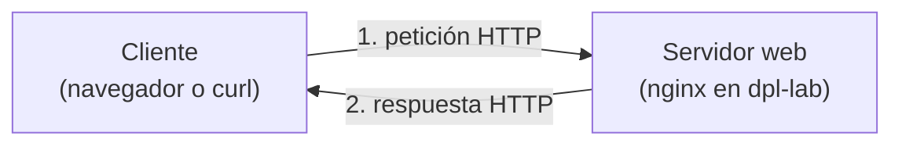

En el curso, nginx corre dentro del contenedor `dpl-lab` y escucha en el puerto 80 **del contenedor**. Ese puerto está **publicado** en tu ordenador (el anfitrión): Docker conecta el puerto 80 de tu ordenador con el 80 del contenedor (opción `-p`, apartado 7.3). Por eso desde el navegador basta con `http://localhost/`.

### 2.3 Las capas de red (OSI simplificado)

Mandar datos por la red se reparte en **capas**, como una cadena de montaje: cada capa se ocupa de una tarea, se apoya en la capa de debajo y da servicio a la de encima. El modelo de referencia es **OSI**, con siete capas, que se numeran de abajo (1, el cable) arriba (7, los programas).

| Nº | Capa | Qué hace | En la web | Cómo se comprueba |
|---|---|---|---|---|
| 7 | Aplicación | Los protocolos que usan los programas | HTTP, HTTPS, DNS, FTP | `curl`, `dig` |
| 6 | Presentación | Formato de los datos y cifrado | HTML, CSS, JSON, TLS (según el curso) | `curl -v`, `curl -k` |
| 5 | Sesión | Mantener el diálogo | Cookies y sesiones | |
| 4 | Transporte | Comunicación entre puertos | TCP (80 y 443), UDP | `ss -tlnp` |
| 3 | Red | Direcciones IP y rutas | IP | `ping`, `ip route` |
| 2 | Enlace | Direcciones físicas (MAC) | Ethernet, Wi-Fi | |
| 1 | Física | El medio | Cables, ondas | |

Para qué sirve en la práctica: cuando algo "no funciona", la pila te dice dónde mirar. Puede fallar la aplicación (servicio parado), el transporte (puerto cerrado o no publicado), la red (no hay ruta) o el nombre (DNS). Lo verás en el apartado 8.

Lo que más se pregunta: **HTTP está en la capa 7, TCP en la 4 e IP en la 3.**

### 2.4 Las capas de una aplicación web

Además de las capas de red, una aplicación web se divide por **funciones**. El curso habla de cuatro capas:

| Capa | Qué hace | Tecnologías típicas | En el restaurante |
|---|---|---|---|
| Cliente | La interfaz que usa la persona | Navegador (Chrome, Firefox) | El cliente en la mesa |
| Presentación | Sirve las páginas (HTML, CSS, JS) y recibe lo que manda el cliente | nginx | El camarero |
| Lógica de negocio | Ejecuta el código: calcula, valida, gestiona sesiones, consulta datos | PHP, Python; PHP-FPM, Gunicorn | La cocina |
| Datos | Guarda la información que debe durar | PostgreSQL, MySQL, ficheros | La despensa |

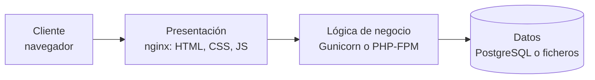

Si la web es **estática** (las páginas son siempre iguales), no hay capa de datos ni de lógica: el contenido está dentro de los propios HTML. Es el caso de mi práctica de NGINX y de la web de gitanddocs.

### 2.5 Dos capas frente a tres capas

- **Dos capas**: cliente y servidor. El servidor lo hace todo (o solo sirve ficheros). Ejemplo: nginx sirviendo un `index.html`.
- **Tres capas**: presentación (servidor web), aplicación (servidor de aplicaciones) y datos (base de datos), cada una separada. Ejemplo: nginx, Gunicorn con Django y PostgreSQL (UT4).

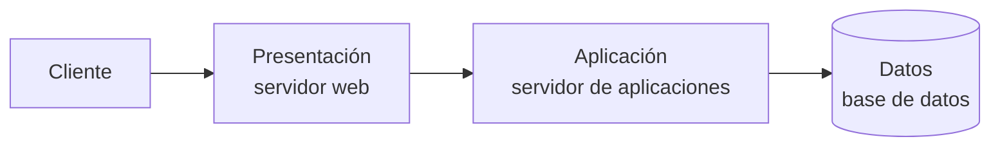

Ventajas e inconvenientes (lo que pide el CE a):

| | Dos capas | Tres capas |
|---|---|---|
| Ventajas | Sencilla, barata, pocas piezas, fácil de montar y de entender | Cada capa se cambia o se escala por separado; la base de datos no queda expuesta al exterior; más fácil de mantener y repartir entre equipos |
| Inconvenientes | Mezcla responsabilidades; escala peor; si crece se vuelve difícil de mantener | Más piezas que instalar, configurar y vigilar; más puntos que pueden fallar; algo más de latencia entre capas |
| Cuándo | Webs estáticas, prototipos, sitios pequeños | Aplicaciones con lógica y datos (tiendas, intranets, APIs) |

### 2.6 Servidor web frente a servidor de aplicaciones

Es **una de las preguntas más típicas**. Memoriza esta tabla:

| | Servidor web | Servidor de aplicaciones |
|---|---|---|
| Qué hace | Sirve ficheros que ya existen (HTML, CSS, JS, imágenes) y respuestas simples | Ejecuta código y genera la respuesta en el momento |
| Contenido | El mismo para todos los clientes (estático) | Depende de los datos, la sesión y la petición (dinámico) |
| Ejemplos | nginx, Apache | Gunicorn (Python), PHP-FPM (PHP), Tomcat (Java), Node.js |
| En el curso | nginx en UT2 y UT3 | PHP-FPM o Gunicorn en la UT2 (calculadora), Gunicorn con Django en la UT4 |

Error de concepto frecuente: pensar que nginx ejecuta PHP o Python. **No lo hace.** nginx se los pasa al servidor de aplicaciones: con `proxy_pass` a Gunicorn y con `fastcgi_pass` a PHP-FPM (apartado 6).

### 2.7 Servicios web, agentes y API

Tres palabras que el curso distingue:

- **Servicio web**: la idea abstracta de lo que se hace. Ejemplo: "calcular el total de un pedido".
- **Agente**: el programa concreto que lo hace (por ejemplo, el código Python que suma los precios). Se puede reescribir en otro lenguaje sin que el servicio cambie.
- **API** (interfaz de programación de aplicaciones): el contrato que dice cómo se pide el servicio, con qué datos y qué se recibe. En la web lo normal es una API HTTP/REST: recursos con URL, métodos (GET, POST...) y respuestas en JSON. Ejemplo: `POST /api/pedidos/total` con un JSON y respuesta `{"total": 42.5}`.

Usar un servicio tiene tres pasos: **descubrimiento** (saber dónde está, normalmente por su URL y DNS), **acuerdo** (usar el mismo protocolo y formato) e **intercambio de mensajes** (petición y respuesta).

### 2.8 Fases de un proyecto web

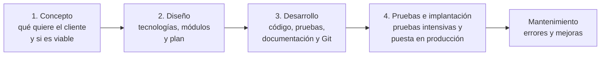

- **Concepto**: entender qué quiere el cliente y sus límites (presupuesto, tecnología, conocimientos).
- **Diseño**: decidir cómo se hará: tecnologías, módulos, plan de tareas y especificación funcional.
- **Desarrollo**: programar con pruebas, documentación y control de versiones.
- **Pruebas e implantación**: probar en un entorno lo más parecido posible al real y ponerlo en marcha. Es el momento crítico.
- **Mantenimiento**: corregir errores y añadir mejoras (suele ser un contrato aparte).

Se desarrolla **de abajo arriba (bottom-up)**: primero datos, luego lógica de negocio y por último presentación. Si empiezas por la interfaz, tendrás que rehacerla cuando descubras qué datos y reglas hacen falta.

### 2.9 Alternativas de implantación

Antes de montar tu propio servidor, piensa si es la mejor opción:

| Alternativa | Qué es | Ventajas | Inconvenientes | Cuándo |
|---|---|---|---|---|
| On-premise | Servidores propios en la organización | Control total, datos en casa, sin cuotas | Comprar y mantener hardware, luz, seguridad física | Datos sensibles, intranets, requisitos legales |
| Hosting | Alquilar espacio en un servidor de otra empresa | Sin mantener hardware ni software, fiable | Menos control, límites del plan, dependes del proveedor | Webs pequeñas o medianas |
| Cloud | Infraestructura de terceros, elástica y de pago por uso | Escala rápido, pagas lo que usas, servicios gestionados | Coste variable, dependencia, facturación compleja | Cargas variables, proyectos que crecen |
| CMS (WordPress) | Una aplicación ya hecha para publicar contenido desde un panel, sin programar | Se publica en poco tiempo y hay miles de plugins y temas | Cuesta salirse de lo que permite; tienes que actualizarlo y vigilar su seguridad | Webs cuyo contenido cambia a menudo pero cuya estructura casi no cambia (blogs, webs de empresa) |

En la UT2 trabajamos como si fuera **on-premise**, pero simulado: la "máquina propia" es el contenedor `dpl-lab`.

### 2.10 Arquitecturas modernas: CDN, edge y JAMstack

- **Latencia**: el tiempo que tarda un dato en ir y volver. Depende de la distancia: cuanto más lejos el servidor, más lento.
- **CDN** (red de entrega de contenidos): muchos servidores repartidos por el mundo con copias de tu contenido. Te atiende el más cercano. Además puede cachear, comprimir, poner HTTPS y proteger contra ataques.
- **Edge computing**: ejecutar código en esos nodos cercanos (por ejemplo, redirigir por idioma sin llegar al servidor de origen).
- **JAMstack**: JavaScript en el cliente, APIs para lo dinámico y Markup (HTML) **generado antes**, en el momento del *build* (la fase en la que un programa fabrica todos los ficheros de la web, antes de publicarla), no en cada petición. El HTML se sube a un CDN y se sirve tal cual. La diferencia con una web tradicional (WordPress con PHP): allí cada visita ejecuta código y consulta la base de datos; aquí el servidor solo entrega ficheros ya hechos.
- **Hosting estático**: servicios que publican webs estáticas desde Git con CDN y HTTPS incluidos: GitHub Pages, Netlify, Vercel, Cloudflare Pages.

Relación con lo que ya hice: Zensical genera HTML estático en `site/` y GitHub Pages lo publica. Eso es justo la idea de JAMstack y de hosting estático. En mi práctica, ese mismo HTML lo sirve nginx.

### 2.11 Requisitos para implantar un servidor web

Lo que hace falta (CE h):

- **Máquina** con potencia suficiente. Lo dinámico (PHP, bases de datos) gasta más que lo estático.
- **Sistema operativo** estable y seguro. Lo habitual es Linux.
- **Disco** (la "cuota de disco"): espacio para la aplicación, los logs y las copias de seguridad. Se comprueba con `df -h` (espacio libre) y `du -sh` (lo que ocupa una carpeta).
- **Conexión** a Internet con ancho de banda de subida y bajada suficiente.
- **IP estática** (fija). Si la IP cambia, nadie te encuentra. Sin IP fija existe **DDNS** (DNS dinámico): un servicio que actualiza tu nombre cuando cambia la IP (por ejemplo, Duck DNS).
- **DNS**: traduce nombres (`www.alumno.local`) a IP. En el laboratorio se simula con `/etc/hosts` o con `curl -H "Host: ..."`.
- **Puertos y permisos**: saber en qué puerto escucha cada servicio y que el usuario del servidor pueda leer los ficheros.

### 2.12 Monolito y microservicios (ampliación)

No forma parte de la teoría de la UT2 (en todo el curso solo se nombra de pasada en la UT4), así que es poco probable que caiga en el P1. Basta con reconocerlo:

- **Monolito**: toda la aplicación es un único programa que se despliega entero. Ventaja: sencillo de montar y de probar. Inconveniente: cualquier cambio obliga a desplegarlo todo y, si crece mucho, cuesta mantenerlo.
- **Microservicios**: la aplicación se parte en servicios pequeños e independientes que se hablan por la red (normalmente por API HTTP). Cada uno se despliega por separado, a menudo en su propio contenedor. Ventaja: cada parte se cambia y se escala sola. Inconveniente: muchas más piezas, red y despliegues que vigilar.

Fuentes: [Arquitecturas Web](https://dpl-f1facc.gitlab.io/ut02/teoria/arquitecturas-web/) y [Estructura de una aplicación Web](https://dpl-f1facc.gitlab.io/ut02/teoria/estructura-app-web/).

## 3. HTTP y HTTPS desde cero

### 3.1 Qué es HTTP

**HTTP** (protocolo de transferencia de hipertexto) es el idioma de la web: las normas que siguen el navegador y el servidor para entenderse. Funciona siempre igual: el cliente manda una **petición** (*request*) y el servidor contesta con una **respuesta** (*response*). Tres características:

- **Cliente-servidor**: siempre empieza el cliente.
- **Sin estado** (*stateless*): cada petición es independiente y el servidor no recuerda las anteriores. Para "recordar" (por ejemplo, que has iniciado sesión) se usan **cookies**, que el navegador reenvía en cada petición.
- **Basado en texto** (en HTTP/1.x): puedes leer la petición y la respuesta tal cual. HTTP/2 y HTTP/3 empaquetan los mensajes en binario, pero el significado (métodos, cabeceras, códigos) es el mismo.

### 3.2 Qué pasa cuando escribes una URL

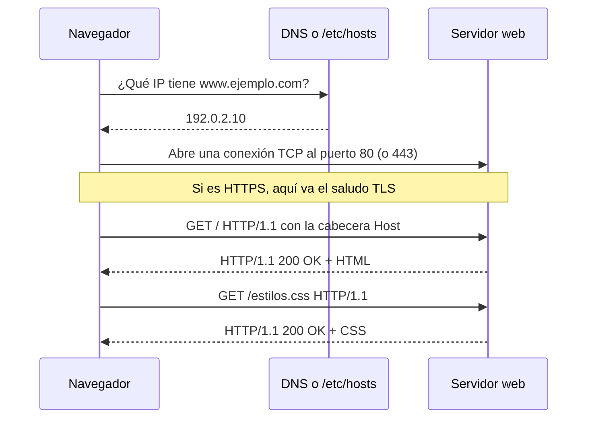

Fíjate en el final: una página **no es una sola petición**. El navegador lee el HTML y pide aparte cada CSS, imagen o script.

### 3.3 La petición

```http
GET /index.html HTTP/1.1
Host: www.alumno.local
User-Agent: curl/8.5.0
Accept: */*

```

Tiene tres partes:

1. **Línea de petición**: método + ruta + versión (`GET /index.html HTTP/1.1`).
2. **Cabeceras**: líneas `Nombre: valor` con información extra (qué sitio se pide, qué cliente es, qué acepta).
3. **Línea en blanco** y, si hace falta, un **cuerpo** con datos (por ejemplo, los campos de un formulario en un POST).

En HTTP/1.1 la cabecera `Host` es **obligatoria**. Si falta, el servidor responde `400 Bad Request`.

### 3.4 La respuesta

```http
HTTP/1.1 200 OK
Server: nginx/1.24.0 (Ubuntu)
Content-Type: text/html
Content-Length: 312

<!DOCTYPE html>
<html>...</html>
```

También tres partes:

1. **Línea de estado**: versión + código + frase (`HTTP/1.1 200 OK`).
2. **Cabeceras**: `Server`, `Content-Type`, `Content-Length`...
3. **Línea en blanco** y el **cuerpo** con el recurso (HTML, imagen, JSON...).

### 3.5 Métodos

El método dice **qué quieres hacer** con el recurso. Dos palabras útiles:

- **Seguro**: no cambia nada en el servidor (solo lee).
- **Idempotente**: repetirlo varias veces deja el servidor igual que hacerlo una vez.

| Método | Para qué | ¿Cuerpo en la petición? | Seguro | Idempotente |
|---|---|---|---|---|
| GET | Pedir un recurso. El más usado | No | Sí | Sí |
| HEAD | Igual que GET pero la respuesta **no trae cuerpo**, solo cabeceras. Ideal para comprobar | No | Sí | Sí |
| POST | Enviar datos (formularios, crear recursos) | Sí | No | No |
| PUT | Crear o reemplazar un recurso completo (APIs REST) | Sí | No | Sí |
| PATCH | Modificar una parte de un recurso | Sí | No | No |
| DELETE | Borrar un recurso | Normalmente no | No | Sí |
| OPTIONS | Preguntar qué métodos admite el servidor para un recurso | No | Sí | Sí |

Ejemplo del curso: la calculadora muestra el formulario con **GET** y calcula con **POST** (los números van en el cuerpo).

### 3.6 Cabeceras importantes

| Cabecera | Va en | Para qué |
|---|---|---|
| `Host` | Petición | Qué sitio se pide. Con ella un mismo servidor aloja varias webs (server blocks) |
| `User-Agent` | Petición | Qué cliente hace la petición (`curl/8.5.0`, un navegador...) |
| `Accept` | Petición | Qué formatos acepta el cliente |
| `Cookie` | Petición | Devuelve al servidor las cookies guardadas (sesión) |
| `Authorization` | Petición | Credenciales (autenticación básica, UT3) |
| `Content-Type` | Las dos | Tipo de lo que va en el cuerpo (`text/html`, `application/json`...) |
| `Content-Length` | Las dos | Tamaño del cuerpo en bytes |
| `Server` | Respuesta | Software del servidor (`nginx/1.24.0`) |
| `Location` | Respuesta | A dónde ir en una redirección 3xx |
| `Set-Cookie` | Respuesta | Pide al navegador que guarde una cookie |
| `Last-Modified` / `ETag` | Respuesta | Fecha o "huella" de la versión del recurso (para la caché) |
| `Cache-Control` | Respuesta | Si se puede guardar en caché y cuánto tiempo |
| `WWW-Authenticate` | Respuesta | Acompaña al 401: dice cómo autenticarse |

### 3.7 Tipos MIME

Un **tipo MIME** dice al cliente **qué es** el contenido, con el formato `tipo/subtipo`. Viaja en `Content-Type`.

| Tipo MIME | Qué es |
|---|---|
| `text/html` | Página HTML |
| `text/css` | Hoja de estilos |
| `text/javascript` | Script |
| `image/png`, `image/jpeg`, `image/svg+xml` | Imágenes |
| `application/json` | Datos JSON (APIs) |
| `application/pdf` | PDF |
| `application/octet-stream` | "Bytes sin tipo conocido": el navegador lo descarga |

nginx elige el tipo según la **extensión** del fichero, con la tabla `/etc/nginx/mime.types` (se carga con `include mime.types;`). Si la extensión no está en la tabla, usa el tipo de la directiva `default_type`, que en el `nginx.conf` de Ubuntu y de la imagen oficial es `application/octet-stream`. Por eso un `.php` que nginx no pasa a PHP-FPM **se descarga**: `.php` no está en la tabla. Si el tipo es incorrecto pasan cosas raras: un CSS que no se aplica o un fichero que se descarga en vez de mostrarse.

### 3.8 Códigos de estado

El código de la línea de estado dice **qué ha pasado**. La primera cifra indica la familia:

| Familia | Significado | Truco para recordarlo |
|---|---|---|
| 1xx | Información (por ejemplo, `101 Switching Protocols`) | "Espera, sigo" |
| 2xx | Éxito | "Todo bien" |
| 3xx | Redirección | "Está en otro sitio" |
| 4xx | Error del **cliente** | "La culpa es tuya": URL mal, sin permiso, petición rara |
| 5xx | Error del **servidor** | "La culpa es mía": algo ha fallado dentro |

Los que tienes que reconocer a primera vista:

| Código | Nombre | Qué significa | Cuándo lo verás en el curso |
|---|---|---|---|
| 200 | OK | Todo correcto | `curl -I http://localhost/` con nginx funcionando |
| 301 | Moved Permanently | Se ha movido para siempre; la nueva URL va en `Location` | `http` a `https` (UT3); carpeta pedida sin barra final (`/markdown` a `/markdown/`) |
| 302 | Found | Movido de forma **temporal**; el navegador no lo recuerda | Redirecciones provisionales (por ejemplo, a una página de login) |
| 304 | Not Modified | "Lo que tienes en caché sigue valiendo"; va sin cuerpo | El navegador pregunta con `If-Modified-Since` o `If-None-Match` y el recurso no ha cambiado |
| 400 | Bad Request | Petición mal formada | Falta `Host` en HTTP/1.1; cabeceras mal escritas |
| 401 | Unauthorized | **Falta autenticarse** (no sé quién eres) | Zona con usuario y contraseña (UT3); va con `WWW-Authenticate` |
| 403 | Forbidden | Sé lo que pides pero **no te dejo** | Permisos de ficheros mal (`chmod 600`); carpeta sin `index.html` |
| 404 | Not Found | No existe donde el servidor lo busca | URL mal escrita, fichero no publicado, `root` mal |
| 405 | Method Not Allowed | El método no se permite para ese recurso | `curl -X BREW` o un POST a un fichero estático |
| 500 | Internal Server Error | La aplicación ha fallado | Error de sintaxis en el PHP o excepción en Python |
| 502 | Bad Gateway | nginx (intermediario) **no consigue respuesta** del servidor de aplicaciones | Gunicorn o PHP-FPM parados, puerto o socket mal |
| 503 | Service Unavailable | El servicio no está disponible ahora (sobrecarga o mantenimiento) | Servidor saturado o en mantenimiento |
| 504 | Gateway Timeout | El servidor de aplicaciones **tarda demasiado** en responder | Gunicorn bloqueado o petición muy lenta |

Las tres parejas que más se confunden:

- **401 y 403**: 401 = "no sé quién eres" (falta autenticación). 403 = "sé lo que pides y no te dejo" (falta autorización o permisos).
- **301 y 302**: 301 permanente (el navegador y los buscadores lo recuerdan). 302 temporal.
- **502 y 504**: 502 = el backend no contesta o no está (caído, puerto mal). 504 = el backend está, pero tarda más de lo permitido.

### 3.9 Versiones de HTTP

| Versión | Año | Transporte | Qué aportó |
|---|---|---|---|
| HTTP/0.9 | 1991 | TCP | Una sola línea, solo pedir un HTML. Sin cabeceras |
| HTTP/1.0 | 1996 | TCP | Cabeceras y otros tipos de recurso. Pero **una conexión TCP nueva por cada petición** (lento) |
| HTTP/1.1 | 1997 | TCP | **Conexiones persistentes** (se reutilizan), negociación de contenido y la **cabecera `Host` obligatoria** (varias webs en una IP). También *pipelining*, poco usado |
| HTTP/2 | 2015 | TCP | **Multiplexación**: muchas peticiones a la vez por una sola conexión. Formato binario y **compresión de cabeceras**. Traía *server push*, que Chrome y Firefox ya han retirado |
| HTTP/3 | 2022 | **QUIC sobre UDP** | Elimina el **bloqueo de cabeza de línea**, une el saludo de conexión y el de TLS, y mantiene la conexión al cambiar de red |

Palabras de la tabla explicadas:

- **Conexión persistente**: la misma conexión TCP se reutiliza para varias peticiones, en vez de abrir y cerrar una por cada una.
- **Pipelining**: mandar varias peticiones seguidas sin esperar respuesta. Las respuestas tienen que volver en el mismo orden, así que una lenta retrasa a las demás; por eso casi no se usó.
- **Negociación de contenido**: el cliente dice lo que prefiere (cabeceras `Accept`, `Accept-Language`, `Accept-Encoding`) y el servidor elige la versión del recurso que mejor encaja (idioma, formato, compresión).
- **Multiplexación**: varias peticiones y respuestas viajan **mezcladas a la vez** por una sola conexión, cada una con su número de flujo.
- **Server push**: el servidor mandaba recursos (por ejemplo el CSS) antes de que el navegador los pidiera.

El **bloqueo de cabeza de línea** (*head-of-line blocking*): TCP entrega los datos en orden. Si se pierde un paquete, todos los de detrás esperan aunque hayan llegado bien. Es como un peaje: si el primer coche no encuentra el ticket, esperan todos. HTTP/2 lo sufre porque todas sus peticiones van por la misma conexión TCP.

**QUIC** es un protocolo de transporte que funciona sobre **UDP** (que no espera ni ordena paquetes) y añade lo que hace falta:

- Saludo combinado (conexión + TLS) en **1-RTT** (una ida y vuelta), o **0-RTT** si ya te habías conectado antes.
- **Flujos independientes**: si se pierde un paquete de una imagen, no se para el JavaScript.
- **Migración de conexión**: la conexión se identifica por un número propio, no por IP y puerto, así que no se corta al pasar del Wi-Fi a los datos móviles.

Para el desarrollador es transparente: navegador y servidor negocian la versión solos. Los puertos por defecto siguen siendo 80 y 443.

### 3.10 HTTPS y TLS

HTTP viaja en **texto plano**: cualquiera en medio puede leerlo o cambiarlo. **HTTPS = HTTP sobre TLS** (*Transport Layer Security*). SSL era el protocolo anterior a TLS; todas sus versiones están retiradas por inseguras, aunque se sigue diciendo "certificado SSL" por costumbre.

Comparación: HTTP es mandar una postal; HTTPS es mandar una carta en un sobre cerrado, después de comprobar el DNI de quien la recibe.

Qué protege TLS:

| Protege | Qué significa |
|---|---|
| Confidencialidad | Nadie en medio puede leer lo que envías (contraseñas, formularios) |
| Integridad | Nadie puede modificar los datos por el camino sin que se note |
| Autenticidad del servidor | El certificado demuestra que hablas con el servidor real |

Qué **no** protege: no hace segura la aplicación (si el PHP tiene fallos, los sigue teniendo) y no oculta a qué servidor te conectas (la IP de destino se ve).

**Certificado digital**: documento que une un nombre de dominio con una **clave pública** y que está **firmado por una autoridad de certificación (CA)** en la que confía el navegador. Las claves van por parejas: la **privada** solo la tiene el servidor y la **pública** la puede ver todo el mundo; lo que se firma con la privada se comprueba con la pública. Si el certificado es **autofirmado** (lo has creado tú, sin CA), cifra igual, pero el navegador avisa de que no es de confianza. Para probar con `curl` se usa `-k`. Los certificados se trabajan en la UT3.

Antes de cifrar, cliente y servidor hacen un **saludo** (*handshake*): se ponen de acuerdo en la versión y el cifrado, el servidor enseña su certificado y entre los dos fabrican las claves de la sesión. Versión simplificada (después de abrir la conexión TCP al 443):

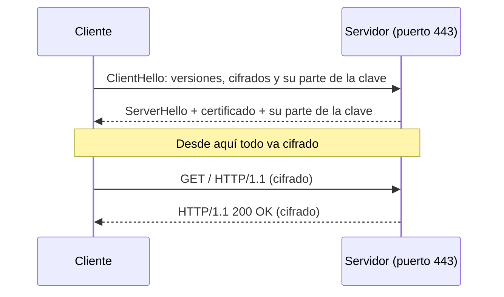

TLS 1.3 (2018) frente a TLS 1.2:

| | TLS 1.2 | TLS 1.3 |
|---|---|---|
| Saludo (handshake) | 2-RTT (dos idas y vueltas) | **1-RTT**, o **0-RTT** si repites conexión |
| Cifrados | Muchos, algunos débiles | Solo **AEAD** modernos (AES-GCM, ChaCha20-Poly1305): cifran y comprueban integridad a la vez |
| Forward secrecy | Opcional | **Obligatorio**: si un día roban la clave privada del servidor, no pueden descifrar sesiones pasadas |
| Intercambio de claves | RSA, DH, ECDH, DHE, ECDHE | Solo efímeros (DHE, ECDHE): claves de usar y tirar, nuevas en cada sesión. Por eso hay *forward secrecy* |

Ojo con el **0-RTT**: un atacante puede copiar los datos de ese primer mensaje y **reenviarlos** (ataque de repetición o *replay*). Por eso en 0-RTT solo deben ir peticiones que no hacen daño si se repiten (las que no cambian nada, como un GET), nunca algo como un POST que hace un pago.

Ojo, la web del curso lo resume diciendo que esos datos "no se usan para operaciones que deban ser idempotentes". La idea es la de arriba: el peligro son las operaciones que **no** se pueden repetir sin consecuencias. En el examen, explica el riesgo (*replay*) y pon el ejemplo del pago.

En producción **todo** debe ir por HTTPS: los navegadores marcan HTTP como "no seguro".

### 3.11 Puertos que debes saber

| Puerto | Protocolo | Servicio |
|---|---|---|
| 22 | TCP | SSH |
| 53 | UDP y TCP | DNS |
| 80 | TCP | HTTP |
| 443 | TCP (y UDP para HTTP/3) | HTTPS |
| 8000 | TCP | Gunicorn en el curso (no es estándar, es costumbre) |
| 8080 | TCP | Puerto alternativo de HTTP (calculadora dockerizada, mi práctica) |
| 9000 | TCP | PHP-FPM por TCP (costumbre) |

### 3.12 curl: el cliente HTTP de la terminal

`curl` es la herramienta de comprobación de todo el curso. Opciones que tienes que saber:

| Opción | Qué hace |
|---|---|
| `curl URL` | Hace un GET y muestra el cuerpo |
| `-I` (`--head`) | Envía un **HEAD** y muestra solo la línea de estado y las cabeceras |
| `-i` (`--include`) | Hace el GET normal y muestra cabeceras **y** cuerpo |
| `-v` (verbose) | Muestra todo el diálogo: `>` lo que envías, `<` lo que recibes, `*` información de conexión |
| `-s` | Silencioso (sin barra de progreso) |
| `-o /dev/null -w "%{http_code}\n"` | Tira el cuerpo y escribe solo el código de estado |
| `-L` | Sigue las redirecciones (3xx) |
| `-H "Host: docs.local"` | Añade o cambia una cabecera. Con `Host` pruebas webs por nombre sin DNS |
| `-X MÉTODO` | Cambia el método (`-X DELETE`, `-X BREW`) |
| `-d "v1=7&v2=5"` | Envía datos de formulario por **POST** |
| `-k` | No comprueba el certificado (solo para pruebas con autofirmados) |
| `-u usuario:clave` | Autenticación básica (UT3) |
| `-f` | Si el servidor devuelve error HTTP, `curl` termina con error (útil en CI) |

Ojo con un detalle de la web del curso: presenta `-I` como *include headers* y en el mismo sitio aclara que en realidad es `--head`. Quédate con lo segundo: `-I` es `--head` (manda un HEAD) y el *include* de verdad es `-i`, en minúscula. Truco: **I mayúscula, solo cabeceras; i minúscula, cabeceras más cuerpo**.

Detalle de la calculadora: se envía `op=%2B` en vez de `op=+` porque en los formularios el `+` significa "espacio". `%2B` es el `+` codificado.

Ejemplo con `curl -v`:

```text
$ curl -v http://localhost/
*   Trying 127.0.0.1:80...
* Connected to localhost (127.0.0.1) port 80
> GET / HTTP/1.1
> Host: localhost
> User-Agent: curl/8.5.0
> Accept: */*
>
< HTTP/1.1 200 OK
< Server: nginx/1.24.0 (Ubuntu)
< Content-Type: text/html
< Content-Length: 312
<
<!DOCTYPE html>
...
```

Salidas reales de mi práctica con `curl -I` (recortadas). Son de la **fase 1**, cuando la documentación todavía respondía en `localhost`. En la versión final `localhost` lleva a la portada, y las mismas pruebas se hacen con `http://docs.local:8080/...` o con `-H "Host: docs.local"`:

```text
$ curl -I http://localhost:8080/
HTTP/1.1 200 OK
Server: nginx/1.30.6
Content-Type: text/html
Content-Length: 40775
Last-Modified: Sun, 18 Oct 2026 17:43:01 GMT
ETag: "6ad50525-9f47"

$ curl -I http://localhost:8080/markdown
HTTP/1.1 301 Moved Permanently
Server: nginx/1.30.6
Location: /markdown/

$ curl -I http://localhost:8080/esto-no-existe
HTTP/1.1 404 Not Found
Server: nginx/1.30.6
Content-Length: 17614
```

Buena costumbre: lee **siempre primero la línea de estado**. Te dice si el problema es tuyo (4xx) o del servidor (5xx).

Fuentes: [HTTP y HTTPS](https://dpl-f1facc.gitlab.io/ut02/teoria/http-https/), [Vista general de HTTP (MDN)](https://developer.mozilla.org/es/docs/Web/HTTP/Guides/Overview), [Métodos HTTP (MDN)](https://developer.mozilla.org/es/docs/Web/HTTP/Reference/Methods), [Códigos de estado (MDN)](https://developer.mozilla.org/es/docs/Web/HTTP/Reference/Status) y [manual de curl](https://curl.se/docs/manpage.html).

## 4. Estructura de una aplicación web

### 4.1 Frontend, backend y datos

Una **aplicación web** es un programa que se usa desde el navegador. Casi todas tienen tres partes:

- **Frontend** (cliente): lo que se ve y se ejecuta en el navegador. HTML (estructura), CSS (estilo) y JavaScript (interactividad).
- **Backend** (servidor): el código que corre en el servidor (Python, PHP...). Hace la lógica y habla con los datos.
- **Datos**: la información que dura, en una base de datos (PostgreSQL, MySQL) o en ficheros.

### 4.2 Contenido estático y dinámico

| | Estático | Dinámico |
|---|---|---|
| Qué es | Ficheros que ya existen y se envían tal cual | Se genera en cada petición ejecutando código |
| Es igual para todos | Sí | No: depende de los datos, la sesión o lo que envíes |
| Quién lo sirve | nginx, directamente desde el disco | El servidor de aplicaciones (nginx solo hace de intermediario) |
| Ejemplos | `index.html`, `estilos.css`, imágenes, la web que genera Zensical | El resultado de la calculadora, un carrito de la compra, una API que devuelve JSON |
| Comparación | Una fotocopia ya hecha | Un plato cocinado al momento |

Cuidado con una trampa: una web hecha con un generador (Zensical, Jekyll) es **estática** aunque tenga buscador o modo oscuro, porque el HTML se genera **antes** y el servidor no ejecuta nada.

### 4.3 Recursos de una aplicación

Los ficheros que forman una aplicación (CE g). Ejemplo con la calculadora Python del curso:

```text
calculadora-python/
├── web/
│   ├── app.py               código Python (lo ejecuta Gunicorn)
│   ├── requirements.txt     dependencias con versión (flask, gunicorn)
│   ├── estilos.css          estático (lo sirve nginx)
│   └── templates/
│       └── index.html       plantilla que rellena Flask
├── nginx-calculadora.conf   copia del server block
├── .gitignore               excluye .venv/ y __pycache__/
└── README.md                documentación paso a paso
```

En la versión PHP, el recurso dinámico es `index.php` (lo ejecuta PHP-FPM) y `estilos.css` sigue siendo estático.

### 4.4 De la URL al fichero: el DocumentRoot

El **DocumentRoot** (en nginx, la directiva `root`) es la carpeta desde la que se sirven los ficheros de un sitio. En Ubuntu, el sitio por defecto usa `/var/www/html`.

nginx construye la ruta del fichero así: **`root` + ruta de la URL**.

| Petición | Con `root /var/www/html;` busca | Resultado |
|---|---|---|
| `GET /index.html` | `/var/www/html/index.html` | 200 si existe y se puede leer |
| `GET /img/logo.png` | `/var/www/html/img/logo.png` | 200, o 404 si no existe |
| `GET /` | La carpeta `/var/www/html/` y dentro el fichero de `index` (`index.html`) | 200 si hay índice; 403 si no hay índice (nginx no lista carpetas por defecto) |
| `GET /web.html` (y no existe) | `/var/www/html/web.html` | 404 |

Por convención, al pedir una carpeta nginx sirve su **índice** (`index.html`), según la directiva `index`. Por eso `http://servidor/` muestra `index.html`.

¿Y si pides `/` y el fichero se llama `web.html` en vez de `index.html`?

- Con la `location` del sitio por defecto de Ubuntu (`try_files $uri $uri/ =404;`), la carpeta existe pero no tiene índice. Como nginx no enseña listados de carpetas (`autoindex` viene desactivado), responde **403** y en `error.log` escribe `directory index of "/var/www/html/" is forbidden`.
- Con una `location` que no prueba carpetas (`try_files $uri =404;`) sale **404**.
- Trampa: el sitio por defecto de Ubuntu tiene `index index.html index.htm index.nginx-debian.html;` y la instalación deja `index.nginx-debian.html` (la página "Welcome to nginx!"). Si solo borras tu `index.html`, verás esa bienvenida con un 200.

Ojo, la web del curso dice que en ese caso sale 404 (y en otro sitio "403/404"). En el examen da la respuesta completa: 404 si nginx no encuentra el recurso, 403 si encuentra la carpeta pero no tiene índice que servir.

### 4.5 Permisos

nginx en Ubuntu trabaja con el usuario **`www-data`**, y ese usuario necesita poder leer los ficheros. Los permisos de Linux se escriben con tres cifras: **propietario, grupo y otros**. Cada cifra suma: lectura (r) = 4, escritura (w) = 2, ejecución (x) = 1.

| Permiso | Letras | Para qué |
|---|---|---|
| `644` | `rw-r--r--` | **Ficheros** publicados: el propietario lee y escribe, el resto solo lee |
| `755` | `rwxr-xr-x` | **Carpetas** publicadas: en una carpeta, la `x` significa "poder entrar" |
| `600` | `rw-------` | Solo el propietario: `www-data` no puede leer y nginx da **403** |
| `777` | `rwxrwxrwx` | Todo para todos. **Nunca** en un servidor |

`chmod -R a+rX carpeta` da lectura a todos y la `X` mayúscula da permiso de entrada solo a las carpetas. Es lo que usan las prácticas de la calculadora.

### 4.6 Quién sirve qué

En la aplicación completa del curso (UT4), nginx sirve el frontend estático (el *build* de Vite) y reenvía las peticiones `/api/*` a Gunicorn con Django:

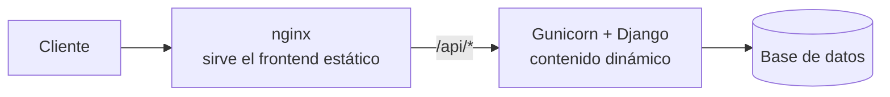

Fuentes: [Estructura de una aplicación Web](https://dpl-f1facc.gitlab.io/ut02/teoria/estructura-app-web/) y [Práctica guiada 17](https://dpl-f1facc.gitlab.io/ut02/practicas/guiada-17-red-logs/).

## 5. El servidor web nginx

### 5.1 Qué es

**nginx** (se pronuncia "engine-x") es un servidor web de alto rendimiento. Hace cuatro trabajos:

1. Servir **contenido estático** muy rápido y con pocos recursos.
2. Hacer de **proxy inverso**: recibir peticiones y pasarlas a otro servicio (Gunicorn, PHP-FPM).
3. Hacer de **caché**: guardar respuestas para no pedirlas otra vez al backend.
4. Hacer de **balanceador de carga**: repartir peticiones entre varios servidores.

Su configuración se escribe en ficheros de texto (no tiene interfaz gráfica).

### 5.2 Proceso master y procesos worker

nginx arranca **un proceso master** y **varios procesos worker**:

- El **master** lee y comprueba la configuración, abre los puertos y vigila a los workers.
- Los **workers** atienden de verdad las peticiones.
- Es **orientado a eventos**: cada worker atiende muchas conexiones a la vez sin quedarse esperando a ninguna.

Comparación: el master es el encargado del restaurante; los workers son camareros que llevan muchas mesas a la vez, sin quedarse de pie esperando a que una mesa decida.

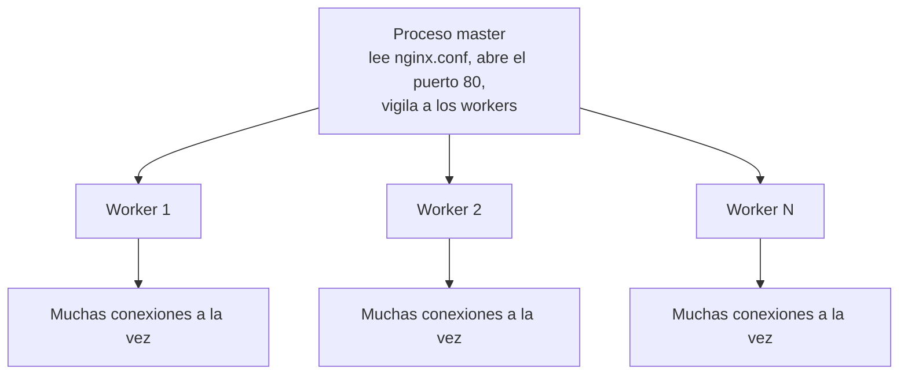

Directivas del proceso (parte global de `/etc/nginx/nginx.conf`):

| Directiva | Qué hace |
|---|---|
| `user www-data;` | Usuario con el que corren los workers. Es quien necesita leer `/var/www/` |
| `worker_processes auto;` | Número de workers. `auto` = uno por núcleo de CPU |
| `worker_connections 768;` | Conexiones simultáneas de **cada** worker (va dentro de `events`) |
| `pid /run/nginx.pid;` | Fichero con el número de proceso del master (lo usa `nginx -s`) |

Máximo de clientes aproximado: `worker_processes × worker_connections`. Con 4 núcleos y 768: 4 × 768 = 3072 conexiones.

Lo puedes ver con `ps aux | grep nginx`:

```text
root      101  ...  nginx: master process nginx -g daemon off;
www-data  102  ...  nginx: worker process
www-data  103  ...  nginx: worker process
```

El master corre como `root` (para poder abrir el puerto 80) y los workers como `www-data`.

### 5.3 nginx frente a Apache

| | Apache | nginx |
|---|---|---|
| Arquitectura | MPM (módulo de multiproceso): en sus modos clásicos, un proceso o un hilo por conexión | Orientada a eventos y asíncrona |
| Estático | Bueno | Excelente, con muy pocos recursos |
| Dinámico | Muy bueno de forma nativa (módulos como el de PHP) | Necesita un servicio externo (PHP-FPM, Gunicorn) |
| Consumo con mucha carga | Mayor (memoria por proceso o hilo) | Menor |
| Configuración | Permite `.htaccess` en cada carpeta | Centralizada en `/etc/nginx/` |

No son enemigos: es común poner nginx delante (estáticos, caché, HTTPS) y Apache detrás.

### 5.4 Instalación y dónde está cada cosa

En el curso se instala el **paquete de Ubuntu** dentro de `dpl-lab`:

```bash
docker exec dpl-lab apt-get update
docker exec dpl-lab apt-get install -y nginx curl
docker exec dpl-lab nginx -v
```

Primero `apt-get update` (actualiza la lista de paquetes) y después `install`. Dentro del contenedor eres `root`, así que no hace falta `sudo`.

Layout de Ubuntu:

```text
/etc/nginx/
├── nginx.conf           configuración principal (incluye las demás)
├── mime.types           tabla extensión -> tipo MIME
├── conf.d/              fragmentos extra (*.conf)
├── sites-available/     sitios disponibles (un fichero por sitio)
├── sites-enabled/       sitios activos: ENLACES simbólicos a sites-available
├── snippets/            trozos reutilizables (fastcgi-php.conf)
└── modules-enabled/     módulos dinámicos activos (UT3)
/var/www/html/           DocumentRoot del sitio por defecto
/var/log/nginx/          access.log y error.log
```

El patrón **available / enabled**: el sitio se escribe en `sites-available/` y se **activa** creando un enlace en `sites-enabled/`. Para desactivarlo se borra el enlace, no el fichero.

```bash
docker exec dpl-lab ln -s /etc/nginx/sites-available/calculadora /etc/nginx/sites-enabled/
docker exec dpl-lab rm -f /etc/nginx/sites-enabled/default
```

Hay tres formas de tener nginx y **no se parecen**. Esto es importante porque mi práctica usa la imagen oficial de Docker, no el paquete de Ubuntu:

| | Paquete de Ubuntu (laboratorio `dpl-lab`) | Paquete de nginx.org | Imagen oficial de Docker `nginx` (mi práctica) |
|---|---|---|---|
| Sitios | `sites-available/` + `sites-enabled/` | `conf.d/*.conf` | `conf.d/*.conf` |
| DocumentRoot por defecto | `/var/www/html` | `/usr/share/nginx/html` | `/usr/share/nginx/html` |
| Usuario de los workers | `www-data` | `nginx` | `nginx` |
| Arranque | En el contenedor: `nginx -g 'daemon off;'` | `systemctl start nginx` (en una máquina con systemd) | Lo arranca la propia imagen en primer plano |
| Logs | Ficheros en `/var/log/nginx/` | Ficheros en `/var/log/nginx/` | `access.log` y `error.log` enlazados a la salida estándar: se ven con `docker logs` |

De dónde sale el DocumentRoot: si un `server` no pone `root`, nginx usa la carpeta `html` dentro del `--prefix` con el que se compiló (se ve con `nginx -V`, que enseña los parámetros de compilación). En la práctica casi nunca llegas a ese valor, porque los ficheros de cada instalación ya declaran su `root`: el sitio `default` de Ubuntu pone `root /var/www/html;` y el `default.conf` de nginx.org y de la imagen oficial pone `root /usr/share/nginx/html;`.

### 5.5 Arrancar nginx dentro de un contenedor

Los contenedores del curso **no tienen systemd**, así que `systemctl start nginx` no funciona: el servidor hay que lanzarlo a mano. Se lanza **en primer plano** (`daemon off`), que es la forma normal en contenedores. El motivo: un contenedor vive mientras vive su **proceso principal**. Si ese proceso es nginx (como en la imagen oficial) y se marchara a segundo plano, Docker vería terminar el proceso principal y pararía el contenedor. En `dpl-lab` el proceso principal es la `bash` de Ubuntu, así que nginx se lanza aparte con `docker exec -d` y se queda en primer plano dentro del contenedor.

```bash
docker exec -d dpl-lab nginx -g 'daemon off;'
docker exec dpl-lab ps aux | grep nginx
```

- `-g 'daemon off;'` pasa una directiva global: "no te vayas a segundo plano".
- `docker exec -d` lo lanza desde el anfitrión sin quedarse esperando.
- Si reinicias el contenedor, nginx queda parado y hay que volver a lanzarlo.

### 5.6 Estructura de la configuración: directivas y contextos

La configuración está hecha de **directivas**. Hay dos tipos:

- **Directiva simple**: nombre, parámetros y **punto y coma** al final. Ejemplo: `root /var/www/html;`
- **Directiva de bloque**: nombre y un bloque entre llaves `{ }`. Si dentro lleva otras directivas, se llama **contexto**.

Los contextos principales y cómo se anidan:

| Contexto | Dónde va | Para qué |
|---|---|---|
| main | Fuera de todo bloque | Ajustes globales del proceso (`user`, `worker_processes`, `error_log`, `pid`) |
| `events { }` | Dentro de main | Cómo se gestionan las conexiones (`worker_connections`) |
| `http { }` | Dentro de main | Todo lo de HTTP: tipos MIME, logs, y los sitios |
| `server { }` | Dentro de `http` | Un sitio web (un "virtual host"): puerto, nombre, carpeta |
| `location { }` | Dentro de `server` (o de otra `location`) | Qué hacer con un grupo de URL |

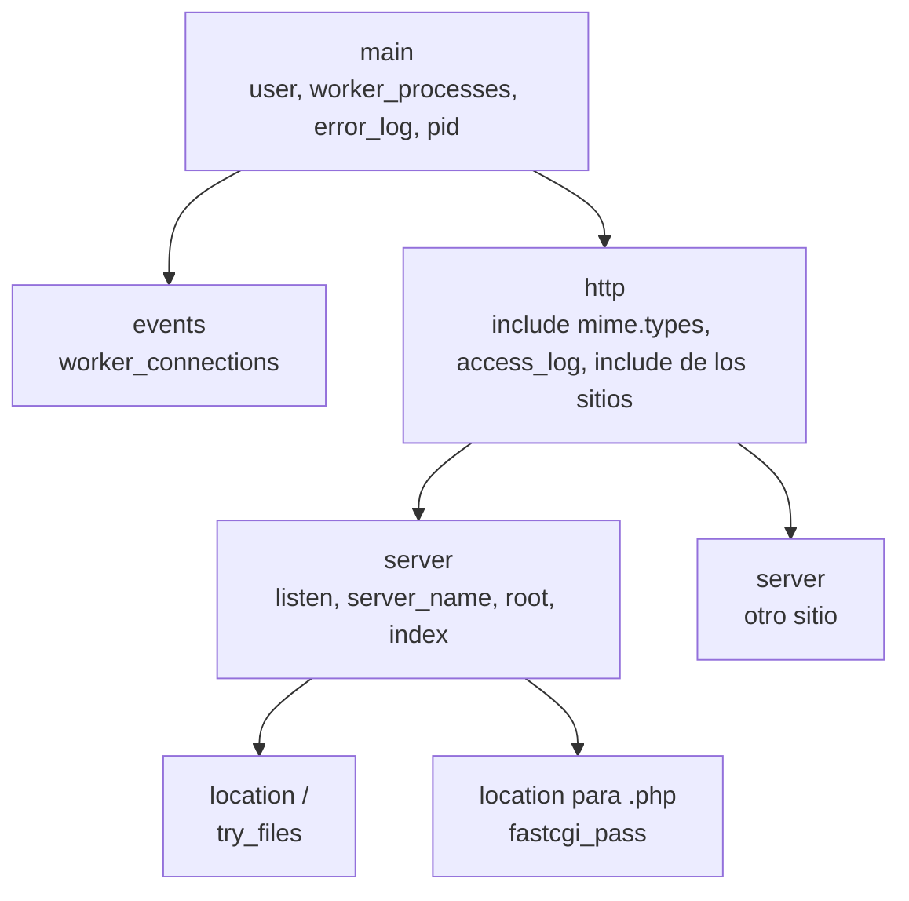

Un `nginx.conf` mínimo y comentado:

```nginx
user  www-data;                 # main: usuario de los workers
worker_processes  auto;         # main: un worker por núcleo
error_log  /var/log/nginx/error.log;
pid        /run/nginx.pid;

events {
    worker_connections 768;     # conexiones por worker
}

http {
    include       /etc/nginx/mime.types;   # tabla de tipos MIME
    access_log    /var/log/nginx/access.log;

    server {
        listen      80;
        server_name www.alumno.local;
        root        /var/www/html;
        index       index.html;

        location / {
            try_files $uri $uri/ =404;
        }
    }
}
```

Reglas que se olvidan:

- Toda directiva simple termina en `;`. Si falta, `nginx -t` da error.
- Lo que va detrás de `#` es un comentario.
- **Herencia**: una directiva puesta en un contexto exterior vale para los de dentro, salvo que la redefinan. Si pones `root` en el `server`, todas sus `location` lo usan.
- `include` mete el contenido de otros ficheros. Así `nginx.conf` de Ubuntu carga `conf.d/*.conf` y `sites-enabled/*`.

### 5.7 Directivas clave

| Directiva | Contexto | Qué hace | Ejemplo |
|---|---|---|---|
| `listen` | server | Puerto (y opcionalmente IP) en el que escucha el sitio. `default_server` lo marca como sitio por defecto de ese puerto | `listen 80 default_server;` |
| `server_name` | server | Nombres a los que responde el sitio (se comparan con la cabecera `Host`) | `server_name docs.local;` |
| `root` | http, server, location | Carpeta raíz: la ruta del fichero es `root` + URI | `root /var/www/docs;` |
| `alias` | location | Sustituye la parte de la `location` por otra carpeta (apartado 5.8) | `alias /srv/fotos/;` |
| `index` | http, server, location | Fichero que se sirve al pedir una carpeta | `index index.php index.html;` |
| `try_files` | server, location | Prueba ficheros en orden y, si ninguno existe, hace lo del último parámetro | `try_files $uri $uri/ =404;` |
| `location` | server, location | Agrupa las URL que coinciden con un patrón | `location /img/ { ... }` |
| `error_page` | http, server, location | Página que se muestra para unos códigos de error | `error_page 404 /404.html;` |
| `return` | server, location | Responde directamente con un código (y una URL en las redirecciones) | `return 301 https://$host$request_uri;` |
| `proxy_pass` | location | Reenvía la petición por HTTP a otro servidor (Gunicorn) | `proxy_pass http://127.0.0.1:8000;` |
| `proxy_set_header` | http, server, location | Cabeceras que se añaden al reenviar | `proxy_set_header Host $host;` |
| `fastcgi_pass` | location | Reenvía la petición por FastCGI (PHP-FPM) | `fastcgi_pass unix:/run/php/php8.3-fpm.sock;` |
| `fastcgi_param` | http, server, location | Parámetros que se mandan a PHP-FPM | `fastcgi_param SCRIPT_FILENAME $document_root$fastcgi_script_name;` |
| `access_log` | http, server, location | Fichero donde se apunta cada petición | `access_log /var/log/nginx/docs.access.log;` |
| `error_log` | main, http, server, location | Fichero donde se apuntan los errores | `error_log /var/log/nginx/docs.error.log;` |
| `absolute_redirect` | http, server, location | Con `off`, las redirecciones que genera nginx llevan una ruta relativa en `Location` | `absolute_redirect off;` |
| `include` | cualquiera | Mete el contenido de otro fichero | `include snippets/fastcgi-php.conf;` |

Variables que aparecen mucho: `$uri` (la ruta pedida, sin la consulta), `$host` (el nombre pedido), `$remote_addr` (IP del cliente), `$scheme` (`http` o `https`), `$request_uri` (ruta con la consulta), `$document_root` (el `root` actual).

### 5.8 root y alias

Los dos dicen dónde están los ficheros, pero **calculan la ruta de forma distinta**:

```nginx
# Opción A
location /fotos/ {
    root /srv/web;          # /fotos/playa.jpg -> /srv/web/fotos/playa.jpg
}

# Opción B (alternativa a la A: las dos juntas en el mismo server
# darían error en nginx -t por location duplicada)
location /fotos/ {
    alias /srv/imagenes/;   # /fotos/playa.jpg -> /srv/imagenes/playa.jpg
}
```

- `root` **añade** la URI entera a la carpeta.
- `alias` **sustituye** la parte que coincide con la `location` (`/fotos/`) por la carpeta.

### 5.9 try_files paso a paso

`try_files $uri $uri/ =404;` significa: "prueba en este orden y quédate con lo primero que exista".

1. `$uri`: ¿existe un **fichero** con esa ruta dentro de `root`? Si sí, lo sirve.
2. `$uri/`: ¿existe una **carpeta** con ese nombre? Si sí, la usa (y sirve su `index`).
3. `=404`: si no existe nada, responde 404.

Ejemplos con `root /var/www/docs;`:

| Petición | Qué encuentra | Respuesta |
|---|---|---|
| `/index.html` | El fichero `/var/www/docs/index.html` | 200 |
| `/markdown/` | La carpeta `/var/www/docs/markdown/` y su `index.html` | 200 |
| `/markdown` (sin barra) | No es fichero, pero sí carpeta | **301** con `Location` a `/markdown/`; luego 200 |
| `/esto-no-existe` | Nada | 404 (con `error_page 404 /404.html;` se muestra esa página) |

Ese 301 lo genera nginx solo (no hace falta escribir ningún `return`) y es el que vi en mi práctica. Por defecto nginx escribe la URL **completa** en `Location`, y para el puerto usa el suyo, el 80 en el que escucha dentro del contenedor, no el 8080 por el que entraba yo desde el Mac. Resultado: `Location: http://localhost/markdown/`, que lleva al puerto 80 del Mac, donde no hay nada. Con `absolute_redirect off;` la cabecera queda `Location: /markdown/` (relativa), el navegador la completa con el host y el puerto que ya estaba usando, y funciona.

En los ejemplos con proxy inverso se usa `try_files $uri =404;` dentro de una `location` exacta para servir solo un estático concreto.

### 5.10 location y sus tipos de coincidencia

Antes, una palabra: una **expresión regular** (*regex*) es un patrón para buscar texto. Por ejemplo, `\.php$` significa "un punto de verdad (`\.`), luego `php`, y ahí se acaba (`$`)", o sea, "termina en `.php`".

| Forma | Nombre | Coincide con | Ejemplo |
|---|---|---|---|
| `location = /ruta` | Exacta | Solo esa URI exacta. Si coincide, **se para la búsqueda** | `location = /estilos.css` |
| `location /ruta` | Prefijo | Toda URI que **empieza** por eso | `location /img/` |
| `location ^~ /ruta` | Prefijo preferente | Como prefijo, pero si es el prefijo más largo **no se miran las regex** | `location ^~ /static/` |
| `location ~ regex` | Expresión regular, distingue mayúsculas | URIs que cumplen el patrón | `location ~ \.php$` |
| `location ~* regex` | Expresión regular, sin distinguir mayúsculas | Igual, ignorando mayúsculas | `location ~* \.(png\|jpg)$` |

Cómo elige nginx la `location` (algoritmo oficial):

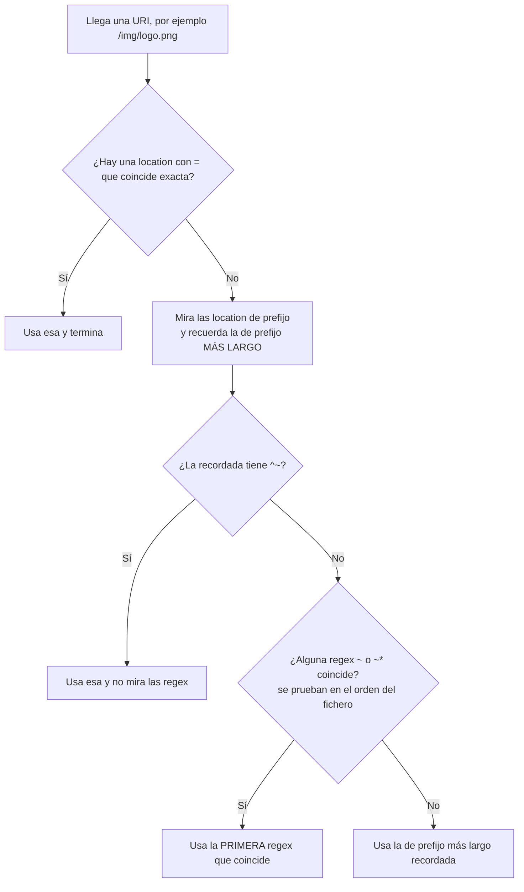

Truco para memorizarlo: **exacta gana siempre; luego el prefijo más largo; las regex le pueden quitar el sitio salvo que lleve `^~`; entre regex gana la primera que aparece en el fichero.**

`location /` coincide con **todo** (todas las URI empiezan por `/`), pero es el prefijo más corto. Por eso funciona como "lo demás".

### 5.11 Cómo elige nginx el server block

Un **server block** (bloque `server`) es un sitio web. Con varios, el mismo nginx sirve varias webs (*virtual hosts*). nginx decide así:

1. Se queda con los `server` cuyo `listen` coincide con la **IP y el puerto** por los que entró la petición.
2. Compara la cabecera **`Host`** con los `server_name`, en este orden: nombre exacto, comodín al principio más largo (`*.ejemplo.org`), comodín al final más largo (`mail.*`) y la primera expresión regular.
3. Si **ninguno** coincide (o no hay `Host`, cosa que solo se permite en HTTP/1.0), atiende el **servidor por defecto** de ese puerto: el que tenga `default_server` o, si nadie lo tiene, **el primero** que aparece en la configuración.

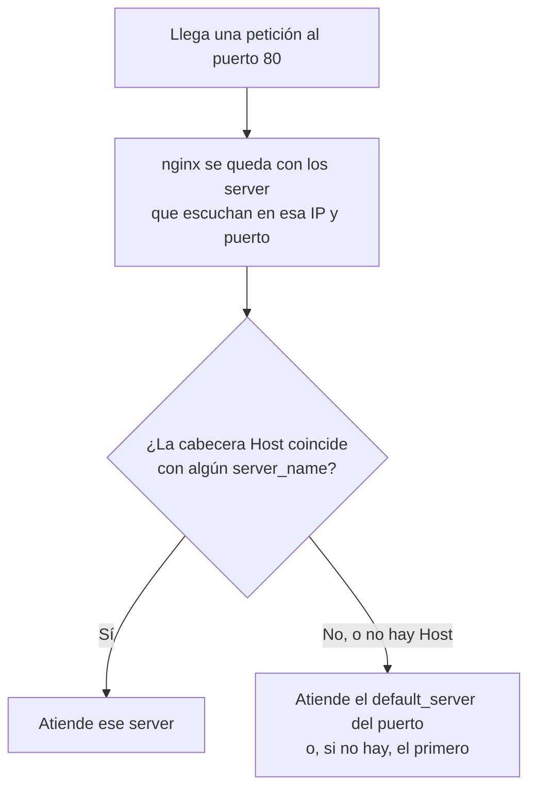

`server_name _;` no tiene nada mágico: `_` es un nombre que nunca coincide con un dominio real. Se usa junto a `default_server` para el sitio "atrapa todo".

Se prueba sin DNS cambiando la cabecera:

```bash
curl -H "Host: docs.local" http://127.0.0.1:8080/
curl -H "Host: otro.local" http://127.0.0.1:8080/   # responde el default_server
```

### 5.12 Comandos de nginx

| Comando | Qué hace |
|---|---|
| `nginx -v` | Versión |
| `nginx -V` | Versión, compilador y parámetros de compilación (`--prefix`, módulos) |
| `nginx -t` | **Comprueba** la sintaxis de toda la configuración e intenta abrir los ficheros que nombra. Dice `syntax is ok` o el fichero y la línea del error |
| `nginx -T` | Igual que `-t`, pero además **imprime toda la configuración** ya juntada (muy útil con `grep`) |
| `nginx -s reload` | Recarga la configuración **sin cortar** el servicio |
| `nginx -s quit` | Parada **ordenada**: espera a que terminen las peticiones en curso |
| `nginx -s stop` | Parada **rápida** |
| `nginx -s reopen` | Vuelve a abrir los ficheros de log (tras rotarlos) |
| `nginx -g 'daemon off;'` | Arranca en primer plano (el arranque en contenedores) |

`-s` viene de *signal* (señal): el comando no arranca otro nginx, solo manda un aviso al master que ya está corriendo, usando el número de proceso guardado en el fichero `pid`.

Ojo, la web del curso dice que `nginx -s stop` detiene "de forma ordenada". Según la documentación oficial de nginx es al revés: **`stop` es la parada rápida** (corta lo que esté en curso) y **`quit` es la ordenada** (espera a que terminen las peticiones). Si te lo preguntan, contesta con la versión oficial y menciona `quit`.

Cómo funciona el `reload`: el master comprueba la configuración nueva. Si es correcta, arranca workers nuevos y pide a los viejos que terminen lo que tienen en curso. Si tiene errores, **sigue con la configuración vieja**. Ojo: `nginx -s reload` necesita que el master esté en marcha. Si nginx está parado, no arranca nada: da un error porque no encuentra el `pid` del master (algo como `open() "/run/nginx.pid" failed`).

Ciclo de trabajo que hay que seguir **siempre**:

```text
editar la configuración -> nginx -t -> nginx -s reload -> curl -I para comprobar
```

### 5.13 Logs de nginx

| Fichero | Qué guarda |
|---|---|
| `/var/log/nginx/access.log` | **Una línea por petición** atendida: IP, fecha, petición, código, tamaño, cliente |
| `/var/log/nginx/error.log` | **Solo los problemas**: permisos, fallos de configuración, backend que no responde |

Cada `server` puede tener sus propios logs con `access_log` y `error_log` (en mi práctica: `docs.access.log` y `blog.access.log`).

Formato por defecto de `access.log` (se llama *combined*; nginx lo usa si `access_log` no indica otro formato). Línea real de mi práctica:

```text
192.168.65.1 - - [18/Oct/2026:20:51:23 +0000] "GET / HTTP/1.1" 200 4149 "-" "curl/8.7.1"
```

| Trozo | Significa |
|---|---|
| `192.168.65.1` | IP del cliente (aquí, la red interna de Docker Desktop por la que llegan las peticiones del Mac) |
| `- -` | El primer guion es fijo (en nginx siempre sale así). El segundo es el usuario autenticado (`$remote_user`): sale `-` si no hay usuario y contraseña |
| `[18/Oct/2026:20:51:23 +0000]` | Fecha y hora |
| `"GET / HTTP/1.1"` | La línea de petición |
| `200` | Código de estado |
| `4149` | Bytes del cuerpo enviados (con un HEAD sale `0`) |
| `"-"` | Referer: página desde la que se llegó |
| `"curl/8.7.1"` | User-Agent: el cliente |

Comandos para leerlos:

```bash
docker exec dpl-lab tail -n 10 /var/log/nginx/access.log   # últimas 10 líneas
docker exec dpl-lab tail -f /var/log/nginx/error.log       # en directo (Ctrl+C para salir)
```

### 5.14 Proxy inverso, caché y balanceo de carga

- **Proxy inverso**: lo explico a fondo en el apartado 6.2, porque es la base de Gunicorn y PHP-FPM.
- **Caché**: nginx guarda copias de las respuestas del backend y las sirve si se vuelven a pedir. Se configura con `proxy_cache_path` (dónde se guarda) y `proxy_cache` (en la `location`). Las cabeceras `Cache-Control` y `Expires` del backend dicen qué se puede guardar y cuánto tiempo.
- **Balanceo de carga**: repartir peticiones entre varios servidores iguales con un bloque `upstream`:

```nginx
upstream aplicacion {
    least_conn;                        # al que tenga menos conexiones
    server 10.0.0.11:8000;
    server 10.0.0.12:8000;
    server 10.0.0.13:8000 backup;      # solo si caen los otros
}

server {
    listen 80;
    location / {
        proxy_pass http://aplicacion;  # el nombre del upstream
    }
}
```

Métodos de reparto: **round-robin** (por turnos, el de por defecto), `least_conn` (menos conexiones activas), `ip_hash` (la misma IP va siempre al mismo servidor, útil para sesiones) y `weight` (pesos). Si un servidor no responde, nginx deja de mandarle tráfico un tiempo.

### 5.15 Relación con mi práctica

Mi práctica está explicada en [04-practica-nginx.md](04-practica-nginx.md). Esto es lo que usa de este apartado, para poder defenderlo:

| Lo que hice | Teoría que hay detrás |
|---|---|
| nginx con la imagen oficial (`nginx:1.30`) en Docker Compose, configuración en `conf.d/` | 5.4: la imagen oficial no usa `sites-available` ni `www-data` |
| Tres server blocks: `docs.local`, `blog.local` y uno con `listen 80 default_server;` y `server_name _;` | 5.11: elección por `Host` y servidor por defecto |
| `/etc/hosts` con `docs.local` y `blog.local` apuntando a `127.0.0.1` (y a `::1`, la versión IPv6) | 2.11: simular DNS en el laboratorio |
| `try_files $uri $uri/ =404;` y el 301 de `/markdown` a `/markdown/` | 5.9 y 3.8 |
| `absolute_redirect off;` para no perder el puerto 8080 | 5.9 y 7.3 (`-p 8080:80`) |
| `error_page 404 /404.html;` con la página de error de Zensical | 5.7 |
| `access_log` y `error_log` propios de cada sitio | 5.13 |
| Volúmenes `:ro` con las webs generadas por Zensical y Jekyll | 4.2 (estático) y 7.4 (Compose) |
| La CI ejecuta `nginx -t` y comprueba con `curl -fsS` | 5.12 y 3.12 |

Detalle de logs: en la imagen oficial, `access.log` y `error.log` son enlaces a la salida estándar del contenedor (se ven con `docker compose logs nginx`). La portada (`default.conf`) no define logs propios, así que hereda ese `access.log` y sus peticiones salen en `docker compose logs`. En cambio, `docs.access.log` y `blog.access.log` son ficheros normales dentro del contenedor, y los leo con `docker compose exec nginx tail -n 3 /var/log/nginx/blog.access.log`.

Fuentes: [Servidor Web nginx](https://dpl-f1facc.gitlab.io/ut02/teoria/servidor-web-nginx/), [Práctica guiada 04](https://dpl-f1facc.gitlab.io/ut02/practicas/guiada-04-nginx/), [Beginner's Guide de nginx](https://nginx.org/en/docs/beginners_guide.html), [How nginx processes a request](https://nginx.org/en/docs/http/request_processing.html), [Server names](https://nginx.org/en/docs/http/server_names.html), [módulo core de HTTP (location, try_files, error_page)](https://nginx.org/en/docs/http/ngx_http_core_module.html), [opciones de la línea de comandos](https://nginx.org/en/docs/switches.html) e [imagen oficial de nginx en Docker Hub](https://hub.docker.com/_/nginx).

## 6. Servidores de aplicaciones: Gunicorn y PHP-FPM

### 6.1 Por qué hace falta un servidor de aplicaciones

nginx es muy bueno entregando ficheros, pero **no ejecuta** código Python ni PHP. Si le pides `index.php` y no le has dicho a quién pasárselo, lo envía como un fichero cualquiera y el navegador lo descarga (apartado 3.7). Para lo dinámico hace falta otro programa, el **servidor de aplicaciones**: tiene la aplicación cargada, recibe cada petición, ejecuta el código y devuelve el resultado.

En el restaurante: el camarero (nginx) **no cocina**. Lleva el pedido a la cocina (Gunicorn o PHP-FPM) y te trae el plato.

En la UT2 hay **dos stacks equivalentes** y cada alumno hace uno: Python (Flask + Gunicorn) o PHP (PHP-FPM). Para el examen conviene saber los dos.

### 6.2 Qué es un proxy inverso

Un **proxy** es un intermediario. Hay dos tipos:

- **Proxy normal** (*forward proxy*): está del lado del **cliente** y sale a Internet en su nombre (por ejemplo, el proxy de una empresa).
- **Proxy inverso** (*reverse proxy*): está del lado del **servidor**. Recibe las peticiones de los clientes y las reenvía a los servidores internos. El cliente cree que habla con nginx y no ve lo que hay detrás.

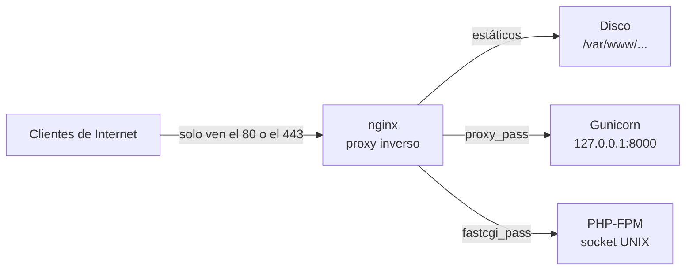

Por qué se pone **nginx delante** del servidor de aplicaciones:

- **Oculta la estructura interna**: el backend escucha en `127.0.0.1` o en una red privada; desde fuera solo se ve nginx.
- **Protege** al servidor de aplicaciones del tráfico directo de Internet.
- **Sirve los estáticos** él mismo, que lo hace mucho mejor, y así no ocupa a los workers de la aplicación.
- **Centraliza** HTTPS, cabeceras, compresión y límites de peticiones.
- Permite **caché** y **balanceo de carga** (apartado 5.14).

Con Gunicorn, nginx reenvía la petición por **HTTP** (`proxy_pass`). Con PHP-FPM la reenvía por **FastCGI** (`fastcgi_pass`); la documentación de nginx lo llama igualmente *FastCGI proxying*. En los dos casos la idea es la misma: nginx delante y la aplicación detrás.

### 6.3 Gunicorn (stack Python)

Conceptos:

- **WSGI** (*Web Server Gateway Interface*, PEP 3333): el estándar de Python que dice cómo un servidor llama a una aplicación web. Gracias a él, cualquier aplicación compatible (Flask, Django) funciona con cualquier servidor WSGI. Ojo: WSGI no viaja por la red. Entre nginx y Gunicorn viaja **HTTP normal**; Gunicorn traduce esa petición a una llamada WSGI a tu código.
- **Gunicorn** (*Green Unicorn*): servidor WSGI para producción. Carga la aplicación, abre un puerto (o un socket UNIX) y reparte las peticiones entre varios **workers**.
- **`app:app`**: módulo `app` (el fichero `app.py`) y, dentro, el objeto `app` (lo que crea `app = Flask(__name__)`). En Django sería `config.wsgi:application`.
- **Servidor de desarrollo de Flask** (`flask run`): cómodo para programar, pero **no es para producción**. Al arrancarlo, Flask lo avisa en la terminal: *"This is a development server. Do not use it in a production deployment."* No está pensado para aguantar carga ni ataques, y en modo depuración puede enseñar información interna (código y variables) a quien provoque un error.

Ojo, la web del curso añade que `flask run` "sirve una petición a la vez". Eso era así en versiones antiguas; desde Flask 1.0 usa hilos y puede atender varias. Lo importante para el examen no cambia: es para desarrollo, no para producción, y en producción va un servidor WSGI como Gunicorn.

Modelo de procesos: igual que nginx, un **proceso maestro** (en la documentación de Gunicorn se llama *arbiter*) arranca los workers y los repone si mueren. Con `--workers 2` se atienden dos peticiones a la vez. La fórmula orientativa de producción es **(2 × núcleos) + 1**; en el laboratorio bastan 1 o 2.

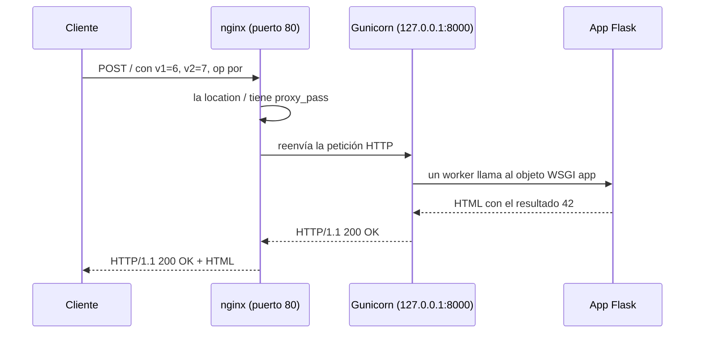

Pasos de la práctica (resumidos):

```bash
# 1. Paquetes base dentro de dpl-lab
docker exec dpl-lab apt-get update
docker exec dpl-lab apt-get install -y python3 python3-venv nginx curl

# 2. Entorno virtual e instalación de dependencias
docker exec dpl-lab bash -c 'cd /home/alumno/dpl/calculadora-python && python3 -m venv .venv'
docker exec dpl-lab bash -c 'cd /home/alumno/dpl/calculadora-python && .venv/bin/pip install -r web/requirements.txt'

# 3. Arrancar Gunicorn en primer plano (sin systemd)
docker exec -d dpl-lab bash -c 'cd /home/alumno/dpl/calculadora-python/web && /home/alumno/dpl/calculadora-python/.venv/bin/gunicorn --bind 127.0.0.1:8000 --workers 2 --access-logfile - --error-logfile - app:app > /var/log/calculadora-gunicorn.log 2>&1'

# 4. Comprobar
docker exec dpl-lab ps aux | grep gunicorn          # maestro + 2 workers
docker exec dpl-lab curl -I http://127.0.0.1:8000/  # Gunicorn directo: 200
docker exec dpl-lab curl -I http://localhost/       # a través de nginx: 200
```

Por qué un **entorno virtual** (`.venv`): en Ubuntu 24.04 el Python del sistema está protegido (política **PEP 668**) y `pip install` global da el error `externally-managed-environment`. El venv es una carpeta con su propio `python` y `pip`, aislada del sistema. Se crea con `python3 -m venv .venv`, se reconstruye con `requirements.txt` y por eso **no se sube a Git** (va en `.gitignore`). Se usa la ruta completa `.venv/bin/...` porque `source .venv/bin/activate` no sobrevive entre comandos `docker exec`.

Opciones de Gunicorn:

| Opción | Qué hace |
|---|---|
| `--bind 127.0.0.1:8000` (`-b`) | Dónde escucha. `127.0.0.1` = solo la propia máquina (nginx llega, el exterior no). Es el valor por defecto |
| `--bind 0.0.0.0:8000` | Escucha en todas las interfaces. Se usa **dentro de un contenedor**, para que otro contenedor (nginx) pueda llegar |
| `--workers 2` (`-w`) | Número de procesos worker |
| `--access-logfile -` / `--error-logfile -` | Logs a la salida estándar (`-`) |
| `--check-config` | Comprueba que la aplicación se puede cargar, sin arrancar |
| `app:app` | Módulo y objeto WSGI |

Para pararlo no hay `systemctl`: `pkill -f gunicorn`.

Server block de nginx para Gunicorn (el de la práctica):

```nginx
server {
    listen 80 default_server;
    listen [::]:80 default_server;
    server_name _;
    root /var/www/calculadora;

    # El estático lo sirve nginx (location exacta: gana a la de /)
    location = /estilos.css {
        try_files $uri =404;
    }

    # Todo lo demás va a Gunicorn
    location / {
        proxy_pass http://127.0.0.1:8000;
        proxy_set_header Host $host;
        proxy_set_header X-Real-IP $remote_addr;
        proxy_set_header X-Forwarded-For $proxy_add_x_forwarded_for;
        proxy_set_header X-Forwarded-Proto $scheme;
    }

    access_log /var/log/nginx/calculadora.access.log;
    error_log /var/log/nginx/calculadora.error.log;
}
```

- `listen [::]:80` hace lo mismo que `listen 80`, pero para IPv6.
- `default_server` y `server_name _` hacen que este sitio responda a cualquier nombre (`localhost` incluido). Por eso la práctica borra el enlace del sitio `default` de Ubuntu: dos `default_server` en el mismo puerto dan error en `nginx -t` (`duplicate default server`).
- Aquí no hay `index` ni `try_files` en `location /`: todo lo que no sea `/estilos.css` se lo come Gunicorn, que decide qué responder.

Las cabeceras de proxy existen porque, sin ellas, la aplicación solo vería a nginx:

| Cabecera | Qué le cuenta a la aplicación |
|---|---|
| `Host $host` | El nombre real que pidió el cliente (si no, vería `127.0.0.1:8000`) |
| `X-Real-IP $remote_addr` | La IP del cliente original |
| `X-Forwarded-For $proxy_add_x_forwarded_for` | La lista de IP por las que ha pasado la petición: la del cliente y la de cada proxy intermedio |
| `X-Forwarded-Proto $scheme` | Si el cliente usó `http` o `https` (para no generar enlaces `http` en un sitio `https`) |

Errores típicos de Gunicorn:

| Error | Causa | Solución |
|---|---|---|
| 502 Bad Gateway | Gunicorn parado o `proxy_pass` a otro puerto | Arrancarlo; comprobar con `curl -I http://127.0.0.1:8000/` |
| 504 Gateway Timeout | Gunicorn saturado o petición más lenta que lo que nginx espera (`proxy_read_timeout`, 60 s por defecto) | Revisar el código o subir `--workers` |
| `Connection in use: ('127.0.0.1', 8000)` (o `[Errno 98] Address already in use`) | Otro proceso ya usa el puerto 8000 | `ss -tlnp \| grep 8000`; `pkill -f gunicorn` y volver a arrancar |
| `externally-managed-environment` | `pip install` fuera del venv (PEP 668) | Usar siempre `.venv/bin/pip` |
| `ModuleNotFoundError: No module named 'flask'` | Gunicorn lanzado con el Python del sistema | Usar la ruta `.venv/bin/gunicorn` |
| `ModuleNotFoundError: No module named 'app'` | Gunicorn arrancado desde otra carpeta: no encuentra `app.py` | Hacer `cd` a la carpeta de `app.py` antes de lanzarlo |
| `Failed to find attribute 'app' in 'app'` | Encuentra `app.py`, pero dentro no hay un objeto llamado `app` | Poner el nombre real del objeto (`app:mi_objeto`) |

Detalle para nota: Gunicorn también tiene su propio límite. Si un worker tarda más de 30 s (opción `--timeout`, 30 por defecto), el maestro lo mata y nginx ve la conexión cortada: el cliente recibe **502**, no 504. El 504 sale cuando nginx se cansa de esperar **antes** que Gunicorn.

### 6.4 PHP-FPM (stack PHP)

Conceptos:

- **FastCGI**: protocolo para que un servidor web pase la ejecución de un programa a un proceso externo que **ya está arrancado** (en vez de lanzar el intérprete desde cero en cada petición).
- **PHP-FPM** (*FastCGI Process Manager*): el gestor de procesos FastCGI de PHP. Mantiene procesos PHP preparados que reciben peticiones y ejecutan los scripts.
- **Pool**: grupo de procesos de PHP-FPM con su configuración (usuario, dónde escucha, cuántos procesos). El de Ubuntu se llama `www` y está en `/etc/php/8.3/fpm/pool.d/www.conf`.

```ini
[www]
user = www-data                       ; usuario que ejecuta los scripts
group = www-data
listen = /run/php/php8.3-fpm.sock     ; socket UNIX donde escucha
listen.owner = www-data               ; quién puede usar el socket
listen.group = www-data
listen.mode = 0660
pm = dynamic                          ; número de procesos variable
pm.max_children = 5                   ; máximo de procesos = peticiones PHP a la vez
pm.start_servers = 2
pm.min_spare_servers = 1
pm.max_spare_servers = 3
```

En Ubuntu nginx y PHP-FPM usan **el mismo usuario** (`www-data`), así que nginx puede usar el socket sin tocar nada. Con el nginx de nginx.org (usuario `nginx`) habría que ajustar el pool.

**Socket UNIX frente a TCP**:

| | Socket UNIX | TCP |
|---|---|---|
| Dirección | Un fichero: `/run/php/php8.3-fpm.sock` | IP y puerto: `127.0.0.1:9000` o `php-fpm:9000` |
| Alcance | **Solo la misma máquina** | Cualquier máquina que llegue a esa IP y puerto |
| Rendimiento | Algo mejor (no pasa por la pila TCP) | Suficiente |
| Permisos | Los del fichero (propietario y modo) | Los del firewall y la IP en la que escucha |
| En el curso | Calculadora nativa en `dpl-lab` | Calculadora dockerizada (nginx y PHP-FPM en contenedores distintos) |

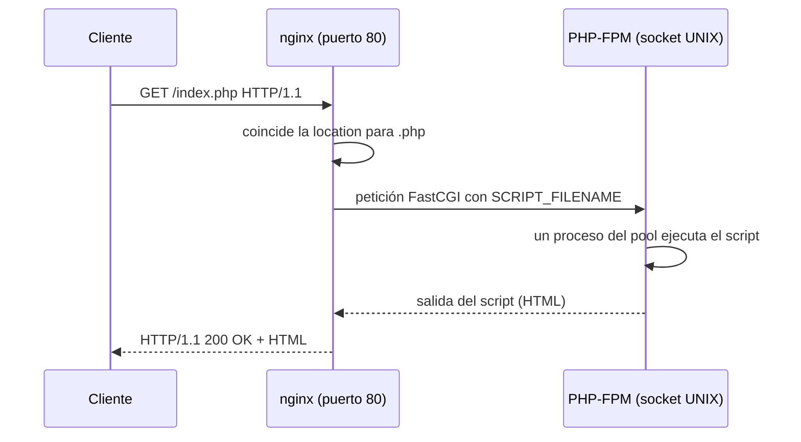

Pasos de la práctica (resumidos):

```bash
docker exec dpl-lab apt-get update
docker exec dpl-lab apt-get install -y php-fpm php-cli
docker exec dpl-lab php -v                     # PHP 8.3.x
docker exec -d dpl-lab php-fpm8.3 -F           # -F = primer plano (sin systemd)
docker exec dpl-lab ps aux | grep php-fpm      # master process + pool www
docker exec dpl-lab ls /run/php/               # php8.3-fpm.sock (aparece al arrancar)
```

El binario lleva la versión en el nombre (`php-fpm8.3`). Si tu versión es otra, cambia el nombre del binario y del socket. Comprobar la configuración de PHP-FPM: `php-fpm8.3 -t`.

Server block de nginx para PHP-FPM (el de la práctica):

```nginx
server {
    listen 80 default_server;
    listen [::]:80 default_server;
    server_name _;
    root /var/www/calculadora;
    index index.php index.html;

    location / {
        try_files $uri $uri/ =404;
    }

    # Solo las URI que terminan en .php
    location ~ \.php$ {
        include snippets/fastcgi-php.conf;
        fastcgi_pass unix:/run/php/php8.3-fpm.sock;
    }
}
```

- `location ~ \.php$`: expresión regular. `\.` es un punto de verdad y `$` significa "termina aquí".
- `include snippets/fastcgi-php.conf`: trozo que trae Ubuntu con los parámetros FastCGI estándar, entre ellos **`SCRIPT_FILENAME`**, que le dice a PHP-FPM **qué fichero ejecutar** (`root` + ruta del script).
- `fastcgi_pass`: **a dónde** se manda la petición: el socket de PHP-FPM. Nunca apunta a un fichero de la web.

Si no usas el snippet de Ubuntu (por ejemplo, con la imagen oficial de nginx en Docker), hay que poner los parámetros a mano:

```nginx
location ~ \.php$ {
    include fastcgi_params;
    fastcgi_param SCRIPT_FILENAME $document_root$fastcgi_script_name;
    fastcgi_pass php-fpm:9000;
}
```

Errores típicos de PHP-FPM:

| Error | Causa | Comprobación |
|---|---|---|
| 502 Bad Gateway | PHP-FPM parado, socket con otro nombre o ruta de `fastcgi_pass` mal | `ps aux \| grep php-fpm`, `ls /run/php/`, `nginx -T \| grep fastcgi_pass` |
| 502 tras actualizar PHP | El socket ha cambiado de nombre (`php8.2` a `php8.3`) | `ls /run/php/` |
| `(13: Permission denied)` en `error.log` | nginx no puede usar el socket | `ls -l /run/php/*.sock`; revisar `listen.owner` y `listen.group` |
| El navegador **descarga** el `.php` | No hay `location ~ \.php$` o no coincide: nginx lo sirve como fichero | `nginx -T` |
| 404 o el texto `File not found.` en un `.php` | El script no está en el `root` o `SCRIPT_FILENAME` está mal | `ls` del DocumentRoot y revisar `root` |
| 500 Internal Server Error | Error en el propio PHP (sintaxis, fallo fatal) | `tail` de `error.log` de nginx y del log de PHP-FPM |
| 403 Forbidden | Permisos de ficheros o carpetas | `ls -l`; carpetas 755 y ficheros 644 |

Buenas prácticas: no dejar `phpinfo()` en producción (enseña toda la configuración), y `display_errors = Off` en producción (los errores al log, no al navegador).

### 6.5 Gunicorn frente a PHP-FPM

| | Gunicorn | PHP-FPM |
|---|---|---|
| Lenguaje | Python (Flask, Django) | PHP |
| Estándar clave | WSGI: cómo Gunicorn llama a tu código Python | FastCGI: cómo nginx le pasa la petición a PHP-FPM |
| Qué viaja entre nginx y él | HTTP | FastCGI |
| Directiva de nginx | `proxy_pass` | `fastcgi_pass` |
| Dirección típica nativa | `127.0.0.1:8000` | `unix:/run/php/php8.3-fpm.sock` |
| Dirección típica en Compose | `http://app:8000` | `php-fpm:9000` |
| Arranque sin systemd | `.venv/bin/gunicorn --bind ... app:app` | `php-fpm8.3 -F` |
| Dónde se configura | Opciones en la línea de comandos | Pool `www.conf` |
| Procesos | Maestro (*arbiter*) + workers | Master + procesos del pool |
| Instalación | `pip` dentro de un venv | `apt-get install php-fpm` |
| Log en la práctica | `/var/log/calculadora-gunicorn.log` | `/var/log/php8.3-fpm.log` |
| Error típico | 502 si está parado o el puerto no coincide | 502 si está parado o el socket no coincide |

### 6.6 Las mismas calculadoras con Docker Compose

Las dos prácticas terminan con la calculadora **dockerizada** en el puerto 8080. Lo importante:

- Cada pieza es un **servicio** en su propio contenedor (`web` con nginx, y `app` o `php-fpm`).
- Los contenedores se encuentran **por el nombre del servicio**: nginx llega a Gunicorn en `http://app:8000` y a PHP-FPM en `php-fpm:9000`.
- Gunicorn escucha en `0.0.0.0:8000` (no en `127.0.0.1`), porque nginx está en **otro** contenedor. Dentro de un contenedor, `127.0.0.1` es **ese mismo contenedor**, así que nginx no llegaría.
- En la versión PHP, los dos servicios montan `./web` en la **misma ruta** (`/var/www/html`). Es necesario: nginx no manda el código a PHP-FPM, solo le dice la ruta del fichero (`SCRIPT_FILENAME`), y PHP-FPM lo abre en **su** disco. Si las rutas no coinciden, PHP-FPM no lo encuentra (`File not found.`). La imagen `php:8-fpm` escucha por TCP en el 9000.
- `ports: "8080:80"` publica el sitio en el 8080 del anfitrión para no chocar con el 80 de `dpl-lab`. Ojo: en la práctica de entorno `dpl-lab` se creó también con `-p 8080:8080`. Si está encendido, el 8080 del anfitrión ya está cogido y Compose falla con `port is already allocated`. Solución: parar `dpl-lab` mientras pruebas o usar otro puerto (por ejemplo `8081:80`).

Fuentes: [Gunicorn](https://dpl-f1facc.gitlab.io/ut02/teoria/gunicorn/), [PHP-FPM](https://dpl-f1facc.gitlab.io/ut02/teoria/php-fpm/), [Práctica guiada: Calculadora Python](https://dpl-f1facc.gitlab.io/ut02/practicas/guiada-05-calculadora-python/), [Práctica guiada: Calculadora PHP](https://dpl-f1facc.gitlab.io/ut02/practicas/guiada-06-php-fpm/), [ajustes de Gunicorn (`--bind`, `--timeout`)](https://gunicorn.org/reference/settings/), [diseño de Gunicorn](https://gunicorn.org/design/), [servidor de desarrollo de Flask](https://flask.palletsprojects.com/en/stable/server/), [`proxy_read_timeout` de nginx](https://nginx.org/en/docs/http/ngx_http_proxy_module.html#proxy_read_timeout), [PHP-FPM en el manual de PHP](https://www.php.net/manual/es/install.fpm.php) y la sección de FastCGI de la [Beginner's Guide de nginx](https://nginx.org/en/docs/beginners_guide.html).

## 7. Nube y contenedores

### 7.1 Virtualización: máquina virtual frente a contenedor

**Virtualizar** es ejecutar varios "ordenadores" o entornos aislados sobre una sola máquina física.

- **Máquina virtual (VM)**: simula un ordenador completo, con **su propio sistema operativo** entero. La gestiona un **hipervisor**: el programa que reparte la CPU, la memoria y el disco reales entre las VM (VirtualBox, VMware).
- **Contenedor**: **comparte el núcleo (kernel)** del sistema anfitrión y solo aísla los procesos, las librerías y los ficheros de la aplicación. El núcleo es la parte central del sistema operativo, la que manda sobre el hardware; como se comparte, no hay que arrancar un sistema operativo entero por cada contenedor.

Comparación: una VM es una casa completa con sus propios cimientos; un contenedor es un piso dentro de un edificio que comparte los cimientos con los demás.

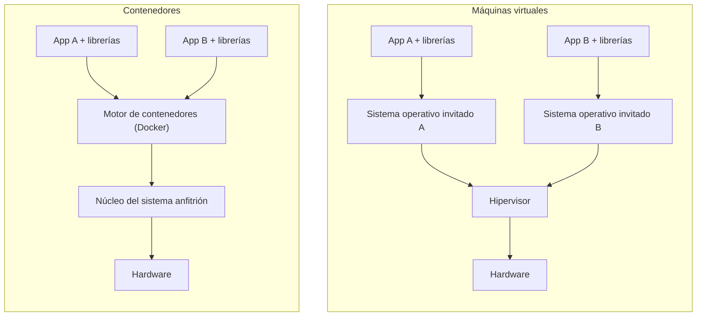

| | Máquina virtual | Contenedor |
|---|---|---|
| Qué virtualiza | El hardware entero | Solo el entorno de la aplicación |
| Sistema operativo | Uno completo por VM | Comparte el núcleo del anfitrión |
| Arranque | Minutos | Segundos |
| Tamaño | Gigas | Megas (a veces cientos) |
| Aislamiento | Más fuerte | Suficiente para la mayoría de casos, pero menor |
| Ejemplos | VirtualBox, VMware, una instancia EC2 | Docker, Podman |

El curso **no usa máquinas virtuales**: todo va con Docker y la imagen oficial de Ubuntu. Curiosidad: en macOS y Windows, Docker Desktop arranca por debajo una pequeña VM Linux, porque los contenedores Linux necesitan un núcleo Linux. No la ves, pero está.

### 7.2 Imagen y contenedor

- **Imagen**: plantilla **inmutable** con el sistema de ficheros y la configuración de una aplicación (`ubuntu:24.04`, `nginx:1.30`, `python:3.12-slim`). Se descarga de un **registro** (Docker Hub) y se nombra `nombre:etiqueta`, donde la etiqueta suele ser la versión. `latest` es solo la etiqueta por defecto, no "la mejor".
- **Contenedor**: una imagen **en ejecución**. De una imagen salen tantos contenedores como quieras. Lo que el contenedor escribe dentro se pierde al borrarlo, salvo que esté en un **volumen**.

Comparación para DAM: **la imagen es la clase y el contenedor es el objeto** (la instancia).

Las imágenes propias se construyen con un **Dockerfile**: un fichero de texto con las instrucciones para fabricar la imagen (de qué imagen partir, qué instalar, qué copiar, qué comando lanzar). En la UT2 no hace falta, porque se usan imágenes oficiales tal cual; se trabaja en la UT4.

Una imagen está hecha de **capas** (las instrucciones del Dockerfile que cambian ficheros, como `RUN` o `COPY`, añaden una cada una). Las capas se comparten entre imágenes, así que se descargan y guardan una sola vez.

### 7.3 Docker en el curso

El contenedor de laboratorio se creó así (práctica de la UT1):

```bash
docker run -dit --name dpl-lab \
  -v ~/dpl:/home/alumno/dpl \
  -p 80:80 -p 8080:8080 -p 8000:8000 \
  ubuntu:24.04
```

| Opción | Qué hace |
|---|---|
| `-d` | En segundo plano |
| `-i` y `-t` | Mantiene la entrada abierta y una terminal (para que el contenedor de Ubuntu no se cierre) |
| `--name dpl-lab` | Nombre fijo para usarlo en otros comandos |
| `-v ~/dpl:/home/alumno/dpl` | **Bind mount**: la carpeta `~/dpl` del anfitrión aparece dentro del contenedor |
| `-p 80:80` | **Publica** el puerto: `anfitrión:contenedor` |

`-p 8080:80` se lee "el 8080 de **mi ordenador** lleva al 80 **del contenedor**". El primero es siempre el del anfitrión. Por eso en mi práctica entro por `localhost:8080` y nginx, dentro, escucha en el 80.

Comandos esenciales:

| Comando | Qué hace |
|---|---|
| `docker ps` / `docker ps -a` | Contenedores en marcha / todos |
| `docker exec dpl-lab comando` | Ejecuta un comando dentro del contenedor |
| `docker exec -it dpl-lab bash` | Abre una terminal dentro |
| `docker exec -d dpl-lab comando` | Lo lanza dentro sin esperar (servicios en primer plano) |
| `docker cp dpl-lab:/ruta ./` | Copia ficheros entre contenedor y anfitrión |
| `docker logs dpl-lab` | Salida del proceso principal del contenedor |
| `docker inspect dpl-lab` | Toda la información (IP, montajes, puertos) |
| `docker stop` / `docker start` / `docker rm -f` | Parar, arrancar, borrar |

Ojo con `docker logs`: solo recoge lo que escribe el **proceso principal** del contenedor (el que arrancó `docker run`; en `dpl-lab`, la `bash` de Ubuntu). Lo que lanzas con `docker exec -d` (como nginx en `dpl-lab`) no aparece ahí; en `dpl-lab` lo fiable es leer `/var/log/nginx/`. En cambio, en la imagen oficial de nginx, nginx **es** el proceso principal y sus logs por defecto sí salen en `docker logs`.

Ojo, la web del curso dice que con `docker logs dpl-lab` se ve la salida de nginx lanzado en primer plano. Con nginx lanzado mediante `docker exec -d` no es así (la documentación de Docker lo limita al proceso principal). Sí es cierto para un contenedor cuyo proceso principal es nginx, como el de la imagen oficial.

Volúmenes:

| | Bind mount | Volumen con nombre |
|---|---|---|
| Sintaxis | `-v /ruta/anfitrion:/ruta/contenedor` | `-v mivolumen:/ruta/contenedor` |
| Dónde vive | Una carpeta tuya, que puedes editar | Una zona gestionada por Docker |
| Uso típico | Desarrollo, ficheros de configuración, webs | Datos que deben durar (base de datos) |

Añadir `:ro` al final monta el volumen **solo lectura** (lo uso en mi práctica para las webs y la configuración).

### 7.4 Docker Compose

**Docker Compose** describe en un fichero YAML (`compose.yaml` o `compose.yml`) **varios contenedores** que forman una aplicación, y los arranca a la vez. YAML es un formato de texto de pares `clave: valor` en el que la **sangría** (los espacios a la izquierda) indica qué va dentro de qué; un espacio de más o de menos lo rompe. Ejemplo de la calculadora Python dockerizada (simplificado y comentado):

```yaml
services:
  app:                                   # servicio con Gunicorn
    image: python:3.12-slim
    working_dir: /srv/app
    volumes:
      - ./web:/srv/app:ro                # el código, solo lectura
    command: >
      sh -c "pip install --no-cache-dir -r requirements.txt &&
             gunicorn --bind 0.0.0.0:8000 --workers 2 app:app"

  web:                                   # servicio con nginx
    image: nginx:1.27
    volumes:
      - ./nginx/default.conf:/etc/nginx/conf.d/default.conf:ro
      - ./web:/usr/share/nginx/html:ro
    ports:
      - "8080:80"                        # anfitrión:contenedor
    depends_on:
      - app                              # arranca app antes que web
```

| Clave | Para qué |
|---|---|
| `services` | Cada contenedor de la aplicación |
| `image` | Imagen de la que nace |
| `ports` | Puertos publicados (`anfitrión:contenedor`) |
| `volumes` | Carpetas o volúmenes montados |
| `command` | Comando que ejecuta al arrancar |
| `depends_on` | Orden de arranque |
| `profiles` | Servicios que solo arrancan si se pide su perfil (en mi práctica, Jekyll con `profiles: ["herramientas"]`) |

Dos cosas que se preguntan:

- Compose crea una **red** para el proyecto y cada servicio se puede alcanzar **por su nombre** (`app`, `php-fpm`). Por eso `proxy_pass http://app:8000;`.
- `depends_on` solo controla el **orden de arranque**: no espera a que el otro servicio esté **listo**. Para eso hay comprobaciones de salud (`healthcheck`), que se ven en la UT4.

Comandos:

| Comando | Qué hace |
|---|---|
| `docker compose up -d` | Crea y arranca todo en segundo plano |
| `docker compose ps` | Estado de los servicios y puertos |
| `docker compose logs --tail=10 app` | Últimas líneas del log de un servicio |
| `docker compose exec web nginx -t` | Ejecuta un comando en un servicio en marcha |
| `docker compose run --rm servicio comando` | Lanza un contenedor puntual y lo borra al acabar (lo usa mi CI) |
| `docker compose down` | Para y borra los contenedores y la red del proyecto (con `-v`, también los volúmenes) |

### 7.5 Qué es la nube

La **nube** es usar, a través de Internet y bajo demanda, servidores, almacenamiento o bases de datos de **otra empresa**, pagando por lo que usas. En lugar de comprar máquinas (on-premise), las alquilas.

Ventajas: **elasticidad** (de 1 a 100 servidores y vuelta), **pago por uso**, **rapidez** (minutos, no semanas), **alcance global** y **fiabilidad**. Formas de pago: **bajo demanda** (por horas, sin compromiso) o **reservada** (te comprometes 1 a 3 años con descuento). Los tres grandes proveedores: AWS, Microsoft Azure y Google Cloud.

- **Región**: zona geográfica (por ejemplo, `eu-west-1`, Irlanda).
- **Zona de disponibilidad (AZ)**: centro de datos independiente dentro de una región (con su propia luz, refrigeración y red). Repartir servidores entre varias zonas da **alta disponibilidad**: si una cae, el servicio sigue.

### 7.6 IaaS, PaaS y SaaS

Los modelos dicen **cuánto gestiona el proveedor y cuánto tú**. Comparación con una pizza:

| Modelo | Te dan | Gestionas tú | Ejemplos | Pizza |
|---|---|---|---|---|
| IaaS (infraestructura como servicio) | Servidores virtuales, disco y red | Sistema operativo, software y aplicación | AWS EC2, Azure Virtual Machines, Google Compute Engine | Te alquilan la cocina: los ingredientes y la receta los pones tú |
| PaaS (plataforma como servicio) | La máquina, el sistema operativo y el entorno de ejecución (por ejemplo, Python ya instalado), listos para tu código | Solo tu código y su configuración | AWS Elastic Beanstalk, Heroku, Google App Engine | Te dan la masa hecha: tú pones los ingredientes |
| SaaS (software como servicio) | La aplicación terminada | Solo usarla | Gmail, Microsoft 365, Salesforce | Te traen la pizza a casa |

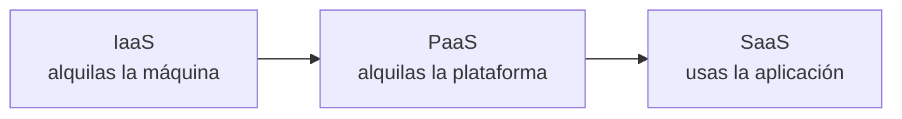

De izquierda a derecha **gestionas menos tú** y pagas más por la comodidad.

Nube y contenedores se complementan: en una máquina IaaS (EC2) puedes instalar Docker como en `dpl-lab`, y los proveedores tienen servicios gestionados de contenedores (AWS ECS, EKS o Fargate). La idea del curso: **empaquetar (contenedor) + describir (código) = despliegue que se puede repetir**.

### 7.7 Los servicios básicos de AWS

| Servicio | Qué es |
|---|---|
| EC2 | Máquinas virtuales (instancias). La pieza básica de IaaS |
| S3 | Almacenamiento de ficheros (objetos) en *buckets*; muy usado para estáticos y copias |
| Route 53 | DNS gestionado |
| VPC | Red privada virtual donde viven tus recursos |
| IAM | Quién puede hacer qué (permisos). Por defecto todo está denegado |
| CloudWatch | Métricas, logs y alarmas |

Al crear una EC2 eliges la **AMI** (plantilla del sistema operativo), el **tipo de instancia** (CPU y RAM, por ejemplo `t3.micro`), la red, el disco (EBS), el **Security Group** y el **key pair** (claves SSH para entrar: la pública va a la instancia y la privada te la quedas tú).

El **Security Group** es el cortafuegos de la instancia. Lo que **entra** está cerrado salvo los puertos que abras tú (por ejemplo, el 22 solo para tu IP y el 80 para todos). Lo que **sale** está permitido por defecto cuando lo creas desde la consola de AWS. Matiz: si lo creas con Terraform, Terraform quita esa regla de salida y hay que escribirla con un bloque `egress`, como hace el ejemplo del curso. Además es *stateful* (con estado): la respuesta a una petición que dejaste entrar sale sin necesitar otra regla.

Para una máquina usarías EC2, para guardar ficheros S3 y para el DNS Route 53 (es una pregunta de la autoevaluación del profesor).

### 7.8 Terraform (solo la idea)

**Terraform** sirve para hacer **infraestructura como código (IaC)**: describes en ficheros de texto (lenguaje **HCL**, ficheros `.tf`) qué máquinas, redes y cortafuegos quieres, y Terraform los crea en el proveedor.

- **Declarativo**: describes el **resultado final**, no los pasos. Si lo ejecutas dos veces, la segunda no cambia nada.
- **Provider**: el plugin que habla con cada proveedor (AWS, Azure, Docker...).
- **Resource**: cada pieza que gestionas (`aws_instance`, `aws_security_group`).
- **State** (`terraform.tfstate`): fichero donde Terraform apunta lo que ya ha creado. **No se sube a Git** (junto con `.terraform/` y `*.tfvars`), y las credenciales nunca van en los `.tf`.
- **Variables y outputs**: las variables hacen la configuración reutilizable (región, tipo de instancia) y los outputs enseñan resultados al terminar (por ejemplo, la IP pública).

Flujo: **write** (escribir los `.tf`) -> `terraform init` (descarga providers) -> `terraform plan` (enseña qué haría, sin hacerlo) -> `terraform apply` (lo crea) -> `terraform destroy` (lo borra todo, para no pagar). Otros comandos útiles: `terraform validate` (comprueba la configuración), `terraform fmt` (la ordena) y `terraform output` (enseña los outputs). Las credenciales de AWS se guardan con `aws configure`, fuera del código.

La práctica 26 (Terraform y AWS) es **formativa**: crea una EC2 con Ubuntu que instala nginx al arrancar (con `user_data`, un script que la instancia ejecuta en su primer arranque). No entra en la media de prácticas.

Instalación y pruebas en la nube (CE e y f): Terraform y la AWS CLI se instalan en el **anfitrión** (la práctica pide, como orientación, Terraform 1.5 o superior y AWS CLI 2) y se comprueban con `terraform -version` y `aws --version`. La prueba de funcionamiento es la misma idea que en local:

```bash
terraform output ip_publica     # la IP pública de la instancia
curl -I http://IP_PUBLICA/      # debe responder HTTP/1.1 200 OK (nginx instalado por user_data)
terraform destroy               # borrar todo al terminar
terraform state list            # no debe listar nada: no queda ningún recurso
```

Fuentes: [Cloud: despliegue en la nube](https://dpl-f1facc.gitlab.io/ut02/teoria/cloud/), [Práctica guiada 26 (formativa)](https://dpl-f1facc.gitlab.io/ut02/practicas/guiada-26-terraform-aws/), [Entorno de trabajo](https://dpl-f1facc.gitlab.io/introduccion/entorno/), [Prepara tu entorno](https://dpl-f1facc.gitlab.io/ut01/practicas/guiada-03-prepara-entorno-docker/), [Docker (fuente primaria del curso, UT4)](https://dpl-f1facc.gitlab.io/ut04/teoria/docker/), [orden de arranque en Compose](https://docs.docker.com/compose/how-tos/startup-order/), [docker logs](https://docs.docker.com/reference/cli/docker/container/logs/) y [recurso `aws_security_group` de Terraform (regla de salida)](https://registry.terraform.io/providers/hashicorp/aws/latest/docs/resources/security_group).

## 8. Red, logs y diagnóstico

### 8.1 Diagnosticar por capas

Cuando algo falla, ve **por orden**, de lo más básico a lo más concreto, usando las capas del apartado 2.3. Así no pierdes el tiempo mirando la configuración de nginx si el contenedor ni siquiera está encendido:

| Pregunta | Capa | Cómo se comprueba |
|---|---|---|
| ¿El contenedor está en marcha? | Base | `docker ps` |
| Si usas un nombre: ¿resuelve a la IP correcta? | Aplicación (DNS) | `/etc/hosts`, `dig` (UT6) |
| ¿Llego a la máquina? | Red (3) | `ping`, `ip route`, `docker inspect` |
| ¿Hay algo escuchando en el puerto? | Transporte (4) | `ss -tlnp` |
| ¿El servicio responde y con qué código? | Aplicación (7) | `curl -I`, `curl -v` |
| ¿Qué dice el servidor? | Aplicación (7) | `access.log`, `error.log`, logs del backend |

### 8.2 Comandos útiles

| Comando | Para qué |
|---|---|
| `curl -I URL` | Ver el código y las cabeceras: la primera comprobación |
| `curl -v URL` | Ver el diálogo completo |
| `ss -tlnp` | Puertos TCP en escucha y qué proceso los usa (`t` TCP, `l` escuchando, `n` números, `p` proceso) |
| `netstat -tlnp` | Lo mismo con la herramienta antigua (paquete `net-tools`) |
| `ping IP` | ¿Llego a esa máquina por red? (usa ICMP, capa de red) |
| `ps aux \| grep nginx` | ¿El proceso está en marcha? Master y workers |
| `nginx -t` / `nginx -T` | ¿La configuración es válida? / Ver la configuración completa |
| `tail -n 20 fichero` / `tail -f fichero` | Últimas líneas de un log / en directo |
| `ls -l` / `ls -ld carpeta` | Permisos y propietario de ficheros / de la propia carpeta |
| `docker ps` / `docker compose ps` | Estado de los contenedores y puertos publicados |
| `docker logs contenedor` / `docker compose logs servicio` | Salida del proceso principal |
| `docker inspect -f '{{range .NetworkSettings.Networks}}{{.IPAddress}} {{end}}' dpl-lab` | IP del contenedor en cada red. `dpl-lab` está en dos (la `bridge` y `dpl-net`), así que salen dos IP; el espacio antes de `{{end}}` evita que salgan pegadas |
| `hostname -I` | IP vista desde dentro del contenedor |
| `ip route \| grep default` | Puerta de enlace: el anfitrión visto desde el contenedor |
| `df -h` / `du -sh carpeta` | Espacio libre / lo que ocupa una carpeta |

La imagen de Ubuntu es mínima. Si un comando no existe: `apt-get install -y iproute2` (trae `ss` e `ip`) o `apt-get install -y iputils-ping` (trae `ping`).

### 8.3 La red de Docker

- La red por defecto de Docker se llama **bridge** y suele dar IP del rango `172.17.0.x`.
- En el curso, `dpl-lab` y `dpl-cliente` se conectan además a una red propia (`dpl-net`, creada con `docker network create`), así que se ven entre sí.
- Desde el anfitrión **no** se entra por la IP del contenedor: se entra por `localhost` y el **puerto publicado** (`-p`).
- En una red creada por ti o por Compose, los contenedores se encuentran **por nombre** (por eso `app:8000` funciona). En la red bridge por defecto, solo por IP.

### 8.4 Leer los logs

Regla rápida:

- **`access.log`**: ¿llegó la petición y qué código se devolvió?
- **`error.log`**: ¿por qué falló? (permisos, backend caído, configuración).
- **Log del backend** (Gunicorn o PHP-FPM): errores de la aplicación.

Ejemplos de `error.log` y su traducción. En estos mensajes, **upstream** significa "el servidor de detrás" (Gunicorn o PHP-FPM), y el número entre paréntesis es el código de error de Linux (13 = permiso denegado, 111 = conexión rechazada, 2 = no existe):

```text
open() "/var/www/html/index.html" failed (13: Permission denied)
```

nginx no puede leer el fichero: permisos. El cliente recibe **403**.

```text
connect() failed (111: Connection refused) while connecting to upstream, upstream: "http://127.0.0.1:8000/"
```

Nada escucha en `127.0.0.1:8000`: Gunicorn parado o puerto distinto. El cliente recibe **502**.

```text
connect() to unix:/run/php/php8.3-fpm.sock failed (2: No such file or directory) while connecting to upstream
```

El socket no existe: PHP-FPM parado o nombre del socket mal. El cliente recibe **502**.

### 8.5 Errores fabricados a propósito

La práctica 17 enseña a leer logs **provocando** errores conocidos:

```bash
# 404: recurso que no existe
docker exec dpl-lab curl -I http://localhost/no-existe.html

# 403: quito la lectura, pruebo y lo dejo como estaba
docker exec dpl-lab chmod 600 /var/www/html/index.html
docker exec dpl-lab curl -I http://localhost/
docker exec dpl-lab chmod 644 /var/www/html/index.html

# 400 o 405: método inventado
docker exec dpl-lab curl -X BREW http://localhost/

# Ver el rastro
docker exec dpl-lab tail -n 10 /var/log/nginx/access.log
docker exec dpl-lab tail -n 10 /var/log/nginx/error.log
```

Qué deja cada uno:

| Error | En `access.log` | En `error.log` |
|---|---|---|
| 404 | Una línea con `404` (con `curl -I` el método es `HEAD`) | Normalmente nada: con `try_files` nginx no lo apunta como error |
| 403 | Una línea con `403` | `Permission denied` |
| 400 o 405 | Una línea con el método raro y su código | Puede no haber nada |

Por qué "400 o 405": `BREW` está bien escrito (letras mayúsculas), así que nginx lo acepta como método desconocido; como lo pedido es contenido estático, que nginx solo entrega con GET o HEAD, contesta **405**. Si el método tuviera caracteres no válidos (por ejemplo, `brew` en minúsculas), nginx no entendería la petición y daría **400**.

### 8.6 Cómo diagnosticar un 502

Un **502 Bad Gateway** significa: "nginx funciona, pero no consigue respuesta del servidor de aplicaciones". El problema está **detrás** de nginx.

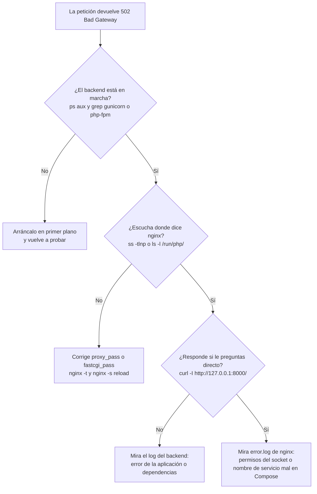

Comandos en orden (stack Python):

```bash
docker exec dpl-lab ps aux | grep gunicorn                          # 1. ¿vivo?
docker exec dpl-lab ss -tlnp | grep 8000                            # 2. ¿escucha en el 8000?
docker exec dpl-lab curl -I http://127.0.0.1:8000/                  # 3. ¿responde directo?
docker exec dpl-lab nginx -T | grep proxy_pass                      # 4. ¿a dónde apunta nginx?
docker exec dpl-lab tail -n 5 /var/log/nginx/calculadora.error.log  # 5. ¿qué dice nginx?
docker exec dpl-lab tail -n 5 /var/log/calculadora-gunicorn.log     # 6. ¿qué dice Gunicorn?
```

Stack PHP: cambia `gunicorn` por `php-fpm`, el puerto por `ls -l /run/php/` y `proxy_pass` por `fastcgi_pass`. El paso 3 no se puede copiar: PHP-FPM habla FastCGI, no HTTP, así que `curl` no sirve para preguntarle directamente. En su lugar, comprueba que el socket existe y lee `/var/log/php8.3-fpm.log`.

Si en vez de 502 sale **504**, el backend existe pero **tarda demasiado**: mira su log y el código (y recuerda el detalle del `--timeout` de Gunicorn del apartado 6.3).

### 8.7 Cómo diagnosticar un 404

Un **404** significa: "nginx funciona, pero el fichero no está donde lo busca". Casi siempre es una ruta.

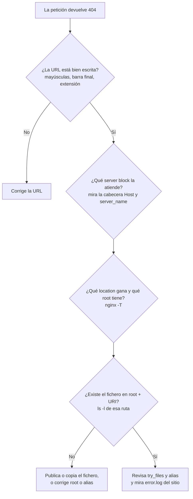

Causas típicas: fichero sin copiar al DocumentRoot, `root` que apunta a otra carpeta, `alias` confundido con `root`, la petición la atiende **otro** server block (el `Host` no coincide), y en contenedores, el volumen no está montado o la web no se generó antes de arrancar (en mi práctica, `site/` y `_site/` tienen que existir antes del `docker compose up`).

No lo confundas con el 403: si pides una **carpeta** que existe pero no tiene índice (por ejemplo, tu página se llama `web.html`), el sitio por defecto de Ubuntu da **403**, no 404 (apartado 4.4).

### 8.8 Otros fallos frecuentes

| Síntoma | Causa probable | Qué hacer |
|---|---|---|
| `curl: (7) Failed to connect` | Nada escucha en ese puerto: nginx parado o puerto no publicado | `docker ps` (columna PORTS), lanzar `nginx -g 'daemon off;'`, revisar `-p` |
| Responde dentro del contenedor pero no desde el anfitrión | El puerto no se publicó al crear el contenedor | Recrearlo con `-p 80:80` |
| `[emerg] bind() to 0.0.0.0:80 failed` | Otro proceso ocupa el puerto 80 | `ss -tlnp` y parar el otro proceso |
| `[emerg] ... duplicate default server` | Dos sitios con `default_server` en el mismo puerto | Desactivar el sitio `default` (`rm` del enlace) |
| `nginx -s reload` da error y no cambia nada | nginx no está en marcha (no hay master al que avisar) | Arrancarlo primero con `nginx -g 'daemon off;'` |
| `port is already allocated` al hacer `docker compose up` | El puerto del anfitrión ya lo publica otro contenedor (por ejemplo, el 8080 de `dpl-lab`) | `docker ps` (columna PORTS); parar el otro contenedor o cambiar el puerto |
| `E: Unable to locate package nginx` | Lista de paquetes sin actualizar | `apt-get update` antes de instalar |
| El navegador muestra la página vieja | Caché del navegador | Probar con `curl` o recarga forzada |

### 8.9 Documentar la instalación y la configuración (CE i)

El último criterio del RA1 pide **dejar por escrito** lo que instalas y configuras en el servidor web, en el de aplicaciones y en los contenedores o la nube, de forma que otra persona pueda repetirlo y comprobarlo. En este módulo eso se hace siempre igual: un microproyecto con su Git, un README paso a paso y un commit por paso (el formato completo de entrega está en [05-ut1-git-documentacion-cicd.md](05-ut1-git-documentacion-cicd.md#9-cómo-se-entrega-una-práctica-en-este-módulo)).

Qué tiene que quedar documentado en las prácticas de la UT2, según lo que piden sus entregas:

| Qué | Ejemplo de evidencia |
|---|---|
| Qué se instaló y qué versión | Salida de `nginx -v`, `php -v` o de `pip install -r requirements.txt` dentro del venv |
| Ficheros de configuración | Copia versionada del server block en el microproyecto (por ejemplo `nginx-calculadora.conf`) y explicación de cada directiva |
| Cómo se arranca sin systemd | Los comandos exactos (`docker exec -d dpl-lab nginx -g 'daemon off;'`, `php-fpm8.3 -F`, Gunicorn con `--bind`) |
| Que funciona | Salidas reales de `nginx -t`, `ps aux \| grep ...`, `curl -I` desde dentro del contenedor y desde el anfitrión |
| Qué pasó | Líneas de `access.log` y `error.log`, y los problemas encontrados con su solución |
| Cómo está montado | Un diagrama Mermaid de la arquitectura (cliente, nginx, servidor de aplicaciones, puertos) |
| En la nube | Salidas de `terraform validate`, `terraform plan`, `terraform output` y `terraform destroy` |

Todo en texto: comandos en bloques de código y sus salidas reales, sin capturas de pantalla y sin credenciales reales. Mi práctica de NGINX es un ejemplo completo: su README tiene Instalación, Configuración, Comprobación y Problemas, y su historial cuenta cada paso ([04-practica-nginx.md](04-practica-nginx.md)).

Fuentes: [Práctica guiada 17: Red, logs y diagnóstico](https://dpl-f1facc.gitlab.io/ut02/practicas/guiada-17-red-logs/), [Arquitecturas Web (errores frecuentes)](https://dpl-f1facc.gitlab.io/ut02/teoria/arquitecturas-web/), [Gunicorn](https://dpl-f1facc.gitlab.io/ut02/teoria/gunicorn/), [PHP-FPM](https://dpl-f1facc.gitlab.io/ut02/teoria/php-fpm/), [Comandos del curso](https://dpl-f1facc.gitlab.io/recursos/comandos/) y, para el 8.9, las entregas de evidencias de las prácticas [04](https://dpl-f1facc.gitlab.io/ut02/practicas/guiada-04-nginx/), [Calculadora Python](https://dpl-f1facc.gitlab.io/ut02/practicas/guiada-05-calculadora-python/), [Calculadora PHP](https://dpl-f1facc.gitlab.io/ut02/practicas/guiada-06-php-fpm/) y [26](https://dpl-f1facc.gitlab.io/ut02/practicas/guiada-26-terraform-aws/), y el [Registro de entregas](https://dpl-f1facc.gitlab.io/evaluacion/entregables/).

## 9. Chuleta final y errores típicos

### Configuraciones mínimas

Sitio estático:

```nginx
server {
    listen 80;
    server_name www.alumno.local;
    root /var/www/html;
    index index.html;

    location / {
        try_files $uri $uri/ =404;
    }
}
```

nginx delante de Gunicorn:

```nginx
location / {
    proxy_pass http://127.0.0.1:8000;          # en Compose: http://app:8000
    proxy_set_header Host $host;
    proxy_set_header X-Real-IP $remote_addr;
    proxy_set_header X-Forwarded-For $proxy_add_x_forwarded_for;
    proxy_set_header X-Forwarded-Proto $scheme;
}
```

nginx con PHP-FPM:

```nginx
location ~ \.php$ {
    include snippets/fastcgi-php.conf;
    fastcgi_pass unix:/run/php/php8.3-fpm.sock;  # en Compose: php-fpm:9000
}
```

### Tablas de memoria

| Ruta (Ubuntu) | Qué es |
|---|---|
| `/etc/nginx/nginx.conf` | Configuración principal |
| `/etc/nginx/sites-available/` | Sitios disponibles |
| `/etc/nginx/sites-enabled/` | Sitios activos (enlaces) |
| `/etc/nginx/conf.d/` | Fragmentos (y sitios en la imagen oficial) |
| `/var/www/html/` | DocumentRoot por defecto |
| `/var/log/nginx/` | `access.log` y `error.log` |
| `/run/php/php8.3-fpm.sock` | Socket de PHP-FPM |
| `/etc/php/8.3/fpm/pool.d/www.conf` | Pool `www` de PHP-FPM |
| `/usr/share/nginx/html/` | DocumentRoot de la imagen oficial y de nginx.org |

| Arranque sin systemd | Comando |
|---|---|
| nginx | `nginx -g 'daemon off;'` |
| PHP-FPM | `php-fpm8.3 -F` |
| Gunicorn | `.venv/bin/gunicorn --bind 127.0.0.1:8000 app:app` |
| Todos desde el anfitrión | `docker exec -d dpl-lab ...` |

| Lo mínimo de memoria | |
|---|---|
| Capas OSI | HTTP en la 7, TCP en la 4, IP en la 3 |
| Puertos | HTTP 80, HTTPS 443, SSH 22, Gunicorn 8000, PHP-FPM 9000 |
| Códigos | 200 bien, 301 movido para siempre, 302 temporal, 304 usa tu caché, 400 petición mal formada, 401 sin autenticar, 405 método no permitido, 403 prohibido, 404 no existe, 500 la aplicación falla, 502 el backend no contesta, 503 no disponible, 504 el backend tarda |
| Versiones | 1.0 conexión por petición; 1.1 persistentes y `Host`; 2 multiplexación sobre TCP; 3 QUIC sobre UDP |
| TLS 1.3 | 1-RTT (0-RTT al repetir), solo AEAD, forward secrecy obligatorio |
| Ciclo nginx | editar, `nginx -t`, `nginx -s reload`, `curl -I` |
| Parar nginx | `nginx -s quit` ordenada; `nginx -s stop` rápida |
| location | `=` exacta; prefijo más largo; `^~` sin regex; regex `~` y `~*` en orden |
| Servidor por defecto | `default_server` o, si no hay, el primero |
| Nube | IaaS máquina, PaaS plataforma, SaaS aplicación |
| Terraform | init, plan, apply, destroy |

### Errores típicos en el examen

1. Decir que nginx **ejecuta** PHP o Python. No: los pasa a PHP-FPM o Gunicorn.
2. Confundir **401** (falta autenticación) con **403** (no tienes permiso).
3. Confundir **502** (el backend no contesta) con **504** (el backend tarda demasiado).
4. Creer que `curl -I` hace un GET. Hace un **HEAD**; el que muestra cabeceras y cuerpo es `-i`.
5. Olvidar que en HTTP/1.1 la cabecera **`Host` es obligatoria**.
6. Decir que HTTP/3 va sobre TCP. Va sobre **QUIC y UDP**.
7. Pensar que HTTPS hace segura la aplicación. Solo cifra y autentica la **conexión**.
8. Recargar sin hacer antes `nginx -t`.
9. Olvidar el `;` al final de una directiva.
10. Mezclar `root` (añade la URI) con `alias` (sustituye la parte de la `location`).
11. Activar un sitio copiando el fichero en `sites-enabled` en vez de hacer un **enlace** (`ln -s`).
12. Pensar que una regex gana siempre a un prefijo. Si el prefijo más largo lleva `^~`, o hay una coincidencia `=`, las regex no se miran.
13. Leer `-p 8080:80` al revés. El primero es el **anfitrión**.
14. Poner Gunicorn con `--bind 127.0.0.1` **dentro de un contenedor** cuando nginx está en otro contenedor. Ahí hace falta `0.0.0.0`.
15. Usar `systemctl` dentro de los contenedores del curso. No hay systemd.
16. Creer que `depends_on` espera a que el servicio esté **listo**. Solo ordena el arranque.
17. Confundir **imagen** (plantilla) con **contenedor** (la imagen en ejecución).
18. Usar el servidor de desarrollo de Flask en producción.
19. Instalar con `pip` fuera del venv en Ubuntu 24.04 (PEP 668).
20. Dar permisos 777 para "arreglar" un 403. Lo correcto: carpetas 755 y ficheros 644.
21. Decir que `nginx -s stop` es la parada ordenada. Según nginx.org, `stop` es la rápida y `quit` la ordenada (la web del curso los confunde).
22. Pensar que pedir una carpeta sin `index.html` siempre da 404. Con el sitio por defecto de Ubuntu da **403** (`directory index ... is forbidden`).
23. Buscar en `docker logs dpl-lab` lo que hace nginx lanzado con `docker exec -d`. Ahí solo sale el proceso principal: lee `/var/log/nginx/`.

## 10. Preguntas de repaso tipo examen

Intenta responder antes de abrir cada respuesta.

**1. (Test)** ¿Cuáles son los tres componentes básicos de una arquitectura web?

- a) HTML, CSS y JavaScript
- b) Cliente, servidor y red con su protocolo
- c) nginx, Gunicorn y PostgreSQL
- d) Frontend, backend y base de datos

<details><summary>Respuesta</summary>

**b)**. Cliente (pide), servidor (responde) y la red con el protocolo (TCP/IP y HTTP). La d) son las partes de una **aplicación**, no de la arquitectura en general.

</details>

**2. (Test)** En el modelo OSI simplificado, ¿en qué capas están HTTP, TCP e IP?

- a) 7, 4 y 3
- b) 4, 3 y 2
- c) 7, 3 y 4
- d) 6, 4 y 2

<details><summary>Respuesta</summary>

**a)**. HTTP en aplicación (7), TCP en transporte (4) e IP en red (3).

</details>

**3. (Verdadero o falso, justifica)** En el modelo cliente-servidor, el servidor puede iniciar la comunicación cuando tiene datos nuevos para el cliente.

<details><summary>Respuesta</summary>

**Falso**. En cliente-servidor **siempre inicia el cliente**; el servidor solo escucha y responde.

</details>

**4. (Relaciona)** En una arquitectura de tres capas con el stack del curso, ¿qué pieza va en cada capa: presentación, aplicación y datos? ¿Qué capa le falta a la calculadora?

<details><summary>Respuesta</summary>

- Presentación: **nginx** (sirve HTML, CSS y JS).
- Aplicación: **Gunicorn** con Flask o Django, o **PHP-FPM**.
- Datos: **PostgreSQL** (o MySQL, o ficheros).

A la calculadora le falta la **capa de datos**: calcula y responde, pero no guarda nada.

</details>

**5. (Verdadero o falso, justifica)** HTTP es un protocolo sin estado, y por eso se usan cookies para mantener una sesión.

<details><summary>Respuesta</summary>

**Verdadero**. El servidor no recuerda las peticiones anteriores. La cookie (`Set-Cookie` en la respuesta, `Cookie` en las siguientes peticiones) lleva en cada petición lo necesario para identificar la sesión.

</details>

**6. (Completa)** Completa esta petición HTTP/1.1 mínima para pedir `http://www.ejemplo.com/contacto.html`:

```http
______ /contacto.html HTTP/1.1
______: www.ejemplo.com

```

<details><summary>Respuesta</summary>

```http
GET /contacto.html HTTP/1.1
Host: www.ejemplo.com

```

El método es **GET** y la cabecera **Host** es obligatoria en HTTP/1.1 (sin ella el servidor responde 400). La línea en blanco final marca el fin de las cabeceras.

</details>

**7. (Qué código devuelve)** nginx funciona con el sitio por defecto de Ubuntu (`try_files $uri $uri/ =404;`). a) Pides `curl -I http://localhost/no-existe.html`. ¿Qué código recibes y dónde queda el rastro? b) Borras todos los índices de `/var/www/html/` y solo dejas `web.html`. ¿Qué devuelve `curl -I http://localhost/`?

<details><summary>Respuesta</summary>

- a) **404 Not Found**. Queda una línea en `access.log` con `"HEAD /no-existe.html HTTP/1.1" 404 0` (HEAD porque se usó `-I`, y 0 bytes de cuerpo). En `error.log` normalmente no aparece nada si la `location` usa `try_files`.
- b) **403 Forbidden**. La carpeta existe pero no tiene ningún fichero de los que dice `index`, y nginx no lista carpetas. En `error.log` sale `directory index of "/var/www/html/" is forbidden`. (La web del curso dice 404 para este caso; justifica por qué es 403.)

</details>

**8. (Qué código devuelve)** Haces `chmod 600 /var/www/html/index.html` y pides `http://localhost/`. ¿Qué código recibes y por qué? ¿Qué verás en `error.log`?

<details><summary>Respuesta</summary>

**403 Forbidden**. Con `600` solo el propietario (`root`) puede leer, y los workers de nginx corren como `www-data`. En `error.log` aparece `open() "/var/www/html/index.html" failed (13: Permission denied)`. Se arregla con `chmod 644`.

</details>

**9. (Qué código devuelve)** Tienes `proxy_pass http://127.0.0.1:8000;`. a) Gunicorn está parado. b) Gunicorn está en marcha pero la petición tarda más que el tiempo máximo que espera nginx. ¿Qué código sale en cada caso?

<details><summary>Respuesta</summary>

- a) **502 Bad Gateway**: nginx no consigue conectar con el backend (en `error.log`: `Connection refused`).
- b) **504 Gateway Timeout**: el backend existe pero no responde a tiempo. (Detalle: si Gunicorn mata antes al worker por su propio `--timeout`, de 30 s por defecto, nginx ve la conexión cortada y da 502.)

</details>

**10. (Test)** Entras en una zona privada sin poner usuario ni contraseña y el servidor responde pidiendo credenciales con la cabecera `WWW-Authenticate`. ¿Qué código es?

- a) 403
- b) 401
- c) 404
- d) 400

<details><summary>Respuesta</summary>

**b) 401 Unauthorized**: falta autenticarse. El 403 sería si el servidor sabe quién eres (o no le importa) y aun así no te deja.

</details>

**11. (Test)** Relaciona cada situación con su código: A) la web se ha cambiado de dominio para siempre; B) redirección provisional a la página de login; C) el navegador pregunta si su copia en caché sigue valiendo y no ha cambiado.

<details><summary>Respuesta</summary>

- A) **301 Moved Permanently** (nueva URL en `Location`; el navegador lo recuerda).
- B) **302 Found** (temporal).
- C) **304 Not Modified** (sin cuerpo: el navegador usa su copia).

</details>

**12. (Test)** Relaciona cada mejora con su versión de HTTP: A) QUIC sobre UDP; B) cabecera `Host` obligatoria y conexiones persistentes; C) multiplexación de peticiones sobre una conexión TCP; D) primera versión con cabeceras, pero una conexión por petición.

<details><summary>Respuesta</summary>

- A) **HTTP/3**
- B) **HTTP/1.1**
- C) **HTTP/2**
- D) **HTTP/1.0**

</details>

**13. (Verdadero o falso, justifica)** Responde a cada una:

- a) HTTPS usa por defecto el puerto 443.
- b) Con HTTPS nadie puede saber a qué servidor te conectas.
- c) Un certificado autofirmado cifra la conexión, pero el navegador avisa.
- d) Con HTTPS la aplicación ya no tiene fallos de seguridad.
- e) En TLS 1.3 el *forward secrecy* es obligatorio.

<details><summary>Respuesta</summary>

- a) **V**. 80 es HTTP y 443 es HTTPS.
- b) **F**. TLS cifra el contenido, pero la IP de destino se ve.
- c) **V**. Cifra igual, pero no lo firma una CA de confianza (con `curl` se prueba con `-k`).
- d) **F**. HTTPS protege la conexión, no corrige los fallos del código.
- e) **V**. Solo usa intercambio de claves efímero, así que robar la clave privada después no descifra sesiones pasadas.

</details>

**14. (Qué hace)** Explica qué hace cada comando:

```bash
curl -I http://localhost/
curl -v http://localhost/
curl -H "Host: blog.local" http://127.0.0.1:8080/
```

<details><summary>Respuesta</summary>

1. Envía una petición **HEAD** y muestra solo la línea de estado y las cabeceras.
2. Hace un GET y muestra **todo el diálogo**: lo enviado con `>`, lo recibido con `<` y la conexión con `*`.
3. Hace un GET al 8080 de la propia máquina pero con la cabecera **`Host: blog.local`**, así nginx elige el server block de `blog.local` sin necesidad de DNS ni `/etc/hosts`.

</details>

**15. (Qué hace esta directiva)** Con `root /var/www/docs;` y `try_files $uri $uri/ =404;`, ¿qué pasa al pedir `/index.html`, `/guia` (que es una carpeta con `index.html`) y `/nada`?

<details><summary>Respuesta</summary>

- `/index.html`: existe como fichero, **200**.
- `/guia`: no es fichero pero sí carpeta. nginx responde **301** a `/guia/` y después sirve `/var/www/docs/guia/index.html` con **200**.
- `/nada`: no hay ni fichero ni carpeta, **404**.

</details>

**16. (Qué location gana)** Con esta configuración, ¿qué `location` atiende cada petición?

```nginx
location = / { }                    # A
location / { }                      # B
location /img/ { }                  # C
location ^~ /img/iconos/ { }        # D
location ~* \.(png|jpg)$ { }        # E
```

Peticiones: 1) `/`; 2) `/contacto.html`; 3) `/img/foto.png`; 4) `/img/iconos/casa.png`; 5) `/img/plano.pdf`.

<details><summary>Respuesta</summary>

1. **A**: coincidencia exacta, se para la búsqueda.
2. **B**: el único prefijo que coincide es `/` y ninguna regex coincide.
3. **E**: el prefijo más largo es C (`/img/`), pero no lleva `^~`, así que se miran las regex y E coincide.
4. **D**: el prefijo más largo es D y lleva `^~`, así que no se miran las regex.
5. **C**: prefijo más largo `/img/` y ninguna regex coincide (`.pdf`).

</details>

**17. (Qué server block atiende)** Todos con `listen 80;`:

```nginx
server { listen 80; server_name docs.local; }               # 1
server { listen 80; server_name blog.local; }               # 2
server { listen 80 default_server; server_name _; }         # 3
```

¿Quién atiende `Host: blog.local`, `Host: otro.local` y `curl http://127.0.0.1/`? ¿Y `Host: otro.local` si quitas `default_server` del 3?

<details><summary>Respuesta</summary>

- `blog.local`: el **2** (nombre exacto).
- `otro.local`: el **3** (ningún nombre coincide y es el `default_server`).
- `curl http://127.0.0.1/`: el `Host` es `127.0.0.1`, que no coincide con nadie, así que el **3**.
- Sin `default_server`, el servidor por defecto es **el primero** que aparece: el **1** (`docs.local`).

</details>

**18. (Qué hace)** Explica `nginx -t`, `nginx -T` y `nginx -s reload`, y di en qué orden se usan tras editar la configuración. ¿Qué pasa si recargas con un error de sintaxis?

<details><summary>Respuesta</summary>

- `nginx -t`: comprueba la sintaxis y los ficheros de la configuración.
- `nginx -T`: lo mismo y además imprime toda la configuración junta.
- `nginx -s reload`: recarga la configuración sin cortar el servicio.

Orden: editar, `nginx -t`, `nginx -s reload` y comprobar con `curl -I`. Si la configuración nueva tiene errores, el master **sigue funcionando con la vieja** y tus cambios no se aplican. Por eso siempre se hace `-t` antes.

</details>

**19. (Qué fichero se sirve)** Para la petición `/fotos/playa.jpg`, ¿qué fichero busca nginx en cada caso? (Son dos configuraciones distintas, no van juntas.)

```nginx
# Caso 1
location /fotos/ { root /srv/web; }

# Caso 2
location /fotos/ { alias /srv/imagenes/; }
```

<details><summary>Respuesta</summary>

- Con `root`: **`/srv/web/fotos/playa.jpg`** (añade la URI entera).
- Con `alias`: **`/srv/imagenes/playa.jpg`** (sustituye `/fotos/` por la carpeta).

</details>

**20. (Completa esta configuración)** nginx debe servir él mismo solo `/estilos.css` y pasar todo lo demás a Gunicorn, que escucha en `127.0.0.1:8000`:

```nginx
server {
    listen 80;
    server_name _;
    root /var/www/calculadora;

    location ___ /estilos.css {              # (1)
        try_files $uri =404;
    }

    location / {
        __________ http://127.0.0.1:8000;    # (2)
        proxy_set_header ____ $host;         # (3)
        proxy_set_header X-Real-IP ________; # (4)
    }
}
```

<details><summary>Respuesta</summary>

1. `=` (location exacta, gana a `/`).
2. `proxy_pass`
3. `Host`
4. `$remote_addr`

</details>

**21. (Completa esta configuración)** Completa para PHP-FPM. a) Nativo en `dpl-lab` con socket UNIX. b) Con Docker Compose, donde el servicio se llama `php-fpm` y escucha por TCP.

```nginx
# a)
location ________ {                                 # (1) URIs que terminan en .php
    include snippets/fastcgi-php.conf;
    ____________ unix:/run/php/php8.3-fpm.sock;     # (2)
}

# b)
location ~ \.php$ {
    include fastcgi_params;
    fastcgi_param SCRIPT_FILENAME ____________________;  # (3)
    fastcgi_pass ____________;                           # (4)
}
```

<details><summary>Respuesta</summary>

1. `~ \.php$`
2. `fastcgi_pass`
3. `$document_root$fastcgi_script_name` (el fichero que PHP-FPM debe ejecutar)
4. `php-fpm:9000` (nombre del servicio y puerto típico de PHP-FPM por TCP)

</details>

**22. (Verdadero o falso, justifica)**

- a) Si nginx está en una máquina y PHP-FPM en otra, pueden comunicarse por un socket UNIX.
- b) El socket UNIX suele rendir algo mejor que TCP cuando todo está en la misma máquina.
- c) Si el usuario de nginx no puede usar el socket, el cliente recibe un 502.

<details><summary>Respuesta</summary>

- a) **F**. Un socket UNIX es un fichero local: solo sirve dentro de la misma máquina. Entre máquinas hace falta TCP (por ejemplo, `php-fpm:9000`).
- b) **V**. No pasa por la pila TCP.
- c) **V**. nginx no puede conectar con el backend; en `error.log` sale `(13: Permission denied)`.

</details>

**23. (Explica)** a) ¿Por qué no se usa `flask run` en producción? b) ¿Qué significa `app:app`? c) ¿Por qué las dependencias van en un entorno virtual en Ubuntu 24.04?

<details><summary>Respuesta</summary>

- a) Es el servidor de **desarrollo**: no está preparado para rendimiento ni seguridad y el propio Flask avisa de que no se use en producción. En producción se usa un servidor WSGI como Gunicorn.
- b) Módulo `app` (fichero `app.py`) y objeto WSGI `app` dentro de él.
- c) Por la política **PEP 668**: el Python del sistema está protegido y `pip install` global da `externally-managed-environment`. El venv aísla las dependencias del proyecto.

</details>

**24. (Verdadero o falso, justifica)** Sobre contenedores:

- a) Una imagen es un contenedor en ejecución.
- b) Un contenedor comparte el núcleo del sistema anfitrión.
- c) Con `-p 8080:80`, el 8080 es el puerto del contenedor.
- d) Dentro de los contenedores del curso, nginx se arranca con `systemctl start nginx`.
- e) En Compose, nginx llega a Gunicorn con `http://app:8000` porque `app` es el nombre del servicio.

<details><summary>Respuesta</summary>

- a) **F**. Es al revés: el contenedor es una imagen en ejecución; la imagen es la plantilla.
- b) **V**. Por eso arranca en segundos y ocupa menos que una VM, que lleva su propio sistema operativo.
- c) **F**. El formato es `anfitrión:contenedor`: 8080 en el anfitrión, 80 dentro del contenedor.
- d) **F**. No hay systemd: se usa `nginx -g 'daemon off;'` (con `docker exec -d`).
- e) **V**. Compose crea una red donde cada servicio se resuelve por su nombre.

</details>

**25. (Clasifica y ordena)** a) Clasifica como IaaS, PaaS o SaaS: Gmail, AWS EC2, Heroku, Microsoft 365, Google Compute Engine, AWS Elastic Beanstalk. b) Ordena el flujo de Terraform: `apply`, `init`, `destroy`, `plan`. c) ¿Por qué `terraform.tfstate` no se sube a Git?

<details><summary>Respuesta</summary>

- a) **IaaS**: AWS EC2, Google Compute Engine. **PaaS**: Heroku, AWS Elastic Beanstalk. **SaaS**: Gmail, Microsoft 365.
- b) `init` (descarga providers), `plan` (enseña los cambios), `apply` (los aplica), `destroy` (lo borra todo).
- c) Porque es el inventario de la infraestructura real y contiene datos de ella. Se versionan los `.tf`, no el estado (tampoco `.terraform/` ni `*.tfvars`).

</details>

## Fuentes

Web del curso (profesor):

- [UT2: Arquitecturas Web y servidores Web](https://dpl-f1facc.gitlab.io/ut02/)
- [Arquitecturas Web](https://dpl-f1facc.gitlab.io/ut02/teoria/arquitecturas-web/)
- [HTTP y HTTPS](https://dpl-f1facc.gitlab.io/ut02/teoria/http-https/)
- [Estructura de una aplicación Web](https://dpl-f1facc.gitlab.io/ut02/teoria/estructura-app-web/)
- [Servidor Web nginx](https://dpl-f1facc.gitlab.io/ut02/teoria/servidor-web-nginx/)
- [Gunicorn](https://dpl-f1facc.gitlab.io/ut02/teoria/gunicorn/)
- [PHP-FPM](https://dpl-f1facc.gitlab.io/ut02/teoria/php-fpm/)
- [Cloud](https://dpl-f1facc.gitlab.io/ut02/teoria/cloud/)
- Prácticas: [04 nginx](https://dpl-f1facc.gitlab.io/ut02/practicas/guiada-04-nginx/), [Calculadora Python](https://dpl-f1facc.gitlab.io/ut02/practicas/guiada-05-calculadora-python/), [Calculadora PHP](https://dpl-f1facc.gitlab.io/ut02/practicas/guiada-06-php-fpm/), [17 Red, logs y diagnóstico](https://dpl-f1facc.gitlab.io/ut02/practicas/guiada-17-red-logs/) y [26 Terraform y AWS (formativa)](https://dpl-f1facc.gitlab.io/ut02/practicas/guiada-26-terraform-aws/)
- [El módulo DPL: RA, CE y contenidos](https://dpl-f1facc.gitlab.io/introduccion/modulo/) y [Preparación de los exámenes](https://dpl-f1facc.gitlab.io/evaluacion/preparacion-examen/)
- [Entorno de trabajo](https://dpl-f1facc.gitlab.io/introduccion/entorno/), [Docker](https://dpl-f1facc.gitlab.io/ut04/teoria/docker/), [Comandos](https://dpl-f1facc.gitlab.io/recursos/comandos/) y [Glosario](https://dpl-f1facc.gitlab.io/recursos/glosario/)

Documentación oficial:

- nginx: [Beginner's Guide](https://nginx.org/en/docs/beginners_guide.html), [How nginx processes a request](https://nginx.org/en/docs/http/request_processing.html), [Server names](https://nginx.org/en/docs/http/server_names.html), [ngx_http_core_module](https://nginx.org/en/docs/http/ngx_http_core_module.html), [ngx_http_index_module](https://nginx.org/en/docs/http/ngx_http_index_module.html), [ngx_http_log_module (formato *combined*)](https://nginx.org/en/docs/http/ngx_http_log_module.html), [ngx_http_proxy_module (`proxy_read_timeout`)](https://nginx.org/en/docs/http/ngx_http_proxy_module.html) y [Command-line parameters](https://nginx.org/en/docs/switches.html)
- [Flask: servidor de desarrollo](https://flask.palletsprojects.com/en/stable/server/)
- MDN: [Vista general de HTTP](https://developer.mozilla.org/es/docs/Web/HTTP/Guides/Overview), [Métodos](https://developer.mozilla.org/es/docs/Web/HTTP/Reference/Methods) y [Códigos de estado](https://developer.mozilla.org/es/docs/Web/HTTP/Reference/Status)
- [Manual de curl](https://curl.se/docs/manpage.html)
- Gunicorn: [Settings](https://gunicorn.org/reference/settings/) y [Design](https://gunicorn.org/design/)
- [PHP-FPM en el manual de PHP](https://www.php.net/manual/es/install.fpm.php)
- Docker: [imagen oficial de nginx](https://hub.docker.com/_/nginx), [orden de arranque en Compose](https://docs.docker.com/compose/how-tos/startup-order/) y [docker logs](https://docs.docker.com/reference/cli/docker/container/logs/)
