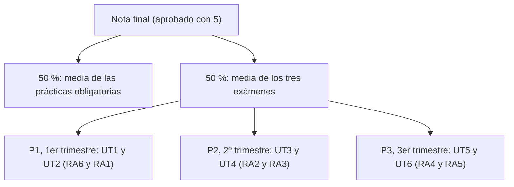
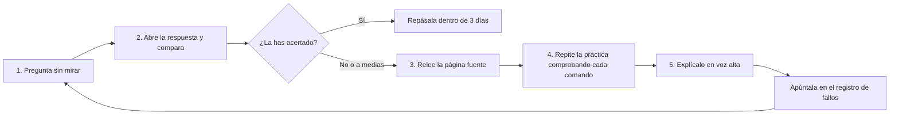
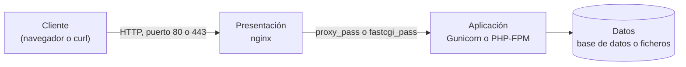

# Plan de repaso y autoevaluación del examen P1

## Índice

- [Cómo usar este archivo](#cómo-usar-este-archivo)
- [1. Cómo es la evaluación](#1-cómo-es-la-evaluación)
- [2. Mapa de criterios de evaluación](#2-mapa-de-criterios-de-evaluación)
  - [RA6: documentación, control de versiones e integración continua](#ra6-documentación-control-de-versiones-e-integración-continua)
  - [RA1: implantación de arquitecturas web](#ra1-implantación-de-arquitecturas-web)
- [3. Método de estudio](#3-método-de-estudio)
  - [3.1 Vocabulario mínimo](#31-vocabulario-mínimo)
  - [3.2 Orden de repaso por RA](#32-orden-de-repaso-por-ra)
  - [3.3 Técnicas que funcionan](#33-técnicas-que-funcionan)
  - [3.4 Plan de dos semanas](#34-plan-de-dos-semanas)
  - [3.5 Registro de fallos](#35-registro-de-fallos)
- [4. Autoevaluación global](#4-autoevaluación-global)
  - [4.1 Git: conceptos, commits e historial](#41-git-conceptos-commits-e-historial)
  - [4.2 Git: ramas, fusiones y flujos de trabajo](#42-git-ramas-fusiones-y-flujos-de-trabajo)
  - [4.3 Git: remotos, colaboración y seguridad](#43-git-remotos-colaboración-y-seguridad)
  - [4.4 Documentación](#44-documentación)
  - [4.5 Integración y despliegue continuos](#45-integración-y-despliegue-continuos)
  - [4.6 Arquitecturas web](#46-arquitecturas-web)
  - [4.7 HTTP y HTTPS](#47-http-y-https)
  - [4.8 Estructura de una aplicación web](#48-estructura-de-una-aplicación-web)
  - [4.9 Servidor web nginx](#49-servidor-web-nginx)
  - [4.10 Servidor de aplicaciones Gunicorn](#410-servidor-de-aplicaciones-gunicorn)
  - [4.11 Servidor de aplicaciones PHP-FPM](#411-servidor-de-aplicaciones-php-fpm)
  - [4.12 Nube y contenedores](#412-nube-y-contenedores)
  - [4.13 Pruebas y documentación de procesos](#413-pruebas-y-documentación-de-procesos)
  - [4.14 Contenidos oficiales que no salen en las autoevaluaciones](#414-contenidos-oficiales-que-no-salen-en-las-autoevaluaciones)
- [5. Simulacro de examen](#5-simulacro-de-examen)
  - [5.1 Preguntas tipo test](#51-preguntas-tipo-test)
  - [5.2 Preguntas prácticas](#52-preguntas-prácticas)
  - [5.3 Soluciones](#53-soluciones)

## Cómo usar este archivo

Este es el archivo "de cierre" de la carpeta del 1er examen. Los apuntes 01 a 06 explican los temas; este te dice **qué estudiar, en qué orden y cómo comprobar que lo sabes**.

1. Lee el apartado 1 para saber cómo te van a evaluar.
2. Usa el mapa del apartado 2 como lista de control: cuando sepas explicar un criterio sin mirar, cambia `[ ]` por `[x]`.
3. Sigue el plan de dos semanas del apartado 3.
4. Contesta las preguntas del apartado 4 **antes** de abrir la respuesta.
5. El penúltimo o último día, haz el simulacro del apartado 5 con reloj.

Apuntes de esta carpeta que se enlazan en todo el archivo:

| Nº | Apunte | De qué trata |
|---|---|---|
| 01 | [01-repo-gitanddocs.md](01-repo-gitanddocs.md) | El repo de clase gitanddocs: estructura, workflow, issues y PR |
| 02 | [02-git-github.md](02-git-github.md) | Git, GitHub, fork, issues y pull requests |
| 03 | [03-uv-zensical.md](03-uv-zensical.md) | uv, Zensical y despliegue con GitHub Actions y Pages |
| 04 | [04-practica-nginx.md](04-practica-nginx.md) | Mi práctica "NGINX para todos y todos para NGINX" |
| 05 | [05-ut1-git-documentacion-cicd.md](05-ut1-git-documentacion-cicd.md) | Teoría de la UT1: Git, documentación y CI/CD |
| 06 | [06-ut2-arquitecturas-servidores-web.md](06-ut2-arquitecturas-servidores-web.md) | Teoría de la UT2: arquitecturas, HTTP, nginx, servidores de aplicaciones y nube |

## 1. Cómo es la evaluación

### Las dos piezas de la nota

En DPL solo hay **dos instrumentos de evaluación** (dos cosas que cuentan para la nota):

- **Prácticas guiadas entregadas** con evidencias: 50 % de la nota. Es la media de todas las prácticas obligatorias, todas pesan igual. Las de ampliación y las de nube son formativas (no cuentan). Una práctica no entregada cuenta como un 0.
- **Exámenes trimestrales**: 50 % de la nota. Son tres, uno por trimestre, y pesan igual.

La fórmula es:

```text
Nota final = 0,5 × media(prácticas) + 0,5 × media(P1, P2, P3)
Se aprueba con una nota final de 5 o más.
```

Haciendo la cuenta, cada examen vale un tercio del 50 %, es decir, **más o menos un 16,7 % de la nota final**. El P1 no decide el curso, pero un buen P1 da mucho margen.



### Qué entra en el P1

El P1 es sobre **todo lo trabajado en el primer trimestre**: la UT1 y la UT2 (una **UT** o unidad de trabajo es cada uno de los temas del curso). Dicho con los nombres oficiales:

- **RA6** (UT1): documentación, control de versiones (Git) e integración continua (CI/CD).
- **RA1** (UT2): arquitecturas web, HTTP y HTTPS, estructura de una aplicación web, nginx, servidores de aplicaciones (Gunicorn o PHP-FPM) y nube y contenedores.

Un **RA** (resultado de aprendizaje) es lo que tienes que saber hacer al acabar. Cada RA se divide en **CE** (criterios de evaluación), que son las cosas concretas que se comprueban. El examen se construye sobre los RA y sus CE, no sobre temas sueltos. Por eso el apartado 2 de este archivo es un mapa de CE.

### Qué es una "prueba objetiva"

La web del curso dice que cada examen trimestral es una **prueba objetiva**. En general se llama así a un examen en el que la nota **no depende de la opinión de quien corrige**: cada pregunta tiene una respuesta correcta decidida de antemano y se corrige comparando con ella. Ejemplos típicos:

- preguntas tipo test (elegir una opción entre varias);
- respuesta corta (un comando, un puerto, un código de estado);
- completar huecos (de un fichero de configuración o de un comando);
- interpretar una salida (de `curl`, de `git log`, de un log de nginx) y decir qué pasa.

Lo que **no** suele haber en una prueba objetiva es un "desarrolla el tema 3". Pero ojo: la página de preparación pide que sepas **explicar y aplicar** cada criterio, no solo reconocerlo. Por eso en este archivo hay preguntas de las dos clases: de reconocer (test) y de producir (escribir comandos o configuración).

La web del curso no dice qué tipos de ejercicio tendrá el P1. La lista de arriba es lo habitual en una prueba objetiva, no un dato oficial.

> **Importante:** el formato exacto del P1 (tipos de ejercicio, número de preguntas y puntuación) **lo publicará el profesor en el aula virtual** antes del examen, y se detallará también en el propio enunciado el día de la prueba. Puede cambiar entre convocatorias. Este plan prepara para cualquier formato razonable, pero cuando salga el oficial, adapta el simulacro a ese formato.

### Si algo sale mal

El módulo tiene dos convocatorias:

- **Ordinaria**: incluye los tres exámenes trimestrales y sus recuperaciones.
- **Extraordinaria**: se evalúan los RA que no hayas superado. Según la página de Recuperación, un examen trimestral suspendido se recupera aquí con una prueba sobre esos RA.

Las prácticas pendientes o suspensas se tienen que entregar, con el mismo formato (ZIP con `.git`), antes de la convocatoria a la que te presentes. Se corrigen igual que en la ordinaria, con las mismas rúbricas. Las fechas y el procedimiento concretos los publica el profesor en el aula virtual: la web del curso no fija fechas.

Fuentes: [Evaluación](https://dpl-f1facc.gitlab.io/introduccion/evaluacion/), [Preparación de los exámenes](https://dpl-f1facc.gitlab.io/evaluacion/preparacion-examen/), [Recuperación](https://dpl-f1facc.gitlab.io/evaluacion/recuperacion/) y [Prácticas y entregas](https://dpl-f1facc.gitlab.io/evaluacion/practicas/).

## 2. Mapa de criterios de evaluación

Cada fila es un criterio oficial (CE) explicado en una frase. La columna "Dónde se estudia" lleva a la página del curso, y "Mi apunte" al apunte de esta carpeta que lo cubre. Cuando sepas **explicarlo en voz alta sin mirar y poner un ejemplo**, cambia `[ ]` por `[x]`.

### RA6: documentación, control de versiones e integración continua

| CE | En sencillo | Dónde se estudia | Mi apunte | Lo sé explicar |
|---|---|---|---|---|
| RA6-a | Conozco varias herramientas que generan documentación (Zensical, MkDocs, Jekyll, el propio GitHub) y sé para qué sirve cada una. | [Documentación](https://dpl-f1facc.gitlab.io/ut01/teoria/documentacion/), [Práctica 02](https://dpl-f1facc.gitlab.io/ut01/practicas/guiada-02-colaboracion-git/) | [01](01-repo-gitanddocs.md), [03](03-uv-zensical.md), [05](05-ut1-git-documentacion-cicd.md) | [ ] |
| RA6-b | Sé documentar un proyecto con el generador propio de su plataforma: paso de ficheros Markdown a una web (`zensical build` en clase, `mkdocs build --strict` en la práctica 02). | [Documentación](https://dpl-f1facc.gitlab.io/ut01/teoria/documentacion/), [Práctica 02](https://dpl-f1facc.gitlab.io/ut01/practicas/guiada-02-colaboracion-git/) | [03](03-uv-zensical.md), [04](04-practica-nginx.md), [05](05-ut1-git-documentacion-cicd.md) | [ ] |
| RA6-c | Uso varios formatos de documentación: Markdown, README, web HTML generada, diagramas Mermaid. | [Documentación](https://dpl-f1facc.gitlab.io/ut01/teoria/documentacion/) | [01](01-repo-gitanddocs.md), [03](03-uv-zensical.md), [05](05-ut1-git-documentacion-cicd.md) | [ ] |
| RA6-d | Documento en equipo con herramientas colaborativas: issues, pull requests, revisiones, wikis y plantillas de issue y PR. | [Documentación](https://dpl-f1facc.gitlab.io/ut01/teoria/documentacion/), [Git (sección 10)](https://dpl-f1facc.gitlab.io/ut01/teoria/git/), [Práctica 02](https://dpl-f1facc.gitlab.io/ut01/practicas/guiada-02-colaboracion-git/) | [01](01-repo-gitanddocs.md), [02](02-git-github.md), [05](05-ut1-git-documentacion-cicd.md) | [ ] |
| RA6-e | Instalo, configuro y uso Git: instalación (`git --version`), identidad, commits, ramas, fusiones y remotos. | [Git](https://dpl-f1facc.gitlab.io/ut01/teoria/git/), [Práctica 01](https://dpl-f1facc.gitlab.io/ut01/practicas/guiada-01-git/), [Práctica 24](https://dpl-f1facc.gitlab.io/ut01/practicas/guiada-24-git-branching/) | [02](02-git-github.md), [04](04-practica-nginx.md), [05](05-ut1-git-documentacion-cicd.md) | [ ] |
| RA6-f | Mantengo el código accesible y seguro: copia en un remoto con acceso solo para quien debe, claves SSH, tokens, `.gitignore` y nada de contraseñas en el repo. | [Git (sección 11)](https://dpl-f1facc.gitlab.io/ut01/teoria/git/) | [02](02-git-github.md), [05](05-ut1-git-documentacion-cicd.md) | [ ] |
| RA6-g | Documento cómo instalé, configuré y usé Git: README y un historial con commits bien escritos. | [Git (convención de commits)](https://dpl-f1facc.gitlab.io/ut01/teoria/git/), [Práctica 01](https://dpl-f1facc.gitlab.io/ut01/practicas/guiada-01-git/) | [04](04-practica-nginx.md), [05](05-ut1-git-documentacion-cicd.md) | [ ] |
| RA6-h | Uso integración continua: un workflow de GitHub Actions comprueba el proyecto (y mide su calidad) en cada push o pull request. | [CI/CD](https://dpl-f1facc.gitlab.io/ut01/teoria/ci-cd/), [Práctica 25](https://dpl-f1facc.gitlab.io/ut01/practicas/guiada-25-github-actions-cicd/) | [01](01-repo-gitanddocs.md), [03](03-uv-zensical.md), [04](04-practica-nginx.md), [05](05-ut1-git-documentacion-cicd.md) | [ ] |

### RA1: implantación de arquitecturas web

| CE | En sencillo | Dónde se estudia | Mi apunte | Lo sé explicar |
|---|---|---|---|---|
| RA1-a | Analizo arquitecturas web (cliente-servidor, capas, alternativas de implantación) con sus ventajas e inconvenientes. | [Arquitecturas Web](https://dpl-f1facc.gitlab.io/ut02/teoria/arquitecturas-web/) | [06](06-ut2-arquitecturas-servidores-web.md) | [ ] |
| RA1-b | Explico los protocolos en los que se apoya un servidor web: HTTP, HTTPS, TCP/IP, y cómo habla con la aplicación (FastCGI, WSGI). | [HTTP y HTTPS](https://dpl-f1facc.gitlab.io/ut02/teoria/http-https/), [nginx](https://dpl-f1facc.gitlab.io/ut02/teoria/servidor-web-nginx/), [Gunicorn](https://dpl-f1facc.gitlab.io/ut02/teoria/gunicorn/), [PHP-FPM](https://dpl-f1facc.gitlab.io/ut02/teoria/php-fpm/) | [04](04-practica-nginx.md), [06](06-ut2-arquitecturas-servidores-web.md) | [ ] |
| RA1-c | Instalo y configuro lo básico de un servidor web (nginx). | [nginx](https://dpl-f1facc.gitlab.io/ut02/teoria/servidor-web-nginx/), [Práctica 04](https://dpl-f1facc.gitlab.io/ut02/practicas/guiada-04-nginx/) | [04](04-practica-nginx.md), [06](06-ut2-arquitecturas-servidores-web.md) | [ ] |
| RA1-d | Instalo y configuro lo básico de un servidor de aplicaciones (Gunicorn o PHP-FPM) y lo uno a nginx. | [Gunicorn](https://dpl-f1facc.gitlab.io/ut02/teoria/gunicorn/), [PHP-FPM](https://dpl-f1facc.gitlab.io/ut02/teoria/php-fpm/), [Práctica 05](https://dpl-f1facc.gitlab.io/ut02/practicas/guiada-05-calculadora-python/), [Práctica 06](https://dpl-f1facc.gitlab.io/ut02/practicas/guiada-06-php-fpm/) | [06](06-ut2-arquitecturas-servidores-web.md) | [ ] |
| RA1-e | Instalo y configuro lo básico de contenedores (Docker) y de la nube (AWS con Terraform). | [Entorno](https://dpl-f1facc.gitlab.io/introduccion/entorno/), [Cloud](https://dpl-f1facc.gitlab.io/ut02/teoria/cloud/), [Práctica 03](https://dpl-f1facc.gitlab.io/ut01/practicas/guiada-03-prepara-entorno-docker/), [Práctica 26](https://dpl-f1facc.gitlab.io/ut02/practicas/guiada-26-terraform-aws/) | [04](04-practica-nginx.md), [06](06-ut2-arquitecturas-servidores-web.md) | [ ] |
| RA1-f | Pruebo que los servidores funcionan: `curl`, `nginx -t`, `ps`, logs, `docker compose ps`. | [Práctica 04](https://dpl-f1facc.gitlab.io/ut02/practicas/guiada-04-nginx/), [Práctica 05](https://dpl-f1facc.gitlab.io/ut02/practicas/guiada-05-calculadora-python/), [Práctica 06](https://dpl-f1facc.gitlab.io/ut02/practicas/guiada-06-php-fpm/), [Práctica 17](https://dpl-f1facc.gitlab.io/ut02/practicas/guiada-17-red-logs/) | [04](04-practica-nginx.md), [06](06-ut2-arquitecturas-servidores-web.md) | [ ] |
| RA1-g | Analizo de qué partes está hecha una aplicación web: frontend, backend y datos; contenido estático y dinámico. | [Estructura de una aplicación Web](https://dpl-f1facc.gitlab.io/ut02/teoria/estructura-app-web/), [Gunicorn](https://dpl-f1facc.gitlab.io/ut02/teoria/gunicorn/), [PHP-FPM](https://dpl-f1facc.gitlab.io/ut02/teoria/php-fpm/) | [06](06-ut2-arquitecturas-servidores-web.md) | [ ] |
| RA1-h | Describo qué hace falta para implantar una aplicación: máquina, sistema operativo, red, IP, DNS, disco y permisos. | [Arquitecturas Web](https://dpl-f1facc.gitlab.io/ut02/teoria/arquitecturas-web/), [Estructura](https://dpl-f1facc.gitlab.io/ut02/teoria/estructura-app-web/), [Cloud](https://dpl-f1facc.gitlab.io/ut02/teoria/cloud/) | [04](04-practica-nginx.md), [06](06-ut2-arquitecturas-servidores-web.md) | [ ] |
| RA1-i | Documento lo que instalo y configuro: README con comandos y salidas reales, y un commit por paso. | [Documentación](https://dpl-f1facc.gitlab.io/ut01/teoria/documentacion/), [UT2](https://dpl-f1facc.gitlab.io/ut02/) | [04](04-practica-nginx.md), [06](06-ut2-arquitecturas-servidores-web.md) | [ ] |

Las prácticas 24, 25 y 26 son de **ampliación** (formativas: no cuentan para la nota de prácticas), pero su contenido sí puede salir en el examen porque está en la teoría.

Fuentes: [El módulo DPL: RA, CE y contenidos](https://dpl-f1facc.gitlab.io/introduccion/modulo/), [UT1](https://dpl-f1facc.gitlab.io/ut01/) y [UT2](https://dpl-f1facc.gitlab.io/ut02/).

## 3. Método de estudio

Partes casi de cero, así que la idea es **pocos temas cada día, pero bien atados**, y comprobar siempre que lo sabes con preguntas, no releyendo.

### 3.1 Vocabulario mínimo

Antes de empezar, estas palabras van a salir todo el rato. Si una no te queda clara, para y vuelve aquí.

| Palabra | Qué es | Para entenderlo |
|---|---|---|
| Repositorio (repo) | Carpeta cuyo historial de cambios guarda Git, dentro de la subcarpeta oculta `.git`. | Un álbum con todas las fotos de tu proyecto. |
| Commit | Una foto guardada del proyecto, con autor, fecha, mensaje y un identificador (hash). | Cada foto del álbum. |
| Rama | Línea de trabajo paralela que no toca la principal (`main`) hasta que se fusiona. | Un borrador aparte del trabajo bueno. |
| Remoto | Copia del repositorio en un servidor (GitHub, GitLab, Gitea). | La copia del álbum guardada fuera de casa. |
| Pull request (PR) | Petición para unir los cambios de una rama a otra, con revisión antes. | Proponer un cambio de alineación y que el entrenador lo apruebe. |
| Protocolo | Reglas que siguen dos programas para entenderse (HTTP, TCP, IP). | El idioma que hablan. |
| HTTP y HTTPS | El protocolo con el que el navegador pide una página y el servidor se la manda. HTTPS es lo mismo, pero cifrado. | Pedir en la barra y que te sirvan; con HTTPS, en un sobre cerrado. |
| Puerto | Número que dice a qué programa de una máquina va el tráfico (80 web, 443 web segura). | El número de puerta de un edificio. |
| Servidor web | Programa que entrega ficheros (HTML, CSS, imágenes) a quien los pide. En el curso, nginx. | El camarero que trae lo que ya está hecho. |
| Servidor de aplicaciones | Programa que ejecuta código para generar la respuesta (Gunicorn para Python, PHP-FPM para PHP). | El cocinero que prepara el plato al momento. |
| Proxy inverso | Servidor que se pone delante de otros, recibe las peticiones y se las pasa. | El recepcionista que reparte las llamadas. |
| DocumentRoot | Carpeta desde la que el servidor web sirve los ficheros (en nginx, la directiva `root`). | La estantería de donde el camarero coge lo que sirve. |
| Server block | Bloque `server { ... }` de la configuración de nginx que describe un sitio: puerto, nombre y carpeta. | La ficha de cada local de un centro comercial. |
| Log | Fichero donde un programa apunta lo que hace y los errores. | El acta del partido. |
| Docker | Programa que crea y ejecuta contenedores. En el curso todos los servidores se instalan dentro de contenedores, nunca en tu ordenador. | La cocina donde se preparan los platos. |
| Imagen (Docker) | Plantilla de solo lectura para crear contenedores (`ubuntu:24.04`, `nginx:1.30`). | La receta. |
| Contenedor | Proceso aislado creado a partir de una imagen, con todo lo que la aplicación necesita. | El plato hecho con esa receta. |
| CI/CD | Automatizar la comprobación (CI) y la publicación (CD) de cada cambio. | Un control de calidad en la salida de la fábrica. |
| Workflow o pipeline | Lista de pasos automáticos que se ejecutan en cada push o PR (en GitHub Actions es un fichero YAML). | Una cadena de montaje. |
| YAML | Formato de texto para configuración que se organiza con sangrías (`compose.yaml`, workflows). | Una lista ordenada por niveles. |
| Markdown | Texto plano con marcas sencillas (`#` para títulos, `**` para negrita) que luego se convierte en HTML. Es el formato de los README. | Apuntes con símbolos que después se pasan a limpio. |

### 3.2 Orden de repaso por RA

El profesor recomienda repasar **por RA**, no por unidades sueltas, y siempre con el mismo ciclo:

1. Releer la **página fuente** del RA (la teoría) y contestar su lista de autoevaluación.
2. Repetir la **práctica guiada** de lo que falles, comprobando cada comando.
3. Rehacer la entrega de evidencias de esa práctica como ensayo: ese es el nivel que se pide.
4. Comprobar que sabes **explicar y aplicar** cada CE, no solo reconocerlo.

El orden que te propongo:

1. **RA6 primero**, porque Git y la documentación se usan en todo lo demás. Dentro de RA6: Git → documentación → CI/CD.
2. **RA1 después**, en este orden: arquitecturas → HTTP y HTTPS → estructura de una aplicación → nginx → servidor de aplicaciones (a fondo el de tu stack, el otro solo la idea) → nube y contenedores. El **stack** es el juego de tecnologías que eliges en la UT2: Python con Flask y Gunicorn, o PHP con PHP-FPM. Los dos valen lo mismo, pero la teoría de ambos puede caer en el examen.



Fuente: [Preparación de los exámenes](https://dpl-f1facc.gitlab.io/evaluacion/preparacion-examen/).

### 3.3 Técnicas que funcionan

**1. Recuperación activa (preguntarte antes de releer).** Releer da sensación de que lo sabes, pero no lo demuestra. Es como ver vídeos de fútbol en vez de entrenar. Haz esto: lee la pregunta, contesta en voz alta o en un papel, y solo entonces abre la respuesta. Marca cada pregunta como bien, a medias o mal.

**2. Explicar en voz alta.** Explica cada concepto como si se lo contaras a un amigo que no ha estudiado nada. Donde te atasques, ahí está el hueco. Sirve también para defender tu práctica: tienes que poder contar qué hace cada línea de tu `compose.yaml`, de tus `.conf` de nginx y de tu `ci.yml`.

**3. Repetir las prácticas comprobando cada comando.** Antes de pulsar Enter, di qué salida esperas. Después, compárala. Si no coincide, ahí hay algo que aprender. Usa tu contenedor `dpl-lab` (si no lo tienes, créalo con la [práctica guiada 03](https://dpl-f1facc.gitlab.io/ut01/practicas/guiada-03-prepara-entorno-docker/)) o tu práctica de nginx. Al acabar cada sesión, para los contenedores (`docker compose down` en la práctica, `docker stop dpl-lab` para el laboratorio, que se vuelve a encender con `docker start dpl-lab` sin perder nada) y cierra Docker Desktop para no gastar batería ni memoria.

**4. Repaso espaciado.** Lo que se repasa varias veces separadas se olvida mucho menos que lo que se empolla de golpe. Vuelve a cada pregunta fallada al día siguiente, a los 3 días y a la semana. El registro del apartado 3.5 sirve para eso.

**5. Dibujar de memoria y mezclar temas.** El profesor pide literalmente saber dibujar sin apuntes el modelo cliente-servidor y la pila de capas. Haz lo mismo con las tres zonas de Git y con el flujo fork → PR → merge. En los repasos, mezcla preguntas de temas distintos: en el examen no vendrán ordenadas.

**Lo que no funciona:** subrayar y releer, memorizar comandos sin saber qué hacen y dejarlo todo para el último día.

### 3.4 Plan de dos semanas

Catorce sesiones de **1 hora**. Cada sesión tiene tres bloques:

- **10 minutos de repaso:** preguntas falladas de días anteriores (repaso espaciado).
- **35 minutos de estudio y práctica:** página del curso + tu apunte + comandos de verdad.
- **15 minutos de preguntas sin mirar** del apartado 4.

**Cómo adaptarlo a la fecha real:** cuenta hacia atrás desde el examen; el día 14 es el día antes. Si tienes menos días, junta los que van seguidos y son del mismo bloque (3 y 4, 6 y 7, 10 y 11). Si tienes más, mete un día de "solo repaso de fallos" cada tres días.

**Día 1. Cómo es el examen y Git desde cero**

- Repaso: lee los apartados 1 y 2 de este archivo (sin marcar nada todavía).
- Estudio: secciones 1 a 3 de la página [Git](https://dpl-f1facc.gitlab.io/ut01/teoria/git/) (qué es un control de versiones, las tres zonas y los estados de un fichero). En una carpeta de pruebas: `git init`, crea un fichero, `git status`, `git add`, `git status`, `git commit`, `git log --oneline`.
- Preguntas: [4.1](#41-git-conceptos-commits-e-historial).

**Día 2. Commits, historial y deshacer**

- Repaso: fallos del día 1.
- Estudio: secciones 5 y 8 de [Git](https://dpl-f1facc.gitlab.io/ut01/teoria/git/): convención de commits del módulo, identidad (`git config --local`), `git log`, `git diff`, `git show`, `git restore` y `--amend`. Haz tres commits con subject y cuerpo y comprueba la autoría con `git log --format='%an <%ae>' | sort -u`. Después mira el historial de tu práctica de nginx y explica cada commit en voz alta.
- Preguntas: [4.1](#41-git-conceptos-commits-e-historial) otra vez, solo las falladas.

**Día 3. Ramas, fusiones y conflictos**

- Repaso: fallos del día 2.
- Estudio: secciones 6 y 7 de [Git](https://dpl-f1facc.gitlab.io/ut01/teoria/git/). En la carpeta de pruebas: crea una rama, haz un commit en ella y fusiónala en `main` sin tocar `main` entre medias (verás un fast-forward); repite con otra rama fusionando con `--no-ff`, y provoca un conflicto a propósito cambiando la misma línea en dos ramas. Resuélvelo y mira el grafo con `git log --oneline --graph --all`.
- Preguntas: [4.2](#42-git-ramas-fusiones-y-flujos-de-trabajo).

**Día 4. Remotos y trabajo en equipo**

- Repaso: fallos del día 3.
- Estudio: secciones 4 y 10 de [Git](https://dpl-f1facc.gitlab.io/ut01/teoria/git/) (clone por SSH o HTTPS, `push -u`, `fetch` y `pull`, fork, upstream, issues, PR, formas de fusionar, etiquetas y releases). Relee tu apunte [02](02-git-github.md). Dibuja de memoria el flujo fork → rama → PR → revisión → merge → sincronizar.
- Preguntas: [4.3](#43-git-remotos-colaboración-y-seguridad).

**Día 5. Seguridad y estrategias de ramas**

- Repaso: fallos de los días 1 y 2 (repaso a los 3 o 4 días).
- Estudio: sección 11 de [Git](https://dpl-f1facc.gitlab.io/ut01/teoria/git/) (claves SSH, tokens, `.gitignore`) y la sección 7 (trunk-based, feature branches, Git Flow y GitHub Flow). Explica en voz alta cada línea del `.gitignore` de tu práctica.
- Preguntas: 10 preguntas al azar de 4.1, 4.2 y 4.3 mezcladas.

**Día 6. Documentación**

- Repaso: fallos de los días 3 y 4.
- Estudio: página [Documentación](https://dpl-f1facc.gitlab.io/ut01/teoria/documentacion/) y tus apuntes [01](01-repo-gitanddocs.md) y [03](03-uv-zensical.md). Compara el README de tu práctica con la estructura que pide el curso. Genera la web con `uv run zensical build` y explica qué hay dentro de `site/`.
- Preguntas: [4.4](#44-documentación).

**Día 7. CI/CD y cierre de RA6**

- Repaso: fallos del día 5.
- Estudio: página [CI/CD](https://dpl-f1facc.gitlab.io/ut01/teoria/ci-cd/). Lee tu `.github/workflows/ci.yml` línea a línea y di qué es `on`, `jobs`, `runs-on`, `steps`, `uses` y `run`. Compáralo con el `docs.yml` de gitanddocs.
- Preguntas: [4.5](#45-integración-y-despliegue-continuos) y [4.14](#414-contenidos-oficiales-que-no-salen-en-las-autoevaluaciones). Marca en el mapa los CE de RA6 que ya sepas explicar.

**Día 8. Arquitecturas web (empieza RA1)**

- Repaso: todas las falladas de RA6 (repaso a la semana del día 1).
- Estudio: página [Arquitecturas Web](https://dpl-f1facc.gitlab.io/ut02/teoria/arquitecturas-web/). Dibuja de memoria el modelo cliente-servidor, la pila de capas con los puertos 80 y 443, y la arquitectura de tres capas. Compara on-premise, hosting, cloud y CMS.
- Preguntas: [4.6](#46-arquitecturas-web).

**Día 9. HTTP y HTTPS**

- Repaso: fallos de los días 6 y 7.
- Estudio: página [HTTP y HTTPS](https://dpl-f1facc.gitlab.io/ut02/teoria/http-https/). Con tu práctica levantada (`docker compose up -d`), lanza `curl -I http://localhost:8080/`, `curl -v http://localhost:8080/` y `curl -I -H "Host: docs.local" http://localhost:8080/`, y pide una ruta que no exista para ver un 404. Escribe de memoria una petición GET completa. Al terminar, `docker compose down`.
- Preguntas: [4.7](#47-http-y-https).

**Día 10. Estructura de una aplicación y nginx**

- Repaso: fallos del día 8.
- Estudio: páginas [Estructura de una aplicación Web](https://dpl-f1facc.gitlab.io/ut02/teoria/estructura-app-web/) y [Servidor Web nginx](https://dpl-f1facc.gitlab.io/ut02/teoria/servidor-web-nginx/). Repite la [práctica guiada 04](https://dpl-f1facc.gitlab.io/ut02/practicas/guiada-04-nginx/) (instalar, `nginx -t`, arrancar en primer plano, `curl`, logs). Explica la diferencia entre la imagen oficial de nginx que usaste (`conf.d/`) y el paquete de Ubuntu (`sites-available/` y `sites-enabled/`).
- Preguntas: [4.8](#48-estructura-de-una-aplicación-web) y [4.9](#49-servidor-web-nginx).

**Día 11. Servidores de aplicaciones**

- Repaso: fallos del día 9.
- Estudio: páginas [Gunicorn](https://dpl-f1facc.gitlab.io/ut02/teoria/gunicorn/) y [PHP-FPM](https://dpl-f1facc.gitlab.io/ut02/teoria/php-fpm/). Haz o repasa la calculadora de tu stack; del otro stack aprende la idea (WSGI frente a FastCGI, `proxy_pass` frente a `fastcgi_pass`). Para el servidor de aplicaciones a propósito y diagnostica el 502 que sale.
- Preguntas: [4.10](#410-servidor-de-aplicaciones-gunicorn) y [4.11](#411-servidor-de-aplicaciones-php-fpm).

**Día 12. Nube y contenedores**

- Repaso: fallos del día 10.
- Estudio: páginas [Cloud](https://dpl-f1facc.gitlab.io/ut02/teoria/cloud/) y [Entorno](https://dpl-f1facc.gitlab.io/introduccion/entorno/). IaaS, PaaS y SaaS, servicios de AWS y el flujo de Terraform. Relee tu `compose.yaml` y explica cada línea (imagen, puertos, volúmenes y perfiles).
- Preguntas: [4.12](#412-nube-y-contenedores) y [4.13](#413-pruebas-y-documentación-de-procesos). Marca en el mapa los CE de RA1.

**Día 13. Repaso global sin mirar**

- Toda la hora: primero todas las preguntas que tengas en el registro de fallos; después 20 preguntas al azar de todo el apartado 4. Para cada CE del mapa que siga sin marcar, vuelve a su página del curso.

**Día 14. Simulacro**

- 30 minutos: el simulacro del apartado 5 con reloj y sin mirar nada.
- 15 minutos: corrígelo con las soluciones y apunta los fallos.
- 15 minutos: repasa solo esos fallos. Nada de temas nuevos. Duerme bien.

### 3.5 Registro de fallos

Copia esta tabla en un papel o en otro archivo y rellénala cada día. Una pregunta sale del registro cuando la aciertas tres veces seguidas en días distintos.

| Fecha | Pregunta (nº) | Qué fallé | Repasar el día | Aciertos seguidos |
|---|---|---|---|---|
| | | | | |
| | | | | |
| | | | | |

## 4. Autoevaluación global

Aquí están **todas las preguntas de las listas de autoevaluación** del final de las páginas de teoría de la UT1 y la UT2, contadas con mis palabras y agrupadas por tema. Las marcadas como **(extra)** no están en esas listas, pero salen en la teoría o en tu práctica y cubren criterios del mapa. Contesta siempre antes de abrir la respuesta.

Las preguntas van numeradas P1, P2...: no confundas esa "P" con el nombre del examen (P1 = primer trimestre).

### 4.1 Git: conceptos, commits e historial

**P1.** Explica qué son el directorio de trabajo (working directory), el index y HEAD.

<details><summary>Respuesta</summary>

- **Working directory**: tu carpeta de trabajo, con los ficheros como los ves y los editas ahora mismo.
- **Index o staging** (zona de preparación): lo que has elegido para el próximo commit. Se llena con `git add`.
- **HEAD**: el commit en el que estás, normalmente el último de tu rama. Avanza con `git commit`.

Analogía de una foto: el working directory es la escena, el index es lo que encuadras y el commit es disparar la foto.

</details>

**P2.** ¿En qué estados puede estar un fichero en Git? ¿Qué le pasa a uno ignorado?

<details><summary>Respuesta</summary>

- **untracked** (sin seguimiento): el fichero es nuevo; Git sabe que existe, pero todavía no lo controla.
- **ignored** (ignorado): un patrón de `.gitignore` le dice a Git que no le haga caso.
- **tracked** (con seguimiento): Git ya lo controla. No es un estado más, sino el grupo que incluye los tres siguientes:
  - **committed** (confirmado): su última versión está guardada en un commit y no tiene cambios;
  - **modified** (modificado): lo has cambiado, pero aún no has hecho `git add`;
  - **staged** (preparado): has hecho `git add`; ese cambio irá en el siguiente commit.

Un fichero ignorado no aparece en `git status` como pendiente y `git add .` lo salta. Ojo: `.gitignore` solo afecta a ficheros que todavía no están versionados. Si ya lo estaba, hay que sacarlo con `git rm --cached fichero`.

</details>

**P3.** ¿Qué hace `git add`? ¿Y `git commit`?

<details><summary>Respuesta</summary>

- `git add fichero` copia el estado actual del fichero al index (lo prepara).
- `git commit -m "mensaje"` guarda una foto permanente de lo que hay en el index, con autor, fecha, mensaje y un hash que lo identifica.

Todo ocurre en tu ordenador. Para que llegue a GitHub hace falta `git push`.

</details>

**P4.** ¿Cómo ves el historial resumido de un repositorio? ¿Y cuántos commits ha hecho cada autor?

<details><summary>Respuesta</summary>

```bash
git log --oneline                  # un commit por línea: hash corto + mensaje
git log --oneline --graph --all    # además dibuja las ramas
git shortlog                       # lista los commits de cada autor
git shortlog -sn                   # solo cuántos commits tiene cada autor, de más a menos
```

Para comprobar la autoría de una entrega se usa `git log --format='%an <%ae>' | sort -u` (nombre y correo de cada autor, sin repetir).

</details>

**P5.** Di en qué situación usarías cada uno de estos comandos: `git stash -u`, `git tag` y `git commit --amend`.

<details><summary>Respuesta</summary>

- `git stash -u`: guarda aparte los cambios sin commit (con `-u` también los ficheros sin seguimiento) y deja la carpeta limpia, por ejemplo para cambiar de rama. Se recuperan con `git stash pop`.
- `git tag -a 0.1.0 -m "..."`: pone una etiqueta a un commit para marcarlo como versión. Se usa el versionado semántico MAJOR.MINOR.PATCH. Se sube con `git push --follow-tags` o `git push origin 0.1.0`.
- `git commit --amend`: rehace el último commit para añadir algo olvidado (`--no-edit`) o cambiar el mensaje (`-m`). Crea un commit nuevo con otro hash, así que no se debe usar en un commit ya subido sin avisar al equipo.

</details>

**P6. (extra)** ¿Cuál es la convención de commits del módulo y cómo se comprueba la autoría?

<details><summary>Respuesta</summary>

Un commit por paso, con dos partes:

- **Subject**: una línea corta en imperativo que resume el paso (por ejemplo "Añade el server block del blog"; los ejemplos de la web del curso son "Añade server block HTTPS del despliegue" e "Instalar nginx y verificar el servicio"). El prefijo de Conventional Commits (`feat:`, `fix:`...) es opcional.
- **Cuerpo**: tras una línea en blanco, explica qué se hizo, cómo y por qué, con comandos y resultados. Con dos `-m`, Git pone esa línea en blanco él solo.

```bash
git commit -m "Añade el server block del blog" -m "Creo blog.conf con server_name blog.local y root /var/www/blog. Compruebo con nginx -t y curl -H 'Host: blog.local'."
```

La identidad (quién firma los commits) tiene que coincidir con tu cuenta del aula virtual: nombre y apellidos reales y el correo de esa cuenta (`git config user.name` y `user.email`; la configuración `--local` manda sobre la `--global`). Se comprueba con `git log --format='%an <%ae>' | sort -u`. Una entrega sin esta identidad puntúa cero.

Un historial con un solo commit tipo "entrega final" no demuestra nada. En cambio, el profesor valora a favor los errores que quedan en el historial y se arreglan después: por ejemplo, tu commit "Arreglo la redirección que perdía el puerto 8080".

</details>

**P7. (extra)** ¿En qué se diferencia un control de versiones centralizado de uno distribuido?

<details><summary>Respuesta</summary>

- **Centralizado** (por ejemplo, Subversion): un único servidor guarda todo el historial. Sin conexión casi no puedes hacer nada.
- **Distribuido** (Git): cada copia tiene el historial completo. Puedes hacer commits, ramas y ver el log sin red; la red solo hace falta para sincronizar (`fetch`, `pull`, `push`).

</details>

**P8. (extra)** ¿Cómo deshaces un cambio? Diferencia `git restore`, `git restore --staged` y `git revert`.

<details><summary>Respuesta</summary>

- `git restore fichero`: descarta los cambios **sin preparar** y deja el fichero como está en el index (si no habías hecho `git add`, eso es lo mismo que el último commit). Lo descartado no se puede recuperar.
- `git restore --staged fichero`: saca el fichero del index, pero **no** borra tus cambios (siguen en el fichero).
- `git revert hash`: crea un commit **nuevo** que deshace lo que hizo otro commit. No reescribe la historia, así que se puede usar con commits ya subidos.

Si quieres que Git deje de seguir un fichero, pero sin borrarlo de tu carpeta: `git rm --cached fichero`.

</details>

Fuente: [Git y control de versiones, autoevaluación](https://dpl-f1facc.gitlab.io/ut01/teoria/git/#12-autoevaluacion) y [UT1](https://dpl-f1facc.gitlab.io/ut01/).

### 4.2 Git: ramas, fusiones y flujos de trabajo

**P9.** Escribe cómo creas una rama, te cambias a ella y, al terminar, la fusionas en `main`.

<details><summary>Respuesta</summary>

```bash
git switch -c docs        # crea la rama docs y se cambia a ella
git add README.md         # preparas los cambios que hayas hecho
git commit -m "Añade la guía de uso" -m "Explico cómo arrancar el proyecto y cómo comprobarlo."
git switch main           # vuelve a main
git merge --no-ff docs    # fusiona docs en main con commit de fusión
git branch -d docs        # borra la rama, ya fusionada
```

`git switch -c docs` equivale a `git branch docs` seguido de `git switch docs`.

</details>

**P10.** ¿Qué diferencia hay entre un merge fast-forward y uno con `--no-ff`?

<details><summary>Respuesta</summary>

- **Fast-forward**: si `main` no ha avanzado desde que creaste la rama, Git solo mueve el puntero de `main` hasta el último commit de la rama. No hay commit de fusión y en el historial no se nota que existió la rama.
- **`--no-ff`**: obliga a crear un commit de fusión aunque se pudiera hacer fast-forward. En el grafo se ve la rama.

En las prácticas se pide `--no-ff` para que el historial muestre el trabajo por ramas. En tu práctica lo hiciste así: mientras trabajabas en `fase-1` y `fase-2`, `main` no avanzó, así que un `git merge` normal habría sido fast-forward. Si "Junto la fase 1 en main" y "Junto la fase 2 en main" existen como commits de fusión, es porque usaste `--no-ff`.

</details>

**P11.** ¿Cuándo aparece un conflicto al fusionar dos ramas y qué pasos sigues para arreglarlo?

<details><summary>Respuesta</summary>

Pasa cuando dos ramas han cambiado las mismas líneas del mismo fichero (o el mismo fichero de forma incompatible, por ejemplo una lo borra y otra lo edita) y Git no sabe con cuál quedarse. Para la fusión y marca el fichero con `<<<<<<< HEAD` (lo tuyo), `=======` y `>>>>>>> rama` (lo que llega).

1. `git status` para ver qué ficheros están en conflicto.
2. Abrir el fichero, dejar el contenido final y borrar las tres marcas.
3. `git add fichero`.
4. `git commit` para cerrar la fusión.

Si te lías, `git merge --abort` lo deja todo como estaba antes del merge.

</details>

**P12.** Compara trabajar casi siempre sobre `main` (trunk-based) con abrir una rama por cada tarea (feature branches). ¿En qué tipo de proyecto elegirías Git Flow?

<details><summary>Respuesta</summary>

- **Trunk-based**: todo el mundo integra en `main` muy a menudo, con ramas de pocas horas. Lo que está a medias se esconde con interruptores de configuración (feature flags). Necesita pruebas automáticas muy fiables.
- **Feature branches**: cada tarea va en su propia rama que sale de `main` y vuelve por un pull request con revisión. Aísla el trabajo, pero las ramas largas acaban en conflictos.
- **Git Flow**: `main` + `develop` + ramas `feature/*`, `release/*` y `hotfix/*`. Encaja con versiones planificadas con fecha o cuando hay que mantener varias versiones. Es pesado si se despliega a diario.

**GitHub Flow** es la versión sencilla: `main` + ramas cortas + PR, desplegando a menudo desde `main`. En el curso: las prácticas se hacen con feature branches fusionadas con `--no-ff`, y la práctica del flujo colaborativo sigue GitHub Flow.

</details>

**P13.** ¿Qué tres formas ofrece GitHub para fusionar un pull request?

<details><summary>Respuesta</summary>

| Forma | Qué hace | Cómo queda el historial |
|---|---|---|
| Merge commit (`--merge`) | Añade un commit de fusión | Se conservan todos los commits y se ve la rama |
| Squash (`--squash`) | Junta todos los commits del PR en uno solo | Lineal, un commit por PR |
| Rebase (`--rebase`) | Copia los commits del PR encima de `main`, sin commit de fusión | Lineal, sin rama visible |

Las opciones entre paréntesis son las de `gh pr merge` (también se elige con el botón de la web). En las prácticas se usa merge commit, para que se vea que hubo una rama.

</details>

**P14. (extra)** ¿Qué diferencia hay entre `git merge` y `git rebase`?

<details><summary>Respuesta</summary>

- `git merge` junta dos historias y **deja ver las dos ramas**; normalmente añade un commit de fusión.
- `git rebase` **cambia la historia**: copia tus commits y los coloca encima de otra rama. El historial queda en línea recta, pero esos commits pasan a tener otro hash.

En el curso se usa `merge`: es lo más sencillo y no cambia commits que ya existen. Regla práctica: no hagas rebase de commits que ya has subido y que otros pueden tener, porque les cambias la historia.

</details>

Fuente: [Git y control de versiones, autoevaluación](https://dpl-f1facc.gitlab.io/ut01/teoria/git/#12-autoevaluacion).

### 4.3 Git: remotos, colaboración y seguridad

**P15.** Explica qué hace cada pareja: `git pull` frente a `git push`, y `git fetch` frente a `git pull`.

<details><summary>Respuesta</summary>

- `git push` **sube** tus commits al remoto. `git pull` **baja** los del remoto y los une a tu rama.
- `git fetch` solo descarga, sin tocar tu rama (puedes mirar qué ha llegado con `git log main..origin/main`, que enseña los commits que tiene `origin/main` y tu `main` todavía no). `git pull` es `fetch` + `merge`: descarga y además lo une a tu rama.

</details>

**P16.** ¿Qué es un fork y cómo lo mantienes al día con el repositorio original?

<details><summary>Respuesta</summary>

Un fork es una copia de un repositorio ajeno en tu cuenta. Trabajas en tu copia sin tocar el original. Para sincronizarlo:

```bash
git remote add upstream git@github.com:usuario-original/repo.git   # solo la primera vez
git fetch upstream
git switch main
git merge upstream/main
git push origin main
```

Con GitHub CLI se puede actualizar el fork que está en GitHub sin pasar por tu ordenador: `gh repo sync tu-usuario/repo --source usuario-original/repo --branch main`. Después, en tu clon, `git pull`.

</details>

**P17.** ¿Para qué sirve `upstream` cuando trabajas con un fork?

<details><summary>Respuesta</summary>

Es el nombre que se da, por costumbre, al remoto que apunta al **repositorio original**. Sirve para traer sus novedades (`fetch` y `merge`); no se usa para subir si no tienes permiso. `origin` es tu fork.

No lo confundas con el otro uso de la palabra: la rama "upstream" de una rama local es la rama remota con la que está vinculada, y se fija con `git push -u origin rama`.

</details>

**P18.** Cuenta los pasos de una contribución por fork, desde el fork hasta la sincronización final.

<details><summary>Respuesta</summary>

1. **Fork** del repositorio original (botón Fork o `gh repo fork`).
2. **Clonar** tu fork: `git clone git@github.com:tu-usuario/repo.git`.
3. Añadir el original como `upstream`.
4. Crear una **rama**: `git switch -c custom-text` (nunca se trabaja en `main`).
5. Hacer **commits** con subject y cuerpo.
6. **Push** de la rama a tu fork: `git push -u origin custom-text`.
7. Abrir el **pull request** hacia el original (`gh pr create`).
8. **Revisión**: comentarios y peticiones de cambio. Si haces más commits en la misma rama y los subes con `git push`, el PR se actualiza solo.
9. **Fusión**: la hace quien mantiene el repo. Con `Closes #N` se cierra la issue.
10. **Sincronizar** tu fork con `upstream` para tener el `main` actualizado.

</details>

**P19.** ¿Por qué no se suben secretos a un repositorio? ¿Qué es un Personal Access Token?

<details><summary>Respuesta</summary>

Porque Git lo guarda todo para siempre: aunque borres la contraseña en un commit nuevo, sigue en el historial, y cualquiera con acceso al repo (o todo Internet si es público) puede verla. Si se sube una por error, lo primero es cambiarla (dejarla inservible) y después quitarla del historial.

Un **Personal Access Token (PAT)** es una clave que se crea en GitHub (Settings > Developer settings) y se usa en lugar de la contraseña cuando trabajas por HTTPS. Se le dan solo los permisos (scopes) necesarios, se trata como una contraseña, no se guarda en el repo y se revoca si se filtra.

</details>

**P20.** ¿Qué es una release y qué tiene que ver con una etiqueta?

<details><summary>Respuesta</summary>

La **etiqueta** (tag) es algo de Git: marca un commit como versión (`0.1.0`). La **release** es la publicación de esa versión en GitHub o GitLab, creada a partir de una etiqueta, con notas y, si hace falta, ficheros descargables. Ejemplo: `gh release create 0.1.0 --title "0.1.0" --notes "Primera versión"`.

</details>

**P21.** ¿Por qué cada práctica que entregas tiene su propio repositorio (su propio `git init`) en lugar de ir todas en uno?

<details><summary>Respuesta</summary>

Porque cada entrega es independiente y se entrega en un ZIP con su carpeta `.git`. Así el historial de esa práctica demuestra el trabajo hecho paso a paso, sin mezclarse con otras entregas, con su propio README y con la autoría correcta. Sin `.git` la práctica no se valora.

</details>

**P22. (extra)** ¿Por qué el módulo recomienda SSH en vez de HTTPS para trabajar con GitHub? ¿Qué es una deploy key?

<details><summary>Respuesta</summary>

Con **SSH** se usa un par de claves: la privada se queda en tu equipo y la pública se registra en GitHub. No escribes credenciales en cada push y no viajan contraseñas. Con **HTTPS** necesitas un token, que es más fácil que se filtre (por ejemplo, en un log).

```bash
ssh-keygen -t ed25519 -C "correo@ejemplo.com"   # crea el par de claves
ssh -T git@github.com                           # comprueba la conexión
```

Una clave de **cuenta** vale para todos tus repos. Una **deploy key** vale solo para un repositorio y, para poder subir con ella, hay que marcar "Allow write access".

</details>

**P23. (extra)** Creas una rama nueva y al hacer `git push` sin nada más te da un error. ¿Qué pasa y cómo lo solucionas?

<details><summary>Respuesta</summary>

Pasa que tu rama local todavía no está **vinculada** a ninguna rama del remoto (no tiene "upstream"), y Git no sabe adónde enviarla. Se arregla la primera vez con (suponiendo que la rama se llama `docs`):

```bash
git push -u origin docs     # -u es --set-upstream: sube la rama y deja hecho el vínculo
git branch -vv              # ahora docs muestra [origin/docs]
```

A partir de ahí, `git push` y `git pull` a secas ya saben con qué rama remota trabajar.

</details>

Fuentes: [Git y control de versiones, autoevaluación](https://dpl-f1facc.gitlab.io/ut01/teoria/git/#12-autoevaluacion) y [Documentación, autoevaluación](https://dpl-f1facc.gitlab.io/ut01/teoria/documentacion/#10-autoevaluacion).

### 4.4 Documentación

**P24.** ¿Qué secciones mínimas lleva el README de cualquier entrega?

<details><summary>Respuesta</summary>

Título y una descripción corta, **índice**, **Instalación**, **Configuración**, **Comprobación** y **Problemas encontrados y solución**, además del **enlace al repositorio remoto**. Los comandos van en bloques de código y son los reales, copiables.

</details>

**P25.** ¿Qué norma sigue el módulo para las secciones del README de una práctica guiada?

<details><summary>Respuesta</summary>

Las secciones tienen que coincidir con los **criterios de la rúbrica** y llevar un **índice** al principio con enlaces internos. El título del proyecto es el único `#` y cada criterio va con `##`. Así el profesor encuentra cada criterio rápido y tú compruebas que no te falta nada.

</details>

**P26. (extra)** ¿Qué ficheros mínimos debería tener cualquier repositorio profesional?

<details><summary>Respuesta</summary>

- `README.md`: la portada del proyecto; explica para qué sirve y los pasos para instalarlo, configurarlo y probarlo.
- `LICENSE`: la licencia, que dice qué puede hacer otra gente con el código.
- `.gitignore`: lo que no se versiona (secretos, ficheros generados, entornos virtuales).

Se recomienda además un `CHANGELOG.md` con los cambios agrupados por versiones.

</details>

**P27.** ¿Por qué se documenta en Markdown y no con un procesador de textos tipo Word?

<details><summary>Respuesta</summary>

Es texto plano con marcas sencillas (`#` para títulos, `**` para negrita, tres comillas invertidas para código). Por eso:

- se versiona bien con Git: `git diff` enseña la línea exacta que cambió (un `.docx` es un binario);
- se lee aunque no se renderice;
- es portable entre sistemas;
- GitHub y GitLab lo muestran formateado y los generadores lo convierten en HTML.

</details>

**P28.** Explica qué hace un generador de sitios estáticos y qué parte de su proyecto se guarda en Git.

<details><summary>Respuesta</summary>

Es una herramienta que convierte una carpeta de ficheros Markdown y un fichero de configuración en una **web estática** (HTML, CSS y JS) lista para servir con nginx o GitHub Pages. Ejemplos: Zensical, MkDocs y Jekyll.

Con Git: las **fuentes** se versionan (`docs/`, `zensical.toml`, `pyproject.toml`, `uv.lock`), pero la **web generada** (`site/`) no, porque se vuelve a crear con `zensical build`. Un workflow de GitHub Actions puede regenerarla y publicarla en cada push, como pasa en gitanddocs.

</details>

**P29.** ¿Qué diferencia hay entre una issue y un pull request (o merge request)?

<details><summary>Respuesta</summary>

- **Issue**: una ficha de trabajo. Describe algo que hay que hacer o que falla. No lleva código.
- **Pull request** (GitHub) o **merge request** (GitLab): una propuesta para unir los cambios de una rama a otra, con revisión antes. Sí lleva código.

Se enlazan: si la descripción del PR dice `Closes #N`, la issue N se cierra sola cuando el PR se fusiona en la rama por defecto (normalmente `main`).

</details>

**P30.** ¿Qué ganas guardando la documentación dentro del repositorio, con Git, en lugar de tenerla en ficheros sueltos?

<details><summary>Respuesta</summary>

La documentación va junto al código y los dos forman una sola entrega. Así queda registrado quién cambió qué y cuándo, se revisa con pull requests como el código, se puede volver a una versión anterior y la integración continua puede comprobarla y publicarla sola.

</details>

**P31. (extra)** ¿Qué herramientas de generación de documentación conoces y cuál elegirías?

<details><summary>Respuesta</summary>

- **GitHub o GitLab**: muestran directamente el Markdown (README, wikis), sin instalar nada.
- **Zensical** y **MkDocs**: generadores que se instalan como paquetes de Python, pensados para documentación técnica (navegación, buscador, avisos, Mermaid). Zensical es lo que usa gitanddocs y la web del curso; MkDocs es el de la práctica 02 (`mkdocs build --strict`, que para la construcción ante cualquier aviso, como un enlace roto).
- **Jekyll**: generador en Ruby muy usado para blogs; GitHub Pages lo soporta de serie. Lo usaste para el blog de tu práctica.
- **markdownlint**: no genera nada, comprueba que el Markdown está bien escrito.

Para documentar un proyecto técnico, Zensical o MkDocs; para un blog, Jekyll.

</details>

Fuente: [Documentación y herramientas colaborativas, autoevaluación](https://dpl-f1facc.gitlab.io/ut01/teoria/documentacion/#10-autoevaluacion).

### 4.5 Integración y despliegue continuos

**P32.** Distingue integración continua, entrega continua y despliegue continuo.

<details><summary>Respuesta</summary>

- **Integración continua (CI)**: cada cambio que se sube se compila y se prueba automáticamente, para encontrar errores en minutos.
- **Entrega continua**: va un paso más allá: todo cambio que supera las pruebas se deja **preparado** para publicarse, pero el paso a producción lo aprueba una persona.
- **Despliegue continuo**: no hay persona que decida; todo lo que pasa el pipeline va **solo** a producción.

Analogía en una cocina: CI es probar cada plato; entrega continua es dejarlo emplatado esperando al camarero; despliegue continuo es una cinta que lo lleva directo a la mesa.

</details>

**P33.** ¿Qué fases suele tener un pipeline y en qué orden conviene ponerlas?

<details><summary>Respuesta</summary>

1. **Source**: descargar el código del commit (`actions/checkout`).
2. **Build**: compilar o instalar dependencias.
3. **Test**: pruebas automáticas.
4. **Package**: crear el artefacto (imagen Docker, ZIP...).
5. **Deploy**: publicarlo en un entorno.

Si una fase falla, las siguientes no se ejecutan. Por eso lo barato y rápido va primero: un error tonto se descubre en segundos sin gastar minutos en lo caro ("fallar rápido").

</details>

**P34.** ¿Qué es un entorno y cuáles son los cuatro habituales?

<details><summary>Respuesta</summary>

Un entorno es cada uno de los sitios por los que pasa el software, desde que lo programas hasta que lo usa la gente:

- **Local**: tu máquina o tu contenedor de laboratorio.
- **Integración**: donde corre el CI y sus pruebas.
- **Staging o preproducción**: una copia lo más parecida posible a producción, para validar antes de publicar.
- **Producción**: lo que usan los usuarios de verdad.

Cuanto más se parezcan, menos sorpresas. Los contenedores ayudan a que se parezcan.

</details>

**P35.** ¿Qué es un artefacto y por qué se usa el mismo en todos los entornos?

<details><summary>Respuesta</summary>

Es el resultado empaquetado y versionado del pipeline: una imagen Docker, un `.war`, un ZIP. Se guarda en un registro (Docker Hub, GitHub Container Registry...). Se **promueve el mismo** de staging a producción, sin volver a compilarlo, para que lo que llega a producción sea exactamente lo que se probó. Además se sabe qué versión hay en cada sitio y volver atrás es desplegar el anterior.

</details>

**P36.** ¿Por qué en GitHub Flow el artefacto solo se construye y publica desde `main`?

<details><summary>Respuesta</summary>

Porque en los pull requests solo se **prueba**; el artefacto se crea cuando el cambio ya se ha fusionado en `main`. Así no se fabrican artefactos de ramas que quizá nunca lleguen a producción, y `main` es la única fuente de lo que se despliega.

</details>

**P37.** Nombra tres herramientas de CI/CD y dónde guarda cada una su configuración.

<details><summary>Respuesta</summary>

| Herramienta | Fichero |
|---|---|
| Jenkins (servidor propio) | `Jenkinsfile` |
| GitHub Actions | `.github/workflows/*.yml` |
| GitLab CI/CD | `.gitlab-ci.yml` |

En las tres la configuración vive dentro del repositorio, así que los cambios del pipeline también se revisan con PR.

</details>

**P38.** ¿Qué son `on`, `jobs` y `steps` en un workflow de GitHub Actions?

<details><summary>Respuesta</summary>

- `on`: **cuándo** se ejecuta (eventos: `push`, `pull_request`, `workflow_dispatch` para lanzarlo a mano, `schedule`).
- `jobs`: **los trabajos**. Cada uno corre en una máquina virtual de GitHub (runner) que se elige con `runs-on`. Por defecto van en paralelo; con `needs` uno espera a otro.
- `steps`: **los pasos** dentro de un trabajo. Cada paso usa una acción ya hecha (`uses: actions/checkout@v4`) o ejecuta un comando (`run: ...`).

En tu `ci.yml`: `on` es push a `main` y pull request; hay un job `comprobar` en `ubuntu-24.04`; y los steps descargan el repo, instalan uv, generan las webs, pasan `nginx -t` y prueban con `curl`.

</details>

**P39.** Tu workflow necesita una contraseña o un token. ¿Por qué no lo escribes en el YAML y qué haces en su lugar?

<details><summary>Respuesta</summary>

Porque el YAML está versionado en el repo y lo puede leer cualquiera con acceso. Los secretos se guardan en la configuración del repositorio (Settings > Secrets and variables > Actions) y se usan así: `${{ secrets.NOMBRE }}`. GitHub los oculta en los logs. Hay uno automático, `GITHUB_TOKEN`, y con `permissions:` se limita lo que puede hacer (permisos mínimos).

</details>

Fuente: [Integración y despliegue continuos, autoevaluación](https://dpl-f1facc.gitlab.io/ut01/teoria/ci-cd/#9-autoevaluacion).

### 4.6 Arquitecturas web

**P40.** ¿Qué tres piezas tiene cualquier arquitectura web?

<details><summary>Respuesta</summary>

1. **Cliente**: el programa que pide (navegador, `curl`, una app móvil).
2. **Servidor**: el programa que escucha y responde (nginx en el curso).
3. **Red y protocolo**: el camino y las reglas (TCP/IP para transportar y HTTP para la web).

</details>

**P41.** ¿En qué capa del modelo OSI trabajan HTTP y TCP? ¿Y el direccionamiento IP?

<details><summary>Respuesta</summary>

- **HTTP**: capa 7, aplicación.
- **TCP**: capa 4, transporte (puertos 80 y 443).
- **IP**: capa 3, red (direcciones y encaminamiento).

Sirve para diagnosticar: "no responde" puede ser el servicio (aplicación), el puerto (transporte), la ruta (red) o el nombre (DNS).

</details>

**P42.** En el modelo cliente-servidor, ¿quién empieza la comunicación?

<details><summary>Respuesta</summary>

Siempre el **cliente**. El servidor no inicia nada: espera peticiones y responde.

</details>

**P43.** En una arquitectura de tres capas, ¿dónde va la base de datos?

<details><summary>Respuesta</summary>

En la **capa de datos**, la tercera. Las otras dos son la de presentación (servidor web: HTML, CSS, imágenes) y la de aplicación (servidor de aplicaciones: la lógica). La capa de aplicación es la que habla con la base de datos.



La web del curso también habla de un modelo de **cuatro capas**, que es el mismo pero contando el cliente como una capa más. En un sitio estático (como tu práctica de nginx) no hay capa de aplicación ni de datos: nginx entrega ficheros que ya existen.

</details>

**P44.** ¿En qué se diferencia un servidor web de un servidor de aplicaciones? Pon un ejemplo real de cada uno.

<details><summary>Respuesta</summary>

- **Servidor web**: entrega ficheros que ya existen, iguales para todos (HTML, CSS, imágenes). Ejemplos: **nginx**, Apache.
- **Servidor de aplicaciones**: ejecuta código y genera la respuesta según los datos o la sesión. Ejemplos: **Gunicorn** (Python), **PHP-FPM** (PHP), Tomcat (Java).

Lo normal es poner nginx delante y que reenvíe a la aplicación lo dinámico.

</details>

**P45.** Diferencia servicio, agente y API con un ejemplo.

<details><summary>Respuesta</summary>

- **Servicio**: **qué** se hace, la idea. Ejemplo: "calcular el resultado de una operación".
- **Agente**: el programa concreto que lo hace. Ejemplo: la aplicación Flask de la calculadora. Podría reescribirse en PHP y el servicio seguiría siendo el mismo.
- **API**: el contrato de **cómo** se pide. Ejemplo: "envía por POST los dos números y la operación, y recibes el resultado".

Para usar un servicio, antes el cliente tiene que **descubrirlo** (saber que existe y dónde está; lo normal es conocer su URL, que se resuelve por DNS), **acordar** las reglas (HTTP, formato de datos) y luego **intercambiar mensajes**.

</details>

**P46.** ¿Cuáles son las fases de un proyecto web y por qué se desarrolla de abajo arriba (bottom-up)?

<details><summary>Respuesta</summary>

1. **Concepto**: qué quiere el cliente, si es viable y con qué límites.
2. **Diseño**: tecnologías, módulos, plan y especificación.
3. **Desarrollo**: código, pruebas, documentación y Git.
4. **Pruebas e implantación**: probar a fondo y poner en producción.

Después viene el mantenimiento. Se desarrolla **datos → negocio → presentación** porque la interfaz depende de qué datos y operaciones existen; si empiezas por la interfaz, acabas cambiándola muchas veces.

</details>

**P47.** Compara tener el servidor en tu propia empresa (on-premise), alquilar un hosting y usar la nube. ¿En qué caso elegirías un CMS?

<details><summary>Respuesta</summary>

- **On-premise**: las máquinas son tuyas y están en tu empresa. Control total, pero compras y mantienes el hardware.
- **Hosting**: alquilas espacio en un servidor de otra empresa. Cómodo, pero con menos control y límites del plan.
- **Cloud**: recursos de un proveedor bajo demanda, que crecen o bajan según lo que necesites y se pagan por uso.

Un **CMS** (como WordPress) encaja cuando el contenido cambia a menudo, la estructura es estable y quien publica no sabe programar.

</details>

**P48.** ¿Por qué importa tener una IP estática y para qué sirve DDNS?

<details><summary>Respuesta</summary>

Si la IP del servidor cambia, nadie lo encuentra aunque todo lo demás esté bien. **DDNS** (DNS dinámico) es un servicio que actualiza el nombre automáticamente cuando cambia tu IP (por ejemplo, Duck DNS). Sirve para un laboratorio o un servicio pequeño; para producción lo serio sigue siendo una IP fija.

</details>

**P49.** ¿Qué puerto usa HTTP por defecto? ¿Y HTTPS?

<details><summary>Respuesta</summary>

HTTP el **80** y HTTPS el **443**.

</details>

**P50.** ¿Qué problema soluciona un CDN? ¿Qué añade el edge computing?

<details><summary>Respuesta</summary>

Un **CDN** es una red de servidores repartidos por el mundo con copias del contenido. Cada usuario recibe la respuesta del nodo más cercano, así tarda menos y el servidor de origen trabaja menos. El **edge computing** va un paso más allá: además de guardar copias, **ejecuta código** en esos nodos (redirigir por idioma, personalizar la página, validar una sesión) sin llegar al origen.

</details>

**P51.** ¿Qué quiere decir JAMstack y qué cambia respecto a una web que fabrica el HTML en el servidor en cada visita?

<details><summary>Respuesta</summary>

**J**avaScript + **A**PIs + **M**arkup. El HTML se genera **una vez, al construir** (build) y se sirve desde un CDN; lo dinámico se hace con JavaScript en el navegador llamando a APIs. En una web tradicional (WordPress con PHP, por ejemplo), el servidor fabrica el HTML **en cada visita**: ejecuta código y pregunta a la base de datos. JAMstack es más rápido, más seguro y más barato de escalar. Tus webs de Zensical y Jekyll siguen la misma idea: HTML generado antes y servido tal cual.

</details>

**P52.** Cita tres servicios de hosting estático y di qué aportan.

<details><summary>Respuesta</summary>

**Netlify**, **Vercel**, **Cloudflare Pages** y **GitHub Pages** (también GitLab Pages). Aportan despliegue automático desde Git, CDN incluido y HTTPS automático. gitanddocs se publica en GitHub Pages.

</details>

**P53. (extra)** ¿Qué requisitos revisas antes de montar un servidor web propio?

<details><summary>Respuesta</summary>

- Una **máquina** con potencia suficiente para las peticiones que esperas.
- Un **sistema operativo** estable y con control de permisos (lo normal, Linux).
- **Conexión** a Internet con ancho de banda suficiente.
- **IP estática** (o DDNS) y **DNS** para que el nombre lleve a esa IP. En el laboratorio se simula con `/etc/hosts`, como hiciste con `docs.local` y `blog.local`.
- **Disco** para la aplicación, los logs y las copias (`df -h`, `du -sh`).
- **Permisos** correctos y **puertos** abiertos o publicados.

</details>

Fuente: [Arquitecturas Web, autoevaluación](https://dpl-f1facc.gitlab.io/ut02/teoria/arquitecturas-web/#10-autoevaluacion).

### 4.7 HTTP y HTTPS

**P54.** Escribe de memoria una petición `GET / HTTP/1.1` completa.

<details><summary>Respuesta</summary>

```text
GET / HTTP/1.1
Host: localhost
User-Agent: curl/8.5.0
Accept: */*

```

Tres partes: **línea de petición** (método, recurso y versión), **cabeceras** (`Nombre: valor`) y una **línea en blanco**, que puede ir seguida de un cuerpo (en un GET normalmente no hay). En HTTP/1.1 la cabecera `Host` es obligatoria: sin ella el servidor responde 400 Bad Request. La respuesta también tiene tres partes: línea de estado (`HTTP/1.1 200 OK`), cabeceras y, tras la línea en blanco, el cuerpo.

</details>

**P55.** ¿Qué diferencia hay entre un 401 y un 403?

<details><summary>Respuesta</summary>

- **401 Unauthorized**: falta **autenticación**; no te has identificado o lo has hecho mal. El servidor pide credenciales con la cabecera `WWW-Authenticate`.
- **403 Forbidden**: falta **autorización**; el servidor entiende la petición pero no te deja. Ejemplo típico: permisos de ficheros mal puestos.

Analogía: 401 es el portero pidiéndote la entrada; 403 es tener entrada pero no poder pasar al palco.

</details>

**P56.** ¿Para qué sirve el método HEAD y qué opción de `curl` lo usa?

<details><summary>Respuesta</summary>

HEAD es como GET pero el servidor devuelve **solo las cabeceras**, sin cuerpo. Sirve para comprobar rápido si algo responde y con qué código. Lo usa `curl -I`.

</details>

**P57.** ¿Qué cabecera permite que un mismo servidor distinga varios sitios por su nombre?

<details><summary>Respuesta</summary>

La cabecera **`Host`**. nginx la compara con el `server_name` de cada server block. Es lo que usaste en tu práctica para servir `docs.local` y `blog.local` por el mismo puerto. Se prueba sin DNS con `curl -H "Host: docs.local" http://localhost:8080/`.

</details>

**P58.** Cuenta qué es HTTPS en solo dos frases, como si se lo explicaras a un compañero.

<details><summary>Respuesta</summary>

HTTPS es el HTTP de siempre, pero viajando por un canal cifrado con TLS, así nadie en medio puede leer ni cambiar los datos. Además, el certificado del servidor permite al navegador comprobar que habla con el servidor auténtico (va por el puerto 443).

</details>

**P59.** Nombra las cinco versiones de HTTP y una mejora de cada una.

<details><summary>Respuesta</summary>

| Versión | Año aprox. | Mejora |
|---|---|---|
| HTTP/0.9 | 1991 | La primera: una línea para pedir un HTML, sin cabeceras |
| HTTP/1.0 | 1996 | Cabeceras y otros tipos de contenido (pero una conexión nueva por petición) |
| HTTP/1.1 | 1997 | Conexiones persistentes y cabecera `Host` (varios sitios en una IP) |
| HTTP/2 | 2015 | Muchas peticiones a la vez por una sola conexión (multiplexación) y cabeceras comprimidas; sigue usando TCP |
| HTTP/3 | 2022 | Cambia TCP por QUIC sobre UDP: sin bloqueo de cabeza de línea |

</details>

**P60.** ¿Por qué HTTP/3 usa UDP y no TCP? ¿Qué es el bloqueo de cabeza de línea?

<details><summary>Respuesta</summary>

TCP entrega todo en orden: si se pierde un paquete, los que llegan detrás esperan aunque estén bien. Eso es el **bloqueo de cabeza de línea** (como una cola de peaje parada por el primer coche). HTTP/3 usa **QUIC**, que va sobre UDP y separa los datos en flujos independientes: si se pierde un paquete de una imagen, el JavaScript sigue llegando. Además, QUIC junta la conexión y el cifrado en un solo paso y aguanta cambios de red (de wifi a datos móviles).

</details>

**P61.** ¿Qué aporta TLS 1.3 frente a la versión 1.2? ¿Qué es el 0-RTT y por qué puede ser peligroso?

<details><summary>Respuesta</summary>

TLS 1.3:

- negocia la conexión en **una ida y vuelta** (1-RTT) en vez de dos;
- solo admite **cifrados modernos** de tipo AEAD (cifran y a la vez comprueban que nadie ha tocado los datos), como AES-GCM o ChaCha20-Poly1305;
- obliga a **forward secrecy** (secreto hacia delante): cada sesión usa claves de un solo uso, así que aunque un día roben la clave privada del servidor, lo grabado antes sigue sin poder leerse.

El **0-RTT** permite que un cliente que ya se conectó antes envíe datos en el primer mensaje, sin esperar. El riesgo es que alguien **repita** esos datos (ataque de repetición o replay). Por eso solo se debe usar con peticiones que no cambian nada en el servidor aunque se repitan (como un GET que solo lee), nunca para un pago o un formulario que crea algo.

Ojo al leer la web del curso: su frase sobre el 0-RTT y la idempotencia se puede entender al revés. La regla buena es la de arriba: lo peligroso de repetir es lo que modifica datos. En el examen, contesta con el riesgo (replay) y esa regla.

</details>

**P62.** ¿Qué es un tipo MIME y en qué parte de la respuesta viaja?

<details><summary>Respuesta</summary>

Es una etiqueta `tipo/subtipo` que dice qué es el contenido: `text/html`, `text/css`, `image/png`, `application/json`. Viaja en la cabecera **`Content-Type`**. nginx lo elige según la extensión del fichero con su tabla `mime.types`. Si está mal, un CSS no se aplica o un PDF se ve como texto.

</details>

**P63. (extra)** Di de memoria qué significan estos códigos: 200, 301, 404, 500, 502 y 504.

<details><summary>Respuesta</summary>

| Código | Significado | Ejemplo |
|---|---|---|
| 200 OK | Todo bien | Página servida |
| 301 Moved Permanently | Redirección permanente; la nueva URL va en `Location` | `/markdown` → `/markdown/` |
| 404 Not Found | No hay nada en esa ruta | Te equivocas al escribir la URL |
| 500 Internal Server Error | El servidor falló al procesar | Error en el código de la aplicación |
| 502 Bad Gateway | nginx no obtiene respuesta válida del servidor de aplicaciones | Gunicorn o PHP-FPM parados |
| 504 Gateway Timeout | El servidor de aplicaciones tarda demasiado | Gunicorn saturado |

Regla rápida: 2xx bien, 3xx redirección, 4xx error del cliente, 5xx error del servidor.

</details>

**P64. (extra)** ¿Qué significa que HTTP sea "sin estado"? ¿Qué métodos HTTP conoces y para qué sirve cada uno?

<details><summary>Respuesta</summary>

**Sin estado** (stateless): cada petición va por libre y el servidor no recuerda las anteriores. Lo que tenga que recordar (por ejemplo, que ya iniciaste sesión) viaja en cada petición, normalmente en una cookie.

| Método | Para qué |
|---|---|
| GET | Pedir un recurso, sin cambiar nada (el más usado) |
| HEAD | Como GET, pero solo cabeceras (`curl -I`) |
| POST | Enviar datos (un formulario, crear algo) |
| PUT / DELETE | Crear o actualizar / borrar un recurso (APIs REST) |
| OPTIONS | Preguntar qué métodos admite el servidor para un recurso |

</details>

Fuente: [HTTP y HTTPS, autoevaluación](https://dpl-f1facc.gitlab.io/ut02/teoria/http-https/#10-autoevaluacion).

### 4.8 Estructura de una aplicación web

**P65.** ¿Qué diferencia hay entre contenido estático y dinámico? Pon tres ejemplos de cada tipo.

<details><summary>Respuesta</summary>

- **Estático** (el fichero se envía tal cual): `index.html`, `estilos.css`, `logo.png`. También la web que genera Zensical en `site/`.
- **Dinámico** (se genera ejecutando código en cada petición): el resultado de la calculadora, un carrito de la compra, la respuesta JSON de una API.

</details>

**P66.** Si instalas nginx con el paquete de Ubuntu, ¿en qué carpeta sirve la web el sitio por defecto?

<details><summary>Respuesta</summary>

`/var/www/html` (lo define el sitio por defecto, `/etc/nginx/sites-available/default`). En la imagen oficial de nginx en Docker es `/usr/share/nginx/html`. En tu práctica usaste tus propias carpetas: `/var/www/docs`, `/var/www/blog` y `/var/www/portada`.

</details>

**P67.** ¿Qué pasa si pides `/` y no hay `index.html` en el DocumentRoot?

<details><summary>Respuesta</summary>

Respuesta corta del curso: **un error 403 o 404**, porque nginx no encuentra el índice.

Más fino: nginx prueba, en orden, los ficheros de la directiva `index`. Si no encuentra ninguno, no enseña el contenido de la carpeta (el listado de directorios, `autoindex`, está desactivado por defecto) y devuelve un error:

- con la `location` por defecto de Ubuntu (`try_files $uri $uri/ =404;`) es un **403 Forbidden**, y en `error.log` aparece "directory index of ... is forbidden";
- con una `location` que no prueba la carpeta (por ejemplo `try_files $uri =404;`) es un **404**.

Trampa del paquete de Ubuntu: su sitio por defecto tiene `index index.html index.htm index.nginx-debian.html;` y al instalar deja `index.nginx-debian.html` (la página "Welcome to nginx!") en `/var/www/html`. Si borras solo tu `index.html`, verás esa bienvenida con un 200, no un error.

</details>

**P68.** ¿Para qué sirve la directiva `index` de nginx?

<details><summary>Respuesta</summary>

Dice qué fichero servir cuando la URL apunta a una carpeta. Con `index index.html;`, al pedir `/` nginx sirve `/index.html`. Si pones varios (`index index.php index.html;`), los prueba en ese orden.

</details>

**P69.** ¿Qué diferencia hay entre frontend y backend?

<details><summary>Respuesta</summary>

- **Frontend**: la parte que llega al navegador y que ve la persona: HTML para la estructura, CSS para el aspecto y JavaScript para que reaccione a lo que haces.
- **Backend**: lo que se ejecuta en el servidor: la lógica de negocio (Python, PHP...) y el acceso a los datos.

Analogía de restaurante: el frontend es la sala; el backend, la cocina.

</details>

Fuente: [Estructura de una aplicación Web, autoevaluación](https://dpl-f1facc.gitlab.io/ut02/teoria/estructura-app-web/#10-autoevaluacion).

### 4.9 Servidor web nginx

**P70.** ¿Qué es "servir contenido estático" y por qué nginx lo hace tan bien?

<details><summary>Respuesta</summary>

Es enviar ficheros que ya existen en el disco, tal cual, sin ejecutar código. nginx lo hace muy bien porque está **orientado a eventos**: un proceso maestro y unos pocos procesos de trabajo (workers) atienden miles de conexiones a la vez con poca memoria. En vez de dedicar un proceso a cada cliente, cada worker va atendiendo lo que esté listo en cada momento, como un camarero que lleva muchas mesas a la vez en lugar de quedarse de pie junto a una sola.

</details>

**P71.** ¿Qué diferencia hay entre `sites-available/` y `sites-enabled/`?

<details><summary>Respuesta</summary>

- `sites-available/`: **todos** los sitios configurados, un fichero por sitio.
- `sites-enabled/`: los sitios **activos**, que son enlaces simbólicos a ficheros de `sites-available/`. `nginx.conf` solo carga estos.

```bash
ln -s /etc/nginx/sites-available/misitio /etc/nginx/sites-enabled/
nginx -t && nginx -s reload
```

Esto es del paquete de Ubuntu. La imagen oficial de nginx (la de tu práctica) usa en su lugar `conf.d/*.conf`.

</details>

**P72.** ¿Por qué no se usa `systemctl start nginx` dentro del contenedor? ¿Cómo se arranca entonces?

<details><summary>Respuesta</summary>

Porque un contenedor no arranca un sistema completo, solo un proceso principal, y no tiene **systemd** (el gestor de servicios de Linux que usa `systemctl`). Se lanza nginx **en primer plano**:

```bash
docker exec -d dpl-lab nginx -g 'daemon off;'
```

`-g 'daemon off;'` evita que nginx se vaya a segundo plano. La imagen oficial de nginx ya arranca así por defecto.

</details>

**P73.** ¿Qué comprueba `nginx -t` y cuándo lo ejecutas?

<details><summary>Respuesta</summary>

Revisa la sintaxis de **toda** la configuración y responde "syntax is ok" y "test is successful", o dice el fichero y la línea del error. Se ejecuta **siempre antes** de recargar (`nginx -s reload`) o arrancar, para no tumbar el servidor con un error. Tu CI lo hace con `docker compose run --rm nginx nginx -t`.

</details>

**P74.** Con el paquete de Ubuntu, ¿dónde está el DocumentRoot por defecto y dónde guarda nginx sus logs?

<details><summary>Respuesta</summary>

- DocumentRoot: `/var/www/html`.
- Logs: `/var/log/nginx/access.log` (cada petición: IP, fecha, método, recurso, código, tamaño) y `/var/log/nginx/error.log` (problemas).

Ojo con `docker logs`: solo enseña la salida del **proceso principal** del contenedor. En `dpl-lab` ese proceso es la `bash` de Ubuntu y nginx se lanza aparte con `docker exec -d`, así que ahí no sale nada de nginx y hay que leer `/var/log/nginx/` (la web del curso dice lo contrario; está explicado en [06](06-ut2-arquitecturas-servidores-web.md#73-docker-en-el-curso)). En la imagen oficial, en cambio, nginx **es** el proceso principal y `access.log` y `error.log` son enlaces a su salida, por eso `docker compose logs nginx` enseña las peticiones. Ojo en tu práctica: `docs.conf` y `blog.conf` escriben en sus propios ficheros (`docs.access.log`, `blog.access.log`...), que son ficheros normales dentro del contenedor. Esas peticiones no salen en `docker logs`; se leen con `docker exec nginx-para-todos tail /var/log/nginx/docs.access.log`.

</details>

**P75.** ¿Qué hace `worker_processes auto`? ¿De qué depende el número máximo de clientes?

<details><summary>Respuesta</summary>

`auto` crea **un worker por cada núcleo** de CPU. El máximo de clientes a la vez es aproximadamente `worker_processes × worker_connections`. Por ejemplo, 4 × 768 = 3072 conexiones.

</details>

**P76.** En Ubuntu, ¿qué usuario ejecuta los workers de nginx y qué tiene que ver eso con los permisos?

<details><summary>Respuesta</summary>

El usuario **`www-data`**. Importa porque ese usuario tiene que poder **leer** los ficheros y entrar en las carpetas que sirve. Si no puede, sale un **403**. Lo normal es carpetas con permisos `755` y ficheros con `644`.

</details>

**P77.** ¿Qué diferencias hay entre instalar nginx desde nginx.org y usar el paquete de Ubuntu?

<details><summary>Respuesta</summary>

| | nginx.org (oficial) | Paquete de Ubuntu |
|---|---|---|
| Versión | Más reciente | La de la distribución |
| Sitios | `conf.d/*.conf` | `sites-available/` + `sites-enabled/` |
| DocumentRoot | `/usr/share/nginx/html` | `/var/www/html` |
| Usuario | `nginx` | `www-data` |

La imagen oficial de Docker que usaste (`nginx:1.30`) sigue el modelo de nginx.org: por eso montaste tus ficheros en `/etc/nginx/conf.d`.

</details>

**P78.** ¿Cómo atiende las conexiones Apache, cómo lo hace nginx y qué consecuencias tiene?

<details><summary>Respuesta</summary>

- **Apache** atiende cada conexión con un proceso o un hilo (módulos MPM). Con muchas conexiones gasta más memoria. Ejecuta contenido dinámico de forma integrada con módulos y permite `.htaccess` por carpeta.
- **nginx** es **orientado a eventos**: pocos workers atienden muchísimas conexiones. Es excelente con estáticos y como intermediario, pero para lo dinámico necesita un servicio aparte (PHP-FPM, Gunicorn). Su configuración está centralizada en `/etc/nginx/`.

No se excluyen: es habitual nginx delante y Apache detrás.

</details>

**P79.** ¿Qué es un proxy inverso y qué ventajas tiene delante de un servidor de aplicaciones?

<details><summary>Respuesta</summary>

Es un servidor que se pone **delante** de otros, recibe las peticiones de los clientes y se las pasa a los servidores internos. El cliente cree que habla con nginx y no ve lo de detrás. Ventajas:

- oculta cómo está montado todo por dentro;
- centraliza HTTPS, cabeceras, compresión y límites;
- protege a los servidores de aplicaciones del tráfico directo de Internet;
- permite caché y balanceo de carga.

</details>

**P80.** ¿Cómo se monta un balanceador de carga con nginx y qué formas de reparto conoces?

<details><summary>Respuesta</summary>

```nginx
upstream aplicacion {
    server 10.0.0.11:8000;
    server 10.0.0.12:8000;
    server 10.0.0.13:8000 backup;
}

server {
    listen 80;
    location / {
        proxy_pass http://aplicacion;
    }
}
```

El bloque `upstream` agrupa los servidores y `proxy_pass` apunta al grupo. Repartos: **round-robin** (por turnos, el de por defecto), **least_conn** (al que tenga menos conexiones), **ip_hash** (la misma IP siempre al mismo servidor) y **weight** (pesos). `backup` solo recibe tráfico si caen los demás.

</details>

**P81. (extra)** ¿Qué es un server block y cómo decide nginx cuál responde a una petición?

<details><summary>Respuesta</summary>

Un **server block** es un bloque `server { ... }` que describe un sitio: en qué puerto escucha (`listen`), con qué nombre (`server_name`) y desde qué carpeta sirve (`root`). Para elegir uno, nginx:

1. Se queda con los server blocks que escuchan en el puerto por el que llegó la petición.
2. Compara la cabecera `Host` con el `server_name` de cada uno.
3. Si ninguno coincide (o no hay `Host`, algo que solo es válido en HTTP/1.0; en HTTP/1.1 nginx responde `400 Bad Request`), responde el **servidor por defecto** de ese puerto: el que lleva `default_server` en el `listen` o, si ninguno lo lleva, el primero que aparece en la configuración.

En tu práctica: `Host: docs.local` va a `docs.conf`, `Host: blog.local` va a `blog.conf` y cualquier otro (por ejemplo `localhost`) va a `default.conf`, que tiene `listen 80 default_server;`. El `server_name _;` no tiene nada de especial: es un nombre que nunca coincide con uno real; lo que lo convierte en el de por defecto es `default_server`.

</details>

Fuente: [Servidor Web nginx, autoevaluación](https://dpl-f1facc.gitlab.io/ut02/teoria/servidor-web-nginx/#10-autoevaluacion).

### 4.10 Servidor de aplicaciones Gunicorn

**P82.** Si nginx ya es un servidor web, ¿para qué hace falta Gunicorn en una aplicación Flask?

<details><summary>Respuesta</summary>

Hace falta porque nginx **no sabe ejecutar Python**. Gunicorn carga la aplicación y ejecuta su código. nginx recibe la petición y, si es dinámica, se la pasa a Gunicorn como proxy inverso. Ninguno sustituye al otro.

</details>

**P83.** ¿Qué es WSGI y qué papel tiene entre Flask y Gunicorn?

<details><summary>Respuesta</summary>

**WSGI** es el estándar de Python que dice cómo se comunican un servidor y una aplicación web. Flask crea un objeto WSGI (`app`) y Gunicorn es un **servidor WSGI** que sabe ejecutarlo. Gracias al estándar, cualquier aplicación compatible (Flask, Django) funciona con cualquier servidor WSGI.

</details>

**P84.** ¿Por qué no se usa `flask run` en producción y sí Gunicorn?

<details><summary>Respuesta</summary>

- `flask run` es para programar en local: no está preparado para carga ni ataques, puede enseñar información interna y el propio Flask avisa de que no se use en producción.
- **Gunicorn** es de producción: un proceso maestro abre el puerto y lanza varios workers (con `--workers 2`, dos) que atienden peticiones en paralelo; si un worker muere, el maestro lo repone.

</details>

**P85.** ¿Qué significa `app:app` en el comando de arranque?

<details><summary>Respuesta</summary>

**Módulo `app`** (el fichero `app.py`) **: objeto `app`** (la variable `app = Flask(__name__)`). Si el fichero se llamara `calc.py`, sería `calc:app`.

</details>

**P86.** Explica la línea `proxy_pass http://127.0.0.1:8000;` y por qué se le añaden las cabeceras `Host` y `X-Forwarded-*`.

<details><summary>Respuesta</summary>

`proxy_pass` reenvía la petición a Gunicorn, que escucha en el puerto 8000 de la misma máquina. Las cabeceras le cuentan a la aplicación cómo era la petición original:

- `Host $host`: el nombre que pidió el cliente (si no, la app cree que le pidieron `127.0.0.1`).
- `X-Real-IP` y `X-Forwarded-For`: la IP del cliente real y los proxies por los que pasó.
- `X-Forwarded-Proto $scheme`: si el cliente usó http o https (si falta, la app genera enlaces http en un sitio https).

</details>

**P87.** ¿Por qué las dependencias se instalan en un entorno virtual (venv) y no con el pip del sistema?

<details><summary>Respuesta</summary>

Ubuntu 24.04 no te deja instalar paquetes con el pip del sistema: lo impide la política **PEP 668** (una norma de Python que Ubuntu aplica; da el error `externally-managed-environment`), para que no rompas los paquetes de Python que gestiona `apt`. Un **venv** es un Python aislado para el proyecto, con su propio `pip`. Las dependencias quedan fijadas en `requirements.txt` y se reproducen en cualquier sitio. La carpeta `.venv/` va al `.gitignore`.

</details>

**P88.** ¿Qué significa un 502 al pedir la aplicación? Di tres causas y cómo comprobarlas.

<details><summary>Respuesta</summary>

**502 Bad Gateway**: nginx no ha conseguido una respuesta válida de Gunicorn.

| Causa | Comprobación |
|---|---|
| Gunicorn no está arrancado | `ps aux \| grep gunicorn` |
| `proxy_pass` apunta a otro puerto que el de `--bind` | `curl -I http://127.0.0.1:8000/` y `ss -tlnp` |
| Gunicorn se cae al arrancar (error en la app o dependencia que falta) | log de Gunicorn y `/var/log/nginx/error.log` |

</details>

**P89.** ¿Cómo arrancas y paras Gunicorn en un contenedor sin systemd?

<details><summary>Respuesta</summary>

Se arranca en primer plano, lanzado desde el anfitrión con `docker exec -d` y usando el Gunicorn del venv:

```bash
docker exec -d dpl-lab bash -c 'cd /home/alumno/dpl/calculadora-python/web && ../.venv/bin/gunicorn --bind 127.0.0.1:8000 --workers 2 app:app'
```

Se comprueba con `docker exec dpl-lab ps aux | grep gunicorn` y se para con `docker exec dpl-lab pkill -f gunicorn` (no hay `systemctl`). Ojo: sin systemd no vuelve a arrancar solo al reiniciar el contenedor, así que hay que documentar en el README cómo relanzarlo.

</details>

Fuente: [Gunicorn, autoevaluación](https://dpl-f1facc.gitlab.io/ut02/teoria/gunicorn/#10-autoevaluacion).

### 4.11 Servidor de aplicaciones PHP-FPM

**P90.** ¿Qué pieza ejecuta los ficheros `.php` y por qué nginx no puede hacerlo solo?

<details><summary>Respuesta</summary>

Los ejecuta **PHP-FPM**. nginx no puede hacerlo porque **no interpreta PHP**: cuando llega una petición a un `.php`, se la pasa a PHP-FPM, que ejecuta el script y le devuelve el HTML resultante. nginx se lo entrega al cliente.

</details>

**P91.** ¿Qué es FastCGI? ¿Y PHP-FPM?

<details><summary>Respuesta</summary>

- **FastCGI**: el protocolo con el que un servidor web habla con los programas que ejecutan código.
- **PHP-FPM** (FastCGI Process Manager): el gestor de procesos FastCGI para PHP. Mantiene varios procesos PHP ya arrancados esperando peticiones, en vez de arrancar el intérprete desde cero cada vez.

</details>

**P92.** ¿Qué dos formas de comunicación admite `fastcgi_pass` y cuándo usas cada una?

<details><summary>Respuesta</summary>

- **Socket UNIX**: `fastcgi_pass unix:/run/php/php8.3-fpm.sock;`. Es un fichero especial; solo sirve dentro de la misma máquina y es algo más rápido. Es lo del laboratorio.
- **TCP**: `fastcgi_pass 127.0.0.1:9000;` o `php-fpm:9000` entre contenedores. Sirve entre máquinas o contenedores distintos.

El nombre real del socket se mira con `ls /run/php/`.

</details>

**P93.** ¿Qué es un pool de PHP-FPM y qué usuario ejecuta los procesos PHP en Ubuntu?

<details><summary>Respuesta</summary>

Un **pool** es un grupo de procesos PHP con su propia configuración: usuario, socket donde escucha y cuántos procesos puede haber (`pm.max_children`). El de por defecto está en `/etc/php/8.3/fpm/pool.d/www.conf` y corre como **`www-data`**, el mismo usuario que nginx en Ubuntu, por eso funciona sin tocar permisos.

</details>

**P94.** ¿Qué significa un 502 al pedir un `.php`? Di tres causas y cómo comprobarlas.

<details><summary>Respuesta</summary>

nginx no consigue hablar con PHP-FPM.

| Causa | Comprobación |
|---|---|
| PHP-FPM no está arrancado | `ps aux \| grep php-fpm` |
| El socket no existe o `fastcgi_pass` apunta a otra ruta | `ls /run/php/` y `nginx -T \| grep fastcgi_pass` |
| nginx no tiene permiso sobre el socket ("Permission denied" en el log) | `ls -l /run/php/*.sock` y `tail /var/log/nginx/error.log` |

</details>

**P95.** ¿Qué consigues con `include snippets/fastcgi-php.conf`? ¿Para qué necesita PHP-FPM el parámetro `SCRIPT_FILENAME`?

<details><summary>Respuesta</summary>

El `include` carga los parámetros FastCGI estándar que trae Ubuntu, para no escribirlos a mano. Entre ellos está **`SCRIPT_FILENAME`**, que le dice a PHP-FPM la **ruta completa del script** que tiene que ejecutar (se forma con el `root` del sitio y la URL). Si falta o está mal, PHP-FPM no encuentra el fichero y responde "File not found".

</details>

**P96.** ¿Cómo arrancas PHP-FPM en un contenedor sin systemd?

<details><summary>Respuesta</summary>

En primer plano con `-F` (no se convierte en demonio):

```bash
docker exec -d dpl-lab php-fpm8.3 -F
docker exec dpl-lab ps aux | grep php-fpm   # maestro + procesos del pool
```

El número de versión del binario depende de la versión de PHP instalada.

</details>

Fuente: [PHP-FPM, autoevaluación](https://dpl-f1facc.gitlab.io/ut02/teoria/php-fpm/#10-autoevaluacion).

### 4.12 Nube y contenedores

**P97.** ¿Qué ventajas tiene la nube frente al modelo on-premise?

<details><summary>Respuesta</summary>

- **Elasticidad**: pasas de un servidor a cien y vuelves según la demanda.
- **Pago por uso**: sin comprar hardware al principio.
- **Rapidez**: un servidor listo en minutos.
- **Alcance global**: centros de datos en muchos países.
- **Fiabilidad**: los centros de datos están pensados para aguantar fallos.

</details>

**P98.** ¿Qué diferencia a IaaS, PaaS y SaaS? Pon un ejemplo de cada modelo.

<details><summary>Respuesta</summary>

| Modelo | Te dan | Gestionas tú | Ejemplo |
|---|---|---|---|
| IaaS (infraestructura) | La máquina virtual, el disco y la red | Sistema operativo, programas y aplicación | AWS EC2 |
| PaaS (plataforma) | Una plataforma lista donde subir tu aplicación | Tu código y su configuración | Heroku, AWS Elastic Beanstalk |
| SaaS (software) | La aplicación terminada | Solo usarla | Gmail, Microsoft 365 |

Cuanto más subes hacia SaaS, menos gestionas y más pagas por comodidad.

</details>

**P99.** En AWS, ¿qué es una región, qué es una zona de disponibilidad y para qué sirve tenerlas en cuenta?

<details><summary>Respuesta</summary>

- **Región**: una zona geográfica (por ejemplo, `eu-west-1`, Irlanda).
- **Zona de disponibilidad**: un centro de datos independiente dentro de la región, con su propia luz, refrigeración y red.

Elegir una región cercana a los usuarios reduce la latencia. Repartir los servidores entre varias zonas da **alta disponibilidad**: si una cae, el servicio sigue.

</details>

**P100.** ¿Qué hace un Security Group con el tráfico que entra y el que sale?

<details><summary>Respuesta</summary>

Es el **cortafuegos virtual** de una instancia de AWS. Lo que **entra** está bloqueado salvo lo que abras a propósito (por ejemplo, el 22 para SSH solo desde tu IP y el 80 para todos). Lo que **sale** está permitido por defecto al crearlo desde la consola; en Terraform hay que escribirlo con un bloque `egress`, como en el ejemplo del curso, porque Terraform quita esa regla por defecto.

Además es "con estado" (stateful): si una petición entra porque la permitiste, su respuesta puede salir sin necesitar otra regla.

</details>

**P101.** ¿Qué es Terraform y qué quiere decir que sea declarativo?

<details><summary>Respuesta</summary>

**Terraform** es una herramienta de **infraestructura como código**: describes servidores, redes y discos en ficheros de texto `.tf` (escritos en HCL, el lenguaje de configuración de Terraform) que se versionan en Git, y Terraform los crea. **Declarativo** significa que describes **cómo quieres que quede**, no los pasos para llegar; Terraform calcula qué falta. Si lo ejecutas dos veces seguidas, la segunda no cambia nada.

</details>

**P102.** ¿Qué guarda el fichero `terraform.tfstate` y por qué se deja fuera de Git?

<details><summary>Respuesta</summary>

Es el fichero donde Terraform apunta **qué recursos reales ha creado**. Gracias a él sabe si algo hay que crearlo o ya existe. No se sube a Git porque contiene datos de la infraestructura (incluso valores sensibles); en equipos se guarda en un almacenamiento remoto con bloqueo (para que dos personas no lo cambien a la vez). Al `.gitignore` van `.terraform/`, `*.tfstate`, `*.tfstate.backup` y `*.tfvars`.

</details>

**P103.** ¿Cuáles son los pasos del flujo de trabajo de Terraform?

<details><summary>Respuesta</summary>

1. **Escribir** los ficheros `.tf`.
2. `terraform init`: descarga los providers (los plugins que hablan con AWS u otros).
3. `terraform plan`: enseña qué cambiaría, sin tocar nada.
4. `terraform apply`: crea o modifica los recursos (pide confirmación).
5. `terraform destroy`: borra todo lo creado, para no pagar de más.

</details>

**P104.** ¿Cómo encajan los contenedores que usas en clase con la nube?

<details><summary>Respuesta</summary>

Se complementan. En una máquina IaaS (EC2) puedes instalar Docker y ejecutar tus contenedores igual que en tu equipo. También hay servicios que ejecutan contenedores sin que gestiones la máquina (AWS ECS, EKS o Fargate). La idea del curso: **empaquetar** (contenedor) + **describir** (infraestructura como código) = un despliegue que se puede repetir en tu portátil o en la nube.

</details>

**P105.** Elige un servicio de AWS para cada necesidad: una máquina virtual, guardar ficheros y el DNS.

<details><summary>Respuesta</summary>

- Máquina: **EC2**.
- Ficheros: **S3** (almacenamiento de objetos en "buckets").
- DNS: **Route 53**.

</details>

**P106. (extra)** ¿Qué diferencia hay entre una imagen y un contenedor?

<details><summary>Respuesta</summary>

La **imagen** es una plantilla de solo lectura (`ubuntu:24.04`, `nginx:1.30`). El **contenedor** es una copia de esa imagen en marcha, con sus propios procesos y ficheros. De una imagen puedes crear muchos contenedores, igual que con una receta haces muchos platos. Un contenedor es más ligero que una máquina virtual porque no lleva un sistema operativo completo: comparte el núcleo (kernel) de Linux del anfitrión. En Mac y Windows, Docker Desktop arranca por debajo una pequeña máquina Linux y los contenedores usan su núcleo.

</details>

**P107. (extra)** ¿Qué significa `-p 8080:80`? ¿Y `docker exec dpl-lab comando`?

<details><summary>Respuesta</summary>

- `-p 8080:80` (o `"8080:80"` en `compose.yaml`) **publica** un puerto: lo que llega al **8080 del anfitrión** se envía al **80 del contenedor**. Por eso en tu práctica entras por `http://localhost:8080` aunque nginx escuche en el 80.
- `docker exec dpl-lab comando` lanza ese comando **dentro** del contenedor `dpl-lab`, aunque lo escribas en la terminal de tu ordenador. Con `-d` lo deja en segundo plano y con `-it ... bash` abres una terminal dentro.

</details>

**P108. (extra)** ¿Qué es Docker Compose y qué comandos básicos usas?

<details><summary>Respuesta</summary>

Es una herramienta para describir **varios contenedores** (servicios) con sus puertos y volúmenes en un fichero `compose.yaml` y manejarlos juntos.

```bash
docker compose up -d      # crea y arranca los servicios en segundo plano
docker compose ps         # estado de los servicios
docker compose logs       # salida de los servicios
docker compose down       # para y borra los contenedores y la red que creó up
```

`down` no borra los volúmenes con nombre (como `gemas` en tu práctica) salvo que añadas `-v`.

Un volumen `./carpeta:/ruta:ro` monta una carpeta del anfitrión dentro del contenedor en **solo lectura**. En tu práctica, el servicio `jekyll` tiene `profiles: ["herramientas"]` para que no arranque con `up` y solo se use con `docker compose run --rm jekyll`.

</details>

Fuentes: [Cloud, autoevaluación](https://dpl-f1facc.gitlab.io/ut02/teoria/cloud/#10-autoevaluacion), [Entorno de trabajo](https://dpl-f1facc.gitlab.io/introduccion/entorno/) y [Práctica guiada 03](https://dpl-f1facc.gitlab.io/ut01/practicas/guiada-03-prepara-entorno-docker/).

### 4.13 Pruebas y documentación de procesos

**P109. (extra)** ¿Cómo demuestras que un servidor web y uno de aplicaciones funcionan?

<details><summary>Respuesta</summary>

Con comprobaciones que dan una salida que se puede verificar. En el laboratorio `dpl-lab` (los comandos se lanzan desde tu ordenador con `docker exec`):

```bash
docker exec dpl-lab nginx -t                          # configuración correcta
docker exec dpl-lab ps aux | grep nginx               # se ven el master y los workers
docker exec dpl-lab curl -I http://localhost/         # 200 OK pidiendo desde el propio contenedor
curl -I http://localhost/                             # 200 OK desde fuera, por el puerto publicado
docker exec dpl-lab curl -I http://127.0.0.1:8000/    # Gunicorn directamente, sin pasar por nginx
docker exec dpl-lab tail -n 5 /var/log/nginx/access.log   # las peticiones quedan registradas
```

En tu práctica con Docker Compose (publica `8080:80`):

```bash
docker compose ps                                            # el servicio nginx está Up
docker compose run --rm nginx nginx -t                       # configuración correcta
curl -I -H "Host: docs.local" http://localhost:8080/         # cada sitio por su nombre
curl -I -H "Host: blog.local" http://localhost:8080/
```

Lo primero que se lee es siempre el **código de estado**.

</details>

**P110. (extra)** ¿Qué tiene que llevar una entrega con evidencias para documentar bien el proceso?

<details><summary>Respuesta</summary>

- **README** paso a paso con índice: instalación, configuración, comprobación, problemas y solución, y el enlace al repositorio remoto.
- **Comandos reales** copiables y sus **salidas reales** en bloques de código, más diagramas Mermaid. Sin capturas de pantalla.
- **Sin credenciales reales** (valores de ejemplo como `CAMBIAR_ESTO`).
- **Un commit por cambio**, con subject y cuerpo, y autoría del aula virtual.
- **ZIP con la carpeta `.git`** (sin ella no se valora).

</details>

Fuentes: [Prácticas y entregas](https://dpl-f1facc.gitlab.io/evaluacion/practicas/), [Práctica guiada 17](https://dpl-f1facc.gitlab.io/ut02/practicas/guiada-17-red-logs/) y [Documentación](https://dpl-f1facc.gitlab.io/ut01/teoria/documentacion/).

### 4.14 Contenidos oficiales que no salen en las autoevaluaciones

El currículo del bloque de RA6 nombra tres cosas que no tienen pregunta propia en las listas del profesor: instalar el control de versiones, crear y usar plantillas, y vigilar las métricas de calidad. Están explicadas en [05](05-ut1-git-documentacion-cicd.md).

**P111. (extra)** ¿Cómo instalas Git, cómo compruebas que funciona y qué dejas documentado de su instalación?

<details><summary>Respuesta</summary>

Se instala en el anfitrión (y la guiada 03 lo instala también dentro de `dpl-lab`):

```bash
xcode-select --install                    # macOS (o brew install git)
apt-get update && apt-get install -y git  # Ubuntu o Debian
git --version                             # comprobación
```

En Windows, con el instalador Git for Windows. Lo que se documenta en el README (CE RA6-g): el comando de instalación, la salida de `git --version`, la configuración de identidad (`git config --local user.name` y `user.email`) con su comprobación (`git log --format='%an <%ae>' | sort -u`) y cómo se usó (ramas, commits, remoto).

</details>

**P112. (extra)** ¿Qué son las plantillas de issue y de pull request y dónde se guardan?

<details><summary>Respuesta</summary>

Son textos ya preparados que GitHub pone en el formulario al crear una issue o un PR, para que todo el mundo rellene los mismos apartados. Se guardan en el propio repositorio:

- `.github/ISSUE_TEMPLATE/*.md`: una por tipo de issue (fallo, mejora, pregunta...). Con varias, GitHub enseña un selector al pulsar New issue (`config.yml` lo configura).
- `.github/pull_request_template.md`: el texto inicial de la descripción de cada PR (qué cambia, `Closes #N`, cómo se ha probado, checklist).

Como están en el repo, se versionan y se cambian con PR. gitanddocs tiene cinco de issue y una de PR ([01](01-repo-gitanddocs.md)).

</details>

**P113. (extra)** ¿Qué significa "monitorizar de forma continua las métricas de calidad" y qué puede medir una CI?

<details><summary>Respuesta</summary>

Que en **cada** push o PR la CI no solo dice si pasa o no, sino que mide cosas del código y esas medidas se pueden seguir en el tiempo. Ejemplos: cuántas pruebas pasan (`pytest`), qué porcentaje del código ejecutan las pruebas (cobertura), cuántos avisos da un *linter* (`ruff`, markdownlint), si la documentación se genera sin enlaces rotos (`mkdocs build --strict`) y cuánto tarda o cuántas veces falla el pipeline. Se ven en el check de cada PR y en la pestaña Actions; con la protección de ramas se puede exigir que pasen antes de fusionar. Hay plataformas dedicadas a guardarlas y dibujarlas, como SonarQube.

</details>

Fuentes: [El módulo DPL: contenidos básicos oficiales](https://dpl-f1facc.gitlab.io/introduccion/modulo/#2-contenidos-basicos-oficiales), [Práctica guiada 01](https://dpl-f1facc.gitlab.io/ut01/practicas/guiada-01-git/) y [CI/CD](https://dpl-f1facc.gitlab.io/ut01/teoria/ci-cd/).

## 5. Simulacro de examen

Hazlo con reloj: **30 minutos**, sin apuntes ni ordenador. Después corrige con el apartado 5.3. Cuando el profesor publique el formato oficial, adapta el reparto de preguntas a ese formato.

### 5.1 Preguntas tipo test

Cada pregunta tiene una sola respuesta correcta.

**T1.** ¿Qué opción de `curl` pide solo las cabeceras de la respuesta?

- a) `curl -v http://localhost/`
- b) `curl -I http://localhost/`
- c) `curl -k http://localhost/`
- d) `curl -u alumno:CAMBIAR_ESTO http://localhost/`

**T2.** Un fichero nuevo, sin versionar, que coincide con un patrón de `.gitignore` está en estado:

- a) staged
- b) modified
- c) ignored
- d) committed

**T3.** `git pull` equivale a:

- a) `git fetch` + `git merge`
- b) `git push` + `git merge`
- c) `git clone` + `git fetch`
- d) `git fetch` + `git push`

**T4.** El servidor responde que falta autenticación y pide credenciales. ¿Qué código devuelve?

- a) 403
- b) 404
- c) 401
- d) 500

**T5.** ¿En qué capa del modelo OSI trabaja TCP?

- a) Red
- b) Transporte
- c) Aplicación
- d) Enlace

**T6.** En un workflow de GitHub Actions, ¿qué bloque indica los eventos que lo disparan?

- a) `jobs`
- b) `steps`
- c) `on`
- d) `runs-on`

**T7.** nginx devuelve 502 Bad Gateway al pedir la calculadora Flask. ¿Cuál es la causa más probable?

- a) Falta `index.html` en el DocumentRoot
- b) Gunicorn está parado o `proxy_pass` apunta a un puerto equivocado
- c) El fichero `estilos.css` tiene permisos 644
- d) El certificado HTTPS ha caducado

**T8.** El proveedor te da una máquina virtual y tú instalas el sistema operativo, nginx y la aplicación. ¿Qué modelo es?

- a) SaaS
- b) PaaS
- c) IaaS
- d) CDN

**T9.** ¿Qué hace `uv run zensical build`?

- a) Abre una vista previa en `http://localhost:8000`
- b) Genera la web estática en la carpeta `site/`
- c) Publica la web en GitHub Pages
- d) Sube los cambios al repositorio remoto

**T10.** ¿Qué diferencia la entrega continua del despliegue continuo?

- a) En la entrega continua una persona decide cuándo se pasa a producción
- b) El despliegue continuo no ejecuta pruebas
- c) Son lo mismo con distinto nombre
- d) La entrega continua no genera artefactos

### 5.2 Preguntas prácticas

**Práctica 1 (escribir comandos).** Estás en `main`. Escribe los comandos para: crear la rama `docs` y cambiarte a ella; preparar y confirmar el fichero `README.md` siguiendo la convención del módulo (subject y cuerpo); volver a `main`; fusionar `docs` creando siempre un commit de fusión; y borrar la rama.

**Práctica 2 (completar un server block).** Quieres que nginx sirva el sitio `blog.local` desde la carpeta `/var/www/blog`, que al pedir `/` se sirva `index.html` y que si el recurso no existe responda 404. Completa los huecos y contesta: ¿qué comando ejecutas antes de recargar? ¿Cómo lo pruebas sin DNS si el contenedor publica `8080:80`?

```nginx
server {
    listen ____;
    server_name ____;

    root ____;
    index ____;

    location / {
        try_files ____;
    }
}
```

**Práctica 3 (interpretar una salida de curl).** En tu práctica lanzas esto:

```text
$ curl -I -H "Host: docs.local" http://localhost:8080/markdown
HTTP/1.1 301 Moved Permanently
Content-Type: text/html
Location: /markdown/
[...]
```

1. ¿Qué método HTTP ha usado `curl`?
2. ¿Qué significa el código y qué hará el navegador?
3. ¿Para qué sirve `-H "Host: docs.local"`?
4. Si en vez de esto saliera `curl: (7) Failed to connect`, ¿qué comprobarías primero?

**Práctica 4 (interpretar un git log).** Esta es la salida del historial de tu práctica:

```text
*   1f456da Junto la fase 2 en main
|\
| * 27437ab Termino el README de la fase 2
| * f1046ea Añado el blog a la CI
| * 6d18ce7 Sirvo la documentación y el blog por su nombre
| * 709f545 Apunto el fallo de la entrada con fecha futura
| * 8ab36e3 Escribo las primeras entradas del blog
| * 634647d Creo el blog con Jekyll
|/
*   bd0a827 Junto la fase 1 en main
|\
| * ed0f051 Documento la fase 1 en el README
| * 19ff647 Añado la CI con GitHub Actions
| * c9d5a1b Arreglo la redirección que perdía el puerto 8080
| * 12eed38 Configuro NGINX para servir la documentación
| * ffdfd13 Cambio el site_url de la documentación
| * e44902e Copio la documentación de gitanddocs
|/
* 501e160 Añado el README y el .gitignore
```

1. ¿Qué comando muestra el historial así?
2. ¿Cuántas ramas de trabajo se han fusionado en `main`?
3. ¿Esas fusiones fueron fast-forward o con `--no-ff`? ¿Cómo lo sabes?
4. ¿Cuál es el commit más antiguo?
5. ¿Qué comando usarías para ver qué cambió exactamente en `c9d5a1b`?

**Práctica 5 (servidor de aplicaciones).** Completa la `location` para que nginx pase todas las peticiones a Gunicorn, que escucha en el puerto 8000 de la misma máquina, conservando el nombre que pidió el cliente y su IP. Después escribe la `location` equivalente del stack PHP, que mande los `.php` al socket de PHP-FPM (puede caer cualquiera de los dos stacks).

```nginx
location / {
    ________ http://127.0.0.1:8000;
    proxy_set_header Host ______;
    proxy_set_header X-Real-IP ______;
}
```

### 5.3 Soluciones

<details><summary>Soluciones del test</summary>

| Pregunta | Respuesta | Por qué |
|---|---|---|
| T1 | b | `-I` hace una petición HEAD: solo cabeceras. `-v` enseña todo el diálogo. |
| T2 | c | Coincide con `.gitignore` y no estaba versionado. |
| T3 | a | `pull` = `fetch` (descargar) + `merge` (unir). |
| T4 | c | 401 = falta autenticación; 403 = no autorizado aunque te identifiques. |
| T5 | b | TCP es transporte (capa 4); IP es red (capa 3); HTTP es aplicación (capa 7). |
| T6 | c | `on` = cuándo; `jobs` = qué trabajos; `steps` = pasos; `runs-on` = en qué máquina. |
| T7 | b | 502 = nginx no recibe respuesta válida del servidor de aplicaciones. |
| T8 | c | En IaaS te dan la infraestructura y el resto es cosa tuya. |
| T9 | b | `build` genera `site/`; la vista previa es `serve`. |
| T10 | a | En la entrega continua el paso final lo decide una persona; en el despliegue continuo es automático. |

</details>

<details><summary>Solución práctica 1</summary>

```bash
git switch -c docs
git add README.md
git commit -m "Añade la sección de comprobación al README" -m "Explico cómo probar el sitio con curl -I y qué salida se espera (HTTP/1.1 200 OK)."
git switch main
git merge --no-ff docs
git branch -d docs
```

Lo que tiene que estar bien: `switch -c` (o `branch` + `switch`), dos `-m` (subject en imperativo y cuerpo con qué, cómo y por qué), `--no-ff` y borrar con `-d` (minúscula, porque ya está fusionada).

</details>

<details><summary>Solución práctica 2</summary>

```nginx
server {
    listen 80;
    server_name blog.local;

    root /var/www/blog;
    index index.html;

    location / {
        try_files $uri $uri/ =404;
    }
}
```

- Antes de recargar: `nginx -t` (y después `nginx -s reload`).
- Prueba sin DNS: `curl -I -H "Host: blog.local" http://localhost:8080/` debe dar `HTTP/1.1 200 OK`. También vale añadir `127.0.0.1 blog.local` a `/etc/hosts` y abrir `http://blog.local:8080`.
- `try_files $uri $uri/ =404` prueba primero el fichero, luego la carpeta y, si no hay nada, responde 404.

</details>

<details><summary>Solución práctica 3</summary>

1. **HEAD**, por la opción `-I`.
2. **301 Moved Permanently**: redirección permanente. `markdown` es una carpeta, así que nginx manda al cliente a la misma ruta con barra final. El navegador pedirá automáticamente la URL de la cabecera `Location`, es decir, `/markdown/` (`curl` no la sigue salvo que añadas `-L`). Sale relativa porque en tu práctica pusiste `absolute_redirect off`: sin eso, nginx escribía una URL completa con su propio puerto (el 80 de dentro del contenedor) y se perdía el 8080.
3. Le dice a nginx qué sitio queremos. nginx compara la cabecera `Host` con el `server_name` de cada server block y elige `docs.local`. Así se prueba sin DNS ni `/etc/hosts`.
4. Que no hay nada escuchando: `docker compose ps` (¿está el contenedor Up?), que el puerto publicado es `8080:80` y `docker compose logs nginx` por si nginx no arrancó por un error de configuración (`nginx -t`).

</details>

<details><summary>Solución práctica 4</summary>

1. `git log --oneline --graph --all`.
2. **Dos**: la de la fase 1 y la de la fase 2 (en tu repo se llaman `fase-1` y `fase-2`, lo ves con `git branch -a`). Cada una es un grupo de commits en una línea aparte que vuelve a `main`.
3. Con **`--no-ff`**: hay commits de fusión (`bd0a827` y `1f456da`) con dos padres, que se ven en el dibujo `|\` y `|/`. Además, `main` no tenía commits nuevos al fusionar, así que sin `--no-ff` Git habría hecho fast-forward: no existirían esos commits y el historial sería una línea recta.
4. `501e160` ("Añado el README y el .gitignore"): es el de abajo del todo.
5. `git show c9d5a1b` (o `git diff c9d5a1b~1 c9d5a1b`).

</details>

<details><summary>Solución práctica 5</summary>

```nginx
location / {
    proxy_pass http://127.0.0.1:8000;
    proxy_set_header Host $host;
    proxy_set_header X-Real-IP $remote_addr;
}
```

Equivalente con PHP-FPM, dentro de una `location ~ \.php$`:

```nginx
location ~ \.php$ {
    include snippets/fastcgi-php.conf;
    fastcgi_pass unix:/run/php/php8.3-fpm.sock;
}
```

Si después sale un 502: comprobar que el servidor de aplicaciones está en marcha (`ps aux | grep gunicorn` o `ps aux | grep php-fpm`) y que la dirección coincide (`curl -I http://127.0.0.1:8000/` o `ls /run/php/`).

</details>

Fuentes del simulacro: [Git](https://dpl-f1facc.gitlab.io/ut01/teoria/git/), [CI/CD](https://dpl-f1facc.gitlab.io/ut01/teoria/ci-cd/), [HTTP y HTTPS](https://dpl-f1facc.gitlab.io/ut02/teoria/http-https/), [Servidor Web nginx](https://dpl-f1facc.gitlab.io/ut02/teoria/servidor-web-nginx/), [Gunicorn](https://dpl-f1facc.gitlab.io/ut02/teoria/gunicorn/), [PHP-FPM](https://dpl-f1facc.gitlab.io/ut02/teoria/php-fpm/) y [Cloud](https://dpl-f1facc.gitlab.io/ut02/teoria/cloud/).
