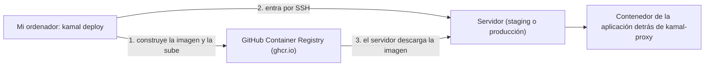

# Máquinas en la nube con Oracle Cloud

Clase del 23/10/2026. El profe crea máquinas en Oracle Cloud (OCI) para desplegar en servidores reales, no solo en Docker en nuestro ordenador. Cada alumno tiene que conseguir las suyas gratis.

## Para qué dos máquinas

- **Producción**: donde está la aplicación de verdad, la que usa la gente.
- **Staging (preproducción)**: una copia lo más parecida posible a producción. Ahí se prueba cada cambio antes de pasarlo a producción. Si algo se rompe, se rompe en staging y no lo ve nadie.


## Vocabulario

| Término | Qué es |
|---|---|
| Instancia | Una máquina virtual en la nube. Un servidor que alquilas (o te dan gratis) |
| Imagen | El sistema operativo con el que arranca la instancia (Ubuntu, Rocky Linux...) |
| Shape | El "tamaño" de la máquina: tipo de procesador, número de CPU y RAM |
| Ampere | Procesadores ARM que usa Oracle. Su shape es `VM.Standard.A1.Flex` |
| Flex | El shape deja elegir cuántas CPU y cuánta RAM le das |
| OCPU | La unidad de CPU de Oracle. En ARM, 1 OCPU es 1 núcleo |
| aarch64 / arm64 | Arquitectura ARM de 64 bits. La imagen tiene que ser de esta arquitectura para un shape Ampere |
| IPv4 pública | La dirección para llegar a la máquina desde internet |
| Clave SSH | Un par de llaves: la pública se queda en el servidor y la privada solo la tienes tú. Con ella entras sin contraseña |

## Lo que hizo el profe, paso a paso

1. Menú de **Compute > Instances > Create instance**.
2. **Ubicación**: la que coge por defecto.
3. **Imagen**: normalmente usa Ubuntu. Empezó a explicarlo con **Rocky Linux 8 (aarch64)**, pero al final **la creó con Ubuntu**.
4. Con Rocky ARM, el **shape** pasaba a **Ampere** (`VM.Standard.A1.Flex`) y en las opciones le ponía **2 OCPU y 12 GB de RAM**. La máquina que creó al final, con Ubuntu, es **AMD**: una de las pequeñas de 1 GB (ver abajo).
   - Para lo que haremos en el curso basta con 1 o 2 CPU.
   - Para el **proyecto final, con Java**, hará falta más.
5. **Red**: todo por defecto, con IPv4 pública.
6. **Acceso**: solo por **SSH**. Hay 4 opciones (generar las claves, subir el archivo de la clave pública, pegar la clave pública o no poner ninguna). Él usa una **clave pública**.
   - Buena práctica: tener **varias claves** (por ejemplo una por máquina). Si roban una, no les sirve para entrar en las demás.
7. Siguiente, siguiente y **Create**.

Sus otras dos máquinas tienen 1 GB de RAM y 1 CPU.

## Por qué 2 OCPU y 12 GB

Antes, la capa gratuita de Oracle (Always Free) daba, en total, **4 OCPU y 24 GB de RAM en máquinas Ampere**. Dos máquinas de 2 OCPU y 12 GB eran justo ese total: una para producción y otra para staging.

**Ojo, esto ha cambiado.** En junio de 2026 Oracle lo recortó a la mitad: ahora da **2 OCPU y 12 GB en total**. Lo aplicó a la fuerza el 18/08/2026. Para tener dos máquinas gratis, cada una tiene que ser de **1 OCPU y 6 GB**. Lo explico en el apunte 09.

Además da **2 máquinas AMD pequeñas** (1 GB de RAM cada una), que encajan con las otras dos del profe. Estas no han cambiado.

Estos límites pueden volver a cambiar. Hay que comprobarlos en la página de Oracle Cloud Free Tier al crear la cuenta.

## ARM o AMD: la imagen tiene que encajar con el procesador

- **Ampere** es ARM. Necesita una imagen `aarch64` (también llamada `arm64`).
- **AMD** (como Intel) es x86. Necesita una imagen `x86_64` (también llamada `amd64`).

Un programa compilado para una arquitectura no funciona en la otra. Por eso, al cambiar la imagen de Rocky ARM a Ubuntu en una máquina AMD, la imagen tiene que ser la de x86_64. La consola de Oracle solo deja combinar imágenes y shapes compatibles.

Esto también importa con Docker: una imagen construida solo para ARM no arranca en una máquina AMD, y al revés.

## Rocky Linux no es Ubuntu

Al final el profe usó Ubuntu, pero conviene saber la diferencia por si alguna vez toca Rocky. Rocky Linux es una copia gratuita de Red Hat Enterprise Linux y muchos comandos cambian:

| Para | Ubuntu | Rocky Linux |
|---|---|---|
| Instalar paquetes | `sudo apt install nginx` | `sudo dnf install nginx` |
| Cortafuegos | `ufw` | `firewalld` (`firewall-cmd`) |
| Seguridad extra | AppArmor | SELinux (puede bloquear cosas aunque los permisos estén bien) |
| Configuración de NGINX | `sites-available` y `sites-enabled` | `/etc/nginx/conf.d/` |

## Conectarse por SSH

La forma general es:

```bash
ssh -i ~/.ssh/mi_clave_privada usuario@IP_PUBLICA
```

- `-i` indica qué clave privada usar. Si la clave está en el sitio por defecto (`~/.ssh/id_ed25519` o `~/.ssh/id_rsa`), no hace falta ponerlo.
- El **usuario** depende de la imagen. En las imágenes de Ubuntu es `ubuntu`.
- La clave privada no se comparte ni se sube nunca a GitHub.

### Un nombre en vez de la IP: /etc/hosts

El profe no escribe la IP pública cada vez. Añadió una línea a `/etc/hosts` de su ordenador con la IP de la máquina y el nombre `pirita`:

```text
IP_PUBLICA   pirita
```

Para verlo usó `bat /etc/hosts` (`bat` es como `cat`, pero con colores). Y ya se conecta así:

```bash
ssh ubuntu@pirita
```

Es lo mismo que hice en la práctica de NGINX con `docs.local` y `blog.local`: `/etc/hosts` es la agenda de mi ordenador, que traduce nombres a IP antes de preguntar al DNS. Solo funciona en el ordenador donde está esa línea.

Truco extra: en `~/.ssh/config` se puede guardar todo (IP, usuario y clave) con un alias, y entonces basta con `ssh pirita`:

```text
Host pirita
    HostName IP_PUBLICA
    User ubuntu
    IdentityFile ~/.ssh/clave_pirita
```

### La contraseña que pide al conectarse

Al hacer `ssh ubuntu@pirita` le pidió **la contraseña de su clave SSH**. Ojo, no es la contraseña del servidor:

- La **clave privada** es un archivo en su ordenador. Se puede proteger con una contraseña (*passphrase*) para que, si alguien la roba, no pueda usarla sin saberla.
- El servidor no tiene contraseña para entrar, solo acepta la clave.
- En el Mac, el llavero puede recordar esa contraseña para no escribirla cada vez.

### Ya estás dentro

Cuando entra, el prompt de la terminal cambia a algo como `ubuntu@nombre-maquina:~$`. Desde ese momento **cada comando se ejecuta en la máquina de Oracle**, no en el Mac. Para salir: `exit`.

Dentro podría instalar a mano lo que haga falta:

- **NGINX**, el servidor web (`sudo apt install nginx`).
- Un servidor **FTP** para enviar archivos (es de la UT5, transferencia de archivos).
- Las dependencias que necesite la aplicación.

## Kamal: desplegar con Docker sin instalar todo a mano

El profe creó **dos máquinas**: una para **producción** y otra para **staging**. No instala la aplicación a mano en ellas: usa **Kamal**, una herramienta que despliega aplicaciones web dentro de contenedores Docker en tus servidores.

**Kamal se instala en el ordenador anfitrión** (mi máquina de desarrollo), no en los servidores. Los comandos se lanzan siempre desde mi ordenador y Kamal hace el resto por SSH.



1. Construye la **imagen Docker** de la aplicación. Por defecto se construye en mi ordenador con Docker.
2. La sube a **GitHub Container Registry** (`ghcr.io`), el almacén de imágenes de GitHub.
3. Entra por **SSH** en el servidor. Si le falta Docker, lo instala.
4. El servidor **descarga la imagen** de `ghcr.io` y arranca el contenedor.
5. Delante pone un proxy (`kamal-proxy`) que dirige las peticiones a la aplicación y permite actualizar sin cortar el servicio.

### Por qué con una herramienta y no a mano

- **Siempre se hace igual.** Los mismos pasos en staging y en producción, sin olvidarse de nada.
- **Menos errores humanos** que conectarse e instalar cosas a mano en cada máquina.
- **Se puede volver atrás** a la versión anterior si algo falla.
- Es la parte de **despliegue** del CI/CD de la UT1: automatizar la llegada del código al servidor.

### Una orden, muchas máquinas

La gran ventaja: desde mi ordenador despliego en **todas las máquinas que quiera a la vez**. Si fueran 32 servidores, se apuntan los 32 en `config/deploy.yml` y un solo `kamal deploy` los actualiza todos:

```yaml
service: mi-aplicacion
image: mi-usuario/mi-aplicacion
servers:
  web:
    - IP_SERVIDOR_1
    - IP_SERVIDOR_2
    # ... hasta los que haga falta
```

Relacionado con la UT2 (arquitecturas):

- **Escalado horizontal**: añadir más máquinas iguales (pasar de 1 a 32). Es lo que facilita Kamal.
- **Escalado vertical**: hacer más grande la misma máquina (más CPU o más RAM, como pasar de 2 a 4 OCPU).
- Con varias máquinas sirviendo la misma aplicación, delante hace falta un **balanceador de carga** que reparta las visitas entre ellas.

### Kamal necesita Ruby en mi ordenador

Kamal está programado en **Ruby**, un lenguaje como Python. Para ejecutarlo hace falta Ruby en el ordenador anfitrión.

| Ruby | Python (lo que ya conozco) |
|---|---|
| Lenguaje Ruby | Lenguaje Python |
| **Gema** (*gem*): una librería o programa de Ruby | Paquete de `pip` |
| `gem install kamal` | `pip install ...` |
| `Gemfile` y `Gemfile.lock` (con Bundler) | `pyproject.toml` y `uv.lock` (con uv) |

Ojo en mi Mac:

- El Ruby que trae macOS (`/usr/bin/ruby`) es el **2.6**, muy viejo y solo para uso interno del sistema. No sirve para Kamal y no hay que instalarle cosas con `sudo`.
- Instalé un Ruby moderno con Homebrew (`brew install ruby`, la 4.0.9) el 23/10/2026. Los programas que instale con `gem` van a `/opt/homebrew/lib/ruby/gems/4.0.0/bin`, que añadí al `PATH` en `~/.zshrc`. Kamal 2.12 funciona con esta versión.
- El profe usó **rbenv**, un **gestor de versiones de Ruby** (como `nvm` para Node o como uv con las versiones de Python). Con `rbenv install` descarga la versión que quieras, con `rbenv global` elige cuál se usa por defecto, y cada proyecto puede fijar la suya con un archivo `.ruby-version`. Él instaló la última, la 4.0.9, la misma que tengo yo con Homebrew.
- `which ruby` dice **dónde** está el Ruby que se usa (con rbenv sale `~/.rbenv/shims/ruby`, con Homebrew `/opt/homebrew/bin/ruby`). `ruby -v` dice **qué versión** es.
- En la práctica de NGINX usé Jekyll (que también es Ruby) **dentro de un contenedor** precisamente para no instalar Ruby en el Mac. Kamal también se puede ejecutar desde Docker, la web de Kamal lo explica.

### Detalles a recordar

- La configuración va en `config/deploy.yml`: servidores, nombre de la imagen y registro.
- Hay **destinos**, por ejemplo uno para staging y otro para producción. Encaja con tener dos máquinas.
- Para subir imágenes a `ghcr.io` hace falta un **token de GitHub** con permiso para escribir paquetes. Es un secreto: no se sube nunca al repositorio.
- Hay que indicar la **arquitectura** de la imagen (`amd64` o `arm64`). Mi Mac es ARM y el servidor del profe es AMD, así que la imagen tiene que construirse para `amd64` (ver el apartado de ARM o AMD).
- Primera vez: `kamal setup`. Siguientes despliegues: `kamal deploy`.

Fuente: https://kamal-deploy.org/

## Pendiente

- [x] Crear mi cuenta gratuita en Oracle Cloud (23/10/2026, región Spain Central (Madrid)). Ver el apunte 09.
- [ ] Crear mis dos instancias: producción y staging.
- [ ] Crear una clave SSH para cada una y comprobar que entro.
- [x] Instalar un Ruby moderno (4.0.9 con Homebrew).
- [x] Instalar Kamal: `gem install kamal` (23/10/2026, Kamal 2.12.0, 15 gemas). Se comprueba con `kamal version`.
- [ ] Crear un token de GitHub para subir imágenes a `ghcr.io` y guardarlo como secreto.
- [ ] Apuntar el resto de la clase (puertos que hay que abrir, qué aplicación vamos a desplegar...).
