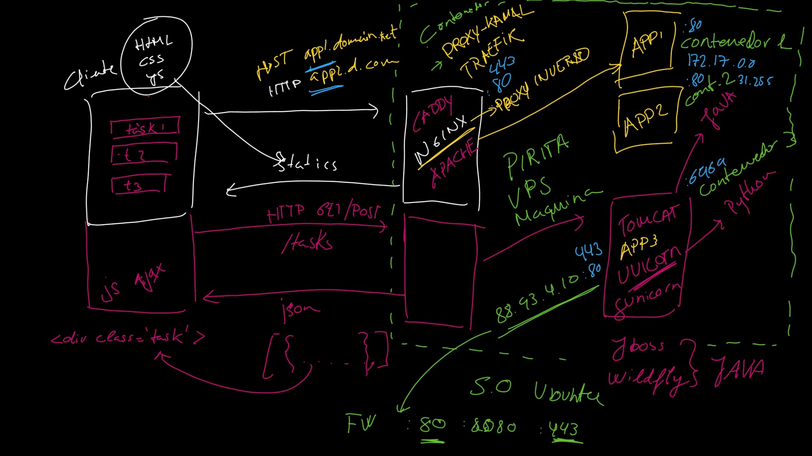
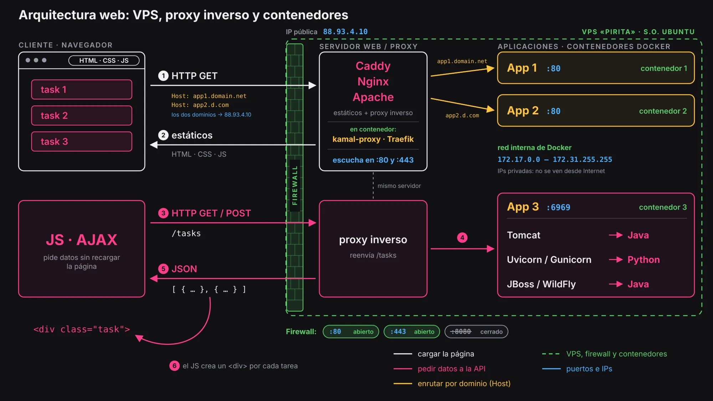
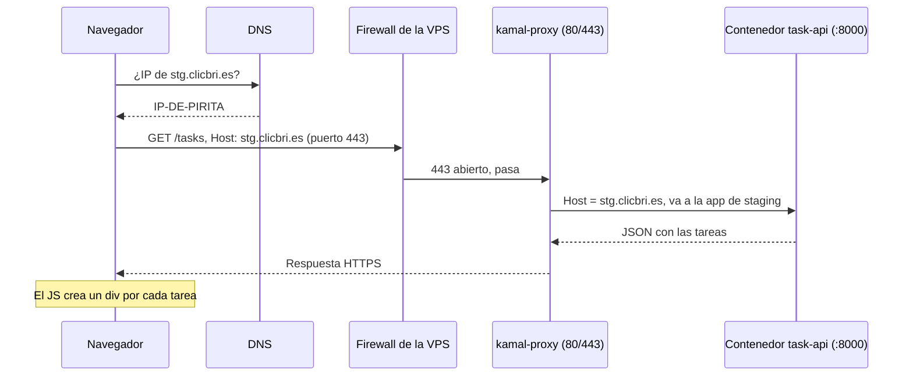
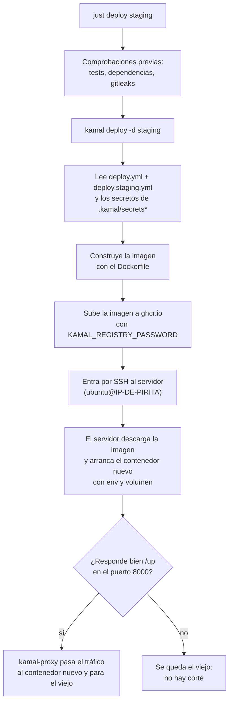

# Clase del 13/11 y cómo será el examen

Apuntes de la clase del viernes 13 de noviembre. En ella el profe explicó en la pizarra cómo llega una petición desde el navegador hasta una aplicación desplegada en una VPS con proxy inverso y contenedores. También contó cómo va a ser el examen.

Los minutos que cito son de las dos grabaciones de la clase: «parte 1» dura 28 min y «parte 2» unos 38 min. Cuando una frase no se oye bien lo marco con `[?]`.

## Índice

- [1. Lo que dijo del examen](#1-lo-que-dijo-del-examen)
  - [1.1 La fecha: el 20, o quizá el 27](#11-la-fecha-el-20-o-quizá-el-27)
  - [1.2 Este fin de semana: cuestionarios en el aula virtual](#12-este-fin-de-semana-cuestionarios-en-el-aula-virtual)
  - [1.3 Cómo será el examen](#13-cómo-será-el-examen)
  - [1.4 Los tipos de pregunta que puso de ejemplo](#14-los-tipos-de-pregunta-que-puso-de-ejemplo)
  - [1.5 Lista de temas que nombró](#15-lista-de-temas-que-nombró)
  - [1.6 Lo que no es mi examen: el ZIP del semipresencial](#16-lo-que-no-es-mi-examen-el-zip-del-semipresencial)
  - [1.7 Frases que no quedaron claras](#17-frases-que-no-quedaron-claras)
- [2. La pizarra explicada desde cero](#2-la-pizarra-explicada-desde-cero)
  - [2.1 Web estática: el «churro»](#21-web-estática-el-churro)
  - [2.2 Web dinámica: el mismo churro que pide datos](#22-web-dinámica-el-mismo-churro-que-pide-datos)
  - [2.3 Servidor web y servidor de aplicaciones](#23-servidor-web-y-servidor-de-aplicaciones)
  - [2.4 Monolito y proxy inverso](#24-monolito-y-proxy-inverso)
  - [2.5 La cabecera Host: cómo sabe el proxy a qué app ir](#25-la-cabecera-host-cómo-sabe-el-proxy-a-qué-app-ir)
  - [2.6 Contenedores e IP privadas: por qué dos apps pueden usar el puerto 80](#26-contenedores-e-ip-privadas-por-qué-dos-apps-pueden-usar-el-puerto-80)
  - [2.7 Puertos publicados y firewall](#27-puertos-publicados-y-firewall)
  - [2.8 HTTP va por TCP](#28-http-va-por-tcp)
  - [2.9 Todo junto: el viaje de una petición](#29-todo-junto-el-viaje-de-una-petición)
- [3. Lo que enseñó en su VPS](#3-lo-que-enseñó-en-su-vps)
- [4. El flujo de despliegue con Kamal](#4-el-flujo-de-despliegue-con-kamal)
  - [4.1 Las piezas](#41-las-piezas)
  - [4.2 Paso a paso](#42-paso-a-paso)
  - [4.3 El deploy.yml línea a línea](#43-el-deployyml-línea-a-línea)
- [5. Cómo se gestionan los secretos](#5-cómo-se-gestionan-los-secretos)
- [6. Claves SSH y quitar las contraseñas](#6-claves-ssh-y-quitar-las-contraseñas)
- [7. Lo de las prácticas que puede caer](#7-lo-de-las-prácticas-que-puede-caer)
  - [7.1 Nginx: reconocer la configuración correcta](#71-nginx-reconocer-la-configuración-correcta)
  - [7.2 Zensical: el comando de build](#72-zensical-el-comando-de-build)
  - [7.3 Por qué usar un entorno virtual](#73-por-qué-usar-un-entorno-virtual)
- [8. Practica con preguntas al estilo del profe](#8-practica-con-preguntas-al-estilo-del-profe)
  - [8.1 Tipo test](#81-tipo-test)
  - [8.2 Elige la configuración correcta](#82-elige-la-configuración-correcta)
  - [8.3 Elige el comando verdadero](#83-elige-el-comando-verdadero)
  - [8.4 Explícalo con tus palabras](#84-explícalo-con-tus-palabras)
  - [8.5 Las 10 preguntas del examen semipresencial](#85-las-10-preguntas-del-examen-semipresencial)
- [9. El examen práctico del semipresencial, en resumen](#9-el-examen-práctico-del-semipresencial-en-resumen)
- [10. Plan hasta el examen](#10-plan-hasta-el-examen)
- [11. Chuleta para la víspera](#11-chuleta-para-la-víspera)

## 1. Lo que dijo del examen

### 1.1 La fecha: el 20, o quizá el 27

- El examen estaba puesto para el **viernes 20 de noviembre**: «el examen del día 20» [parte 1, 01:11].
- Ese día hay **huelga de estudiantes**: «ustedes pusieron el examen un día que iba a ser huelga» [parte 1, 11:08].
- Se habló de pasarlo al **viernes 27**: «El 27, creo, el examen» y «¿quieren hacerlo el 27?» [parte 1, 15:37 a 15:41].
- En la grabación **no queda cerrado**. Hay que mirarlo en el aula virtual o preguntarlo en clase.

> **Actualización del 17/11:** ya está cerrado. El examen es el **viernes 27/11** (lo dijo dos veces en la clase del 17/11, minutos 00:20 y 05:16) y será **sin internet** (minuto 05:16). Lo demás que dijo ese día sobre el examen está en el [apunte 12](12-clase-17-11-api-y-pipeline.md#lo-que-dijo-del-examen).

### 1.2 Este fin de semana: cuestionarios en el aula virtual

- Este fin de semana va a subir **actividades tipo cuestionario** al aula virtual [parte 1, 16:09].
- Cada una tiene **3 intentos** y **cuenta la nota más alta** [parte 1, 16:18 y 16:28].
- **Puntúan para la evaluación continua**: «esas tareas forman parte de la continua y eso vale el 40 % de la nota» [parte 2, 37:03].
- Los cuestionarios traen la explicación de por qué cada respuesta es correcta o no. Alguien dijo en clase que «se aprende mucho» con eso [parte 1, 14:53].

**Qué hago yo:** el primer intento lo hago sin mirar nada, para saber dónde estoy. Luego estudio lo que fallé con estos apuntes, y solo después hago el segundo intento.

### 1.3 Cómo será el examen

Por lo que dijo, el examen tiene dos partes:

| Parte | Qué es | Cita |
|---|---|---|
| A. Preguntas | «una selección de preguntas que tengan que ver con el tema». Pueden salir de la misma batería que los cuestionarios: «yo te doy las preguntas y las respuestas y eso es lo que va a quedar en el examen» | parte 1, 15:06 y 15:16 |
| B. Explicar | «una pequeña pruebita» para que le explique «para qué es cada cosa», conectando ideas | parte 1, 16:41 a 17:06 |

Lo que repitió varias veces:

- **No quiere comandos de memoria.** «No quiero que se aprendan comandos y esas cosas, sino más bien que ustedes sean capaces de explicarme para qué es cada cosa» [parte 1, 16:54].
- **Puede darte un trozo de código** (sobre todo de Kamal) para que expliques para qué sirve: «a lo mejor les pongo de este código cosas que ustedes me tienen que explicar» [parte 1, 17:00] y «yo les pongo el código o una parte de lo de Kamal» [parte 2, 37:13].
- **Entra todo lo contado en clase**: «de todo lo que hemos hablado aquí en clase» [parte 1, 18:01].
- **Internet:** dijo «apago internet y todo», aunque justo después se oye «no, en ese caso no» [parte 1, 17:20, dudoso]. Me preparo como si no hubiera internet.

### 1.4 Los tipos de pregunta que puso de ejemplo

| Formato | Su ejemplo | Cita |
|---|---|---|
| Elegir la configuración buena | «si yo pongo tres ejemplos de una configuración de nginx, y me invento dos de ellos, ustedes van a seleccionar cuál es el correcto» | parte 1, 19:07 |
| Elegir el comando verdadero | «cómo se hace el build con Zensical y les pongo tres comandos [...] que son falsos y el comando que es verdad» | parte 2, 37:44 |
| Explicar un porqué | «por qué es una buena praxis crear un entorno virtual» | parte 2, 38:10 |
| Elegir la explicación correcta o la errónea | «yo les pongo las explicaciones y ustedes seleccionan cuál es la correcta o cuál es la errónea» | parte 2, 38:19 |
| Explicar el flujo | «hazme un flujo de lo que ocurre desde que tú haces el despliegue, qué partes tienes que tener en cuenta» | parte 2, 37:22 |
| Comparar conceptos | «qué diferencia hay entre un servidor web y un servidor de aplicaciones», «una página estática y una página dinámica» | parte 2, 37:36 a 37:44 |

En el apartado [8](#8-practica-con-preguntas-al-estilo-del-profe) hay preguntas de cada tipo para practicar.

### 1.5 Lista de temas que nombró

Marco cada tema cuando sea capaz de explicarlo en voz alta sin mirar:

- [ ] El **flujo de despliegue** y qué partes están implicadas [parte 1, 17:41; parte 2, 37:22]. Apartado [4](#4-el-flujo-de-despliegue-con-kamal).
- [ ] **Cómo se gestionan los secretos** [parte 1, 17:41]. Apartado [5](#5-cómo-se-gestionan-los-secretos).
- [ ] **Claves SSH** (pública y privada) y entrar **solo con la clave, sin contraseña** [parte 1, 18:26 a 18:38]. Apartado [6](#6-claves-ssh-y-quitar-las-contraseñas).
- [ ] **Nginx**: reconocer una configuración correcta [parte 1, 19:07]. Apartado [7.1](#71-nginx-reconocer-la-configuración-correcta).
- [ ] **Zensical**: el comando de build [parte 1, 18:53; parte 2, 37:44]. Apartado [7.2](#72-zensical-el-comando-de-build).
- [ ] **Entorno virtual**: por qué es buena práctica [parte 2, 38:10]. Apartado [7.3](#73-por-qué-usar-un-entorno-virtual).
- [ ] **Servidor web y servidor de aplicaciones** [parte 2, 00:00 y 37:36]. Apartado [2.3](#23-servidor-web-y-servidor-de-aplicaciones).
- [ ] **Web estática y web dinámica** [parte 1, 20:17 a 24:11]. Apartados [2.1](#21-web-estática-el-churro) y [2.2](#22-web-dinámica-el-mismo-churro-que-pide-datos).
- [ ] **Puertos, contenedores y proxy inverso**: «todo esto va a caer en el examen» [parte 2, 13:21]. Apartados [2.4](#24-monolito-y-proxy-inverso) a [2.7](#27-puertos-publicados-y-firewall).
- [ ] **Partes del código de Kamal** [parte 2, 37:13]. Apartado [4.3](#43-el-deployyml-línea-a-línea).

En la clase del 17/11 añadió más temas (capa de modelo, endpoints, autenticación, Ruff, pipeline, migraciones, healthcheck, justfile, Bandit y `echo $?`). Están en el [apunte 12](12-clase-17-11-api-y-pipeline.md).

### 1.6 Lo que no es mi examen: el ZIP del semipresencial

El ZIP `EXAMEN_SEMI` es el **examen práctico del grupo semipresencial**, de una hora. Lo preparó una alumna de segundo y el profe lo dejó en el aula virtual con la solución. Al principio de la clase se habló de él y el profe dijo que el examen «lo pueden hacer, pero sí es verdad que llevan más tiempo» [parte 1, 01:38].

**Mi examen no es ese.** Mi examen es de preguntas y de explicar (apartado 1.3). Aun así, el ZIP me sirve mucho por dos cosas:

1. Trae **10 preguntas tipo test con solución** (las copio en el apartado [8.5](#85-las-10-preguntas-del-examen-semipresencial)).
2. Trae la **app del profe (`task-api`)** con su configuración real de Kamal. Esa es la que enseñó en clase y la que puede salir para que la explique.

### 1.7 Frases que no quedaron claras

Para escucharlas yo en el audio, o preguntarlas en clase:

| Minuto | Qué hay que aclarar |
|---|---|
| parte 1, 11:28 y 15:37 | Si el examen pasa del 20 al 27 |
| parte 1, 15:04 | «El examen tiene dos partes»: no se oye bien si lo dice el profe o un compañero |
| parte 1, 15:16 | Si las preguntas del examen salen tal cual de los cuestionarios |
| parte 1, 15:34 | «50 preguntas»: no está claro si es el número de preguntas del examen |
| parte 1, 17:20 | Si apaga internet en el examen |
| parte 2, 37:08 | El 40 % de la continua. En la web del curso pone otro reparto, así que conviene preguntarlo |

## 2. La pizarra explicada desde cero

Así quedó la pizarra al final de la clase:



Y este es el mismo esquema pasado a limpio:



> **Ojo con un dato del esquema:** el rango de IP privadas de Docker no va de 172.17 a 172.31. Lo explico bien en el apartado [2.6](#26-contenedores-e-ip-privadas-por-qué-dos-apps-pueden-usar-el-puerto-80).

### 2.1 Web estática: el «churro»

**Analogía:** una web estática es como un **folleto impreso**. Está hecho de antemano y todos los que lo piden reciben el mismo.

- Con Zensical (o Jekyll) escribí la web en Markdown y ejecuté el **build**, que en español es «construir».
- El build genera una carpeta (`site/` en Zensical) llena de **HTML, CSS y JavaScript**. Eso es lo que el profe llama «el **churro**»: el resultado compilado, que ya no se toca a mano [parte 1, 20:17].
- **Nginx** solo tiene que **entregar esos ficheros** tal cual: «el NGINX [...] vomita el churro de estáticos» [parte 1, 25:38].

El recorrido es así:

1. El navegador pide `GET /` con la cabecera `Host: docs.midominio.test`.
2. Nginx busca el fichero en `site/` y lo devuelve.
3. El navegador pinta lo que ha recibido. **No hay más peticiones a ningún servidor** para pedir datos.

### 2.2 Web dinámica: el mismo churro que pide datos

Lo que más recalcó el profe: **una web dinámica es el mismo tipo de churro**. Sigue siendo HTML, CSS y JS que Nginx entrega igual. La diferencia está **dentro del JavaScript**: ese JS hace **peticiones HTTP a una API** para traer datos [parte 1, 20:55 a 23:36].

**Analogía:** la estática es el folleto impreso. La dinámica es un folleto con un **hueco en blanco** y un **teléfono**: cuando lo abres, llama a la tienda, pregunta «¿qué tareas tengo?» y escribe la respuesta en el hueco.

El ejemplo de la pizarra es una app de tareas:

1. El navegador carga el churro (HTML, CSS y JS) igual que en una web estática.
2. El JS hace una petición en segundo plano, sin recargar la página. A eso se le llama **AJAX**, y en JS moderno se hace con `fetch`. Por ejemplo, `GET /tasks` para leer las tareas o `POST /tasks` para crear una.
3. La **API** (en clase, `task-api` con FastAPI) responde con **JSON**: `[{"id": 1, "title": "..."}, ...]`.
4. El JS recorre ese JSON y **crea un `<div class="task">` por cada tarea** usando una plantilla [parte 1, 22:00].

| | Estática | Dinámica |
|---|---|---|
| Qué entrega el servidor web | El churro | El churro (igual) |
| ¿El JS pide datos a una API? | No | Sí: peticiones HTTP con fetch o AJAX |
| Formato de los datos | No hay | JSON |
| Ejemplo de clase | Docs con Zensical, blog con Jekyll | Frontend de tareas + `task-api` |
| Qué hace falta en el servidor | Solo un servidor web | Servidor web + servidor de aplicaciones con la API |

> **Frase para el examen:** «Una web dinámica también son ficheros estáticos. La diferencia es que su JavaScript hace peticiones HTTP a una API, recibe JSON y con eso rellena la página en el navegador.»

### 2.3 Servidor web y servidor de aplicaciones

**Analogía de un restaurante:**

- El **servidor web** es el **camarero**: entrega lo que ya está hecho, como el agua o el pan (los ficheros estáticos). También lleva los pedidos a la cocina (eso es hacer de proxy).
- El **servidor de aplicaciones** es la **cocina**: ejecuta tu código (Python o Java), hace la lógica de negocio, consulta la base de datos y prepara la respuesta.

| | Servidor web | Servidor de aplicaciones |
|---|---|---|
| Qué hace | Sirve ficheros estáticos por HTTP y reenvía peticiones (proxy inverso) | Ejecuta el código de la app (la lógica de negocio) |
| Ejemplos | Nginx, Apache, Caddy | Java: Tomcat, JBoss / WildFly. Python: Uvicorn, Gunicorn |
| Qué devuelve | El fichero tal cual | Algo generado en ese momento (por ejemplo, JSON) |

Lo que dijo el profe [parte 2, 00:00 a 00:38]:

- **Tomcat** «tiene funciones como servidor web», pero cuando conectas código Java «ya no es un servidor web como tal, es un servidor de aplicaciones».
- En el servidor de aplicaciones está «la lógica de negocio».
- Puede ser Spring Boot (Java) o Flask y FastAPI (Python) [parte 2, 00:40].

**Detalle por si preguntan más fino:**

- **Uvicorn** es el servidor que ejecuta apps Python de tipo ASGI, como FastAPI. Es el que usa la `task-api`: `uvicorn app.main:app --port 8000`.
- **Gunicorn** es un gestor de procesos para apps Python (WSGI, como Flask). Puede arrancar varios procesos de Uvicorn a la vez.
- **JBoss** es de Red Hat y su versión libre se llama **WildFly**. Ambos son servidores de aplicaciones Java completos.

### 2.4 Monolito y proxy inverso

- **Monolito** es lo que habíamos hecho hasta ahora: un solo servidor que lo hace todo [parte 2, 02:48].
- Con un **proxy inverso** pones **una sola puerta de entrada** delante de varias apps. El proxy recibe todas las peticiones y **reenvía cada una a la app que toca** [parte 2, 03:11].

**Analogía:** el proxy inverso es la **recepción de un edificio de oficinas**. Todo el mundo entra por la misma puerta, dice a qué empresa va, y el recepcionista le manda a la planta correcta. Desde fuera no se ven las plantas, solo la recepción.

Hay varias herramientas que pueden hacer de proxy inverso [parte 2, 04:04 a 04:35]:

- **Nginx**, si lo configuras con `proxy_pass`.
- **Traefik**.
- **kamal-proxy**, que es el que monta Kamal en el servidor.

Por qué usar uno:

- Puedes tener **varias apps en la misma máquina** detrás de los puertos 80 y 443.
- El HTTPS (los certificados) se gestiona **en un solo sitio**.
- Las apps no se exponen directamente a internet.
- Kamal lo usa para **desplegar sin cortes**: arranca el contenedor nuevo y cambia el tráfico cuando ya responde.

### 2.5 La cabecera Host: cómo sabe el proxy a qué app ir

Todas las apps están en **la misma IP**, así que el proxy no puede distinguirlas por la IP. Las distingue por el **nombre de dominio**, que viaja dentro de la petición en la **cabecera `Host`** [parte 2, 06:22 a 07:16].

1. El navegador pide `http://app1.domain.net/`.
2. El DNS traduce `app1.domain.net` a la IP de la VPS. `app2.d.com` puede apuntar a **la misma IP**.
3. La petición llega con la cabecera `Host: app1.domain.net`.
4. El proxy lee esa cabecera y reenvía la petición a la app 1. Si llega `Host: app2.d.com`, la reenvía a la app 2.
5. La respuesta vuelve por el mismo camino: app, proxy y cliente [parte 2, 08:00].

Esto ya lo hice en la práctica de Nginx: el `server_name` de cada bloque `server` decide qué web se sirve según el Host [parte 2, 06:49]. El profe lo comparó con el **token JWT**, que también viaja en las cabeceras [parte 2, 07:16].

> **Corrección:** en clase dijo «en el cuerpo de la petición, en los encabezados». Lo correcto es que **Host va en las cabeceras** (headers). El cuerpo (body) es otra parte de la petición distinta, donde va, por ejemplo, el JSON de un `POST`.

### 2.6 Contenedores e IP privadas: por qué dos apps pueden usar el puerto 80

Esto es lo que dijo que «todo esto va a caer en el examen» [parte 2, 13:21].

- Un **contenedor** es como un mini-ordenador ligero que **comparte el sistema operativo** de la máquina.
- Docker le da a **cada contenedor su propia IP privada**, dentro de su red interna. La red por defecto de Docker es **`172.17.0.0/16`**: `172.17.0.1` es la máquina y luego vienen `172.17.0.2`, `172.17.0.3`... [parte 2, 16:04].
- Un puerto solo puede estar ocupado **una vez por máquina**. Pero cada contenedor cuenta como **una máquina distinta** con su propia IP.
- Por eso la app 1 (`172.17.0.2:80`) y la app 2 (`172.17.0.3:80`) **pueden usar las dos el puerto 80** sin chocar [parte 2, 17:22 a 17:31].
- Lo que **no** se puede es que dos procesos del **mismo** contenedor escuchen en el mismo puerto [parte 2, 31:42].

**Analogía:** en un edificio, el piso 2 y el piso 3 pueden tener **las dos la puerta «A»**. La dirección completa es «piso + puerta», igual que «IP + puerto».

**Rangos de IP privadas** (no se ven desde internet):

| Rango | Desde | Hasta |
|---|---|---|
| `10.0.0.0/8` | 10.0.0.0 | 10.255.255.255 |
| `172.16.0.0/12` | **172.16**.0.0 | **172.31**.255.255 |
| `192.168.0.0/16` | 192.168.0.0 | 192.168.255.255 |

> **Corrección:** en clase dudaron con el rango 172 y se dijo «desde la 172.17 hasta la 172.31» [parte 2, 16:51]. El rango privado empieza en **172.16**. La 172.17 es solo la red que **Docker** usa por defecto, que está dentro de ese rango.

### 2.7 Puertos publicados y firewall

Desde internet **solo se ve la IP pública** de la VPS. Las IP privadas de los contenedores no se ven.

- **Solo el contenedor del proxy se publica** en la máquina. Lo hace con `0.0.0.0:80->80` y `0.0.0.0:443->443` [parte 2, 30:43]. `0.0.0.0` significa «en todas las IP de la máquina».
- Las apps **no se publican**. El proxy les llega por la red interna de Docker, a su IP privada y a su puerto (en la `task-api`, el 8000) [parte 2, 18:30 a 19:00].
- En el **firewall** de la VPS (en Oracle, la lista de seguridad) hay que abrir el **80** (HTTP) y el **443** (HTTPS), y otro puerto solo si de verdad lo usas, por ejemplo el 8080 [parte 2, 12:29 a 13:05].
- Una vez dentro, el proxy ya no enruta por puertos sino **por el nombre del Host** [parte 2, 20:39 a 20:53].

| Puerto | Para qué | ¿Abierto en el firewall? |
|---|---|---|
| 22 | SSH (administrar la máquina) | Sí, para entrar yo |
| 80 | HTTP | Sí |
| 443 | HTTPS | Sí |
| 8000 | La app dentro de su contenedor | **No**: solo se llega a través del proxy |

### 2.8 HTTP va por TCP

En la salida de `docker ps` pone `80/tcp` y `443/tcp` [parte 2, 29:17 a 29:44]:

- **HTTP va por TCP.** TCP garantiza que llegan todos los paquetes y en orden, y una web no puede llegar a medias.
- **UDP** no garantiza la entrega. Se usa en **tiempo real** (videollamadas, juegos), donde importa más el dato más reciente que recuperar uno perdido.

> **Matiz:** la respuesta para el examen es «TCP», porque así lo explicó él. Aun así, conviene saber que **HTTP/3** va sobre QUIC, que usa UDP. Si una pregunta habla de HTTP/3, la respuesta cambia.

### 2.9 Todo junto: el viaje de una petición



Contado en una frase: el navegador pregunta al DNS la IP, envía la petición al 443 de esa IP, el firewall la deja pasar, kamal-proxy mira la cabecera Host y la reenvía al contenedor de la app por la red interna, en el puerto 8000. Uvicorn ejecuta FastAPI, que responde con JSON, y el JS lo pinta.

## 3. Lo que enseñó en su VPS

El profe tiene dos máquinas en Oracle Cloud:

| Máquina | Entorno | IP | Dominio |
|---|---|---|---|
| **pirita** | staging (pruebas) | IP-DE-PIRITA | `stg.clicbri.es` |
| **galena** | producción | IP-DE-GALENA | `clicbri.es` |

En clase entró con `ssh ubuntu@pirita` y ejecutó `docker ps` [parte 2, 28:46]. Salían **dos contenedores**:

1. **kamal-proxy**, publicado en `0.0.0.0:80->80/tcp` y `0.0.0.0:443->443/tcp`. Es la puerta de entrada.
2. **La app** (`tasks-api` de staging), con el puerto **8000** del contenedor y **sin publicarlo** en la máquina.

En galena se ve lo mismo, pero con **otra versión** de la imagen. La versión se distingue por la **etiqueta** de la imagen [parte 2, 33:06].

Una pregunta de un compañero lo aclaró: **la imagen no se construye en el servidor.** Se construye en tu ordenador a partir del `Dockerfile` [parte 2, 33:47].

**La conexión entre `app_port` y `EXPOSE`** [parte 2, 23:39 a 24:54]:

- En el `Dockerfile`: `EXPOSE 8000` y `uvicorn ... --port 8000`. La app escucha en el 8000 **dentro del contenedor**.
- En `deploy.yml`: `proxy: app_port: 8000`. Le dice a kamal-proxy en qué puerto del contenedor está la app.
- Los dos **tienen que coincidir**. Si cambio la app al 8080, tengo que cambiar `app_port` a 8080.
- `proxy: host: stg.clicbri.es` dice para qué dominio es la app. Es la cabecera Host que mira el proxy.

**Dominios para el proyecto** [parte 2, 04:42 a 05:20]: el profe ofreció hacernos **subdominios del suyo**, así que no hace falta comprar un dominio. Lo que sí hace falta es **una máquina con IP pública** donde desplegar. Comentó que a algunos no les funcionó Oracle y nombró **DigitalOcean** como opción barata.

## 4. El flujo de despliegue con Kamal

**Kamal** es una herramienta que **despliega apps en contenedores Docker en tus propios servidores por SSH**. Con un comando construye la imagen, la sube, entra en el servidor, arranca el contenedor nuevo y le pasa el tráfico sin cortes.

### 4.1 Las piezas

| Pieza | Qué es | Dónde está |
|---|---|---|
| `Dockerfile` | La receta para construir la imagen de la app | En el repo |
| Imagen Docker | La app empaquetada con todo lo que necesita | Se construye en mi ordenador |
| Registro (`ghcr.io`) | El «almacén» de imágenes de GitHub, donde se sube la imagen para que el servidor la descargue | Internet |
| `config/deploy.yml` | La configuración común de Kamal | En el repo |
| `config/deploy.staging.yml` y `config/deploy.production.yml` | Lo que cambia en cada entorno (IP, dominio) | En el repo |
| `.kamal/secrets*` | Los **valores** de los secretos | **Solo en mi ordenador**, ignorado por Git |
| Clave SSH | Para que Kamal entre en el servidor sin contraseña | `~/.ssh/` en mi ordenador |
| kamal-proxy | El proxy inverso que Kamal monta en el servidor | Contenedor en la VPS |
| `justfile` | Atajos: `just deploy staging` | En el repo |

### 4.2 Paso a paso



1. **`just deploy staging`.** Antes de desplegar, el `justfile` pasa unas comprobaciones (`just preflight`): tests, dependencias y **gitleaks**, que busca secretos filtrados. Después lanza `kamal deploy -d staging`. La `-d` indica el destino (*destination*).
2. **Kamal lee la configuración.** Junta `deploy.yml` con `deploy.staging.yml` y lee los secretos de `.kamal/secrets*`.
3. **Construye la imagen** con el `Dockerfile`, para la arquitectura del servidor (`builder: arch: amd64`).
4. **Sube la imagen al registro** `ghcr.io`, iniciando sesión con `KAMAL_REGISTRY_PASSWORD`. La imagen va etiquetada con la versión (el commit).
5. **Entra por SSH** al servidor de `servers`, con el usuario `ubuntu` y su clave.
6. **En el servidor** se asegura de que kamal-proxy está en marcha, **descarga la imagen** y arranca el **contenedor nuevo**. Le pasa las variables de entorno y monta el **volumen** `/var/lib/tasks-api:/data`, donde vive la base de datos SQLite. Así los datos no se pierden al cambiar de contenedor.
7. **Healthcheck.** kamal-proxy llama a **`/up`** en el puerto 8000 del contenedor nuevo. Solo cuando responde bien le pasa el tráfico y apaga el viejo. A eso se le llama **desplegar sin cortes** (*zero-downtime*).
8. **HTTPS.** Con `ssl: true`, kamal-proxy consigue solo el certificado de **Let's Encrypt** para el dominio. Para eso el DNS tiene que apuntar a la VPS y los puertos 80 y 443 tienen que estar abiertos.

**Staging y producción:** primero despliego en **staging** (pirita, `stg.clicbri.es`) para probar. Si todo va bien, despliego **la misma imagen** en **producción** (galena, `clicbri.es`) con `just deploy production`.

### 4.3 El deploy.yml línea a línea

Esto es lo que puede darme para que lo explique [parte 2, 37:13]. Es el de la `task-api`:

```yaml
service: tasks-api              # nombre del servicio (nombre de los contenedores)
image: modiael/tasks-api        # nombre de la imagen en el registro

registry:
  server: ghcr.io               # registro de GitHub donde se sube la imagen
  username: modiael
  password:
    - KAMAL_REGISTRY_PASSWORD   # el NOMBRE del secreto; el valor está en .kamal/secrets

ssh:
  user: ubuntu                  # usuario con el que Kamal entra por SSH

builder:
  arch: amd64                   # construir la imagen para la arquitectura del servidor

proxy:
  app_port: 8000                # puerto de la app dentro del contenedor (= EXPOSE 8000)

env:
  clear:                        # variables NO secretas: se pueden ver en el repo
    PYTHONUNBUFFERED: "1"
  secret:                       # variables SECRETAS: aquí solo el nombre
    - JWT_SECRET_KEY
```

Y lo que cambia en `deploy.staging.yml`:

```yaml
servers:
  web:
    - IP-DE-PIRITA             # pirita: a qué máquina se despliega

proxy:
  host: stg.clicbri.es          # dominio: lo que mira kamal-proxy en la cabecera Host
  app_port: 8000
  ssl: true                     # HTTPS automático con Let's Encrypt

volumes:
  - /var/lib/tasks-api:/data    # carpeta de la VPS : carpeta del contenedor (la BD no se pierde)

env:
  clear:
    APP_ENV: staging
    DATABASE_URL: sqlite:////data/tasks.db
```

`deploy.production.yml` es igual, pero con la IP de galena (`IP-DE-GALENA`) y el dominio `clicbri.es`.

**Las dos ideas que tengo que saber contar:**

1. **`env.clear` frente a `env.secret`**: las variables `clear` se escriben con su valor y se versionan. Las `secret` solo llevan el **nombre**, y su valor se lee de `.kamal/secrets*`, que no está en Git.
2. **`proxy.host` + `app_port`** conectan con la pizarra: el proxy recibe la petición, mira el Host y la manda al contenedor, al puerto `app_port`.

## 5. Cómo se gestionan los secretos

Un **secreto** es cualquier dato que da acceso a algo: contraseñas, tokens, claves. En la `task-api` hay dos:

- `KAMAL_REGISTRY_PASSWORD`: el token para subir imágenes a `ghcr.io`.
- `JWT_SECRET_KEY`: la clave con la que la API firma los tokens de login.

**Regla de oro: los secretos nunca van al repositorio.** Si un secreto llega a GitHub, aunque lo borres en el siguiente commit, se queda en el historial.

Cómo lo hace el proyecto:

| Medida | Para qué |
|---|---|
| `.env` y `.kamal/` en el `.gitignore` | Los ficheros con valores reales no se suben nunca |
| `.env.example` en el repo, con `JWT_SECRET_KEY=` vacío | Documenta **qué** variables hacen falta, sin sus valores |
| `env.secret` en `deploy.yml` | En el repo solo aparece el **nombre** del secreto |
| `.kamal/secrets*` en mi ordenador | Desde ahí Kamal lee los **valores** al desplegar y se los pasa al contenedor |
| **gitleaks** (`just security-secrets`) | Revisa todo el historial de Git buscando secretos filtrados. Se ejecuta antes de cada despliegue |
| En GitHub Actions, los **Secrets** del repositorio | El CI usa los secretos sin que estén escritos en el código |
| Generar la clave con `openssl rand -hex 32` | Una clave larga y aleatoria. Si se filtra, se **rota**: se cambia por otra nueva |

> **Frase para el examen:** «Los secretos no se versionan. En el repo solo va el nombre de cada secreto (`env.secret` en `deploy.yml`) y un `.env.example` sin valores. Los valores están en `.kamal/secrets`, que está en el `.gitignore`, y Kamal los inyecta en el contenedor al desplegar. Además, gitleaks revisa el historial por si se ha colado alguno.»

## 6. Claves SSH y quitar las contraseñas

Esto ya lo hice en la [práctica guiada de SSH](../practica-ssh/README.md). Repaso lo que tengo que saber **explicar** [parte 1, 18:26 a 18:38].

**Analogía:** la **clave pública** es un **candado** que puedes repartir y poner en todas las puertas que quieras. La **clave privada** es la **única llave** que lo abre y **nunca sale de tu ordenador**.

1. `ssh-keygen -t ed25519` crea el par de claves en `~/.ssh/`:
   - `id_ed25519` es la **privada**: no se comparte jamás.
   - `id_ed25519.pub` es la **pública**: se puede dar a quien sea.
2. La pública se copia al servidor, dentro de `~/.ssh/authorized_keys`. Se puede hacer con `ssh-copy-id usuario@servidor`.
3. Al conectar, el servidor te lanza un reto que solo puede resolver quien tiene la privada. **La clave privada nunca viaja por la red.**
4. **Quitar las contraseñas:** en `/etc/ssh/sshd_config` del servidor se pone:

   ```text
   PasswordAuthentication no
   PermitRootLogin no
   ```

   Luego se reinicia el servicio SSH. **Antes de cerrar la sesión abierta, pruebo a entrar desde otra terminal**, para no quedarme fuera.

**Por qué se hace:** una contraseña se puede adivinar a base de intentos (ataque de **fuerza bruta**). Una clave ed25519 no. Además, Kamal necesita entrar al servidor **sin que nadie teclee nada**, y eso solo se puede hacer con claves.

## 7. Lo de las prácticas que puede caer

### 7.1 Nginx: reconocer la configuración correcta

No hace falta memorizarla. Basta con saber **qué hace cada línea** para detectar la inventada. El bloque típico para servir el churro de Zensical es este:

```nginx
server {
    listen 80;                          # puerto en el que escucha
    server_name docs.diego.test;        # responde a este Host

    root /usr/share/nginx/docs;         # carpeta con el churro (lo que generó el build)
    index index.html;                   # fichero por defecto de cada carpeta

    location / {
        try_files $uri $uri/ =404;      # si existe el fichero lo da; si no, error 404
    }
}
```

Y el de proxy inverso, para reenviar a una app:

```nginx
server {
    listen 80;
    server_name app.diego.test;

    location / {
        proxy_pass http://127.0.0.1:8000;   # a dónde reenvía la petición
        proxy_set_header Host $host;        # conserva la cabecera Host original
    }
}
```

**Trampas típicas** que pondría en las opciones falsas:

- Directivas fuera de `server { }`, o líneas sin `;` al final.
- `root` apuntando a los **Markdown** (`docs/`) en vez de al churro (`site/`).
- `proxy_pass` en un sitio que solo tiene que servir ficheros, o `root` en un sitio que tiene que reenviar a una app.
- `listen 443` sin certificado, o `server_name` con `http://` delante (el `server_name` es solo el nombre).
- Directivas inventadas, como `serve_static on;` o `document_root`, que es de Apache, no de Nginx.

### 7.2 Zensical: el comando de build

| Comando | Qué hace |
|---|---|
| `uv run zensical new .` | Crea un proyecto nuevo en la carpeta actual |
| `uv run zensical serve` | Servidor de **desarrollo** con recarga automática (`localhost:8000`). Es para ver los cambios mientras escribo, **no** para producción |
| **`uv run zensical build`** | **Genera el churro** en `site/`. Este es el comando verdadero del build |
| `uv run zensical build --clean` | Lo mismo, pero borrando antes lo que había |

**Comandos falsos que podría poner:** `zensical compile`, `zensical deploy`, `npm run build` (eso es de JavaScript), `pip install zensical build`, `zensical build --output html`.

Recordatorio: `site/` (y `.cache/`) van en el `.gitignore`, porque **se regeneran** con el build.

### 7.3 Por qué usar un entorno virtual

Un **entorno virtual** (`.venv`) es una carpeta con **un Python y unas librerías solo para ese proyecto**.

**Analogía:** cada proyecto tiene **su propia caja de herramientas**. Si en un proyecto necesito la versión 1 de un martillo y en otro la versión 2, no se pisan.

Por qué es buena práctica:

1. **Aislamiento.** Las dependencias de un proyecto no chocan con las de otro ni con el Python del sistema.
2. **Reproducible.** Con `pyproject.toml` y `uv.lock`, cualquiera (o el servidor) instala exactamente las mismas versiones.
3. **No ensucia el sistema.** No hace falta `sudo` ni instalar nada global. Si algo se rompe, borro `.venv` y lo vuelvo a crear.
4. **No se sube a Git.** `.venv` va en el `.gitignore`, porque se recrea con `uv sync`.

Con **uv** no hace falta crearlo a mano: `uv sync` o `uv run` crean `.venv` automáticamente. `uvx` es distinto: ejecuta una herramienta en un entorno **temporal**, sin añadirla al proyecto.

## 8. Practica con preguntas al estilo del profe

Primero contesto sin mirar y luego abro la respuesta. Las que falle las apunto en el registro de errores del [plan de la semana](10-semana-del-examen.md).

### 8.1 Tipo test

**1. ¿Qué diferencia una web dinámica de una estática?**

- a) La dinámica no usa HTML.
- b) La dinámica se sirve con un servidor de aplicaciones y la estática con uno web.
- c) Las dos son ficheros HTML, CSS y JS, pero el JS de la dinámica pide datos a una API y rellena la página.
- d) La estática no puede tener JavaScript.

<details>
<summary>Respuesta</summary>

**c.** El churro es igual de estático. La diferencia es que su JS hace peticiones HTTP (fetch o AJAX) a una API. La b es una trampa: el frontend lo entrega el servidor web en los dos casos, y lo que vive en el servidor de aplicaciones es la API. La d es falsa: una web estática puede tener JS (por ejemplo, un menú que se despliega).

</details>

**2. ¿Qué formato suele devolver una API REST como `task-api`?**

- a) HTML
- b) JSON
- c) CSS
- d) Markdown

<details>
<summary>Respuesta</summary>

**b.** JSON, que el JS del navegador convierte en elementos de la página.

</details>

**3. ¿Cuál de estos es un servidor de aplicaciones?**

- a) Nginx
- b) Caddy
- c) Uvicorn
- d) Apache sirviendo `site/`

<details>
<summary>Respuesta</summary>

**c.** Uvicorn ejecuta código Python (FastAPI). Nginx, Caddy y Apache son servidores web.

</details>

**4. Dos apps en la misma VPS escuchan las dos en el puerto 80. ¿Por qué no chocan?**

- a) Porque Docker reparte el puerto 80 por turnos.
- b) Porque cada contenedor tiene su propia IP privada, así que son «máquinas» distintas.
- c) Porque el firewall las separa.
- d) Sí chocan: no se puede.

<details>
<summary>Respuesta</summary>

**b.** La dirección completa es IP + puerto: `172.17.0.2:80` y `172.17.0.3:80` son distintas. Lo que no se puede es publicar dos veces el mismo puerto **de la máquina**.

</details>

**5. ¿Cómo sabe el proxy inverso a qué app mandar una petición?**

- a) Por la IP de destino.
- b) Por la cabecera `Host` de la petición.
- c) Por el puerto de origen del cliente.
- d) Al azar.

<details>
<summary>Respuesta</summary>

**b.** Todas las apps comparten IP, así que el proxy decide por el nombre de dominio que llega en la cabecera `Host`.

</details>

**6. En la VPS con Kamal, ¿qué contenedor publica los puertos 80 y 443 en la máquina?**

- a) Todos los contenedores de las apps.
- b) Solo kamal-proxy.
- c) Ninguno: los publica el firewall.
- d) El contenedor de la base de datos.

<details>
<summary>Respuesta</summary>

**b.** Solo el proxy es la puerta de entrada. Las apps se quedan en la red interna de Docker.

</details>

**7. ¿Qué rango de IP privadas es el correcto?**

- a) 172.0.0.0 a 172.255.255.255
- b) 172.16.0.0 a 172.31.255.255
- c) 172.17.0.0 a 172.31.255.255
- d) 192.0.0.0 a 192.255.255.255

<details>
<summary>Respuesta</summary>

**b.** El rango privado `172.16.0.0/12`. La 172.17 es solo la red por defecto de Docker, que está dentro de él.

</details>

**8. ¿Qué puertos hay que abrir en el firewall de la VPS para una web con HTTPS?**

- a) 8000 y 8080
- b) 80 y 443 (y el 22 para entrar por SSH)
- c) Todos, para que no falle nada
- d) Solo el 8000

<details>
<summary>Respuesta</summary>

**b.** El 8000 de la app no se abre, porque se llega a ella a través del proxy.

</details>

**9. ¿Por qué HTTP va por TCP y no por UDP?**

- a) Porque TCP es más rápido.
- b) Porque TCP garantiza que llegan todos los paquetes y en orden.
- c) Porque UDP no existe en internet.
- d) Porque UDP solo sirve para el DNS.

<details>
<summary>Respuesta</summary>

**b.** Una web no puede llegar a medias. UDP se usa en tiempo real (vídeo, juegos), donde perder un paquete no importa tanto.

</details>

**10. En `deploy.yml` pone `app_port: 8000`. ¿Con qué tiene que coincidir?**

- a) Con el puerto del firewall.
- b) Con el puerto en el que escucha la app dentro del contenedor (`EXPOSE 8000` y `--port 8000`).
- c) Con el 443.
- d) Con el puerto de SSH.

<details>
<summary>Respuesta</summary>

**b.** Es el puerto **del contenedor** al que kamal-proxy reenvía las peticiones.

</details>

**11. ¿Qué diferencia hay entre `env.clear` y `env.secret` en `deploy.yml`?**

- a) Ninguna.
- b) `clear` lleva el valor escrito y se versiona. `secret` solo lleva el nombre y el valor se lee de `.kamal/secrets`.
- c) `secret` cifra el valor dentro del repo.
- d) `clear` borra la variable.

<details>
<summary>Respuesta</summary>

**b.**

</details>

**12. ¿Dónde debe estar el valor de `JWT_SECRET_KEY`?**

- a) En `deploy.yml`.
- b) En el `README.md`.
- c) En `.kamal/secrets` (ignorado por Git) o en una variable de entorno.
- d) En `.env.example`.

<details>
<summary>Respuesta</summary>

**c.** `.env.example` solo lleva el nombre, con el valor vacío.

</details>

**13. ¿Para qué sirve gitleaks?**

- a) Para comprimir el repositorio.
- b) Para buscar secretos filtrados en el código y en el historial de Git.
- c) Para desplegar con Kamal.
- d) Para crear claves SSH.

<details>
<summary>Respuesta</summary>

**b.**

</details>

**14. ¿Qué parte de la clave SSH se copia al servidor?**

- a) La privada.
- b) La pública, en `~/.ssh/authorized_keys`.
- c) Las dos.
- d) Ninguna: se copia la contraseña.

<details>
<summary>Respuesta</summary>

**b.** La privada no sale nunca de mi ordenador.

</details>

**15. ¿Qué línea de `sshd_config` impide entrar con contraseña?**

- a) `PasswordAuthentication no`
- b) `PubkeyAuthentication no`
- c) `PermitPassword false`
- d) `UsePassword off`

<details>
<summary>Respuesta</summary>

**a.** La b haría justo lo contrario: quitaría la entrada con clave. La c y la d no existen.

</details>

**16. ¿Para qué sirve el healthcheck en `/up` al desplegar con Kamal?**

- a) Para contar visitas.
- b) Para no pasarle tráfico al contenedor nuevo hasta que responda bien, y así no cortar el servicio.
- c) Para reiniciar la VPS.
- d) Para renovar el certificado.

<details>
<summary>Respuesta</summary>

**b.**

</details>

**17. ¿Dónde se construye la imagen Docker de la app con Kamal?**

- a) En el servidor de producción.
- b) En mi ordenador (o en el CI). Luego se sube al registro y el servidor la descarga.
- c) En el navegador.
- d) En kamal-proxy.

<details>
<summary>Respuesta</summary>

**b.** Lo preguntó un compañero en clase [parte 2, 33:47].

</details>

**18. ¿Para qué es el volumen `/var/lib/tasks-api:/data`?**

- a) Para que los datos (la base de datos SQLite) no se pierdan al cambiar de contenedor en cada despliegue.
- b) Para acelerar la red.
- c) Para guardar los logs de Nginx.
- d) Para guardar la imagen.

<details>
<summary>Respuesta</summary>

**a.** Los contenedores se tiran y se crean en cada despliegue. Lo que está en el volumen se queda en la VPS.

</details>

### 8.2 Elige la configuración correcta

**19. Quiero servir el churro de Zensical en `docs.diego.test`. ¿Cuál es la buena?**

Opción A:

```nginx
server {
    listen 80;
    server_name docs.diego.test;
    root /usr/share/nginx/docs;
    index index.html;
    location / {
        try_files $uri $uri/ =404;
    }
}
```

Opción B:

```nginx
listen 80;
server {
    server_name http://docs.diego.test;
    root /usr/share/nginx/docs
    location / {
        try_files $uri $uri/ =404;
    }
}
```

Opción C:

```nginx
server {
    listen 80;
    server_name docs.diego.test;
    location / {
        proxy_pass /usr/share/nginx/docs;
    }
}
```

<details>
<summary>Respuesta</summary>

**A.**

- La B tiene `listen` fuera de `server`, `http://` dentro de `server_name` y le falta el `;` después de `root`.
- La C usa `proxy_pass`, que sirve para reenviar a **otra dirección** (por ejemplo `http://127.0.0.1:8000`), no para servir una carpeta.

</details>

**20. Quiero que Nginx reenvíe `app.diego.test` a una app que escucha en el puerto 8000. ¿Cuál es la buena?**

Opción A:

```nginx
server {
    listen 80;
    server_name app.diego.test;
    root http://127.0.0.1:8000;
}
```

Opción B:

```nginx
server {
    listen 80;
    server_name app.diego.test;
    location / {
        proxy_pass http://127.0.0.1:8000;
        proxy_set_header Host $host;
    }
}
```

Opción C:

```nginx
server {
    listen 8000;
    server_name app.diego.test;
    location / {
        try_files $uri =404;
    }
}
```

<details>
<summary>Respuesta</summary>

**B.**

- La A usa `root`, que es para carpetas, no para direcciones.
- La C pone Nginx a escuchar en el 8000, y ese puerto ya lo ocupa la app. Además, no reenvía nada.

</details>

### 8.3 Elige el comando verdadero

**21. ¿Cuál genera la web estática de Zensical?**

- a) `uv run zensical compile`
- b) `uv run zensical build`
- c) `uv run zensical deploy --static`
- d) `npm run zensical`

<details>
<summary>Respuesta</summary>

**b.** Genera `site/`. El resto no existen.

</details>

**22. ¿Cuál arranca el servidor de desarrollo de Zensical para ver los cambios mientras escribo?**

- a) `uv run zensical serve`
- b) `uv run zensical start`
- c) `uv run zensical build --watch`
- d) `nginx -s zensical`

<details>
<summary>Respuesta</summary>

**a.**

</details>

**23. ¿Cuál despliega la `task-api` en staging?**

- a) `kamal push staging`
- b) `just deploy staging` (que por dentro lanza `kamal deploy -d staging`)
- c) `docker deploy staging`
- d) `git push staging`

<details>
<summary>Respuesta</summary>

**b.**

</details>

### 8.4 Explícalo con tus palabras

Las contesto en voz alta o por escrito, en 4 a 6 líneas, y luego comparo con la respuesta modelo.

**24. Explica el flujo desde que lanzo el despliegue hasta que un usuario ve la app.**

<details>
<summary>Respuesta modelo</summary>

Lanzo `just deploy staging`. Primero se pasan comprobaciones (tests y gitleaks) y luego Kamal lee `deploy.yml` y `deploy.staging.yml` y los secretos de `.kamal/secrets`.

Kamal construye la imagen con el `Dockerfile` en mi ordenador, la sube a `ghcr.io` y entra por SSH con clave a la VPS. Allí descarga la imagen y arranca un contenedor nuevo con las variables de entorno y el volumen de datos.

kamal-proxy comprueba `/up`: cuando responde bien, le pasa el tráfico y para el contenedor viejo, así que no hay corte.

Cuando un usuario entra en `stg.clicbri.es`, el DNS le da la IP de la VPS. La petición pasa el firewall por el 443 y llega a kamal-proxy, que mira la cabecera Host y la reenvía al contenedor, al puerto 8000. Uvicorn ejecuta FastAPI y responde.

</details>

**25. ¿Qué diferencia hay entre un servidor web y uno de aplicaciones? Pon un ejemplo de cada uno.**

<details>
<summary>Respuesta modelo</summary>

El servidor web (Nginx, Apache, Caddy) entrega ficheros ya hechos (HTML, CSS, JS) y puede reenviar peticiones como proxy inverso.

El servidor de aplicaciones ejecuta el código de la app y su lógica de negocio, y genera la respuesta en ese momento, por ejemplo JSON a partir de la base de datos. Ejemplos: Uvicorn para FastAPI en Python, o Tomcat y WildFly para Java.

En la `task-api`, kamal-proxy recibe las peticiones y Uvicorn ejecuta la API.

</details>

**26. ¿Qué es una web dinámica? ¿En qué se parece a una estática?**

<details>
<summary>Respuesta modelo</summary>

Las dos son ficheros HTML, CSS y JS que entrega un servidor web: el «churro» del build.

La dinámica tiene, además, funciones de JavaScript que hacen peticiones HTTP asíncronas (fetch o AJAX) a una API, por ejemplo `GET /tasks`. La API responde con JSON y el JS crea con esos datos los elementos de la página, como un `div` por tarea, sin recargarla.

</details>

**27. ¿Cómo se gestionan los secretos en un despliegue con Kamal?**

<details>
<summary>Respuesta modelo</summary>

Los secretos nunca se versionan. En `deploy.yml` solo va el nombre del secreto en `env.secret` (y `KAMAL_REGISTRY_PASSWORD` en `registry.password`). Los valores están en `.kamal/secrets`, que está en el `.gitignore` igual que `.env`. En el repo solo hay un `.env.example` sin valores, para documentar qué variables hacen falta.

Al desplegar, Kamal lee los valores y los pasa al contenedor como variables de entorno.

gitleaks revisa el historial para detectar fugas. Si se filtra un secreto, se rota: se genera uno nuevo con `openssl rand -hex 32`.

</details>

**28. ¿Por qué se configura SSH con claves y se desactiva la contraseña?**

<details>
<summary>Respuesta modelo</summary>

Con contraseña, cualquiera puede intentar adivinarla a base de intentos (fuerza bruta). Con claves, la pública está en el servidor (`authorized_keys`) y la privada solo en mi ordenador, y nunca viaja por la red. Es imposible de adivinar.

Al poner `PasswordAuthentication no` en `sshd_config`, solo entra quien tiene la clave privada. Además, Kamal necesita entrar sin teclear nada, y eso solo es posible con claves.

</details>

**29. ¿Por qué dos contenedores pueden usar el mismo puerto y cómo llegan las peticiones a cada uno?**

<details>
<summary>Respuesta modelo</summary>

Docker da a cada contenedor su propia IP privada (red `172.17.0.0/16`). Como la dirección completa es IP + puerto, `172.17.0.2:80` y `172.17.0.3:80` no chocan.

En la máquina solo se publica el proxy, en el 80 y el 443. El proxy recibe todo, mira la cabecera Host y reenvía cada petición a la IP privada y al puerto del contenedor que toca.

En el firewall solo se abren el 80 y el 443 (y el 22 para SSH).

</details>

**30. ¿Por qué es buena práctica usar un entorno virtual?**

<details>
<summary>Respuesta modelo</summary>

Porque aísla las dependencias de cada proyecto: no chocan con otros proyectos ni con el Python del sistema, y no hace falta `sudo`.

Con `pyproject.toml` y `uv.lock` es reproducible: cualquiera, y el servidor, instala las mismas versiones. Si se rompe, se borra `.venv` y se recrea con `uv sync`. No se sube a Git.

</details>

**31. Si cambio la app para que escuche en el 8080, ¿qué tengo que tocar?**

<details>
<summary>Respuesta modelo</summary>

El `Dockerfile` (`EXPOSE 8080` y `--port 8080` en el `CMD`) y `app_port: 8080` en el `deploy.yml`, porque los dos tienen que coincidir.

En el firewall no hace falta abrir nada, porque desde fuera se sigue entrando por el 80 y el 443 a través de kamal-proxy.

</details>

### 8.5 Las 10 preguntas del examen semipresencial

Vienen en el ZIP con su solución. Están pensadas para su examen práctico, pero los conceptos son los mismos.

**1. Gitea va en un stack de Docker Compose separado del de Nginx. ¿Cuál es la ventaja principal?**

- a) Gitea solo funciona si no comparte red con otros contenedores.
- b) Se puede reiniciar, actualizar o tirar un stack sin afectar al otro, y cada uno tiene su propia red.
- c) Docker Compose no permite más de tres servicios en el mismo fichero.
- d) Así Gitea puede usar el puerto 80 sin conflictos.

**2. Se ejecuta `docker run --rm -v "$PWD:/docs" -w /docs ghcr.io/astral-sh/uv:python3.12-alpine uvx zensical new .` sin la opción `-u`. ¿Qué pasará con los ficheros creados?**

- a) No se creará nada, porque el contenedor se borra con `--rm`.
- b) Serán propiedad de root en el equipo, y luego no podrás editarlos sin `sudo`.
- c) Se crearán dentro del contenedor pero no en tu carpeta.
- d) Serán propiedad de tu usuario, porque Docker mantiene el UID del host.

**3. ¿Qué hace `uvx`?**

- a) Instala un paquete de forma global en el sistema.
- b) Crea un entorno virtual permanente en la carpeta actual.
- c) Ejecuta una herramienta de Python en un entorno temporal y aislado, sin añadirla al proyecto.
- d) Actualiza uv a la última versión.

**4. ¿Por qué la carpeta que genera el build de Zensical debe ir en `.gitignore`?**

- a) Porque Git no puede versionar ficheros HTML.
- b) Porque se puede regenerar a partir de las fuentes, y versionarla solo mete ruido y conflictos en el historial.
- c) Porque Nginx no puede leer ficheros que estén en un repositorio Git.
- d) Porque Zensical borra el `.git` si encuentra la carpeta versionada.

**5. En un bloque `server` de Nginx, ¿qué función tiene `server_name docs.alumno.test;`?**

- a) Registra el dominio en un servidor DNS público.
- b) Indica a qué nombre de host responde ese sitio, comparándolo con la cabecera `Host` de la petición.
- c) Cambia el hostname del contenedor de Nginx.
- d) Define el nombre del fichero de logs.

**6. Se añade `127.0.0.1 docs.alumno.test` a `/etc/hosts`. ¿Qué afirmación es correcta?**

- a) Cualquier equipo del aula podrá acceder a `docs.alumno.test`.
- b) Solo afecta a la resolución de nombres del equipo donde se ha editado el fichero.
- c) Hay que reiniciar el equipo para que se aplique.
- d) Hace falta además un contenedor DNS para que funcione.

**7. Nginx ya publica el puerto 80 del equipo. Al levantar otro contenedor con `"80:80"`, ¿qué ocurre?**

- a) Docker reparte el tráfico entre los dos contenedores.
- b) Kamal detecta el conflicto y cambia de puerto solo.
- c) Docker no puede publicar el puerto porque ya está en uso, y el contenedor no arranca.
- d) Nginx se detiene automáticamente.

**8. En `deploy.yml` se pone `registry: server: localhost:5555`. ¿Qué hace Kamal?**

- a) Sube la imagen a Docker Hub con el nombre `localhost`.
- b) Levanta un registro local, sube ahí la imagen y el servidor la descarga a través del túnel SSH.
- c) Copia el código fuente por SSH y construye la imagen en el servidor.
- d) Nada: es obligatorio usar un registro externo.

**9. ¿Para qué usa kamal-proxy el healthcheck en `/up`?**

- a) Para medir cuántos usuarios hay conectados.
- b) Para no enviar tráfico al contenedor nuevo hasta que responda bien, y así desplegar sin cortes.
- c) Para reiniciar el servidor si la app tarda en responder.
- d) Para comprobar que la clave SSH es válida.

**10. En el alias de Kamal se usa `-v /var/run/docker.sock:/var/run/docker.sock`. ¿Por qué?**

- a) Para que Kamal pueda conectarse por SSH al servidor.
- b) Para que el contenedor de Kamal use el Docker del equipo para construir la imagen y levantar el registro local.
- c) Para que la app desplegada pueda acceder a internet.
- d) Es opcional: solo sirve para ver los logs más rápido.

<details>
<summary>Soluciones</summary>

| Pregunta | Respuesta | Por qué |
|---|---|---|
| 1 | b | Separar los stacks separa redes y ciclos de vida: tocar uno no rompe el otro |
| 2 | b | Por defecto el contenedor se ejecuta como root, y los ficheros del volumen quedan como root |
| 3 | c | `uvx` ejecuta herramientas en un entorno temporal |
| 4 | b | Es un artefacto generado: se reconstruye a partir de las fuentes |
| 5 | b | Nginx elige el bloque `server` comparando la cabecera Host con `server_name` |
| 6 | b | `/etc/hosts` es local al equipo y se aplica al momento |
| 7 | c | Un puerto del equipo solo lo puede publicar un proceso: «port is already allocated» |
| 8 | b | Con un registro que empieza por `localhost`, Kamal usa su registro local y lo expone por SSH |
| 9 | b | kamal-proxy solo cambia el tráfico al contenedor nuevo cuando pasa el healthcheck |
| 10 | b | Sin el socket, el contenedor de Kamal no tendría ningún Docker con el que construir ni subir |

</details>

## 9. El examen práctico del semipresencial, en resumen

Lo resumo para entender cómo se encadenan las piezas, no para memorizarlo. En una hora tenían que montar todo esto en su ordenador:

| Fase | Qué se hace | Puntos |
|---|---|---|
| 1 | Levantar **Gitea** (un GitHub casero) en Docker, en los puertos 3300 (web) y 2221 (SSH) | 1 |
| 2 | Subir la app base a un repo, con el commit `feat: app base inicial` | 1,5 |
| 3 | Documentación con **uv + Zensical** dentro de Docker (con `-u` para no crear ficheros de root), `site/` y `.cache/` en el `.gitignore` | 2 |
| 4 | **Nginx** sirviendo la documentación en `docs.<alumno>.test`, añadido a `/etc/hosts` | 2 |
| 5 | Desplegar la app con **Kamal** en un «servidor de producción» simulado (un contenedor con SSH y Docker dentro) y un registro local. Hay que resolver el **choque de puertos**: kamal-proxy en el 8080 y Nginx delante haciendo de proxy inverso | 3,5 + 0,5 extra |

Lo que más me sirve para mi examen es la **fase 5**, porque es la pizarra de clase hecha en pequeño:

- **Nginx** escucha en el 80 y **reenvía** con `proxy_pass` a kamal-proxy, conservando el Host con `proxy_set_header Host $host`.
- **kamal-proxy** mira el Host y manda la petición a la app.
- Se ve claro que **dos procesos no pueden publicar el mismo puerto de la máquina**. Por eso uno se mueve al 8080.

Curiosidades de la corrección: un mensaje de commit mal escrito restaba un 25 %, y si faltaba el commit, la fase valía como mucho la mitad.

## 10. Plan hasta el examen

Cuento con que es el **viernes 20**. Si lo pasa al **27**, repito los días 3 a 6 en la semana extra.

| Día | Qué hago | Tiempo |
|---|---|---|
| Sáb 14 | Leer los apartados 1 y 2 de este apunte. Dibujar la pizarra de memoria en un folio (cliente, firewall, proxy, contenedores, puertos) | 1 h 30 |
| Dom 15 | Primer intento de los **cuestionarios del aula virtual**, sin mirar. Apuntar los fallos | 1 h |
| Lun 16 | Apartados 3, 4 y 5 (VPS, Kamal y secretos). Explicar en voz alta el `deploy.yml` línea a línea | 1 h 30 |
| Mar 17 | Apartados 6 y 7 (SSH, Nginx, Zensical, venv). Preguntas 1 a 23 | 1 h 30 |
| Mié 18 | Preguntas 24 a 31 **por escrito**, sin mirar, y comparar con el modelo. Segundo intento de los cuestionarios | 1 h 30 |
| Jue 19 | Repasar solo los fallos. Las 10 preguntas del semipresencial. Leer la chuleta del apartado 11 | 1 h |
| Vie 20 | Examen. Antes, solo la chuleta | 15 min |

**Plan actualizado el 17/11: el examen es el viernes 27.** Desde el miércoles 18, la semana extra queda así:

| Día | Qué hago | Tiempo |
|---|---|---|
| Mié 18 | Apunte 12: «Lo que dijo del examen» y apartados 0 a 5 (modelo, endpoints, puertos, protocolo, autenticación). Explicar en voz alta autenticación frente a autorización | 1 h 30 |
| Jue 19 | Apunte 12, apartados 6 a 13 (Ruff, pipeline, migraciones, imagen y contenedor, healthcheck, justfile, seguridad, `echo $?`) | 1 h 30 |
| Vie 20 | Huelga. Apunte 12, apartado 14. Contar en voz alta los pasos de una migración que para el servicio | 1 h |
| Sáb 21 | Preguntas del apunte 12 (1 a 36), sin mirar. Apuntar los fallos | 1 h 30 |
| Dom 22 | Siguiente intento de los cuestionarios del aula virtual. Repasar los fallos con los apuntes 11 y 12 | 1 h |
| Lun 23 | El flujo de punta a punta en un folio, sin mirar: del `git push` hasta que la petición llega a la app (apartado 15 del apunte 12 y la pizarra de este) | 1 h 30 |
| Mar 24 | Si hay clase, apuntar lo que diga del examen. Después, por escrito: preguntas 24 a 31 de este apunte y 22 a 29 y 34 del apunte 12 | 1 h 30 |
| Mié 25 | Solo los fallos. Explicar cada tema «a la abuela» en dos minutos | 1 h |
| Jue 26 | Las chuletas de los dos apuntes, y a dormir pronto | 45 min |
| Vie 27 | Examen. Antes, solo las chuletas | 15 min |

Para Git, CI y la parte de arquitectura que ya estudié, sigo usando el [plan de la semana del examen](10-semana-del-examen.md), sobre todo los apartados 6 y 7.

## 11. Chuleta para la víspera

- **Estática:** el churro (HTML, CSS, JS) del build, que Nginx entrega tal cual.
- **Dinámica:** el mismo churro, pero su JS hace fetch o AJAX a una API (`GET` y `POST /tasks`) y pinta el JSON que recibe.
- **Servidor web** (Nginx, Apache, Caddy): ficheros y proxy. **Servidor de aplicaciones** (Uvicorn, Gunicorn, Tomcat, WildFly): ejecuta el código y la lógica de negocio.
- **Proxy inverso** (Nginx con `proxy_pass`, Traefik, kamal-proxy): una puerta para muchas apps. Decide por la cabecera **Host**.
- **Contenedores:** cada uno con su IP privada (Docker usa `172.17.0.0/16`), así que dos apps pueden usar el mismo puerto. Solo el proxy se publica en el 80 y el 443.
- **IP privadas:** `10/8`, `172.16/12` (de 172.16 a 172.31) y `192.168/16`.
- **Firewall:** abrir el 80, el 443 y el 22. El 8000 no.
- **HTTP va por TCP** (fiable y en orden). UDP es para tiempo real.
- **Kamal:** construye la imagen, la sube a `ghcr.io`, entra por SSH, arranca el contenedor nuevo, healthcheck en `/up`, cambia el tráfico sin cortes. Con `ssl: true` el certificado es automático.
- **`app_port` = `EXPOSE`** del Dockerfile (8000). **`host`** = dominio (cabecera Host).
- **Secretos:** nunca en Git. `env.secret` lleva solo el nombre, el valor está en `.kamal/secrets`. `.env.example` va sin valores. gitleaks revisa el historial.
- **SSH:** la pública en `authorized_keys`, la privada nunca sale de mi ordenador. `PasswordAuthentication no`.
- **Zensical:** el build es `uv run zensical build` y genera `site/`. `serve` es solo para desarrollo.
- **venv:** aísla dependencias, es reproducible (`uv.lock`), no necesita `sudo` y no va a Git.
