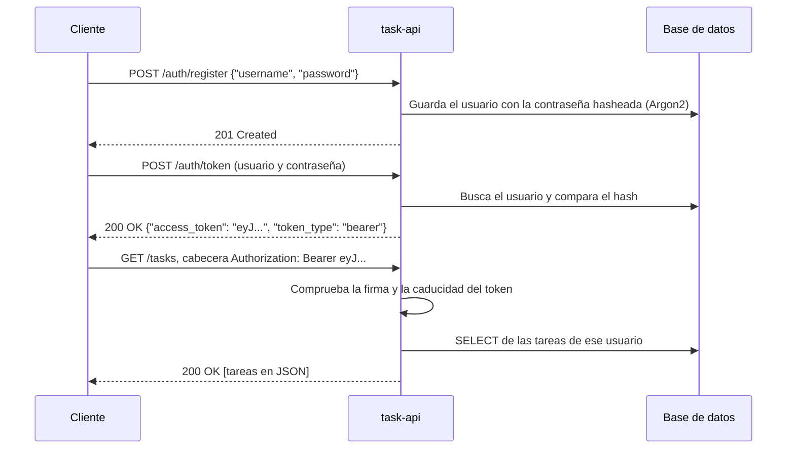
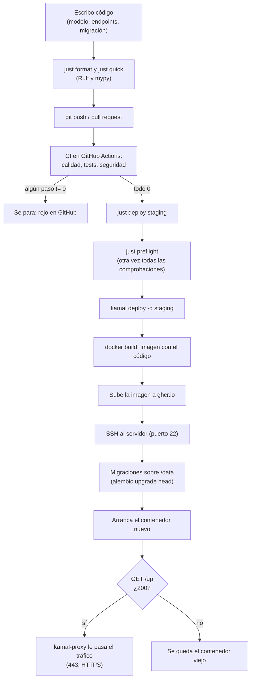

# Clase del 17/11: la API por dentro y el pipeline

Apuntes de la clase del martes 17 de noviembre. El profe repasó la `task-api` por dentro y fue diciendo lo que hay que saber para el examen. Lo explico todo con el código real de su proyecto, que es el que va a enseñar.

Es la continuación del [apunte 11](11-clase-13-11-y-examen.md), donde están la pizarra de la VPS, Kamal y los secretos.

## Índice

- [Lo que dijo del examen](#lo-que-dijo-del-examen)
- [0. La lista del profe](#0-la-lista-del-profe)
- [1. La capa de modelo: cómo se conecta la API a la base de datos](#1-la-capa-de-modelo-cómo-se-conecta-la-api-a-la-base-de-datos)
- [2. El flujo de un endpoint GET y uno POST, protegido o no](#2-el-flujo-de-un-endpoint-get-y-uno-post-protegido-o-no)
  - [2.1 Qué es un endpoint](#21-qué-es-un-endpoint)
  - [2.2 Los endpoints de la task-api](#22-los-endpoints-de-la-task-api)
  - [2.3 Un POST protegido, paso a paso](#23-un-post-protegido-paso-a-paso)
  - [2.4 Un GET protegido, paso a paso](#24-un-get-protegido-paso-a-paso)
  - [2.5 Qué implica que sea GET o POST](#25-qué-implica-que-sea-get-o-post)
  - [2.6 Qué implica que esté protegido o no](#26-qué-implica-que-esté-protegido-o-no)
  - [2.7 Los códigos de respuesta](#27-los-códigos-de-respuesta)
- [3. Qué puertos hay que abrir](#3-qué-puertos-hay-que-abrir)
- [4. El protocolo con el que trabajamos](#4-el-protocolo-con-el-que-trabajamos)
- [5. Cómo funciona la autenticación](#5-cómo-funciona-la-autenticación)
  - [5.1 Autenticación y autorización no son lo mismo](#51-autenticación-y-autorización-no-son-lo-mismo)
  - [5.2 Registro, login y token, paso a paso](#52-registro-login-y-token-paso-a-paso)
  - [5.3 Qué es un JWT](#53-qué-es-un-jwt)
- [6. Ruff: el linter y el formateador](#6-ruff-el-linter-y-el-formateador)
- [7. Las partes del pipeline de desarrollo](#7-las-partes-del-pipeline-de-desarrollo)
- [8. Migraciones: actualizar y hacer rollback](#8-migraciones-actualizar-y-hacer-rollback)
- [9. Imagen y contenedor: dónde se materializa el código](#9-imagen-y-contenedor-dónde-se-materializa-el-código)
- [10. Cómo sabe Kamal si la app está viva](#10-cómo-sabe-kamal-si-la-app-está-viva)
- [11. El justfile](#11-el-justfile)
- [12. Herramientas de seguridad: Bandit y compañía](#12-herramientas-de-seguridad-bandit-y-compañía)
- [13. echo $?: el código de salida](#13-echo--el-código-de-salida)
- [14. Desplegar con cuidado en producción](#14-desplegar-con-cuidado-en-producción)
  - [14.1 Desplegar automáticamente tras cada push](#141-desplegar-automáticamente-tras-cada-push)
  - [14.2 Probar primero en staging](#142-probar-primero-en-staging)
  - [14.3 Feature flags](#143-feature-flags)
  - [14.4 Backup antes de migrar](#144-backup-antes-de-migrar)
  - [14.5 Una aplicación preparada para el rollback](#145-una-aplicación-preparada-para-el-rollback)
  - [14.6 Cuándo desplegar y qué hacer si hay que parar el servicio](#146-cuándo-desplegar-y-qué-hacer-si-hay-que-parar-el-servicio)
  - [14.7 Lista antes de tocar producción](#147-lista-antes-de-tocar-producción)
- [15. Todo junto: del código a producción](#15-todo-junto-del-código-a-producción)
- [16. Practica](#16-practica)
  - [16.1 Tipo test](#161-tipo-test)
  - [16.2 Explícalo con tus palabras](#162-explícalo-con-tus-palabras)
  - [16.3 Desplegar con cuidado](#163-desplegar-con-cuidado)
- [17. Chuleta](#17-chuleta)

## Lo que dijo del examen

Sacado de la grabación de la clase. Cada frase la recogen los cuatro transcriptores igual, salvo donde lo indico.

| Minuto | Qué dijo |
|---|---|
| 00:20 y 05:16 | **El examen es el viernes 27/11.** Se pasa del 20 por la huelga. |
| 05:16 | «Como voy a cortar internet...». No terminó la frase, pero queda claro: **sin internet**. Ni documentación ni nada; lo que no lleves en la cabeza no lo tienes. |
| 08:59 a 09:17 | «Va a ser un **examen muy sencillo**. Si ustedes son capaces de **explicar a vuestra abuela** lo mismo que les he explicado yo en clase, van a aprobar.» Y «para llegar al **10**, que un **niño de 5 años** también lo entienda». |
| 09:17 | «No les voy a poner cosas de **aprenderse de memoria**, sino que ustedes **entiendan el flujo**: qué partes tiene el despliegue, qué procesos o qué herramientas tenemos para hacerlo.» |
| 14:00 | La diferencia entre **autenticación y autorización** «podría ser perfectamente de examen», y también **en qué parte del flujo** está. |
| 29:50 | Sobre `echo $?`: «esto es **importante, acuérdense**». |
| 42:13 | «Me gustaría que de mí saquen **cuáles son las nociones para hacer CI/CD**.» |
| 44:39 | Los **pasos para hacer una migración** que para el servicio: «esto **podría quedar también en el examen**». |
| 44:39 a 45:35 | «¿Les he preguntado por qué hace el **comando concreto**? No. ¿Les importa? No. [...] Lo miran en la documentación, no pasa nada. Pero sí les importa entender **cuál es el flujo** [...] **Y eso es lo que les voy a evaluar.**» |

**Cómo estudiarlo:** para cada tema, ensaya explicarlo **en voz alta y con palabras sencillas**, como si se lo contaras a alguien que no sabe nada. Si te atascas o necesitas un tecnicismo para salir del paso, ese tema todavía no lo tienes. Los comandos exactos importan mucho menos que saber **qué paso va antes, cuál después y por qué**.

## 0. La lista del profe

Lo que dijo que hay que saber, en el orden en que lo apunté, con el apartado donde lo explico:

- [ ] Qué es la **capa de modelo** que se conecta a la base de datos. [1](#1-la-capa-de-modelo-cómo-se-conecta-la-api-a-la-base-de-datos)
- [ ] El **flujo de los endpoints GET y POST**, protegidos o no, qué implicaciones tienen y qué hace cada parte. [2](#2-el-flujo-de-un-endpoint-get-y-uno-post-protegido-o-no)
- [ ] **Qué puertos** hay que abrir. [3](#3-qué-puertos-hay-que-abrir)
- [ ] El **protocolo** con el que estamos trabajando. [4](#4-el-protocolo-con-el-que-trabajamos)
- [ ] Cómo funciona la **autenticación** y la diferencia entre **autenticación y autorización**. [5](#5-cómo-funciona-la-autenticación)
- [ ] **Ruff** para el linter, y **formatear** el código. [6](#6-ruff-el-linter-y-el-formateador)
- [ ] Las **partes del pipeline** de desarrollo. [7](#7-las-partes-del-pipeline-de-desarrollo)
- [ ] Hacer **migraciones**, tanto para actualizar como para hacer **rollback**. [8](#8-migraciones-actualizar-y-hacer-rollback)
- [ ] El código se **materializa en el contenedor**, que sale de una **imagen**. [9](#9-imagen-y-contenedor-dónde-se-materializa-el-código)
- [ ] **Kamal detecta si un servicio está activo** mediante el **código de respuesta**. [10](#10-cómo-sabe-kamal-si-la-app-está-viva)
- [ ] El **justfile**: un fichero de texto con alias de comandos para automatizar el proyecto. [11](#11-el-justfile)
- [ ] Herramientas de **seguridad** como **Bandit**. [12](#12-herramientas-de-seguridad-bandit-y-compañía)
- [ ] **`echo $?`**: dice si el último comando terminó bien o mal. [13](#13-echo--el-código-de-salida)

Segunda parte de la clase, sobre cómo desplegar sin romper nada:

- [ ] **Automatizar el despliegue** después de cada push. [14.1](#141-desplegar-automáticamente-tras-cada-push)
- [ ] **Probar los cambios en staging** antes de producción. [14.2](#142-probar-primero-en-staging)
- [ ] **Feature flags.** [14.3](#143-feature-flags)
- [ ] **Backup** antes de una migración. [14.4](#144-backup-antes-de-migrar)
- [ ] Una **aplicación preparada para el rollback**. [14.5](#145-una-aplicación-preparada-para-el-rollback)
- [ ] Hacer los cambios **en horas de poca actividad** y, si la migración obliga a **parar el servicio**, avisar y algo más. [14.6](#146-cuándo-desplegar-y-qué-hacer-si-hay-que-parar-el-servicio)

## 1. La capa de modelo: cómo se conecta la API a la base de datos

**Analogía:** la base de datos es un **almacén** con estanterías (tablas). La capa de modelo es el **plano del almacén** escrito en Python: dice qué estanterías hay y qué cabe en cada una. Gracias a ese plano, el código trabaja con objetos de Python y no tiene que escribir SQL a mano.

A esa técnica se le llama **ORM** (*Object-Relational Mapping*, «mapeo objeto-relacional»): **cada clase es una tabla, cada atributo es una columna y cada objeto es una fila**. En la `task-api` el ORM es **SQLAlchemy** y la base de datos es **SQLite** (un único fichero, `tasks.db`).

La API tiene cuatro capas, cada una en su fichero:

| Fichero | Capa | Qué hace |
|---|---|---|
| `app/main.py` | Endpoints | Recibe las peticiones HTTP y decide qué hacer |
| `app/schemas.py` | Esquemas (Pydantic) | **Valida** lo que entra y **filtra** lo que sale, en JSON |
| `app/models.py` | **Modelo** (SQLAlchemy) | Las tablas de la base de datos como clases de Python |
| `app/database.py` | Conexión | Abre la conexión con la base de datos y da una sesión a cada petición |

**El modelo** (`app/models.py`) tiene dos clases, y por tanto dos tablas:

```python
class User(Base):
    __tablename__ = "users"                      # nombre de la tabla
    id: Mapped[int] = mapped_column(Integer, primary_key=True)
    username: Mapped[str] = mapped_column(String(50), unique=True)
    hashed_password: Mapped[str] = mapped_column(String(255))   # nunca la contraseña en claro
    tasks: Mapped[list[Task]] = relationship(back_populates="user")

class Task(Base):
    __tablename__ = "tasks"
    id: Mapped[int] = mapped_column(Integer, primary_key=True)
    title: Mapped[str] = mapped_column(String(200))
    completed: Mapped[bool] = mapped_column(Boolean, default=False)
    user_id: Mapped[int] = mapped_column(ForeignKey("users.id"))  # de quién es la tarea
```

- `primary_key=True`: el identificador único de cada fila.
- `unique=True`: no puede haber dos usuarios con el mismo nombre.
- `ForeignKey("users.id")`: **clave foránea**. Cada tarea apunta al usuario que la creó. Así se sabe de quién es cada tarea.
- `relationship`: permite ir de un usuario a sus tareas (`user.tasks`) sin escribir la consulta.

**La conexión** (`app/database.py`):

- `DATABASE_URL` dice dónde está la base de datos. Se lee de una **variable de entorno**: en local es `sqlite:///./tasks.db` y en el servidor es `sqlite:////data/tasks.db`, dentro del **volumen**, para que no se pierda.
- `engine` es el motor que habla con la base de datos.
- `get_db()` abre una **sesión** para cada petición y la cierra al terminar.

**Por qué hay esquemas además del modelo:** el modelo es lo que se **guarda**; el esquema es lo que se **enseña**. Por ejemplo, `User` tiene `hashed_password`, pero el esquema de salida `UserRead` solo tiene `id`, `username` y `created_at`. Así el hash de la contraseña **nunca sale** en una respuesta.

> **Frase para el examen:** «La capa de modelo son las clases de SQLAlchemy de `models.py`. Cada clase es una tabla y cada atributo una columna (ORM). Los endpoints trabajan con esos objetos y SQLAlchemy los traduce a SQL contra SQLite. La conexión se configura con la variable de entorno `DATABASE_URL`.»

## 2. El flujo de un endpoint GET y uno POST, protegido o no

### 2.1 Qué es un endpoint

Un **endpoint** es una «ventanilla» de la API: un **método HTTP** más una **ruta**. Por ejemplo, `GET /tasks` o `POST /tasks`. Misma ruta, distinto método: son ventanillas distintas.

En FastAPI se declara con un decorador encima de una función:

```python
@app.get("/tasks")          # método GET, ruta /tasks
def list_tasks(...):
    ...
```

### 2.2 Los endpoints de la task-api

| Método | Ruta | ¿Protegido? | Qué hace |
|---|---|---|---|
| `GET` | `/up` | No | Dice si la app está viva (lo usa Kamal) |
| `GET` | `/health` | No | Comprobación de salud |
| `POST` | `/auth/register` | No | Registra un usuario |
| `POST` | `/auth/token` | No | Login: devuelve un token |
| `GET` | `/auth/me` | Sí (token) | Devuelve el usuario que ha iniciado sesión |
| `POST` | `/tasks` | Sí | Crea una tarea mía |
| `GET` | `/tasks` | Sí | Lista mis tareas |
| `GET` | `/tasks/{id}` | Sí | Devuelve una tarea mía |
| `PATCH` | `/tasks/{id}` | Sí | Cambia parte de una tarea mía |
| `DELETE` | `/tasks/{id}` | Sí | Borra una tarea mía |

**Cómo se ve en el código que un endpoint está protegido:** lleva `Depends(get_current_user)`. Esa línea obliga a mandar un token válido.

```python
@app.post("/tasks", status_code=201)
def create_task(
    payload: TaskCreate,                               # 1. el JSON del cuerpo, validado
    current_user: User = Depends(get_current_user),    # 2. exige token: PROTEGIDO
    db: Session = Depends(get_db),                     # 3. sesión de base de datos
) -> Task:
    task = Task(title=payload.title, user_id=current_user.id)
    db.add(task)                                       # 4. prepara el INSERT
    db.commit()                                        # 5. lo guarda de verdad
    db.refresh(task)                                   # 6. recarga el id y la fecha
    return task                                        # 7. sale como JSON (TaskRead)
```

`/up` no lleva nada de eso, así que es **público**:

```python
@app.get("/up")
def healthcheck():
    return {"status": "ok"}
```

### 2.3 Un POST protegido, paso a paso

Crear una tarea: `POST /tasks`.

1. **El cliente envía** la petición con dos cosas:
   - en la **cabecera**: `Authorization: Bearer <token>`;
   - en el **cuerpo**: el JSON `{"title": "Estudiar DPL"}`.
2. **kamal-proxy** la recibe por el 443 y la pasa al contenedor, al 8000 (apunte 11).
3. **Uvicorn** se la da a FastAPI, que busca el endpoint `POST /tasks`.
4. **Validación del cuerpo** con el esquema `TaskCreate`: el título tiene que tener entre 1 y 200 caracteres. Si no cumple, responde **422** sin tocar nada más.
5. **Autenticación** con `get_current_user`: lee el token, comprueba la firma y la caducidad, y busca al usuario. Si falta el token o no vale, responde **401**.
6. **Sesión de base de datos** con `get_db`.
7. **Capa de modelo:** crea un objeto `Task` con `user_id` = el usuario del token, y `db.commit()` hace el `INSERT` en SQLite.
8. **Respuesta:** **201 Created** con la tarea en JSON, filtrada por el esquema `TaskRead`.

### 2.4 Un GET protegido, paso a paso

Listar mis tareas: `GET /tasks?skip=0&limit=100`.

1. El cliente envía la petición **sin cuerpo**. Los datos opcionales van en la **URL** (`?skip=0&limit=100`, la *query string*) y el token en la cabecera `Authorization`.
2. Autenticación igual que antes: sin token válido, **401**.
3. Comprueba que `skip` y `limit` tienen sentido. Si no, **400**.
4. Consulta con el modelo: `SELECT` de las tareas **donde `user_id` es el mío**.
5. Respuesta **200 OK** con la lista en JSON. Si no tengo tareas, devuelve `[]`, no un error.

### 2.5 Qué implica que sea GET o POST

| | GET | POST |
|---|---|---|
| Para qué | **Leer** datos | **Crear** algo (o enviar datos para que se procesen, como el login) |
| ¿Cambia algo en el servidor? | No | Sí: crea una fila |
| ¿Lleva cuerpo? | No. Los datos van en la URL | Sí: JSON (o formulario, en el login) |
| ¿Repetirlo da lo mismo? | Sí (*idempotente*) | No: dos POST crean **dos** tareas |
| Respuesta típica | 200 OK | 201 Created |

Por eso **los datos sensibles nunca van en la URL de un GET**: la URL se queda en el historial del navegador y en los logs del servidor. Por eso el login es un `POST` con la contraseña en el cuerpo.

### 2.6 Qué implica que esté protegido o no

| | Público | Protegido |
|---|---|---|
| Ejemplos | `/up`, `/auth/register`, `/auth/token` | `/tasks`, `/auth/me` |
| ¿Hace falta token? | No | Sí: `Authorization: Bearer <token>` |
| Sin token | Funciona | **401 Unauthorized** |
| Qué datos ve | Nada privado | **Solo los suyos**: filtra por `user_id` |

Tiene que haber algo público, si no nadie podría registrarse ni hacer login para conseguir el token. Y `/up` tiene que ser público porque **kamal-proxy no tiene token** y lo necesita para saber si la app está viva.

### 2.7 Los códigos de respuesta

El **código de respuesta** (*status code*) es un número de tres cifras que acompaña a cada respuesta y dice cómo ha ido. La primera cifra da la familia:

| Familia | Significado |
|---|---|
| **2xx** | Todo bien |
| **4xx** | El fallo es **del cliente** (petición mal hecha, sin permiso...) |
| **5xx** | El fallo es **del servidor** (la app ha petado) |

Los que usa la `task-api`:

| Código | Nombre | Cuándo sale |
|---|---|---|
| **200** | OK | GET o PATCH correctos, y `/up` |
| **201** | Created | POST que crea (registro, tarea) |
| **204** | No Content | DELETE correcto: no devuelve nada |
| **400** | Bad Request | `skip` o `limit` sin sentido |
| **401** | Unauthorized | Sin token, token caducado o falso, o usuario y contraseña incorrectos |
| **404** | Not Found | La tarea no existe **o no es tuya** |
| **409** | Conflict | Registrarse con un nombre de usuario que ya existe |
| **422** | Unprocessable Content | El JSON no cumple el esquema (por ejemplo, título vacío) |

> **Detalle fino:** si pides la tarea de otro usuario, la API responde **404** y no **403**. Así no deja adivinar qué tareas existen.

## 3. Qué puertos hay que abrir

Un **puerto** es la «puerta» de una máquina por la que entra cada servicio. La IP es la dirección del edificio y el puerto, el número de la puerta.

**En el firewall de la VPS** (en Oracle, la lista de seguridad) solo se abren estos:

| Puerto | Para qué | ¿Abrir? |
|---|---|---|
| **22** | **SSH**: entrar a administrar la máquina, y por donde entra Kamal | Sí |
| **80** | **HTTP**. Kamal pide tenerlo abierto para conseguir el certificado de Let's Encrypt y para redirigir a HTTPS | Sí |
| **443** | **HTTPS**: el tráfico real de la web | Sí |
| 8000 | Uvicorn, **dentro** del contenedor | **No**: solo se llega a él desde kamal-proxy, por la red interna de Docker |

**En mi ordenador**, para desarrollar, la API se arranca con `just run` y escucha en `http://127.0.0.1:8000`. No hay que abrir nada, porque es solo para mí.

> **Regla:** se abre lo mínimo imprescindible. Cada puerto abierto es una puerta más por la que alguien puede intentar entrar.

## 4. El protocolo con el que trabajamos

Trabajamos con **HTTP**, y en producción con **HTTPS**. Van en capas, como un paquete dentro de otro:

| Capa | Protocolo | Qué aporta |
|---|---|---|
| Aplicación | **HTTP** | El «idioma» de la web: métodos (GET, POST...), rutas, cabeceras, cuerpo y códigos de respuesta |
| Seguridad | **TLS** (la «S» de HTTPS) | **Cifra** la comunicación. Sin TLS, cualquiera en medio podría leer el token |
| Transporte | **TCP** | Garantiza que llegan **todos** los paquetes y **en orden** |
| Red | **IP** | Lleva cada paquete a la dirección correcta |

Sobre HTTP, la API sigue el estilo **REST**: cada recurso tiene su ruta (`/tasks`), se usa el método HTTP para decir qué se hace con él y los datos van en **JSON**.

En la `task-api`, el certificado de HTTPS lo saca **kamal-proxy** automáticamente con **Let's Encrypt** (`ssl: true` en el `deploy.yml`). Dentro de la VPS, de kamal-proxy al contenedor, va en HTTP normal.

> **Por qué HTTPS es obligatorio con login:** el token y la contraseña viajan en cada petición. Sin cifrar, se podrían robar.

## 5. Cómo funciona la autenticación

### 5.1 Autenticación y autorización no son lo mismo

| | **Autenticación** | **Autorización** |
|---|---|---|
| Pregunta | **¿Quién eres?** | **¿Qué puedes hacer?** |
| Analogía | El portero del edificio mira tu **DNI** | Tu tarjeta solo abre **tu** oficina, no las de los demás |
| En la `task-api` | Login con usuario y contraseña, y luego el **token** en cada petición (`get_current_user`) | Solo puedes ver y tocar **tus** tareas: las consultas filtran por `user_id` |
| Si falla | **401** Unauthorized | **403** Forbidden (aquí la API usa **404** para no dar pistas) |
| Va primero | Sí | Después: sin saber quién eres no se puede decidir qué puedes hacer |

> Curiosidad que puede salir: el código 401 se llama «Unauthorized», pero en realidad significa «**no autenticado**». El de «no autorizado» de verdad es el 403.

En el código, la autorización está en `_get_owned_task`:

```python
select(Task).where(Task.id == task_id, Task.user_id == user_id)   # la tarea Y que sea mía
```

### 5.2 Registro, login y token, paso a paso



1. **Registro** (`POST /auth/register`): la contraseña **no se guarda tal cual**. Se guarda su **hash** con **Argon2**. Un hash es una «huella» de la contraseña que no se puede deshacer: si alguien roba la base de datos, no ve las contraseñas.
2. **Login** (`POST /auth/token`): la API calcula el hash de la contraseña que le mandas y lo compara con el guardado. Si coincide, te da un **token JWT** que caduca a los 30 minutos. Si no, **401**.
3. **Peticiones protegidas:** el cliente manda el token en la cabecera `Authorization: Bearer <token>`. La API comprueba que la **firma** es buena y que **no ha caducado**. No guarda sesiones: todo lo que necesita está en el token. A eso se le llama **sin estado** (*stateless*).

### 5.3 Qué es un JWT

Un **JWT** (*JSON Web Token*) es como una **pulsera de un festival**: te la ponen en la entrada (login), lleva escrito quién eres y hasta cuándo vale, y en cada puesto solo miran la pulsera sin volver a pedirte el DNI.

Tiene tres partes separadas por puntos: `cabecera.datos.firma`.

- **Datos** (*payload*) de la `task-api`:
  - `sub`: el id del usuario;
  - `iat`: cuándo se creó;
  - `exp`: cuándo caduca.
- **Firma:** se calcula con el algoritmo **HS256** y la clave **`JWT_SECRET_KEY`**. Solo quien tiene esa clave puede fabricar tokens válidos.

Dos consecuencias importantes:

1. **Si se filtra `JWT_SECRET_KEY`, cualquiera puede fabricar tokens** y hacerse pasar por cualquier usuario. Por eso es un secreto y va en `.kamal/secrets`, nunca en el repo (apunte 11, apartado 5).
2. **El JWT está firmado, pero no cifrado.** Cualquiera puede leer sus datos (van en base64). Por eso dentro solo va el id del usuario, nunca la contraseña.

## 6. Ruff: el linter y el formateador

En clase sonaba como «raft», pero se escribe **Ruff**. Es una herramienta de Python que hace dos trabajos:

| Trabajo | Comando | Qué hace | Analogía |
|---|---|---|---|
| **Linter** | `ruff check .` | Busca **errores y malas prácticas** sin ejecutar el código: imports sin usar, variables que no existen, imports desordenados... | El **corrector ortográfico** que subraya en rojo |
| **Formateador** | `ruff format .` | **Reescribe** el código con un estilo uniforme: espacios, comillas, líneas de 88 caracteres como máximo | **Justificar el texto** en Word: no cambia lo que dice, solo cómo se ve |

Hay dos formas de usar el formateador:

- `ruff format .` (`just format`) **cambia** los ficheros. Lo uso yo antes de hacer commit.
- `ruff format --check .` (`just format-check`) **solo comprueba** y falla si algo no está formateado. Lo usa el **CI**, que no debe tocar el código.

Por qué se usan:

- Todo el equipo escribe con **el mismo estilo**, así que los diffs solo muestran cambios de verdad.
- Pillan errores **antes** de ejecutar nada.
- Las reglas están en el `pyproject.toml`, en `[tool.ruff]`. Así son las mismas para todos.

Relacionado: **mypy** (`just typecheck`) comprueba los **tipos**. Por ejemplo, avisa si a una función que espera un número le pasas un texto.

## 7. Las partes del pipeline de desarrollo

Un **pipeline** es una **cadena de montaje**: el código pasa por una serie de controles en orden y, **si uno falla, la cadena se para**. En la `task-api` está en `.github/workflows/ci.yml` y se ejecuta en **GitHub Actions** con cada push a `main` y cada pull request.

| Fase | Paso | Comando | Qué comprueba |
|---|---|---|---|
| **Preparar** | Descargar el código | `actions/checkout` | |
| | Instalar uv, Python y just | | |
| | Instalar dependencias | `just install` | Exactamente las versiones del `uv.lock` |
| | Comprobar el lockfile | `just lock-check` | Que `uv.lock` cuadra con `pyproject.toml` |
| **Calidad** | Formato | `just format-check` | Ruff: estilo |
| | Lint | `just lint` | Ruff: errores y malas prácticas |
| | Tipos | `just typecheck` | mypy |
| **Tests** | Unitarios | `just test-unit` | Piezas sueltas, sin servicios externos |
| | Integración | `just test-integration` | La API con una base de datos de prueba, incluidas las migraciones |
| | Cobertura | `just coverage-check` | Que los tests recorren al menos el **80 %** del código |
| | E2E (de punta a punta) | `just test-e2e` | Arranca un Uvicorn de verdad y le hace peticiones reales |
| **Seguridad** | Código | `just security-bandit` | **Bandit**: código peligroso |
| | Dependencias | `just security-deps` | **pip-audit**: librerías con vulnerabilidades conocidas |
| | Secretos | `just security-secrets` | **gitleaks**: contraseñas o claves en el historial |
| | Requirements | `just export-check` | Que `requirements.txt` (el que usa Docker) cuadra con `uv.lock` |
| **Desplegar** | Manual, desde mi ordenador | `just deploy staging` | Repite todas las comprobaciones (`just preflight`) y lanza Kamal |

> El despliegue **no** está en el CI porque necesitaría la clave SSH y la contraseña del registro dentro de GitHub. El profe lo hace a mano con `just deploy`.

**Por qué se ordena así:** primero lo más rápido y barato (formato, lint), y al final lo más lento (tests E2E, seguridad). Si el formato está mal, para qué esperar a que pasen todos los tests.

**Para qué sirven los tests, y para qué no.** Lo explicó con calma en clase:

- Un test comprueba que una función hace **lo que yo espero** con las entradas que **yo he pensado**. Ejemplo del profe: una función que suma; el test le pasa 2 y 3 y espera 5. También se prueban los casos raros: un 0, un número muy grande, o un texto en vez de un número, para ver que lanza el error que toca.
- **Que los tests pasen no significa que la app esté perfecta.** Los tests también son código, y yo me puedo equivocar al escribirlos: si escribo mal la función **y** el test, el test sale en verde igual.
- Su gran utilidad es hacer de **chivato**. Si cambio una función que se usa en otra parte del código, el test de esa otra parte se pone en rojo y me avisa: «esto antes devolvía otra cosa». Entonces o el test estaba mal, o el cambio rompe algo. Eso se llama detectar una **regresión**.

Es como una **alarma de humo**: no te enseña a cocinar, pero pita si algo se quema donde antes no se quemaba nada.

## 8. Migraciones: actualizar y hacer rollback

**El problema:** el modelo cambia con el tiempo. Por ejemplo, la versión 2 de la `task-api` añadió usuarios: una tabla `users` nueva y una columna `user_id` en `tasks`. La base de datos de producción **ya tiene datos** y no se puede borrar para crearla otra vez.

**La solución:** las **migraciones**. Son ficheros de código que dicen **cómo pasar la base de datos de una versión a la siguiente** y **cómo deshacerlo**. En la `task-api` las gestiona **Alembic**.

**Analogía:** son como los **commits de Git, pero para la estructura de la base de datos**. Cada migración apunta a la anterior y se pueden aplicar o deshacer en orden.

```text
(vacía) --> 0001_baseline --> 0002_add_users   <-- head (la última)
             crea tasks        crea users y añade user_id a tasks
```

Cada fichero de migración tiene **dos funciones**:

```python
def upgrade():     # hacia delante
    op.create_table("users", ...)
    op.add_column("tasks", sa.Column("user_id", ...))

def downgrade():   # hacia atrás (rollback)
    op.drop_column("user_id")
    op.drop_table("users")
```

Los comandos:

| Para qué | Receta | Comando de Alembic |
|---|---|---|
| **Actualizar** la base de datos a la última versión | `just migrate` | `alembic upgrade head` |
| **Rollback**: deshacer la última migración | `just migrate-down` | `alembic downgrade -1` |
| Crear una migración nueva a partir de los cambios del modelo | `just revision "mensaje"` | `alembic revision --autogenerate -m "mensaje"` |
| Comprobar que no hay cambios en el modelo sin su migración | `just migrate-check` | `alembic check` |

Cosas que hay que saber:

- La migración **autogenerada hay que revisarla a mano**. Alembic no detecta todo; por ejemplo, un renombrado lo ve como «borrar columna y crear otra», y eso **perdería los datos**.
- **La app se niega a arrancar** si la base de datos no está en la última migración (`head`). Lo comprueba al arrancar y da el comando para arreglarlo.
- En el despliegue, las migraciones se aplican sobre el volumen `/data` **antes** de arrancar la versión nueva.
- Hay **dos rollbacks distintos**:
  - **Rollback del código:** `kamal rollback <versión>` vuelve a poner el contenedor de la versión anterior.
  - **Rollback de la base de datos:** `alembic downgrade -1` deshace la última migración.

  Si la versión nueva cambió la base de datos, a veces hace falta **hacer los dos**.

## 9. Imagen y contenedor: dónde se materializa el código

| | **Imagen** | **Contenedor** |
|---|---|---|
| Qué es | Un **paquete de solo lectura** con todo lo necesario: sistema base, Python, dependencias y **el código** | **La imagen en marcha**: un proceso vivo creado a partir de una imagen |
| Se crea con | `docker build` a partir del `Dockerfile` | `docker run` (o Kamal en el servidor) |
| Dónde vive | En el registro (`ghcr.io`) y en las máquinas que la descargan | En la máquina donde se ejecuta |
| Analogía | La **receta impresa** o el **molde** | El **bizcocho** hecho con ese molde |
| En programación | Una **clase** | Un **objeto** |

El código se **mete en la imagen** cuando se construye. En el `Dockerfile` de la `task-api`:

```dockerfile
FROM python:3.14-slim                   # imagen base: Linux mínimo con Python
COPY requirements.txt .
RUN python -m pip install -r requirements.txt   # dependencias
COPY app/ ./app/                        # AQUÍ entra el código en la imagen
COPY alembic.ini ./
COPY alembic/ ./alembic/                # y las migraciones
USER 10001                              # no se ejecuta como root
EXPOSE 8000
CMD ["python", "-m", "uvicorn", "app.main:app", "--host", "0.0.0.0", "--port", "8000"]
```

Y se **materializa** (se ejecuta de verdad) cuando de esa imagen se arranca un **contenedor**: en ese momento se lanza el `CMD`, es decir, Uvicorn con la app.

> **Matiz a lo que apunté en clase:** el contenedor no «forma parte» de la imagen. Es al revés: **el contenedor se crea a partir de la imagen**. De una misma imagen se pueden arrancar muchos contenedores iguales.

Consecuencias:

- Cada despliegue construye una **imagen nueva**, etiquetada con la versión (el commit), y arranca un **contenedor nuevo**. El viejo se tira.
- Lo que se guarda dentro de un contenedor **se pierde** al tirarlo. Por eso la base de datos va en un **volumen** (`/data`).

## 10. Cómo sabe Kamal si la app está viva

Cuando Kamal arranca el contenedor nuevo, **kamal-proxy no le manda tráfico enseguida**. Primero hace un **healthcheck** (comprobación de salud):

1. kamal-proxy hace `GET /up` al contenedor nuevo, al puerto `app_port` (8000).
2. Mira el **código de respuesta**:
   - **200 OK** (un 2xx): la app está viva. kamal-proxy **le pasa el tráfico** y apaga el contenedor viejo.
   - Otro código, o no responde en un tiempo: la app **no está bien**. El despliegue **falla** y se queda el contenedor viejo, así que **los usuarios no notan nada**.
3. A eso se le llama **desplegar sin cortes** (*zero-downtime deploy*).

En el código, `/up` es lo más simple posible a propósito, y es **público** (kamal-proxy no tiene token):

```python
@app.get("/up", include_in_schema=False)   # include_in_schema=False: no sale en /docs
def healthcheck():
    return {"status": "ok"}                 # responde 200 si la app ha arrancado
```

Si la app no arranca (por ejemplo, porque falta `JWT_SECRET_KEY` o la base de datos no está migrada), `/up` nunca responde 200 y Kamal no la pone en marcha. Es una red de seguridad.

> **Frase para el examen:** «Kamal sabe si el servicio está activo por el código de respuesta del healthcheck: kamal-proxy llama a `/up` y solo si recibe un 200 le pasa el tráfico al contenedor nuevo.»

## 11. El justfile

**`just`** es un programa que ejecuta **recetas** (*recipes*). Las recetas se escriben en un fichero de texto llamado **`justfile`**, en la raíz del proyecto. Cada receta es un **nombre corto para uno o varios comandos** largos.

**Analogía:** es la **marcación rápida** del móvil. En vez de teclear el número largo, pulsas «1». En vez de teclear `uv run --locked --env-file .env alembic upgrade head`, escribes `just migrate`.

Así se ve una receta:

```just
# Aplicar las migraciones de Alembic.        <- comentario: sale en `just --list`
migrate:                                     <- nombre de la receta
    uv run --locked --env-file .env alembic upgrade head   <- comando (con sangría)
```

- `just --list` (o solo `just`) enseña todas las recetas con su comentario.
- Una receta puede **depender de otras**. Se escriben después de los dos puntos y se ejecutan antes:

  ```just
  run: migrate                                  # antes de arrancar, migra
  test: test-unit test-integration coverage-check
  quick: format-check lint typecheck
  verify: quick test test-e2e
  preflight: verify lock-check security-bandit security-deps security-secrets export-check
  ```

- Una receta puede recibir **parámetros**: `just deploy staging` o `just deploy production`.

Las recetas más importantes:

| Receta | Qué hace |
|---|---|
| `just install` | Instala las dependencias exactas del `uv.lock` |
| `just run` | Migra y arranca la API en local |
| `just format` / `just lint` | Ruff |
| `just test` | Tests unitarios, de integración y cobertura |
| `just migrate` / `just migrate-down` | Migraciones hacia delante y hacia atrás |
| `just security-bandit` | Bandit |
| `just preflight` | **Todas** las comprobaciones antes de desplegar |
| `just deploy staging` | preflight, exportar `requirements.txt` y `kamal deploy -d staging` |

> **Matiz a lo que apunté en clase:** no es Kamal el que lanza el justfile, sino al revés. **`just deploy` es el que lanza Kamal**, después de pasar todas las comprobaciones.

**Por qué es buena idea:**

- Nadie tiene que memorizar comandos largos.
- **El CI usa las mismas recetas** que yo en local (`run: just lint` en el `ci.yml`). Si pasa en mi ordenador, pasa en el CI.
- Si un comando cambia, se cambia en un solo sitio.

## 12. Herramientas de seguridad: Bandit y compañía

La `task-api` usa tres herramientas de seguridad, cada una mirando una cosa distinta:

| Herramienta | Qué revisa | Ejemplos de lo que encuentra | Receta |
|---|---|---|---|
| **Bandit** | **Mi código** Python | Contraseñas escritas en el código, uso de `eval`, `subprocess` con `shell=True`, hashes débiles como MD5, `assert` usado para seguridad | `just security-bandit` |
| **pip-audit** | **Las librerías** que uso | Una versión de una dependencia con una vulnerabilidad conocida (un CVE) | `just security-deps` |
| **gitleaks** | **El historial de Git** | Una clave o un token que alguien subió y luego «borró» (en el historial sigue estando) | `just security-secrets` |

**Bandit** es un **analizador estático**: lee el código **sin ejecutarlo**, como el linter, pero buscando **fallos de seguridad** en vez de fallos de estilo. En la `task-api` se ejecuta así:

```bash
bandit -c pyproject.toml -r app     # -r: recorre la carpeta app/ entera
```

Si encuentra algo, termina con error, y el pipeline se para.

> **Ojo con un matiz.** En clase, el profe puso como ejemplo de Bandit una dependencia nueva con un CVE (una vulnerabilidad conocida). En la `task-api`, eso en realidad lo detecta **pip-audit**; Bandit mira **tu propio código**. Si en el examen pregunta en general por las herramientas de seguridad del pipeline, nombra las tres y di qué mira cada una, y quedas bien de cualquier forma.

Bandit, como casi todas estas herramientas, se instala desde **PyPI**, el repositorio de paquetes de Python. Es el equivalente a Maven Central en Java: el sitio de donde se descargan las dependencias.

> **Frase para el examen:** «La seguridad se revisa en tres frentes: Bandit analiza mi código, pip-audit las dependencias y gitleaks el historial de Git buscando secretos. Las tres están en el pipeline y en el preflight, así que no se puede desplegar si alguna falla.»

## 13. echo $?: el código de salida

Cada comando que se ejecuta en la terminal, al terminar, deja un número llamado **código de salida** (*exit code*):

- **`0`**: ha terminado **bien**.
- **Cualquier otro número** (1, 2, 127...): ha habido un **error**.

La variable **`$?`** guarda el código de salida **del último comando**, y `echo $?` lo enseña:

```bash
true
echo $?          # 0: true siempre termina bien

false
echo $?          # 1: false siempre termina mal

ruff check .
echo $?          # 0 si el código está limpio, 1 si ha encontrado errores

comandoinventado
echo $?          # 127: «command not found»
```

> **Cuidado:** `$?` es solo del **último** comando. Si haces `echo $?` dos veces seguidas, la segunda da `0`, porque es el código del primer `echo`.

**Por qué es tan importante:** así es como **todo el pipeline sabe si seguir o pararse**.

- **GitHub Actions** mira el código de salida de cada paso. Si es distinto de 0, marca el paso en rojo y para el workflow.
- **`just`** para la receta en cuanto un comando falla. El justfile usa `set -euo pipefail`, que hace que bash se pare con el primer error.
- Las herramientas se configuran para **fallar con un código distinto de 0** cuando encuentran algo:
  - `gitleaks ... --exit-code 1` si encuentra un secreto;
  - `coverage report --fail-under=80` si la cobertura es menor del 80 %;
  - `ruff format --check` si algo no está formateado.
- Con `&&` se encadenan comandos que solo siguen si el anterior salió con 0: `just test && just deploy staging`.

## 14. Desplegar con cuidado en producción

Producción es la app que usan los usuarios de verdad. Si algo se rompe ahí, lo notan ellos. Todo este apartado va de lo mismo: **cambiar producción sin romperla, y que si se rompe se pueda volver atrás rápido**.

### 14.1 Desplegar automáticamente tras cada push

Ahora mismo, en la `task-api`, el despliegue es **manual**: el profe ejecuta `just deploy staging` en su ordenador. Lo siguiente es **automatizarlo**: cada `git push` a `main` pasa el CI y, **si todo sale en verde**, GitHub Actions despliega solo.

Se hace añadiendo al `ci.yml` un segundo trabajo (*job*) que **depende** del de calidad:

```yaml
  deploy-staging:
    needs: quality                         # solo si el job de calidad ha pasado entero
    if: github.ref == 'refs/heads/main'    # solo con cambios en main
    runs-on: ubuntu-latest
    steps:
      # descargar el código, instalar Kamal y cargar la clave SSH
      - run: kamal deploy -d staging
        env:
          KAMAL_REGISTRY_PASSWORD: ${{ secrets.KAMAL_REGISTRY_PASSWORD }}
          JWT_SECRET_KEY: ${{ secrets.JWT_SECRET_KEY }}
```

- `needs: quality` es la clave: si un test o Bandit falla, el CI se para (código de salida distinto de 0) y **no se despliega**.
- La clave SSH y las contraseñas van en los **Secrets del repositorio** de GitHub, nunca en el YAML. El README de la `task-api` dice que no lo tiene automatizado precisamente porque eso exige meter esas credenciales en GitHub.
- Lo normal es automatizar **staging** del todo (eso es **despliegue continuo**) y que a **producción** se pase con un botón que pulsa una persona (eso es **entrega continua**). En GitHub Actions ese botón es `workflow_dispatch`.

**Por qué automatizar:** se despliega siempre igual, sin olvidar ningún paso, y nadie puede desplegar código que no haya pasado los tests.

**Reactivo o programado.** En clase un compañero preguntó si se podía lanzar el despliegue a una hora fija. El profe distinguió dos cosas:

- **Reactivo:** el pipeline **reacciona a un evento**: un push, un merge a `main` o una etiqueta de versión nueva. Esto es lo que él llama automatizar de verdad, y es lo que ya hicimos con Zensical: cada push a `main` lanzaba el job que publicaba la web.
- **Programado:** se lanza **a una hora fija**, por ejemplo a las 12 de la noche, con un `cron`. Se puede hacer, pero no es reactivo. Eso sí, el profe dijo que para una **migración** puede ser hasta recomendable, porque así eliges una hora con pocos usuarios.

En GitHub Actions las dos formas se escriben en el `on:` del workflow:

```yaml
on:
  push:
    branches: [main]        # reactivo: se lanza con cada push a main
  schedule:
    - cron: "0 3 * * *"     # programado: todos los días a las 03:00 (hora UTC)
```

### 14.2 Probar primero en staging

**Staging** (en el profe, pirita y `stg.clicbri.es`) es un **ensayo general**: una copia de producción con la misma configuración, pero sin usuarios reales.

- Se despliega primero en staging, se prueba, y solo si va bien se pasa a producción (galena y `clicbri.es`).
- A producción va **la misma imagen** que se probó en staging. Solo cambian el servidor, el dominio y los secretos (`deploy.staging.yml` frente a `deploy.production.yml`).
- Las **migraciones** también se ensayan en staging. Así se sabe si funcionan y **cuánto tardan**.

### 14.3 Feature flags

Un **feature flag** (interruptor de funcionalidad) es un **interruptor en la configuración** que enciende o apaga una funcionalidad nueva **sin volver a desplegar**.

**Analogía:** es como instalar una lámpara nueva en casa pero dejarla con el interruptor apagado. La instalación (el despliegue) ya está hecha; encenderla es solo darle al interruptor. Si la lámpara hace un cortocircuito, se apaga y ya, sin tener que desmontarla.

Ejemplo con una variable de entorno, como las del `deploy.yml`:

```yaml
env:
  clear:
    NUEVA_BUSQUEDA: "false"     # el código nuevo ya está desplegado, pero apagado
```

```python
if os.getenv("NUEVA_BUSQUEDA") == "true":
    return busqueda_nueva(...)
return busqueda_antigua(...)
```

Para qué sirven:

- **Separar desplegar de activar.** El código llega a producción apagado, y se enciende cuando se quiere: por ejemplo, en una hora tranquila.
- **Apagar rápido si falla**, que es mucho más rápido que un rollback.
- **Encenderlo solo para algunos usuarios** al principio (por ejemplo, el equipo o un 5 %) y ver si va bien antes de dárselo a todos.

### 14.4 Backup antes de migrar

Una migración **cambia la estructura de la base de datos que tiene los datos reales**. Si sale mal, se pueden perder datos. Por eso **antes de migrar se hace una copia de seguridad** (*backup*).

- El `downgrade` **no siempre recupera los datos**. Por ejemplo, el `downgrade` de la migración 0002 de la `task-api` hace `drop_table("users")`: deshace la estructura, pero **los usuarios que hubiera se pierden**. El backup es la red de seguridad de verdad.
- En la `task-api` la base de datos es un fichero SQLite en el volumen de la VPS (`/var/lib/tasks-api/tasks.db`). El backup es una copia de ese fichero, con fecha, hecha **justo antes** de migrar. Por ejemplo, con `sqlite3 tasks.db ".backup tasks-2026-11-17.db"`.
- **Un backup que nunca se ha probado a restaurar no vale.** Hay que comprobar que se puede recuperar.

### 14.5 Una aplicación preparada para el rollback

**Rollback** es volver a la versión anterior cuando la nueva falla. La app tiene que estar **preparada de antemano**, porque en plena caída no hay tiempo de improvisar:

| Qué | Cómo se prepara |
|---|---|
| **El código** | Kamal guarda las imágenes anteriores en el servidor. `kamal rollback <versión>` arranca la anterior en segundos (la versión es la etiqueta de la imagen, el commit) |
| **La base de datos** | Cada migración tiene su `downgrade()` y se ha probado. `alembic downgrade -1` |
| **Los datos** | El backup del apartado anterior |
| **Migraciones compatibles** | Se cambia la base de datos en dos pasos: primero se **añade** lo nuevo (una columna nueva, por ejemplo) sin quitar lo viejo; cuando la versión nueva ya funciona, en otro despliegue se **quita** lo viejo. Así la versión anterior de la app sigue funcionando con la base de datos nueva, y el rollback del código no rompe nada |

> **Ojo en la `task-api`:** la app se niega a arrancar si la base de datos no está exactamente en su última migración. Si se vuelve a la imagen anterior, hay que deshacer también la migración (`alembic downgrade`); si no, la versión vieja no arrancará y `/up` nunca dará 200.

### 14.6 Cuándo desplegar y qué hacer si hay que parar el servicio

- Los cambios se hacen en **horas de poca actividad**, cuando hay menos usuarios: si algo falla, afecta a menos gente.
- Esas horas se miran en los datos de uso de la app. No siempre es de madrugada: depende de quién la use.

Si la migración obliga a **parar el servicio**, hay que organizar una **ventana de mantenimiento**:

1. **Avisar con antelación** a los usuarios: día, hora, cuánto va a durar y qué deja de funcionar.
2. Hacerlo en la **hora con menos usuarios**.
3. **Ensayarla antes en staging**, si se puede con una copia de los datos reales. Así se sabe si funciona y cuánto tarda de verdad.
4. Hacer un **backup** justo antes de empezar.
5. Tener el **plan de rollback** preparado: imagen anterior, `downgrade` y backup.
6. Poner una **página de mantenimiento** en vez de dejar que la web dé error. Kamal lo hace con `kamal app maintenance` y vuelve a la normalidad con `kamal app live`.
7. Al terminar, **comprobar y vigilar**: `/up` responde, los logs están limpios (`just logs production`) y lo importante funciona. Luego, **avisar de que ya está**.

**El paso en el que más insistió el profe: «chapar» el proxy.** Lo dibujó en la pizarra. En la VPS está el **proxy inverso** (kamal-proxy), detrás el **contenedor** con la versión 1 de la app, y delante los **clientes**, conectados por HTTP. El orden que contó fue este:

1. Se manda un **correo** a los usuarios. Su ejemplo: «el viernes a las 22:00 UTC haremos el mantenimiento del servicio; no estará disponible durante un tiempo». Ese tiempo es lo que **calculamos que tarda el despliegue**.
2. Se **construye la imagen nueva** con el código nuevo y se **prepara la migración**.
3. Llegada la hora, se le dice al **proxy** que **todo lo que llegue lo bloquee y lo mande a una página estática** que avisa de que el servicio está en mantenimiento. Con Kamal es `kamal app maintenance`, y Kamal se encarga de no mandar el tráfico a la app.
4. **Solo entonces** se migra y se despliega. Al terminar, `kamal app live` y a comprobar.

**Por qué hay que cortar el tráfico antes de migrar:** si no, **siguen llegando peticiones** mientras se mueven los datos de un lado a otro, y eso **rompe la migración**. En palabras del profe, la base de datos se puede quedar «completamente destrozada». Por eso hay que hacerlo **activamente**: no basta con avisar.

Es como una tienda que va a cambiar las estanterías de sitio: primero cuelga el cartel de «cerrado por reformas» y **cierra la puerta**. Si deja entrar clientes mientras mueve las estanterías, alguien coge algo de un estante a medio montar y se lía.

**Lo ideal es no tener que parar nada:** con migraciones compatibles (apartado 14.5) y el despliegue sin cortes de Kamal, los usuarios ni se enteran.

### 14.7 Lista antes de tocar producción

- [ ] El CI está en verde (tests, Ruff, Bandit, gitleaks...).
- [ ] Probado en staging, con la misma imagen.
- [ ] Si hay migración: ensayada en staging y backup hecho.
- [ ] Plan de rollback preparado (imagen anterior, `downgrade`, backup).
- [ ] Si es una funcionalidad nueva y arriesgada, va detrás de un feature flag.
- [ ] Hora de poca actividad y, si hay corte, usuarios avisados.
- [ ] Después del despliegue: `/up`, logs y una prueba a mano.

## 15. Todo junto: del código a producción



## 16. Practica

Primero contesto sin mirar y luego abro la respuesta.

### 16.1 Tipo test

**1. ¿Qué es la capa de modelo en la `task-api`?**

- a) Los ficheros HTML de la web.
- b) Las clases de SQLAlchemy que representan las tablas de la base de datos.
- c) El `Dockerfile`.
- d) Los tests unitarios.

<details>
<summary>Respuesta</summary>

**b.** `models.py`: cada clase es una tabla y cada atributo una columna (ORM).

</details>

**2. ¿Qué indica en el código que un endpoint está protegido?**

- a) Que use el método POST.
- b) Que lleve `Depends(get_current_user)`, que exige un token válido.
- c) Que su ruta empiece por `/auth`.
- d) Que devuelva JSON.

<details>
<summary>Respuesta</summary>

**b.** Ojo con la c: `/auth/register` y `/auth/token` son públicos.

</details>

**3. Hago `GET /tasks` sin la cabecera `Authorization`. ¿Qué responde la API?**

- a) 200 con una lista vacía.
- b) 401 Unauthorized.
- c) 404 Not Found.
- d) 500 Internal Server Error.

<details>
<summary>Respuesta</summary>

**b.** Es un endpoint protegido y no hay token.

</details>

**4. ¿Qué diferencia hay entre autenticación y autorización?**

- a) Son sinónimos.
- b) La autenticación comprueba quién eres; la autorización, qué puedes hacer.
- c) La autorización va antes que la autenticación.
- d) La autenticación solo existe en HTTPS.

<details>
<summary>Respuesta</summary>

**b.**

</details>

**5. ¿Cómo se guarda la contraseña en la base de datos?**

- a) Tal cual, para poder recuperarla.
- b) Cifrada con `JWT_SECRET_KEY`.
- c) Como un hash (Argon2), que no se puede deshacer.
- d) No se guarda.

<details>
<summary>Respuesta</summary>

**c.** Al hacer login se calcula el hash de lo que escribes y se compara con el guardado.

</details>

**6. Si alguien consigue `JWT_SECRET_KEY`, ¿qué puede hacer?**

- a) Nada, porque las contraseñas están hasheadas.
- b) Fabricar tokens válidos y hacerse pasar por cualquier usuario.
- c) Solo leer los logs.
- d) Borrar el repositorio.

<details>
<summary>Respuesta</summary>

**b.** Por eso es un secreto.

</details>

**7. Mando dos veces seguidas el mismo `POST /tasks`. ¿Qué pasa?**

- a) La segunda da error 409.
- b) Se crean dos tareas iguales, porque POST no es idempotente.
- c) La segunda no hace nada.
- d) Se sobrescribe la primera.

<details>
<summary>Respuesta</summary>

**b.**

</details>

**8. ¿Qué código devuelve `POST /tasks` cuando funciona?**

- a) 200
- b) 201
- c) 204
- d) 302

<details>
<summary>Respuesta</summary>

**b.** 201 Created. El 204 es el del DELETE.

</details>

**9. Mando `{"title": ""}` a `POST /tasks` con un token válido. ¿Qué responde?**

- a) 201
- b) 401
- c) 422
- d) 500

<details>
<summary>Respuesta</summary>

**c.** El esquema `TaskCreate` exige un título de al menos 1 carácter.

</details>

**10. ¿Qué puertos se abren en el firewall de la VPS?**

- a) 22, 80 y 443.
- b) 8000 y 443.
- c) Solo el 8000.
- d) Todos.

<details>
<summary>Respuesta</summary>

**a.** El 8000 queda dentro, detrás de kamal-proxy.

</details>

**11. ¿Sobre qué protocolo de transporte va HTTP en la `task-api`?**

- a) UDP
- b) TCP
- c) FTP
- d) SSH

<details>
<summary>Respuesta</summary>

**b.** Y con TLS por encima para tener HTTPS.

</details>

**12. ¿Qué hace `ruff format --check .`?**

- a) Formatea el código.
- b) Comprueba si el código está formateado, sin cambiarlo, y falla si no lo está.
- c) Ejecuta los tests.
- d) Busca vulnerabilidades.

<details>
<summary>Respuesta</summary>

**b.** Es el que usa el CI. `ruff format .` (sin `--check`) es el que cambia los ficheros.

</details>

**13. ¿Qué es un linter?**

- a) Un programa que ejecuta el código más rápido.
- b) Una herramienta que analiza el código sin ejecutarlo para encontrar errores y malas prácticas.
- c) Un servidor web.
- d) Un tipo de base de datos.

<details>
<summary>Respuesta</summary>

**b.** En la `task-api`, `ruff check .`.

</details>

**14. ¿Qué comando hace rollback de la última migración?**

- a) `alembic upgrade head`
- b) `alembic downgrade -1`
- c) `alembic revision --autogenerate`
- d) `kamal rollback`

<details>
<summary>Respuesta</summary>

**b.** La d también es un rollback, pero **del código** (vuelve a la imagen anterior), no de la base de datos.

</details>

**15. ¿Por qué hay que revisar a mano una migración autogenerada?**

- a) Porque Alembic no la guarda.
- b) Porque Alembic no detecta todo; por ejemplo, un renombrado lo trata como borrar y crear, y se perderían datos.
- c) Porque está escrita en SQL.
- d) No hace falta revisarla.

<details>
<summary>Respuesta</summary>

**b.**

</details>

**16. ¿Qué relación hay entre imagen y contenedor?**

- a) Son lo mismo.
- b) El contenedor se crea a partir de la imagen; es la imagen en ejecución.
- c) La imagen se crea a partir del contenedor.
- d) El contenedor guarda varias imágenes.

<details>
<summary>Respuesta</summary>

**b.** La imagen es el molde y el contenedor, el bizcocho.

</details>

**17. ¿Cómo sabe Kamal que la versión nueva está lista para recibir tráfico?**

- a) Espera siempre 30 segundos.
- b) kamal-proxy llama a `/up` y espera un código 200.
- c) Lo comprueba por SSH.
- d) Mira si el contenedor existe.

<details>
<summary>Respuesta</summary>

**b.**

</details>

**18. ¿Qué es el `justfile`?**

- a) Un fichero de configuración de Docker.
- b) Un fichero de texto con recetas: nombres cortos para comandos que automatizan el proyecto.
- c) El fichero de secretos de Kamal.
- d) Un tipo de test.

<details>
<summary>Respuesta</summary>

**b.**

</details>

**19. ¿Qué analiza Bandit?**

- a) Las dependencias.
- b) El historial de Git.
- c) El código Python, buscando patrones inseguros.
- d) El formato del código.

<details>
<summary>Respuesta</summary>

**c.** Las dependencias las revisa pip-audit, y el historial, gitleaks.

</details>

**20. Ejecuto `ruff check .` y luego `echo $?`, y sale `1`. ¿Qué significa?**

- a) Que ha encontrado 1 error exactamente.
- b) Que el comando ha terminado con error: ha encontrado algún problema.
- c) Que todo está bien.
- d) Que es la versión 1 de Ruff.

<details>
<summary>Respuesta</summary>

**b.** 0 es bien, y cualquier otro número es error. No cuenta los fallos.

</details>

**21. ¿Por qué el CI se para cuando falla un paso?**

- a) Porque el paso devuelve un código de salida distinto de 0.
- b) Porque GitHub lo decide al azar.
- c) Porque se acaba el tiempo.
- d) No se para: siempre ejecuta todos los pasos.

<details>
<summary>Respuesta</summary>

**a.**

</details>

### 16.2 Explícalo con tus palabras

**22. Explica qué pasa desde que el cliente hace `POST /tasks` hasta que recibe la respuesta.**

<details>
<summary>Respuesta modelo</summary>

El cliente manda la petición con el JSON de la tarea en el cuerpo y su token en la cabecera `Authorization: Bearer`. Llega por HTTPS al 443 de la VPS, kamal-proxy la pasa al contenedor por el 8000 y Uvicorn se la da a FastAPI.

FastAPI valida el JSON con el esquema `TaskCreate` (si no cumple, 422). Después, `get_current_user` comprueba el token (si no vale, 401). Con la sesión de `get_db`, crea un objeto `Task` del modelo con el `user_id` del usuario y hace `commit`, que lo guarda en SQLite.

Responde 201 Created con la tarea en JSON, filtrada por el esquema `TaskRead`.

</details>

**23. ¿Qué diferencia hay entre autenticación y autorización? Pon un ejemplo de la `task-api`.**

<details>
<summary>Respuesta modelo</summary>

La autenticación comprueba **quién eres**: en la `task-api`, el login con usuario y contraseña da un token JWT, y en cada petición `get_current_user` comprueba ese token. Si falla, 401.

La autorización decide **qué puedes hacer** una vez se sabe quién eres: cada usuario solo puede ver y modificar sus propias tareas, porque las consultas filtran por `user_id`. Si pides una tarea de otro, la API responde 404.

</details>

**24. Explica cómo funciona el login con JWT y por qué `JWT_SECRET_KEY` es un secreto.**

<details>
<summary>Respuesta modelo</summary>

Al registrarse, la contraseña se guarda como hash Argon2, nunca en claro. En el login (`POST /auth/token`), la API compara el hash de la contraseña recibida con el guardado. Si coincide, genera un JWT con el id del usuario (`sub`), la fecha de creación (`iat`) y la de caducidad (`exp`), firmado con HS256 y `JWT_SECRET_KEY`.

El cliente lo manda en cada petición en la cabecera `Authorization: Bearer`, y la API comprueba la firma y la caducidad sin guardar sesiones.

Quien tenga `JWT_SECRET_KEY` puede fabricar tokens válidos de cualquier usuario. Por eso va en `.kamal/secrets` y nunca en el repositorio.

</details>

**25. ¿Qué son las migraciones y cómo se hace un rollback?**

<details>
<summary>Respuesta modelo</summary>

Son ficheros que dicen cómo cambiar la estructura de la base de datos de una versión a otra sin perder los datos. Por ejemplo, la 0002 crea la tabla `users` y añade `user_id` a `tasks`. Las gestiona Alembic.

Cada migración tiene `upgrade()` para avanzar y `downgrade()` para volver atrás. `alembic upgrade head` aplica todas las pendientes y `alembic downgrade -1` deshace la última (en el justfile, `just migrate` y `just migrate-down`).

Las autogeneradas se revisan a mano. El rollback del código con `kamal rollback` es aparte del de la base de datos.

</details>

**26. Describe las partes del pipeline de la `task-api` y por qué van en ese orden.**

<details>
<summary>Respuesta modelo</summary>

Primero prepara el entorno (descarga el código, instala uv, Python, just y las dependencias exactas del lockfile). Luego la calidad: formato con Ruff, lint con Ruff y tipos con mypy. Después los tests: unitarios, integración, cobertura mínima del 80 % y E2E con un Uvicorn real. Por último la seguridad: Bandit para el código, pip-audit para las dependencias y gitleaks para los secretos.

Van de lo más rápido a lo más lento, para fallar cuanto antes. Si cualquier paso termina con un código distinto de 0, el pipeline se para.

El despliegue es manual con `just deploy`, que repite las comprobaciones y lanza Kamal.

</details>

**27. ¿Qué es el `justfile` y por qué se usa?**

<details>
<summary>Respuesta modelo</summary>

Es un fichero de texto con recetas: nombres cortos para comandos largos, que se ejecutan con `just <receta>`. Las recetas pueden depender de otras (`preflight` ejecuta `verify`, Bandit, pip-audit, gitleaks...) y recibir parámetros (`just deploy staging`).

Sirve para no memorizar comandos, para tenerlos en un solo sitio y para que el CI use exactamente las mismas recetas que el desarrollador.

</details>

**28. ¿Para qué sirve `echo $?` y qué tiene que ver con el pipeline?**

<details>
<summary>Respuesta modelo</summary>

`$?` guarda el código de salida del último comando: 0 si terminó bien y otro número si falló. `echo $?` lo enseña.

El pipeline se basa en eso: GitHub Actions y `just` miran el código de salida de cada comando y se paran si no es 0. Por eso herramientas como gitleaks o coverage se configuran para salir con error cuando encuentran un problema.

</details>

**29. ¿Cómo sabe Kamal que puede pasar el tráfico a la versión nueva?**

<details>
<summary>Respuesta modelo</summary>

kamal-proxy hace un healthcheck: llama a `GET /up` en el contenedor nuevo, en el puerto `app_port`. Si recibe un 200, le pasa el tráfico y apaga el viejo. Si no responde bien, el despliegue falla y se queda el contenedor viejo, así que no hay corte para los usuarios.

`/up` tiene que ser público porque kamal-proxy no tiene token.

</details>

### 16.3 Desplegar con cuidado

**30. ¿Qué hace `needs: quality` en un job de despliegue de GitHub Actions?**

- a) Instala las herramientas de calidad.
- b) Hace que el despliegue solo se ejecute si el job de calidad (tests, lint, seguridad) ha pasado.
- c) Despliega en paralelo con los tests.
- d) Obliga a revisar el código a mano.

<details>
<summary>Respuesta</summary>

**b.**

</details>

**31. ¿Para qué sirve un feature flag?**

- a) Para marcar commits importantes.
- b) Para encender o apagar una funcionalidad nueva sin volver a desplegar.
- c) Para elegir el servidor de producción.
- d) Para cifrar los secretos.

<details>
<summary>Respuesta</summary>

**b.** Separa desplegar de activar, y si algo falla se apaga al momento.

</details>

**32. ¿Por qué se hace un backup antes de migrar, si ya existe `downgrade`?**

- a) No hace falta: con el `downgrade` basta.
- b) Porque el `downgrade` deshace la estructura pero no siempre recupera los datos; por ejemplo, un `drop_table` los borra.
- c) Porque Alembic lo exige.
- d) Para que la migración vaya más rápido.

<details>
<summary>Respuesta</summary>

**b.**

</details>

**33. Una migración obliga a parar el servicio. ¿Cuál es la mejor forma de hacerlo?**

- a) En la hora punta, para que se note menos.
- b) Sin avisar, para no alarmar.
- c) Con aviso previo, en la hora con menos usuarios, ensayada en staging, con backup, rollback preparado y página de mantenimiento.
- d) Directamente en producción, que es donde están los datos de verdad.

<details>
<summary>Respuesta</summary>

**c.**

</details>

**34. Explica cómo prepararías un despliegue a producción que lleva una migración de la base de datos.**

<details>
<summary>Respuesta modelo</summary>

Primero, que el CI esté en verde. Luego despliego en staging la misma imagen y ensayo la migración allí, para ver que funciona y cuánto tarda.

Antes de tocar producción, preparo el rollback: la imagen anterior, que Kamal guarda (`kamal rollback`), el `downgrade` de la migración y un backup de la base de datos hecho justo antes, porque el `downgrade` no siempre recupera los datos.

Si la funcionalidad es arriesgada, la pongo detrás de un feature flag. Lo hago en la hora con menos usuarios. Si hay que parar el servicio, aviso antes a los usuarios con la hora y la duración, y pongo una página de mantenimiento.

Al terminar compruebo `/up`, miro los logs y aviso de que ya está.

</details>

**35. Durante una migración que para el servicio, ¿por qué se pone el proxy en modo mantenimiento en vez de limitarse a avisar a los usuarios?**

- a) Para que la imagen nueva se construya más rápido.
- b) Porque si siguen llegando peticiones mientras se mueven los datos, la migración se puede romper y dejar la base de datos inconsistente.
- c) Porque Kamal no deja migrar sin una página estática.
- d) Para que el healthcheck `/up` devuelva 200.

<details>
<summary>Respuesta</summary>

**b.** Avisar no basta: alguien puede entrar igual. Hay que cortar el tráfico activamente con `kamal app maintenance`, y el proxy muestra una página estática que avisa del mantenimiento.

</details>

**36. ¿Cuál de estos despliegues es reactivo?**

- a) Uno que se lanza todos los días a las 03:00 con un `cron`.
- b) Uno que se lanza cuando se hace merge de una rama en `main`.
- c) Uno que lanza una persona cuando se acuerda.
- d) Ninguno: todos los despliegues son programados.

<details>
<summary>Respuesta</summary>

**b.** Reacciona a un evento. El de la a) también es automático, pero programado: va por la hora, no por un cambio en el código.

</details>

## 17. Chuleta

- **Capa de modelo:** `models.py`, con SQLAlchemy (ORM): clase = tabla, atributo = columna, objeto = fila. Conexión en `database.py` con `DATABASE_URL`. Los esquemas Pydantic validan lo que entra y filtran lo que sale.
- **Endpoint** = método + ruta. **Protegido** = `Depends(get_current_user)` y exige `Authorization: Bearer <token>`.
- **GET** lee, sin cuerpo, idempotente, 200. **POST** crea, con cuerpo JSON, no idempotente, 201.
- **Códigos:** 200, 201, 204 / 400, 401, 404, 409, 422 / 5xx = fallo del servidor.
- **Puertos del firewall:** 22, 80 y 443. El 8000 no.
- **Protocolo:** HTTP(S) sobre TCP/IP, con TLS para cifrar. API REST con JSON.
- **Autenticación** = quién eres (401). **Autorización** = qué puedes hacer (403; aquí 404).
- **Login:** contraseña hasheada con Argon2; JWT con `sub`, `iat` y `exp`, firmado con HS256 y `JWT_SECRET_KEY`. Firmado, no cifrado.
- **Ruff:** `ruff check` es el linter; `ruff format` formatea (`--check` solo comprueba, para el CI). mypy, los tipos.
- **Pipeline:** preparar, calidad (formato, lint, tipos), tests (unitarios, integración, cobertura del 80 %, E2E), seguridad (Bandit, pip-audit, gitleaks). Si un paso sale distinto de 0, se para.
- **Migraciones (Alembic):** `upgrade head` para actualizar, `downgrade -1` para el rollback. Cada fichero tiene `upgrade()` y `downgrade()`. Las autogeneradas se revisan a mano.
- **Imagen** = molde con el código (`docker build`). **Contenedor** = la imagen en marcha (`docker run` o Kamal).
- **Healthcheck:** kamal-proxy hace `GET /up` y, si recibe 200, pasa el tráfico. Si no, se queda el viejo.
- **justfile:** recetas = alias de comandos. `just deploy` lanza Kamal, no al revés.
- **Seguridad:** Bandit (mi código), pip-audit (dependencias), gitleaks (secretos en el historial).
- **`echo $?`:** código de salida del último comando. 0 = bien; cualquier otro = error.
- **Desplegar tras cada push:** un job con `needs: quality` en GitHub Actions; credenciales en los Secrets del repo. Staging automático (despliegue continuo); producción con botón (entrega continua).
- **Staging primero**, con la misma imagen que irá a producción.
- **Feature flag:** interruptor en la configuración; despliegas apagado y enciendes (o apagas) sin redesplegar.
- **Backup antes de migrar:** el `downgrade` no siempre recupera los datos.
- **Rollback preparado:** imagen anterior (`kamal rollback`), `downgrade` probado, backup y migraciones compatibles.
- **Parar el servicio:** avisar antes, hora de menos usuarios, ensayo en staging, backup, rollback listo, página de mantenimiento, vigilar y avisar al terminar.
- **Chapar el proxy antes de migrar** (`kamal app maintenance`): si siguen entrando peticiones mientras se mueven los datos, la migración se rompe y la base de datos puede quedar destrozada.
- **Reactivo** = reacciona a un evento (push, merge, etiqueta). **Programado** = a una hora fija con `cron`; útil para migraciones de madrugada.
- **Tests:** comprueban lo que yo espero con las entradas que yo pensé; no garantizan que la app esté perfecta. Sirven de chivato ante regresiones.
- **Examen:** viernes 27/11, sin internet. Explicar el flujo con palabras sencillas («a la abuela»); los comandos concretos importan poco.
