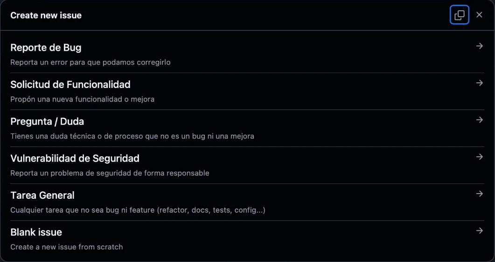

# Issue: el config.yml de las plantillas de issue no es YAML válido

En el repo de clase [monium/gitanddocs](https://github.com/monium/gitanddocs) he encontrado un fallo en la configuración de las plantillas de issue. En este informe voy apuntando cada paso: cómo lo compruebo, cómo lo reporto con una issue y cómo lo arreglo con un PR. Hago un commit por cada paso.

## Vocabulario

| Término | Qué es |
|---|---|
| Plantilla de issue | El formulario que sale al pulsar **New issue** (Reporte de Bug, Solicitud de Funcionalidad...). Están en `.github/ISSUE_TEMPLATE/` |
| `config.yml` | El archivo de esa carpeta que dice cómo se muestra el menú de plantillas |
| YAML | El formato de ese archivo: líneas `clave: valor` y sangría para lo que va dentro de otra cosa. Es el mismo formato que el `compose.yaml` de Docker |
| Heredoc | Truco de la terminal para escribir un archivo: `cat > archivo << 'EOF'`, el contenido y una línea final `EOF` |

## El fallo

El archivo `.github/ISSUE_TEMPLATE/config.yml` tiene esto:

```text
cat > .github/ISSUE_TEMPLATE/config.yml << 'EOF'
blank_issues_enabled: false
contact_links:
  - name: Pregunta general
    url: https://github.com/orgs/community/discussions
    about: Si no sabes qué tipo de issue crear, consulta aquí primero.
EOF
```

Las líneas 2 a 6 son el YAML bueno. Piden dos cosas:

- `blank_issues_enabled: false`: que no se puedan crear issues en blanco, sin plantilla.
- `contact_links`: que en el menú salga un enlace de ayuda llamado "Pregunta general".

La línea 1 y la línea 7 son el comando de la terminal (un heredoc) que se usó para crear el archivo. En vez de ejecutarlo, se pegó entero dentro del archivo. Con esas dos líneas el archivo deja de ser YAML válido y GitHub no lo puede leer.

El archivo llegó con el [PR #11](https://github.com/monium/gitanddocs/pull/11), el que añadió las plantillas, fusionado el 02/10/2026.

## Cosas que tengo que tener en cuenta

- **Yo siempre voy a ver la opción de issue en blanco.** Tengo permiso de escritura en el repo, y según la [documentación de GitHub](https://docs.github.com/en/communities/using-templates-to-encourage-useful-issues-and-pull-requests/configuring-issue-templates-for-your-repository#configuring-the-template-chooser) quien tiene ese permiso la sigue viendo aunque `blank_issues_enabled` esté en `false`, con la marca "Maintainers only". El arreglo se nota sobre todo en la gente sin permiso de escritura (el repo es público) y en el enlace de ayuda, que lo ve todo el mundo.
- Por eso **no uso la issue #32 como ejemplo** de issue en blanco: es del profe, que es administrador y siempre puede crearlas.
- La rama `main` exige **3 aprobaciones** para fusionar un PR.
- El CI del repo (`docs.yml`) solo se ejecuta con un push a `main`, no en los PR. Las comprobaciones antes del PR las tengo que hacer yo en local.

## Entorno

| Qué | Detalles |
|---|---|
| Equipo | Mac con Apple Silicon |
| GitHub | La web para la issue, la rama, el arreglo y el PR |
| Terminal | git 2.54.0 y uv 0.13.1, solo para comprobar el YAML |

## Pasos

1. Veo el efecto del fallo en el menú de New issue
2. Miro el archivo `config.yml` en GitHub
3. Compruebo que nadie lo ha reportado
4. Reproduzco el error en local
5. Creo la issue con la plantilla "Reporte de Bug"
6. Creo la rama `issue-N` desde la issue
7. Arreglo el archivo en la rama
8. Compruebo el YAML arreglado
9. Abro el PR y pido revisión
10. Merge, borro la rama y compruebo el resultado

## Organización

- `README.md`: este informe.
- `evidencias/`: capturas y salidas de cada paso.

---

## Paso 1: Veo el efecto del fallo en el menú de New issue

En la pestaña **Issues** del repo pulso el botón **New issue**. Sale el menú para elegir plantilla:



Lo que se ve:

- Las 5 plantillas del repo: Reporte de Bug, Solicitud de Funcionalidad, Pregunta / Duda, Vulnerabilidad de Seguridad y Tarea General.
- Abajo, **Blank issue**, sin ninguna marca. Si GitHub leyera el archivo, como tengo permiso de escritura la seguiría viendo, pero marcada como "Maintainers only".
- **No aparece el enlace "Pregunta general"** que pide `config.yml`.

Conclusión: GitHub no está aplicando `config.yml`. Esta captura me sirve como prueba del "antes" para la issue.

## Paso 2: Miro el archivo config.yml en GitHub

Abro el archivo en la web: [`.github/ISSUE_TEMPLATE/config.yml`](https://github.com/monium/gitanddocs/blob/main/.github/ISSUE_TEMPLATE/config.yml).


Lo que se ve:

- **Línea 1:** `cat > .github/ISSUE_TEMPLATE/config.yml << 'EOF'`. Es el comando de la terminal, no YAML.
- **Líneas 2 a 6:** el YAML bueno.
- **Línea 7:** `EOF`, el final del heredoc. Tampoco es YAML.
- Encima del código, GitHub enseña el último commit que tocó el archivo: `1fa505f`, de IvnMD, con el mensaje del PR de las plantillas. Con **History** se ve el historial completo del archivo y con **Blame** quién escribió cada línea.
- GitHub no muestra ningún aviso de que el archivo esté mal. Lo enseña con colores como si fuera YAML normal y simplemente no lo aplica. Por eso el fallo ha pasado desapercibido casi un mes.
