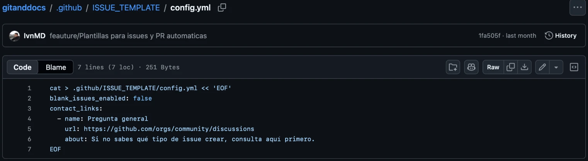
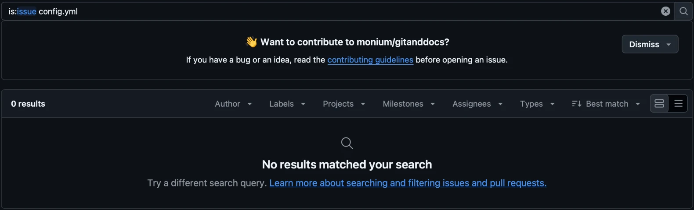
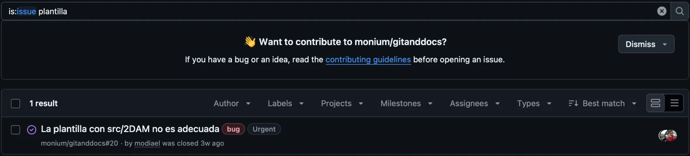
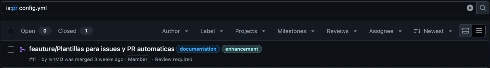
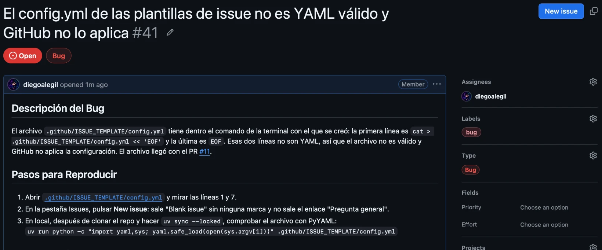

# Issue: el config.yml de las plantillas de issue no es YAML válido

En el repo de clase [monium/gitanddocs](https://github.com/monium/gitanddocs) he encontrado un fallo en la configuración de las plantillas de issue. En este informe voy apuntando cada paso: cómo lo compruebo, cómo lo reporto con una issue y cómo lo arreglo con un PR. Hago un commit por cada paso.

## Vocabulario

| Término | Qué es |
|---|---|
| Plantilla de issue | El formulario que sale al pulsar **New issue** (Reporte de Bug, Solicitud de Funcionalidad...). Están en `.github/ISSUE_TEMPLATE/` |
| `config.yml` | El archivo de esa carpeta que dice cómo se muestra el menú de plantillas |
| YAML | El formato de ese archivo: líneas `clave: valor` y sangría para lo que va dentro de otra cosa. Es el mismo formato que el `compose.yaml` de Docker |
| Heredoc | Truco de la terminal para escribir un archivo: `cat > archivo << 'EOF'`, el contenido y una línea final `EOF` |

## El fallo

El archivo `.github/ISSUE_TEMPLATE/config.yml` tiene esto:

```text
cat > .github/ISSUE_TEMPLATE/config.yml << 'EOF'
blank_issues_enabled: false
contact_links:
  - name: Pregunta general
    url: https://github.com/orgs/community/discussions
    about: Si no sabes qué tipo de issue crear, consulta aquí primero.
EOF
```

Las líneas 2 a 6 son el YAML bueno. Piden dos cosas:

- `blank_issues_enabled: false`: que no se puedan crear issues en blanco, sin plantilla.
- `contact_links`: que en el menú salga un enlace de ayuda llamado "Pregunta general".

La línea 1 y la línea 7 son el comando de la terminal (un heredoc) que se usó para crear el archivo. En vez de ejecutarlo, se pegó entero dentro del archivo. Con esas dos líneas el archivo deja de ser YAML válido y GitHub no lo puede leer.

El archivo llegó con el [PR #11](https://github.com/monium/gitanddocs/pull/11), el que añadió las plantillas, fusionado el 02/10/2026.

## Cosas que tengo que tener en cuenta

- **Yo siempre voy a ver la opción de issue en blanco.** Tengo permiso de escritura en el repo, y según la [documentación de GitHub](https://docs.github.com/en/communities/using-templates-to-encourage-useful-issues-and-pull-requests/configuring-issue-templates-for-your-repository#configuring-the-template-chooser) quien tiene ese permiso la sigue viendo aunque `blank_issues_enabled` esté en `false`, con la marca "Maintainers only". El arreglo se nota sobre todo en la gente sin permiso de escritura (el repo es público) y en el enlace de ayuda, que lo ve todo el mundo.
- Por eso **no uso la issue #32 como ejemplo** de issue en blanco: es del profe, que es administrador y siempre puede crearlas.
- La rama `main` exige **3 aprobaciones** para fusionar un PR.
- El CI del repo (`docs.yml`) solo se ejecuta con un push a `main`, no en los PR. Las comprobaciones antes del PR las tengo que hacer yo en local.

## Entorno

| Qué | Detalles |
|---|---|
| Equipo | Mac con Apple Silicon |
| GitHub | La web para la issue, la rama, el arreglo y el PR |
| Terminal | git 2.54.0 y uv 0.13.1, solo para comprobar el YAML |

## Pasos

1. Veo el efecto del fallo en el menú de New issue
2. Miro el archivo `config.yml` en GitHub
3. Compruebo que nadie lo ha reportado
4. Reproduzco el error en local
5. Creo la issue con la plantilla "Reporte de Bug": [#41](https://github.com/monium/gitanddocs/issues/41)
6. Creo la rama `issue-41` desde la issue
7. Arreglo el archivo en la rama
8. Compruebo el YAML arreglado
9. Abro el PR y pido revisión
10. Merge, borro la rama y compruebo el resultado

## Organización

- `README.md`: este informe.
- `evidencias/`: capturas y salidas de cada paso.

---

## Paso 1: Veo el efecto del fallo en el menú de New issue

En la pestaña **Issues** del repo pulso el botón **New issue**. Sale el menú para elegir plantilla:


Lo que se ve:

- Las 5 plantillas del repo: Reporte de Bug, Solicitud de Funcionalidad, Pregunta / Duda, Vulnerabilidad de Seguridad y Tarea General.
- Abajo, **Blank issue**, sin ninguna marca. Si GitHub leyera el archivo, como tengo permiso de escritura la seguiría viendo, pero marcada como "Maintainers only".
- **No aparece el enlace "Pregunta general"** que pide `config.yml`.

Conclusión: GitHub no está aplicando `config.yml`. Esta captura me sirve como prueba del "antes" para la issue.

## Paso 2: Miro el archivo config.yml en GitHub

Abro el archivo en la web: [`.github/ISSUE_TEMPLATE/config.yml`](https://github.com/monium/gitanddocs/blob/main/.github/ISSUE_TEMPLATE/config.yml).



Lo que se ve:

- **Línea 1:** `cat > .github/ISSUE_TEMPLATE/config.yml << 'EOF'`. Es el comando de la terminal, no YAML.
- **Líneas 2 a 6:** el YAML bueno.
- **Línea 7:** `EOF`, el final del heredoc. Tampoco es YAML.
- Encima del código, GitHub enseña el último commit que tocó el archivo: `1fa505f`, de IvnMD, con el mensaje del PR de las plantillas. Con **History** se ve el historial completo del archivo y con **Blame** quién escribió cada línea.
- GitHub no muestra ningún aviso de que el archivo esté mal. Lo enseña con colores como si fuera YAML normal y simplemente no lo aplica. Por eso el fallo ha pasado desapercibido casi un mes.

## Paso 3: Compruebo que nadie lo ha reportado

Antes de abrir una issue hay que mirar que no exista ya. Si no, dos personas acaban haciendo lo mismo, como pasó con el PR #34, que duplicaba trabajo que el profe ya tenía en su rama.

Uso el buscador de la pestaña Issues y de la pestaña Pull requests:

- `is:issue` busca solo issues y `is:pr` solo PR.
- Quito `state:open`, que es lo que pone el buscador por defecto. Así salen también las cerradas, porque alguien podría haberlo reportado y haberla cerrado ya.

**Búsqueda 1:** [issues que mencionan config.yml](https://github.com/monium/gitanddocs/issues?q=is%3Aissue%20config.yml). No sale ninguna.



**Búsqueda 2:** [issues que mencionan "plantilla"](https://github.com/monium/gitanddocs/issues?q=is%3Aissue%20plantilla), por si alguien lo reportó sin poner el nombre del archivo. Sale solo la #20, cerrada (icono morado), pero no tiene que ver: ahí "plantilla" significa cómo están organizadas las carpetas del proyecto con Zensical, no las plantillas de issue. Una misma palabra puede significar dos cosas, así que hay que abrir lo que salga antes de decidir.



**Búsqueda 3:** [PR que mencionan config.yml](https://github.com/monium/gitanddocs/pulls?q=is%3Apr%20config.yml), por si alguien intentó arreglarlo sin abrir issue. Sale solo el #11, fusionado (icono morado de merge). Es el PR que añadió el archivo roto, no uno que lo arregle. Al lado pone "Review required": se fusionó sin que nadie lo aprobara, y por eso el fallo no lo vio nadie. Ahora `main` exige 3 aprobaciones.



Conclusión: **nadie ha reportado ni arreglado el fallo**. Puedo abrir la issue.

Otra cosa que he visto: en las búsquedas de issues sale el cartel "Want to contribute to monium/gitanddocs? read the contributing guidelines". El repo no tiene ningún archivo con normas para contribuir. Lo dejo para la segunda tarea, la mejora.

## Paso 4: Reproduzco el error en local

La web no dice si un YAML está bien o mal, así que lo compruebo en la terminal con PyYAML, el lector de YAML para Python.

**4a. Clono el repo de clase** dentro de mi carpeta de DPL y hago que mis apuntes ignoren esa carpeta. `.git/info/exclude` funciona como un `.gitignore`, pero solo en mi ordenador y sin que se suba a ningún sitio. Salida completa en [04a-clonar.txt](evidencias/04a-clonar.txt).

```bash
cd "$HOME/Desktop/DAM 2do Año/DPL"
gh repo clone monium/gitanddocs
echo "gitanddocs/" >> .git/info/exclude
```

La barra de mi terminal lo confirma: el número de archivos sin seguimiento de mis apuntes pasa de 5 a 6 al clonar y vuelve a 5 después del `echo`.

**4b. Instalo lo que pide el proyecto.** `--locked` instala exactamente las versiones de `uv.lock`, las mismas que mis compañeros. Crea la carpeta `.venv`, que el repo ignora en su `.gitignore`. Salida en [04b-uv-sync.txt](evidencias/04b-uv-sync.txt).

```bash
cd gitanddocs
uv sync --locked
```

Instala 11 paquetes, entre ellos `zensical==0.0.65` y `pyyaml==6.0.3`. PyYAML viene porque lo necesita Zensical.

**4c. Leo el archivo como YAML:**

```bash
uv run python -c "import yaml,sys; yaml.safe_load(open(sys.argv[1]))" .github/ISSUE_TEMPLATE/config.yml
```

| Trozo | Qué hace |
|---|---|
| `uv run` | Ejecuta dentro de `.venv`, donde está PyYAML. El `python3` del Mac no lo tiene |
| `python -c "..."` | Ejecuta el programa corto que va entre comillas |
| `yaml.safe_load(open(sys.argv[1]))` | Abre el archivo que pongo al final y lo lee como YAML |

Si el archivo es válido no sale nada. Aquí sale un error (salida completa en [04c-validar-yaml.txt](evidencias/04c-validar-yaml.txt)). Lo importante son las dos últimas líneas:

```text
yaml.scanner.ScannerError: mapping values are not allowed here
  in ".github/ISSUE_TEMPLATE/config.yml", line 2, column 21
```

Cómo se lee:

- Un error de Python (*traceback*) se lee **de abajo arriba**. Las líneas de en medio son el camino que ha seguido PyYAML por dentro y no me interesan.
- **Línea 2, columna 21** es el `:` de `blank_issues_enabled:`, porque `blank_issues_enabled` tiene 20 letras.
- La línea 1 (`cat > ...`) no es `clave: valor`, así que YAML la toma como un texto suelto y cree que la línea 2 es la continuación de ese texto. Al llegar al `:` se encuentra un `clave: valor` en medio de un texto y protesta: "mapping values are not allowed here" (aquí no se permite un `clave: valor`).

Con esto tengo el error exacto para ponerlo en la issue.

## Paso 5: Creo la issue con la plantilla "Reporte de Bug"

Issue creada: [#41 El config.yml de las plantillas de issue no es YAML válido y GitHub no lo aplica](https://github.com/monium/gitanddocs/issues/41), el 26/10/2026.



**Antes de escribirla decido qué hará el arreglo.** Quitar las líneas 1 y 7 está claro. Además el enlace "Pregunta general" lleva al foro general de GitHub (`github.com/orgs/community/discussions`), que no sirve para la clase. Hasta ahora no se veía por el fallo, pero con el arreglo empezará a salir en el menú de New issue. Por eso también cambio su url por la web de la documentación de clase, https://monium.github.io/gitanddocs/.

Lo de las labels `task` y `security`, que piden dos plantillas y no existen en el repo, lo dejo fuera: es otro problema distinto y una issue debe tratar uno solo.

**Cómo la creo**, todo en la web:

1. Pestaña **Issues** > **New issue** > **Reporte de Bug**.
2. Título y cuerpo siguiendo la plantilla: descripción, pasos para reproducir, comportamiento esperado y actual, evidencia, entorno y severidad. Añado una sección **Solución propuesta** y digo que me encargo yo. El texto completo está en [05-cuerpo-issue-41.md](evidencias/05-cuerpo-issue-41.md).
3. En **Evidencia** arrastro al cuadro las capturas de los pasos 1 y 2, con una frase delante de cada una para que se entienda qué muestra. GitHub las sube y escribe una etiqueta `` por cada una.
4. Antes de crearla miro la pestaña **Preview** de arriba abajo: tabla, casillas, enlaces e imágenes.
5. Con los botones de debajo del cuadro, antes de pulsar **Create**:

| Botón | Valor | Para qué |
|---|---|---|
| Assignee | `diegoalegil` | Que se vea que la issue es mía y nadie más se ponga con ella |
| Label | `bug` | La pone sola la plantilla |
| Issue type | `Bug` | El tipo de issue que usa el repo |
| Project | `DPL` | Que entre en el tablero Kanban de la clase |

Al elegir el tablero salen dos campos suyos, **Priority** y **Effort**, que dejo vacíos.

Al crearla, la automatización del tablero la pone en la columna **Sin asignar**. GitHub le da el número **41**, que usaré para la rama (`issue-41`) y para cerrarla desde el PR.
