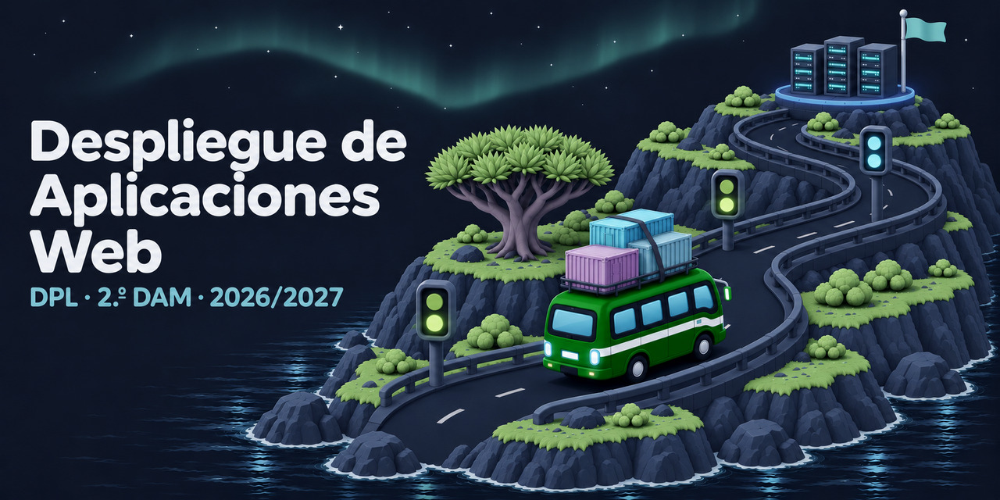

# Despliegue de Aplicaciones Web (DPL)


Actividades, prácticas y apuntes del módulo durante 2.º DAM (curso 2026/2027). El curso sigue en marcha y el contenido se va completando según avanzan las clases. Cada actividad lleva sus instrucciones en su propio README.

## Contenido

### General

| Actividad | Qué es |
|---|---|
| [La asignatura](general/asignatura.md) | Cómo se trabaja en clase: organización en GitHub, tablero Kanban, ciclo de issues y PR. |
| [Trabajar desde casa](general/trabajar-en-casa.md) | Instalar Git, GitHub CLI y uv en el ordenador de casa. |

### 1.er trimestre

| Actividad | Qué es |
|---|---|
| [Práctica guiada: acceso por SSH](1er-trimestre/practica-ssh/) | SSH desde cero en Linux: claves y contraseña deshabilitada, con [informe](1er-trimestre/practica-ssh/README.md) y [evidencias](1er-trimestre/practica-ssh/evidencias/). |
| [Issue: config.yml inválido](1er-trimestre/issue-bug-config-yml/) | Detectar, reportar y arreglar un YAML roto en el repo de clase con issue y PR, con [informe](1er-trimestre/issue-bug-config-yml/README.md). |
| [Práctica NGINX](https://github.com/diegoalegil/nginx-para-todos) | NGINX, Docker Compose, Jekyll y Zensical, en su propio repositorio. |
| [Tareas pendientes](1er-trimestre/pendientes.md) | Issues abiertas y asignadas en el repo de clase, con ideas de issues nuevas. |
| [Novedades](1er-trimestre/novedades.md) | Cambios que han entrado en el repo de clase: PR, issues y repos nuevos. |
| [Primer examen](1er-trimestre/1er-examen/) | Doce apuntes de estudio, del [repo de clase](1er-trimestre/1er-examen/01-repo-gitanddocs.md) y [Git](1er-trimestre/1er-examen/02-git-github.md) hasta [la VPS con Kamal](1er-trimestre/1er-examen/11-clase-13-11-y-examen.md) y [la API con su pipeline](1er-trimestre/1er-examen/12-clase-17-11-api-y-pipeline.md), con un [plan de repaso](1er-trimestre/1er-examen/07-plan-de-repaso-p1.md). |

### 2.º trimestre

Todavía no hay actividades.

### 3.er trimestre

Todavía no hay actividades.

## Estructura

```text
.
├── general/                  la asignatura y la puesta a punto en casa
├── 1er-trimestre/
│   ├── 1er-examen/           apuntes del primer examen (01 a 12) e imágenes
│   ├── practica-ssh/
│   └── issue-bug-config-yml/
├── 2do-trimestre/
└── 3er-trimestre/
```

Diego Gil · 2.º DAM · 2026/2027
